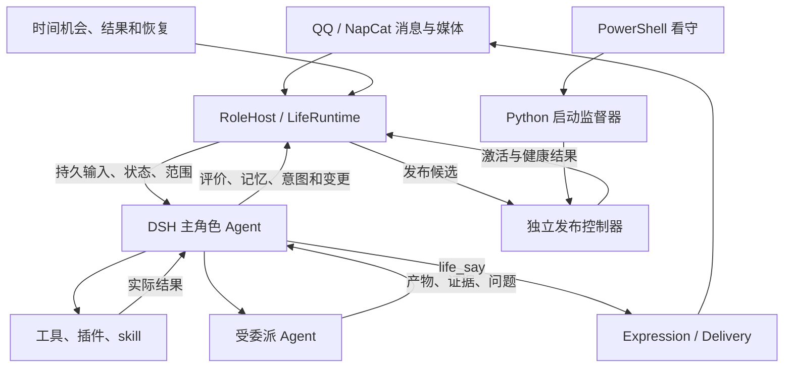
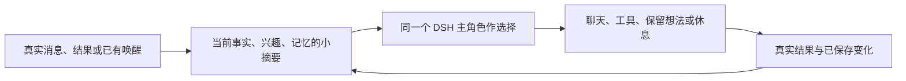
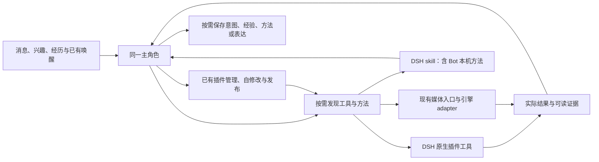

# QQ 自主角色：系统设计、接口与维护

当前实施状态以 [实施状态报告](docs/life-implementation-status.md) 为准。2026-10-27 新增本机统一设置网页、历史人物画像回填、普通连续活动与媒体收藏生命周期；费用与整理恢复已按用户要求取消本轮处理，多人格卡管理也已取消。

设置页：<http://127.0.0.1:6100/>。随 supervisor 启动，首次登录密码保存在本机 `data/settings/login.txt`。网页覆盖主配置字段、独立动力/咨询文件及已登记音色；保存后点击“重启并生效”，等本轮操作结束后核对运行实例。复杂嵌套参数使用 JSON 编辑器。单一人格、数据库和角色身份字段只读。QQ 未登录时仍可保存配置，但认知服务和真实收发不可用。

以下保留系统设计与运行说明。旧的独立人格描述只适用于 `unified_persona=false` 的兼容模式；当前部署使用一份人格，画像和场景表达独立。伪代码说明职责和一致性要求，不是可直接调用的 API；具体字段以代码和工具描述为准。

人格、skill 和角色积累的生活资料属于运行材料，不属于工程说明。保留 `persona.md`、`persona.example.md`、`personas/`、`self.md`、`skills/` 及有效生活数据；第三方依赖的说明和许可证由依赖自身维护。

Git 只保存程序、通用设计、空白配置/人格模板和合成回归测试。真实配置与密钥、人格、自我叙述、记忆/日志/媒体、动力参数、本机学习的 `skills/` 和生成的 `scripts/` 仅留在本机，由 `.gitignore` 排除。新增机器需创建本机 `skills/` 目录，不从另一部署复制私人方法。已被跟踪的私人文件还须从 Git 索引移除；忽略规则与新提交都不会擦除旧提交中的既有内容。

## 1. 目标和不变量

角色通过 QQ 与人相处，也能自主探索、学习、解决问题、发展方法和改变自己。核心循环为：

> 觉察状态和经历 → 理解意义 → 产生想法 → 选择尝试或休息 → 使用能力 → 检查结果 → 更新记忆、方法和打算。

大模型负责理解、情境评价和行动选择；程序负责持久状态、实际身份、时间推进、执行资格、真实回执和恢复。

- 一个逻辑主角色拥有最终选择权，可以有多个会话和执行线程。Python 不另建规划器、关键词情绪判定器或平行主动消息循环。
- 普通聊天、联想、想象和兴趣不要求先建立任务；需要跨轮次延续、委派或履行承诺时才保存意图。
- 自发探索无需外部交办。动机可以来自好奇、回忆和自身需要；动机、事实依据、操作授权分别处理。
- 聊天、研究和自主生活共享工具。插件提供能力，工具执行操作，skill 保存方法，子 Agent 承担委派。
- 人格、情绪和需要提供选择材料，不用“最大欲望必定执行某动作”的规则替她选择。
- 自修改必须分清写入、加载生效和行为改善；工具成功、目标实现和消息送达也分别验证。
- 新消息、用户停止、等待约定和私人范围必须影响实际执行。

这些是可观察的角色机制，不证明模型具有人类主观体验；写记忆、改提示词和 skill 不等于训练模型权重。

## 2. 架构与代码职责



DSH 是认知和执行载体，不是角色身份的名字。角色身份来自人格与持续记录；更换会话不等于更换主人格。

| 职责 | 主要文件 |
|---|---|
| 平台接入、身份、命令、启动与健康 | `bot.py`、`life/role_host.py` |
| 主角色上下文、生活工具、意图、委派归属 | `life/role_agent.py` |
| 输入去重、认领、回放、连接和中止 | `life/agent_session.py`、`life/services/dsh_bridge.py` |
| 事件、情绪、需要、确定性结算 | `life/runtime.py`、`life/state.py`、`life/drives.py`、`life/appraisals.py` |
| 关系、偏好、叮嘱、经历与遗忘 | `life/relationships.py`、`life/recollection.py`、`life/memory.py` |
| 媒体、音色、冻结表达、节奏与回执 | `life/media.py`、`life/asr.py`、`life/voice_catalog.py`、`life/expression.py`、`life/message_layout.py`、`life/delivery.py` |
| 思考时机、文字结果预算和用量 | `life/resource_policy.py`、`life/usage.py` |
| 自修改、候选验证、迁移与发布 | `life/self_change.py`、`life/dsh_changes.py`、`life/release*.py` |
| 进程监督和恢复 | `life/supervisor.py`、`lifesupervisor.py`、`supervise.py`、`tools/bot-watchdog.ps1` |

生产路径为 OneBot → RoleHost → DSH 主角色 → 类型化生活提交 → Delivery。`life/services/` 保留会话桥、工坊及编辑原语，不再组装平行 ServiceHub 认知。尚存的辅助/兼容模块不因此成为生产入口。

扩展架构的交付标准见第 11.9～11.13 节：普通能力通过原生插件、方法通过 skill、重媒体通过 adapter 扩充，主角色仍在同一认知循环中自主选择。工程设计只补齐共用接口与一致性，不为她未来每个兴趣或每种工具预先设计行为流程。

## 3. 数据、身份和范围

业务状态统一保存在 `data/life.db`；DSH home 保存自身会话日志；`data/life-control` 保存发布与监督状态。它们各有用途，不重复维护业务意图和记忆。

| 标识/记录 | 语义与约束 |
|---|---|
| `agent_id` | 稳定角色身份，跨重启和压缩保留 |
| `conversation_id` | 宿主绑定的私聊/群聊地址，不由模型任意改写 |
| `actor_id / participant_id` | 平台实际 QQ 账号，昵称、自称和引用不是身份凭证 |
| `session_id / generation` | DSH 上下文与世代，旧世代不继续写当前业务 |
| 事件 | 原始来源、发送者、外部 ID、发生/接收时间和派生关系 |
| `state_snapshots / state_journal` | 当前投影、版本和可重复结算证据 |
| `agent_inputs / agent_events` | 持久输入、处理状态和连续事件游标 |
| 意图与操作 | 范围、版本、检查点、执行归属和实际结果 |
| `deliveries / delivery_reviews` | 分片回执与重连后单次复核归属 |

角色共用一套情绪与内驱时钟；关系按角色与实际人物账号维护。同一个人群聊/私聊的关系对象一致，但可见经历不同。群中每条事件保留自己的说话人、引用、@ 和回复链。

主人身份由 `owner` 与实际 QQ 账号匹配。群受众进入模型前已过滤私人资料；主人出现在群里也不公开主人私聊。工具开放范围与熟悉程度分开。发送绑定不可变地址，不使用会被并发会话覆盖的全局 last_peer。

## 4. 主认知、插话与恢复

宿主给思考机会和当前事实，主角色选择表达、查资料、使用能力、委派、改打算或休息，不按关键词切换业务模式。

```python
async def receive_message(raw):
    scope = host.bind_actual_identity_and_address(raw)
    with repo.tx():
        event = events.ingest_once(raw, scope)
        item = inbox.enqueue_once(event, current_session(scope))
        attention.hold_new_side_effects_for_unhandled_input(item)
    await bridge.deliver_or_reconcile(item, mode="steer")

def commit_proposal(call, proposal):
    with repo.tx():
        require_current_scope_session_sources_and_versions(call, proposal)
        if life_calls.has_receipt(call.id):
            return life_calls.receipt(call.id)
        # 理解与停止先独立、幂等保存；后续动作阻塞不撤销理解。
        input_resolutions.commit_once(call.id, proposal.handled_input_ids,
                                      proposal.activity_changes)
    with repo.tx():
        require_current_scope_session_sources_and_versions(call, proposal)
        require_effect_eligibility_or_return_remaining_inputs(call, proposal)
        result = apply_typed_role_proposal(proposal)
        return life_calls.save_receipt(call.id, result)
```

accepted 只证明收到，consumed 只证明进入模型步骤，settled 只证明该模型轮已结束；后两者都不等于 handled。主角色通过 `handled_input_ids` 和相应活动变更确认处理，已进入模型的旧轮输入也可明确确认。理解提交先独立保存；剩余输入阻止动作时不回滚已完成的理解。阻塞回执须列出剩余编号、是否可确认及原文读取入口，不能只重复“还有未处理输入”。生成期间到达的新输入仍保留屏障。临时 RPC 失败由持久收件箱对账，不必等 worker 崩溃。

启动招呼是角色表达，不是全局收信开关。进程启动后的新消息先持久保存，认知未就绪则等待；其他会话不必等主人招呼送达。启动后不再移动离线消息的时间截点，以免吞掉启动期间的实时输入。

事件按 `(session_id, seq)` 去重，补齐缺口后推进游标。通知线程只解析入队，不跨线程直接共享 SQLite 写入；数据库事务内不等网络。DSH 日志和 Python 数据库不是原子事务，响应丢失先查稳定 input ID 的接收状态。

长工作优先异步委派。超过交接时间的步骤需保存进度、请求中止相关执行并保留新输入；`handoff_seconds` 是交接策略，不是网络硬实时保证。

第 10.1～10.6 节补充消息流修订：区分业务输入与纯控制唤醒；收到新消息先暂停未提交的副作用和待发片段，不直接取消已启动作业或删除未发内容。理解确认、对外表达、结束模型轮和完成工作分别提交。第 12.1～12.8 节补充按任务提供上下文，实施时与本修订一起验收。

## 5. 情绪、内驱力与念想

| 层次 | 含义和变化依据 |
|---|---|
| 人格、方法 | 身份、自我认识、习惯；通过明确纠正、长期经历和验证改变 |
| 快情绪 | joy 愉悦、concern 不安、frustration 恼、hurt 委屈、anticipation 兴奋；由事件意义、原因和恢复速度改变 |
| 慢心境 | 按真实时间积分的整体状态，不能随读取次数变化 |
| 内驱需要 | 探索、胜任、连接、亲密、性欲、连贯、自主、余量；分别具有动态与证据 |
| 对象关系 | 熟悉、信任、舒适、情感联结；由具体人物的经历形成 |
| 念想、打算 | 主角色理解状态、经历和情境后选择的想法与延续方向 |

愉悦不是依恋，需要连接不是已有深厚关系；亲密与性欲分别保存。提供数值时同时给含义、方向、原因和变化，不把裸数字当完整心理描述。

八项需要使用 drive_v2 的独立状态和参数。累计需要有界增长，任务/资源需要由事实推导；高位持续、内部缓解和恢复期按真实时间边界推进。activation_change、互动满足、验证任务满足、内部调节、偏好学习分开计证据。内部缓解不能冒充与用户新发生的互动；调用成功不能自动等于目标满足；满足抑制不再次扣除同一次满足。

念想不是每两分钟必然生成一条的作业。宿主便宜地检查时机；主角色被唤醒后可以探索，也可以没新想法而休息。一次“想联系某人”可延续为多条表达、等待、理解答复和后续交流。

### 5.1 语义评价与速度

主角色判断对象、关系、语境、实际意义、置信度及持续性；程序负责来源、时间、有限数值、去重、版本和事务。措辞力度不能直接换算伤害量。

普通任务没有关系意义时不产生关系增量。玩笑或亲密语境中的尖锐语言不自动等于伤害；明确不适、拒绝和边界变化也不能被场景标签吞掉。引用、否定和想象正确归因，不一律降权。

重要事件可以立即显著改变情绪，澄清也可以快速缓解相关感受；平复速度依据原因是否仍在调整。慢心境、对象关系和人格各有时间尺度。参数属于待校准的工程模型，不是心理学定律。

```python
def settle_appraisal(scope, proposal):
    with repo.tx():
        require_sources_and_versions(scope, proposal)
        roots = resolve_stimulus_roots(proposal.source_event_ids)
        if same_committed_proposal(roots, proposal):
            return previous_receipt()
        if proposal.supersedes_appraisal_id:
            state = replay_valid_history_replacing_interpretation(proposal)
        else:
            require_unclaimed_stimuli(roots)
            state = advance_old_parameters_to_commit_time()
            state = apply_bounded_affect_drive_and_relation_evidence(state, proposal)
        save_state_journal_claims_and_receipt_together(state, proposal)
```

固定参数段的恢复可表示为 `baseline + (value-baseline) * exp(-ln(2)*elapsed/half_life)`。参数修改从生效时刻向后使用，不重算此前全部时间。

context_refs 只帮助理解，不重复计刺激；音频与转写不能算两遍。误判修订替换旧解释并重放之后仍有效的评价，保留其他会话的后续经历；不简单取负旧增量、不重做外部行动。自发想象能影响自身感受，但不能被记为对方又做了一件事。模型不可用时保留待评价输入，不靠关键词永久抢先结算。

## 6. 关系地位、持久影响与区间语义

当前四项正向关系指标统一保存在 v2 metrics：familiarity、trust、comfort、bond。**主人每项 0.7～1，其他人 0～0.9。** 新增同类依恋指标应注册到同一政策，不能另开不受约束的数值。

边界表达身份位置，不授予权限，也不证明已经有亲密经历。初始值注明 policy_initialization；有经历再报告实际依据。触底不抹掉委屈、分歧和未解事项；触顶不阻止保存新经历。负面感受和人物事项不套用正向分数下限。

语义区间是 [0,.2)、[.2,.4)、[.4,.6)、[.6,.8)、[.8,1]，另外叠加身份边界。

| 指标 | 0～0.2 | 0.2～0.4 | 0.4～0.6 | 0.6～0.8 | 0.8～1 |
|---|---|---|---|---|---|
| 熟悉 | 了解很少，需要问 | 初步认识 | 知道部分习惯和经历 | 相当熟悉 | 共同背景丰富，仍允许变化 |
| 信任 | 有证据才表示戒心；无证据是未知 | 谨慎信任 | 有可靠经历，也有不确定 | 通常信赖，乐于配合明确请求 | 深厚信赖，坦诚沟通，自然配合 |
| 舒适 | 拘谨紧张 | 能交流，较保留 | 日常自然，局部谨慎 | 放松自然，愿分享真实感受 | 自在亲近，沟通轻松坦诚 |
| 联结 | 尚无稳定牵挂 | 轻度关心 | 值得维持，持续关注 | 关系重要，愿延续分享 | 深厚牵挂，短暂分歧不抹去联结 |

这些是参考，不是固定台词。熟悉不等于喜欢，信任不等于事实正确率，舒适不等于从无不满，联结不等于性欲。

关系语义版本为 `relationship-semantics-2`。高信任、高舒适不作为主动拒绝、抬杠或故意不配合的理由；明确且可完成的请求默认积极配合，信息不足先补充理解，实际受阻时说明原因与可行方式。关系分数不设置拒绝或不配合的行为阈值。

主角色提交 relation_protocol=2、subject_actor_id、based_on_relationship_version 及每项 metric/direction/magnitude/confidence，不直接给绝对分数或 delta。direction 为 increase/decrease/unchanged；magnitude 为 slight/meaningful/major。

默认幅度 0.005/0.02/0.06，置信门槛 0.35，日累计预算 0.10；幅度、敏感度和日预算可校准，身份与 0.7/0.9 不能经普通动力参数修改。细节以 `life/relationships.py` 的版本化计算为准。

```python
def reduce_relation(current, evidence, policy, config):
    require_registered_metrics_and_actual_actor(evidence)
    result = copy(current)
    for impact in evidence.impacts:
        proposed = meaning_to_delta(impact, config)
        delta = limit_by_remaining_daily_absolute_budget(proposed, result, config)
        lo, hi = policy.bounds(evidence.actor_id)
        result.metrics[impact.metric] = clamp(result.metrics[impact.metric] + delta, lo, hi)
        record_proposed_applied_and_clipped_effect(impact, proposed, delta, result)
    return result
```

偏好、边界、约定、未解决事项和相处方法复用记忆及 relationship_annotation_links，保存对象、来源、范围、有效期、替代关系与修复状态。去重、修订、回放、重启和遗忘保持一致政策。

模型上下文应类似：“舒适 0.74，通常放松、交流自然、愿意分享真实感受；政策位置与经历共同形成；另有一项未解决分歧。”初始值不能伪装成历史亲密。

## 7. 自我认识、记忆和人格

自我认识由初始人格、当前真实能力与状态、经历形成的认识共同构成。写一行自我描述不能创造摄像头、身体、工具或账号权限。

区分实际输入/操作、感知结果、推断和情境表达。双方进行过一次亲密或角色互动，是可记住的真实交流经历，也可影响模拟情绪和关系；叙事中的身体动作仍保留情境性质，不生成实际物理感知记录。自然交流不必每句加免责声明。

记忆保存经历、事实、知识、解释、方法、日记与叮嘱，附来源、认识类型、有效时间、状态和替代关系。事件自动留痕，主角色选择沉淀内容；召回受范围、相关性和预算约束，记得不等于每次提起。

`persona.md` 与 `personas/public.md` 是两个独立人格源，分别由配置 persona 与 public_persona 指定。主人私聊只加载私有人格，其他私聊与群聊只加载公开人格；语言风格与规则各自生效，两份文件互不派生、不自动同步。self.md 仍是可选素材。

“这次详细”只影响本轮；“以后少用客服语气”保存偏好。普遍性格修改人格，通用方法修改 skill，动力参数修改配置并重载；经历不无限追加进人格。说记住或改好了之前应取得写入与生效回执。

压缩/换会话保留角色、意图、检查点、已送达片段和未知操作。遗忘约束业务检索、旧会话、摘要与派生材料，废弃上下文不能继续生成和发送；物理删除外部服务副本需要单独核对完成程度。

## 8. 持续意图、商量与委派

一次性目标、持续兴趣、用户承诺、周期职责有不同生命周期。阶段成功不关闭长期方向；主角色可恢复自己暂放的兴趣，但用户明确暂停/取消的方向必须等用户恢复。

直接做、先告诉一声、先商量由主角色根据情境选择，不设置比例或逐工具申请。明确说好等答复，就保存 waiting、对应人物、事项和恢复条件；未回答/超时不是同意。普通告知不自动形成等待，无依赖的活动可继续。

系统权限申请与角色自主商量分开：前者依据实际权限系统找授权者，后者可面向有关对象；其他人的答复不能冒充主人的系统授权。QQ 说“可以”不会直接改变 Windows 文件权限。

子 Agent 接收目标、必要材料、产物和验收方法，继承范围与停止约束。它调查、编码和检查；主角色核对并采用结果。B 站等账号上的公开表达由主角色决定并执行，子代理草稿不会直接变成评论或 QQ 正文。使用用户账号时，平台展示的仍是该账号身份。

```python
async def cancel_intent(scope, ref, request):
    with repo.tx():
        intent = tasks.require_current(scope, ref)
        tasks.cancel_and_increment_revision(intent, request)
        wakes.cancel_for(ref)
        execution.revoke_new_dispatch(ref)
        runs = execution.bound_descendant_tree(ref)
        cancellation.save_requests(runs, request)
    for run in runs:
        await bridge.cancel(run, preserve_unrelated_inbox=True)
    return await reconcile_actual_stopped_or_unknown(runs)
```

停止要覆盖归属执行树，不能只停根 Agent。已发生效果仍记录事实，旧结果不复活目标；不可取消的在途工具保留未知。完成后的分享、遇到问题的求助由主角色选择，同时履行明确回复和结果交付约定。

### 8.1 主动性与真实活动：概要范围

本节于 2026-10-24 根据项目核查及外部资料形成，描述小范围增强的设计边界；分阶段实现及验证记录见第 8.17 节，引用项目未作为依赖安装。保持一个 DSH 主角色、现有 SQLite 业务数据和现有唤醒入口；不新增情绪或内驱指标。

目标是让她有可延续的兴趣、真实做过的事，以及适时想分享的内容。聊天、想象、玩心和休息本身也成立，不要求所有念想都产出作品或完成任务。实际读取网页、理解字幕、试用音色、处理图片、写小工具，都是可形成经历的计算机活动；是否选择、是否分享，仍由她判断。

**日程系统仍待用户决定，本轮不实现每日排程。** 不生成“开会、上班、外出”等虚构现实行程，也不以假装繁忙或故意延迟回复营造生活感。已有明确约定、任务时间和自行选择的再次思考时间继续有效，与安排一整天的生活是两回事。

首版只补三个相连的环节：真实活动的简短连续记录、兴趣与未表达想法的召回、基于新经历的小结。多模态主动表达复用第 9～10 节；资源限制和失败恢复作为执行保障，不另建“主动性服务”。

### 8.2 外部参考与采用边界

以下是直接核查的项目资料或作者论文。左列说明来源的机制；右列是针对本项目的取舍，不是原项目已验证本机效果的结论。仅借鉴设计；本轮不复制源码或引入依赖。

| 参考 | 有价值的机制 | 本项目取舍 |
|---|---|---|
| [Inner Thoughts，CHI 2025](https://arxiv.org/html/2501.00383v2) | 想法可以保留，随谈话演变，并寻找表达时机 | 保留短念想及相关线索，在已有认知轮里决定是否表达；不照搬独立连续思考流、多次评分调用或发言概率阈值。论文也讨论了重复想法、阈值和计算成本的局限 |
| [Yuralume](https://github.com/Yuralume/yuralume-core#features) | 活动后的残留、带来源的现实信息，以及角色主动联系 | 仅让真实工具结果和真实交流留下延续材料；不采用虚构日程、社交动态站点、天气/RSS 常驻抓取及两级额外模型裁判 |
| [Voyager](https://voyager.minedojo.org/) | 根据当前能力选择探索，利用执行反馈改进并积累技能 | 借鉴“小范围尝试—核对—保存可复用方法”，由现有主角色完成；不部署游戏环境、训练系统或独立课程生成 Agent |
| [Generative Agents 的反思实现](https://github.com/joonspk-research/generative_agents/blob/main/reverie/backend_server/persona/cognitive_modules/reflect.py) | 将经历提炼成较高层认识，并连接支持它的记忆 | 小结保存为带来源的推断；不把模拟世界、反思频率或重要性公式直接移植为真人心理规则 |
| [ReMe](https://github.com/agentscope-ai/ReMe#-why-reme) 及其 [上下文压缩设计](https://github.com/agentscope-ai/ReMe/blob/main/docs/en/context_compaction.md) | 来源可回查、按需取小段材料、保留未完成与不确定的证据 | 沿用本项目记忆和分页读取，补足兴趣召回与来源指针；不启用第二套记忆库、自动巩固后台或逐条模型评分压缩 |
| [Anthropic 的长期执行经验](https://www.anthropic.com/research/effective-harnesses-for-long-running-agents) 与 [简化 Agent 结构的建议](https://www.anthropic.com/research/building-effective-agents) | 逐步推进、保留可接续状态、核对真实结果；复杂度需要有收益依据 | 每次只推进有限活动，复用检查点；不把其编码工作流强加给普通聊天。重复失败保护是本项目的工程补充 |

新增参考没有带来必须安装的新框架。最值得吸收的是“兴趣能留下来、经历可追溯、下次接得上”，而不是让更多 Agent 同时运行。

### 8.3 现状、缺口与数据归属

代码已具备 `life_intent(kind=ongoing, origin=self)`、检查点、自主暂停/恢复、`life_rest(thought=...)`、带来源的推断记忆、工具结果回流、语义唤醒合并和空闲退避。尚不能把“接口存在”当作这些材料已经稳定影响主动行为。

核查发现 `RoleAgent.context()` 的初始记忆检索仍以最近一条用户消息为主要查询线索；自己的兴趣和活动虽可能在其他字段中出现，却未稳定成为召回入口。只在人格中增加“更主动”，不能修复这个缺口。

| 材料 | 复用位置 | 拟补内容与限制 |
|---|---|---|
| 真实活动摘要 | `role_operations`、`work_jobs`、`events`、媒体资产及实际回执 | 按范围派生“在做什么、已确认哪一步、下一步、结果引用、发生时间”。原记录仍是权威，不再写一份独立活动数据库 |
| 短念想与谈资 | 现有 thought/reflection 事件、`memories` | 保存简短内容、来源、主题、适用受众和待续问题；按需召回。无需保存完整内部推理，也不自动为一句想说的话建立任务 |
| 持续兴趣 | 现有 ongoing 意图与 `checkpoint` | 区分“为什么感兴趣、已知道什么、还想了解什么、上次停在哪里”。暂未探索不算失败；用户停止的方向不能因兴趣仍在而自行恢复 |
| 小结与方法 | 推断记忆、叮嘱、现有 skill | 保存可修订认识及原始依据；方法经过实际试用再沉淀。反思不再次给原事件结算情绪或关系分数 |
| 相处偏好 | 现有带范围的偏好/叮嘱 | 用户对主动聊天、图片、语音的明确反馈可持久保存；一次没回复不能直接推导“不喜欢她”或降低关系 |

拟用字段如 `topic_cues`、`open_question`、`last_result_ref`、`reflection_source_cursor` 属于概要语义，不是当前已经可调用的工具参数。实施时优先映射现有字段；确有不足才在原接口、校验和持久记录中一起补齐，不能只把 JSON 写入提示词。

时间使用事件实际发生/接收时间和明确时区。昨天的检索今天才返回，应分别保留开始与结果时间。只有真实提出了某个期限，才保存对应到期信息；不从普通兴趣生成截止日，也不因计时结束就认定活动已完成。

### 8.4 一条主循环中的工作方式



宿主准备有限材料，主角色可以当场回应、继续聊天、顺手查一条信息、保留尚不适合说的念想，或为需要跨轮的探索保存意图。选了一个方向后先做一个可接续的小尝试，不因为“要主动”同时开多个大项目。

比如她实际读到某个视频的字幕，觉得其中一个观点有趣，可以查一处来源，也可以先保存疑问。以后你谈到相关话题，她能接着说；这次没有合适时机分享，也不等于探索白做了。仅取得字幕时应说明依据是字幕，不冒充完整看过视频或识别了所有画面。

主动选择文字、表情、图片、语音也属于这一轮判断。上下文只给简短的真实能力状态、可用素材引用、相关表达偏好和资源等待情况；素材目录、音色详情按需读取。已有合适图片或表情可直接选择，新生成确有表达价值再提交异步任务，不为提高“图片使用率”反复生图。表达没有最低配额，不设置“每十句必须发一次语音”。

保留的念想再次出现时，要结合后来消息判断是否仍有意义；已分享材料以送达回执为依据标记，未发送、结果未知和已送达分开。旧材料可以在新情境中再聊，但不靠换调用编号重复发送。

```python
# 概要伪代码：复用现有调用，不新增第二个 Agent 主循环。
def prepare_existing_role_turn(scope, trigger):
    required = load_inputs_constraints_promises_and_unknown_effects(scope)
    cues = select_small_cues(trigger, ongoing_interests(scope), recent_real_results(scope))
    optional = recall_scoped_material(cues, existing_memory_budget)
    return fit_existing_context_budget(required, optional)

async def main_role_turn(existing_input):
    # 以下选择在当前 DSH Agent 轮中进行，不固定拆成多次模型调用。
    context = prepare_existing_role_turn(existing_input.scope, existing_input)
    choice = role_understands_and_chooses(context)
    persist_explicit_understanding_before_attempting_effects(choice)
    if choice.needs_cross_turn_continuity:
        save_or_update_existing_intent_and_checkpoint(choice)
    if choice.requests_execution:
        # 资格与资源检查只负责是否可执行，不替她决定想做什么。
        await dispatch_through_existing_tools_or_queue(choice)
    if choice.has_reusable_new_understanding:
        save_scoped_inference_with_source_refs(choice)
    finish_with_existing_say_or_rest(choice)
```

小结先搭在原本已有的聊天、结果理解或空闲认知轮中；只检查上次成功保存小结后的新材料，需要时再读来源。不每天全文重读，不新增固定午夜反思模型调用，不把重复小结当作新经历。保存失败不推进来源游标；一条解释有变化时修订原认识，不无限追加矛盾的人格条目。

### 8.5 有限主机上的执行预算

本节按第 9.7 节记录的 8GB 显存、32GB 内存设备设计。该轮媒体测试中整卡显存已接近上限，图片编辑时系统可用内存降至约 2.8 GiB；因此“单项能跑”不意味着可同时常驻多套引擎。以下是首版设计约束，需实施和生产验证后才算生效。

| 项目 | 首版约束 |
|---|---|
| 常驻组件 | 继续使用现有 Bot、DSH、QQ 和数据库；本节不增加常驻模型、向量服务或独立反思进程 |
| 思考机会 | 整轮操作结束后随机等待 600～3600 秒，已抽取时间持久化；真实消息、完成结果及明确约定照常触发。高驱动力随空闲唤醒进入决定，不新增快速模型轮询 |
| 自发执行 | 同一时刻最多推进 1 项后台自发活动，可保留多个休眠兴趣；额度按角色全局计算，不因多个会话或子代理倍增。聊天收信不占这个名额 |
| 重任务 | 沿用第 9.5 节的单 GPU 排他执行和卸载规则；语音、生图及其他占 GPU 的作业共享资源准入。资源不够就排队，不同时加载两套模型 |
| 其他资源 | 重活动启动前检查当前内存/进程负载，工作途中按已有执行器采样；限额由实测配置，不能仅看显存。交互消息和停止请求优先，排队不阻塞 QQ 事件循环 |
| 上下文 | 复用现有 6000 token 动态目标与 2400 token 可选记忆目标；首次通常展示 3 条短线索，最多 5 条，完整记录按需读。必要输入、等待约定、未知效果不为凑预算而删除 |
| 模型调用 | 不为每个念想另加生成器、评分器、裁判或反思模型；选择主要搭在已有轮次。真实探索仍会增加调用，使用现有 usage 记录衡量，不能宣称零成本 |
| 外部资料 | 先用已有搜索和浏览能力按需取得；不默认订阅天气、新闻、RSS、持续截图或全盘扫描，也不自动下载新大模型 |

如果媒体任务已经开始，新聊天通常继续用现有轻量通道处理；是否补发语音、等待出图或先用文字由角色判断。用户明确要求的某种输出不能悄悄降级成别的形式后声称完成。GPU 内核未必能瞬间中断，不能承诺任何负载下都秒回；上线前需实际测量插话和停止。

重任务排队时不反复唤醒模型询问“好了没有”，由真实完成/失败或资源可用事件通知。聊天活跃时暂缓新的自发重任务，已有任务按可取消边界处理；空闲后的恢复仍由主角色决定，不轮流强制完成所有兴趣。

### 8.6 无进展保护与可观察性

本次启动故障说明：调用次数增长、心跳正常，都不代表已经处理输入或成功交流。新增主动性不能再用无限重试掩盖阻塞。

拟在已有操作和唤醒记录上保存小型失败指纹：事项/操作、规范错误、相关输入或结果版本。相同条件下连续三次没有新证据、没有处理进度的同类失败，暂停该事项的自动重试，保留阻碍及检查点；重启不清零后立刻重试。新输入可触发重新理解和回应，但不自动清除原操作的失败保护；相关结果/权限/资源确实变化，或一次有实质差别的受控方法探测，才重新评估该操作。次数是首版工程默认，不是情绪阈值。

这个限制只约束失败事项的自动重复派发，不冻结所有会话，不把待处理消息偷偷标成完成。输入确认失败应给出可处理的剩余清单；合法的新消息、读取、确认、取消和恢复路径持续可用。沉默、休息、没分享作品或者一次探索没有发现，都不算技术失败。

继续写现有运行日志和 usage，不增加控制面板。记录少量结构化信息即可：触发来源、所选兴趣/事项引用、动作或安静结束、实际结果、暂缓原因、重复失败次数及用量。机器记录资源原因，角色可保存一句选择摘要；不要求输出完整内部推理。诊断材料按现有隐私规则留本机。

### 8.7 实施顺序与验收边界

第一步只接“真实活动摘要 + 自身兴趣召回 + 现有表达能力提示”，让同一个主角色看到自己可以继续的内容；同时保证第 4 节输入恢复不阻塞接收。利用已有文本、检索和素材即可验收，不等待新生图/TTS 接入。

第二步再补“少量新经历小结 + 后台自发并发限制 + 重复失败保护”，保障齐备后才扩大自发执行；详细实施顺序以第 8.17 节 P0～P4 为准。媒体重任务复用第 9 节的生产接入，不在这里重写。首版不实施日程、游戏挂机、社交动态流、多角色社会、第二套记忆、独立反思模型或主动性评分训练。

| 场景 | 验收要点 |
|---|---|
| 自己想到一个问题 | 没有用户交办也可选择一次小探索；保留疑问和实际结果，不强制报备或汇报 |
| 当时没说的想法 | 以后相关话题中可召回，并结合新消息决定说、改写或放下；普通念想不强制建任务 |
| 真正做过什么 | 能定位操作/来源/产物；未执行和未完整感知的部分不写成实际经历 |
| 多模态主动表达 | 能自主选择已可用的图片、表情或音色；不可用时有真实限制，非配额驱动 |
| 用户来聊天或叫停 | 自发后台活动不挡收信；暂停/取消及等待答复约束继续有效 |
| 主机繁忙 | 新重任务等待，已保存兴趣不丢；完成后由结果事件回流，不增加高频模型探测 |
| 同一错误反复出现 | 只暂停出错事项的重复尝试，其他聊天仍工作；日志可解释原因，不无限循环 |
| 压缩、重启和多人场景 | 关键检查点、兴趣引用及真实回执保留；私聊兴趣和原因不能因此泄露到群聊 |
| 收益与成本 | 比较自然交流是否能接续、无变化调用是否减少、每次探索用量及聊天延迟；不以发言数量或假装忙碌作为成功标准 |

后续详细设计见第 8.8～8.17 节。未确定的日程边界不由实施者自行扩大；首版仍不引入新云服务、模型常驻或批量自主任务。

### 8.8 设计审查结论与交付约束

**设计审查结论：按本节以下修订通过。** 审查本身只确认设计与代码的兼容性，不代替实现、独立审查或实机验收；后续实施状态及证据统一记录在第 8.17 节。

| 原概要中不够明确的地方 | 审查后的确定处理 |
|---|---|
| “一个后台活动”可能被理解为只许保存一个兴趣 | 限制实际执行，不限制兴趣数；ongoing 的 active 不等于进程正在执行。休息和等待资源不长期占名额 |
| 真实活动可能直接引用 operation.succeeded 当完成 | 工具返回、业务目标达成、作品可用、QQ 送达分别表示。现有 `isError` 不足以判定外部操作确实失败或成功 |
| 给思考材料后可能额外加一整段上下文 | 念想、活动线索与常规记忆共享现有预算；不得各取一份 1200 tokens 后相加 |
| 小结游标可能按最新事件时间直接推进 | 只提交宿主发出的连续增量批次；核对已处理编号后推进，不跨过未读材料 |
| 任意新消息都可能清除失败计数 | 新消息能唤起认知，但只有相关条件确实变化才放开原操作重试；“你好”和新 call_id 都不算修好了环境 |
| thought 事件已有记录，可能误认为已经能检索 | 保留原事件，并按明确选择写入现有 interpretation 记忆与词法索引；只写日志不算完成 |
| 普通任务与自发探索的 origin 可自由填写 | 资源归属由宿主根据实际触发、绑定意图和父执行继承；模型的 origin 是意图说明，不能单独用来绕开后台限制 |
| 安全保障排在增强之后才实现 | 分阶段开发，但扩大自发执行前必须同时具备名额、终态核对和无进展保护；只读上下文增强可先上线 |

本设计保持：一个主认知主体、八项内驱、现有关系政策、自然语言控制、已有等待/取消/隐私边界。没有增加固定发言概率、每天任务数、人格数值或主动消息 KPI。人格文件已由用户维护，实施者不得借本次交付重写私人设定。

### 8.9 模块职责与修改落点

最多新增两个小型 Python 辅助模块；它们是现有主循环调用的普通函数/服务，不拥有模型客户端、独立定时器或另一个任务系统。若放入现有文件仍清晰，也可不新建文件。

| 位置 | 必须承担的改动 |
|---|---|
| `life/continuity.py`（可新增） | 按范围生成活动视图；构建检索线索；短念想/小结的类型化提交；增量材料批次与游标校验 |
| `life/initiative.py`（可新增） | 宿主绑定执行归属；角色全局的一个后台名额；重复失败指纹与恢复核对。无语义规划或额外模型调用 |
| `life/role_agent.py` | context 注入、现有 read/remember/rest/intent 接口扩展；before_tool 与结果观察接入；停止及会话恢复保留约束 |
| `life/memory.py`、`life/recollection.py`、`life/repo.py` | 复用 interpretation、来源、版本、supersedes、归档与词法索引；多线索召回合并去重；确保派生资料遵守遗忘与受众 |
| `life/tasks.py` | 保留原状态机；保存兴趣字段；为“仅保存兴趣”提供不切换当前执行绑定的路径 |
| `life/resource_policy.py` | 在原合并唤醒及退避中接入局部重试暂停、真实资源就绪事件；不增加模型轮询 |
| `life/agent_session.py`、`life/role_host.py` | 保持第 4 节已修复的输入确认与启动收信；接入时不得恢复全局启动门槛 |
| `life/work_queue.py` 及第 9 节媒体执行器 | 真正占 GPU 的动作只走已有受控执行/租约路径；等待、停止、释放须有实际证据 |
| `life/role_config.py`、`config.example.toml` | 只增加本节明确列出的资源参数，解析、校验、默认值和示例同步 |
| DSH 的 `packages/sdk/server/src/qq-life-sessions.ts`、`server.ts` | 更新工具说明和协商能力；结果错误仍向模型显示可处理信息，不能丢掉状态说明 |

DSH 工作副本目前为 `D:\projects\dsh-bridge-work`，实际路径以配置为准。修改它前先遵循该仓库的 `AGENTS.md`、架构及构建要求；不要只改编译产物。Bot SDK profile 和桌面 DSH 是不同运行实例，构建通过也不等于 Bot 已加载新版本。

### 8.10 数据设计：复用业务记录，新增少量控制元数据

**首版不新增数据库或业务表。** 正文继续在 events/memories，意图继续在 action_task 记录，操作与作业仍用现有表；新增控制状态使用带版本的 meta 键。下列字段在 continuity_enabled 开启且 continuity_protocol:1 匹配时提供，关闭或协议不匹配时不能调用新字段。

| 对象 | 存储及字段 | 约束 |
|---|---|---|
| 短念想 | `memories.kind=interpretation`，`source_kind=inference`，`topic_tags` 含 `continuity:thought`，原 summary/sources/version/status | 正文最多 400 字符；问题直接写在短正文中，检索 cues 进入现有 terms。不开任务，无自动截止日 |
| 经历小结 | 同上，标签 `continuity:reflection` | 推断保留真实依据；写小结不再对来源重复 appraise。不凭小结自动改人格或升级为 fact |
| 兴趣补充 | 原 action_task JSON 的 `interest:{cues,open_question}` | 只给 ongoing 使用；goal、checkpoint、origin、revision、暂停和等待仍是原字段，不复制状态机 |
| 小结游标 | `meta[continuity:reflection:<scope_id>]` | `{schema:1,forget_epoch,version,floor_seq,through_seq}`；floor 是启用边界，through 是之后已确认处理的批次终点 |
| 后台名额 | `meta[initiative:slot:<agent_id>]` | `{schema:1,version,run_id,root_scope_id,root_session_id,generation,phase,members,updated_at}`；全角色只有一个，内容不直接公开给其他受众 |
| 操作归属 | `meta[initiative:operation:<operation_id>]` | 只保存 run_id、触发输入引用、分类和父操作/子会话引用，不重复存工具正文。异步执行从此继承归属 |
| 失败保护 | `meta[initiative:guard:<scope_id>:<owner_key>]` | `{schema:1,version,fingerprint,count,phase,last_receipt_ref,relevant_versions,resume_condition,probe}`；owner_key 是实际根事项与失败族或协议恢复通道，不是全局 Bot。probe 仅记一次探测的条件版本、请求签名及消费状态 |
| 表达关联 | `meta[continuity:expression:<logical_message_id>]` | 保存本次表达引用的 thought/activity ID；是否送达仍读 deliveries，不另存 sent=true |

`members` 只记录本次在途 operation、delegate、job 的稳定引用和核对状态；上限由首版串行执行约束控制，不把完整执行历史放入槽位。已终结成员归入原操作记录后移出槽位。

所有 meta 读取先确认 scope、实际父执行、generation/forget_epoch 和版本；全局名额只能告诉无权查看来源的会话“资源忙”，不能暴露另一会话的目标或正文。旧 generation 不可继续发起写入，但其在途成员仍须由恢复流程核对，不能直接当成不存在。新增控制元数据与其事件来源在遗忘时一同失效；还在运行的进程先停止/核对，只保留必要的资源归属引用，不能因删除元数据就认为资源已释放。

念想替换采用“新 memory + supersedes_id + 旧 memory 标记 superseded”的原有模式；归档用 archived，正常召回只取 active/disputed。替换和归档需要 base_ref/base_version，同事务提交，新版本不覆盖旧证据。新条目使用原 memory ID 作为 note_ref，不再造一套笔记身份。重试依赖原 life_calls 回执；换 call_id 但相同正文、来源和 base_ref 的语义重复也返回已有记录，不重新激活已归档版本。

旧 thought 事件不批量改造成长期记忆，也不批量重算关系或情绪。首次启用小结时记录当前 scope 的 ingest_seq 为 floor/through，注明 `activation_boundary`，含义是“从此处开始增量整理”，不是“旧历史已全部反思”。旧经历仍可正常检索。启用及游标写入同事务，失败不能留下半个边界。

### 8.11 现有工具的扩展协议

继续使用 `life_read / life_remember / life_rest / life_intent / life_say`，不添加独立 planner 或 thought_generator 工具。所有新字段由 Python 校验，DSH 同步说明；不能依赖 JSON 能透传就认为协议已实现。

| 工具扩展 | 参数及实际结果 |
|---|---|
| `life_read(kind=continuity)` | `view=overview|thoughts|activities|reflection_batch`，可选 query/ref/cursor/limit；只返回本受众材料，limit 默认 5、上限 20，正文仍受现有结果预算约束 |
| `life_remember(kind=inference, continuity=...)` | continuity 为 `{type:thought|reflection,action:create|replace|archive,base_ref?,base_version?,batch_ref?,reviewed_ids?,outcome?}`；正文及来源仍用 text/sources，cues 最多 8 个、每个最多 40 字符 |
| `life_rest(..., keep_thought=true)` | 配合现有 thought 和可选 thought_cues，在成功安静结束时保存短念想并返回 note_ref/memory_id；默认 false 保持原事件记录行为。空 thought 或过长文本需返回可纠正错误 |
| `life_intent(..., interest=..., bind=false)` | 保存 ongoing 兴趣；bind 默认 true 兼容现状。bind=false 仅允许 action=save，不改变已有 session.intent_ref；不借此恢复等待、取消或用户暂停的事项。一次技术探测的可选 retry_probe 见第 8.15 节 |
| `life_say(..., continuity_refs=[...])` | 可选、最多 5 个当前范围可见引用，只做表达关联；回复来源、幂等和送达语义不变，不自动归档想法或算目标已完成 |

短念想例子（需启用增强并匹配协议）：

```json
{"thought":"刚才的字幕里有个说法还没弄清，之后想找原始资料看看。","keep_thought":true,"thought_cues":["字幕","原始资料"],"handled_input_ids":["<已理解的输入>"],"reflection_outcome":"new_thought","next_attention":{"mode":"adaptive"}}
```

只保存兴趣、不切走当前聊天执行的例子：

```json
{"goal":"逐渐了解一种感兴趣的绘画风格","kind":"ongoing","origin":"self","checkpoint":"已读到一篇入门材料，还没有实际练习","interest":{"cues":["绘画","画风"],"open_question":"这种风格最显著的构图特点是什么？"},"bind":false,"sources":["<本会话的想法或实际材料来源>"]}
```

统一成功回执包含 `ok`、稳定引用、当前 version 及 `saved/archived/duplicate` 等真实结果。错误用现有 `stale_context/source_removed/scope_mismatch/invalid_input/resource_wait/outcome_unknown`；失败保护另加 `retry_suspended`。错误 message 必须含阻碍、可用读取方式及继续条件，不能仅把必要字段藏在 DSH 不显示的附加数据里。

增量小结提交的 `outcome` 为 `summarized|no_new_insight`。前者有 text 与有效 sources，后者不造空洞记忆；两者都必须提交 batch_ref 与本批全部 reviewed_ids。创建新的 reflection 必须来自有效批次；可在同一次 summarized 提交中 replace 已有小结，原子修订并推进游标。单纯纠正旧小结可 replace 并提供新的有效依据，不带 batch_ref/outcome，也不推进游标。archive 不处理新批次，不需要正文或 batch_ref，只检查 base_ref/base_version。`replace/archive` 不能越权改用户叮嘱、事实或关系条目；处理旧认识不等于删除原始经历。

接口协商增加 `continuity_protocol:1`，现有 relation_protocol=2 和 resource_protocol=1 保持。两端匹配才提供新增工具描述与字段；不匹配时保留基础聊天并报告增强未启用，不让整台 Bot 启动失败，也不对新字段静默忽略后报成功。已有 next_attention 和 thought 字段保留原语义。

### 8.12 真实活动视图与有限上下文

活动视图是从记录派生的读取结果，**不额外调用模型生成“生活日报”**。仅展示当前受众可见的近况，按实际归属关联 operation → result event → asset/job → delivery，所有引用必须能回查；无法可靠关联时保留单独记录，不靠文本相似度拼成一段经历。

建议返回结构：

```json
{"ref":"<operation 或 job 引用>","intent_ref":null,"phase":"result_available","tool":"<实际工具名>","started_at":"<真实时间>","result_at":"<真实时间或 null>","summary":"工具已返回材料，尚未验证任务结论","result_refs":["<结果事件>"],"asset_refs":[],"coverage":"reported","goal_verified":false,"delivery":"not_requested"}
```

phase 仅取 `queued/running/result_available/failed_confirmed/outcome_unknown/cancelled_confirmed`。`isError=true` 且未证明副作用未发生时用 outcome_unknown；已声明无外部写入效果的只读工具可按实际结束回执确认失败。普通无错误工具结果只证明 result_available。原进程确已停止才表示 cancelled_confirmed。已提交后台作业的回执不能冒充作业结束；返回错误字符串但 `isError=false` 也不得自动宣称业务成功。明确业务结果由对应适配器的类型化回执解释，不为每个工具再加一个 LLM 判官。

上下文按以下顺序构造：必要输入/约束/待核对效果 → 当前真实活动与兴趣摘要 → 有限记忆。把同一个引用在多个栏位重复展开的内容去重。新增线索初始通常 3 条、最多 5 条，超预算只留下引用和按需读取入口；不降低必要材料的完整性。下面的 required 不包含旧版已渲染的可选记忆块；必须替换原可选渲染位置，不能在原块后追加新块。当前执行绑定和阻碍是必要信息，休眠兴趣全文是可选材料。

多线索检索最多三路：本轮真实消息的主题（无新消息时不强行复用最后一句问候）、当前绑定或相关 ongoing 兴趣、最近真实结果/保留念想。复用 `terms()`、现有词法检索与排序；合并候选后按 memory_id、来源根去重，再用**一个总预算**渲染。宿主提供备选材料，不强制选分数最高的事情做，也不让某条近期兴趣永远压过聊天。

```python
def continuity_context(scope, binding, call, policy):
    required = existing_required_context(scope, binding, call)
    triggers = current_turn_visible_inputs(binding)
    activities = query_recent_scoped_activity_refs(scope, limit=5)
    interests = query_visible_ongoing_interests(scope, limit=5)
    thoughts = query_current_continuity_memories(scope, limit=5)
    cues = distinct_cues_from(triggers, interests, activities, thoughts, max_queries=3)
    candidates = lexical_candidates_for_each_cue(scope, cues, per_query_limit=20)  # SQL 先限定受众
    candidates = filter_scope_sources_epoch_and_status(candidates, scope)
    candidates = deduplicate_by_memory_and_evidence(candidates)
    remaining = max(0, policy.dynamic_context_target_tokens - estimate(required))
    total = min(policy.memory_context_target_tokens, remaining)
    previews = render_refs_and_short_material(
        activities, interests, thoughts,
        budget=min(policy.continuity_context_target_tokens, total))
    memories = render_ranked_candidates(candidates, budget=max(0, total-estimate(previews)))
    return required, previews, memories
```

读取不可增加“被喜欢”“已分享”等业务计数；每一步重新展示同一念想不产生新经历或重置空闲退避。需要轮换展示时使用已有轮次/稳定索引，不能按 context 回调次数改变选择。查询应使用 scope、状态、seq/时间范围和 LIMIT；不得每轮扫描全部 agent_events 或全盘读取 skill/素材。

### 8.13 念想保存与增量小结伪代码

普通闲聊只使用原 say/rest 即可；保存长期材料仍是角色的选择。纯内在想法可以以本轮认知机会作为生成出处，不要求伪造外部证据。来源保留为 inference；若以后将其解释为现实事实，仍须取得真正的观察或用户陈述。

```python
def save_continuity_note(scope, proposal, call):
    with repo.tx():
        require_current_call_scope_and_epoch(call, scope)
        if life_calls.has_receipt(call.id):
            return life_calls.receipt(call.id)
        require_standalone_note_operation(proposal)  # 新增量小结须走 commit_reflection
        result = write_note_in_current_transaction(scope, proposal, call)
        return save_call_receipt(call, result)

def write_note_in_current_transaction(scope, proposal, call):
    base = require_current_base_if_needed(proposal, scope)
    if proposal.action == "archive":
        archive_memory_and_increment_version(base)
        return archived_receipt(base)
    evidence = require_scoped_live_sources_and_bounded_summary(proposal, scope)
    if semantic_duplicate_exists(proposal, base, scope):
        return existing_note_receipt(proposal)
    origin = ingest_inference_once(scope, call.id, proposal.text, evidence.event_ids)
    note = existing_memory_remember(
        kind="interpretation", source_kind="inference", text=proposal.text,
        sources=unique([origin.id, *evidence.event_ids, *evidence.root_event_ids]),
        derived_from=unique([*verified_base_links(base), *evidence.memory_ids]),
        tags=["continuity:" + proposal.type], extra_terms=proposal.cues)
    if base:
        link_successor_and_supersede_base(note, base)
    return saved_note_receipt(note)
```

内部写入函数不另写 life_calls 回执；rest、独立记忆提交或小结提交由各自外层事务只写一次回执。`keep_thought=true` 的记忆与成功 rest 状态同事务提交；失败不留下半个念想。第 4 节已经独立确认的输入理解仍保留，不能为回滚念想而撤销输入确认。来源检查必须追溯实际根事件，不能只检查新生成的 inference 包装事件是否还存在。保存想法/小结是记录接口，不再送入原经历的情绪、关系结算入口；若角色另有对当下的新评价，仍须走现有独立评价协议及去重，不自动套用本批来源再次计分。

宿主生成的小结批次来自游标之后的、同 scope 的有效 message/tool_result/真实动作结果；剔除自身反思、心跳、重复恢复提示和已遗忘材料，音频/转写等共同来源按刺激根去重。时间排序使用 ingest_seq，不用模型猜“今天”。读取批次默认最多 12 个根事件，最大 20，预览受现有工具预算限制。

批次返回 `batch_ref/base_cursor_version/forget_epoch/after_seq/through_seq/items/has_more`。batch_ref 由范围、版本、事件 ID 和内容摘要确定，并随现有 life_read 回执保存；不另建批次库。预览注明是否截断和实际覆盖范围；必要时用原 observation 分页。reviewed_ids 表示理解了这批实际提供的材料，不证明读完原网页、看完视频或所有日志；摘要结论只能覆盖已读取部分。只读批次不推进业务游标。

```python
def read_reflection_batch(scope, cursor, limit=12):
    require_current_scope_epoch(cursor, scope)
    events = first_eligible_event_roots_after(scope, cursor.through_seq, limit=min(limit,20))
    if not events:
        return {"items": [], "has_more": False}  # 不生成空反思轮
    return bounded_batch_receipt(scope, cursor, events)

def commit_reflection(scope, proposal, call):
    with repo.tx():
        require_current_call_scope_and_epoch(call, scope)
        if life_calls.has_receipt(call.id):
            return life_calls.receipt(call.id)
        batch = require_issued_read_receipt(proposal.batch_ref, call.root_session_id)
        cursor = require_unchanged_cursor(scope, batch.base_cursor_version)
        require_unchanged_visible_batch_sources(batch, scope)
        require_exact_set(proposal.reviewed_ids, batch.event_ids)
        require_supported_outcome_and_sources(proposal, batch)
        note = (write_note_in_current_transaction(scope, proposal, call)
                if proposal.outcome == "summarized" else None)
        advance_cursor(scope, batch.through_seq, expected_version=cursor.version)
        return save_call_receipt(call, reflection_receipt(note, batch))
```

`through_seq` 是该批首段连续合格材料的末项，不是任意选中几条后的 MAX(seq)。明确引用更早的解释可作为 context_refs，但不改变批次覆盖。遇到版本冲突、来源遗忘、写入失败，整个提交回滚并重新读取；同一批次重试不重复写记忆。`no_new_insight` 也由角色明确提交，不由计时器代替理解。

替换解释须同时更新原记忆的 supersedes/status/version 和关联索引；历史模式可回查旧版本，默认召回不把旧结论继续当当前认识。任何来源被遗忘后，派生记忆、其 inference 事件正文及已缓存的批次预览/工具回执都须按原遗忘闭包失效；现有删除路径若只清直接来源，应补齐此传递失效。不能先丢掉一个来源、仍保留据此生成的完整结论；也不能从旧成功回执恢复遗忘内容。

### 8.14 后台名额、资源排队与聊天优先

新增参数只保留三个，其余页大小/长度限制为协议常量：

| 配置 | 默认 | 校验及用途 |
|---|---|---|
| `continuity_enabled` | false | Config 的布尔开关；两端协议就绪且分阶段验证后启用。关闭增强保留基础聊天和已有数据 |
| `resource_policy.continuity_context_target_tokens` | 400 | 正整数，不能大于 memory_context_target_tokens；是现有记忆预算的子额度 |
| `resource_policy.autonomous_no_progress_limit` | 3 | 正整数；同一失败条件下的自动重复上限，不是调用总额度 |

ResourcePolicy 当前拒绝未知键且按正整数校验；两个新增数值必须同时进入 dataclass、解析、上下界校验和示例配置。布尔开关在 Config 单独校验，不混入这个整数循环。未知字段仍报错，不能为方便接入改成“忽略所有未知配置”。一个后台活动和一个在途后台原生工具/子 Agent 是首版固定上限，不新增一排并发旋钮。

**执行归属在派发前冻结。** 主角色绑定到实际意图，子代理及后台 job 继承根 run_id；工具自行返回的“我是前台任务”不改变归属。由 idle/self_scheduled 等自发机会发起、没有对应用户请求的操作按后台管理；直接响应真实用户请求的操作保留交互性质。`origin=user` 还须关联同 scope、实际 user_report 的请求证据，并由主角色理解其要求，宿主不加关键词分类器。来源不明的外部执行按后台处理，普通回复、读取自身记录和停止控制不因此被阻塞。

已有后台事项中途收到一句闲聊，不自动变成交互任务。模型可解释并改变计划，但不能仅改 origin 或新建子任务绕开父级归属。资源归属不改变操作权限；群聊允许什么工具仍由已有 public_tools 等边界决定。

名额状态使用以下转换；它与意图 active/paused/waiting 分离：

```text
空闲 → reserved → running → draining → 空闲
                       ↘ outcome_unknown → 核对确已停止/结束 → 空闲

queued / waiting_resource：尚未运行，不占后台名额或 GPU。
ongoing active：只是兴趣仍有效，不自动占名额。
root turn 已结束但子 Agent/job 仍在运行：继续占名额。
租约过期或宿主重启：进入核对，不能直接抢占旧进程的资源。
```

在同一个 SQLite 事务里检查并保留名额、写操作归属、登记实际操作 ID；不在事务里调用网络。名额键按 agent_id 全局唯一，不能按私聊/群聊分别取得一个。允许同一 run 内顺序进行多步；前一个异步子 Agent 没结束时，不再开启第二个后台执行工作。宿主能力策略确认 effect=read 的工具不占这个名额，仍校验身份、范围、待处理输入、意图和重复失败保护；所以 glob/read/grep 可用于排查，不能把任意 pwsh 命令当成只读来绕过限制。

调用结束与操作效果分别记录。DSH 同步原生工具的结构化 `AbortError/ABORTED` 回执确认调用已结束，释放其执行名额，原操作及防重放保护仍保留 outcome_unknown；活动视图额外显示 execution_state=settled。`ABORTED_BEFORE_DISPATCH` 确认尚未执行，可记 cancelled。恢复时核对已保存回执的 call_id 与原操作，不凭错误文本、超时、租约过期或重启推断停止；未登记执行契约的插件、后台接受回执及未结束的子代理仍需各自终态。无结构化目标的命令按请求签名隔离保护，原命令不可重放，其他排查方法不被一并冻结。

必须接两个实际派发点：DSH 原生外部工具的 before_tool，以及现有媒体执行泵开始运行 job 之前。`life_image` 等仅登记媒体作业时，把宿主生成的 run_id/执行归属写入原 job 的 payload 或父调用关联，不允许模型自填覆盖；此时尚不占执行名额。一个自发根事项最多保留一个未完成媒体 job，重复请求返回既有引用；用户明确要求的队列沿用原规则。不能因为现有 before_tool 放行 life_*，让媒体执行器绕过同一名额检查。

```python
def before_external_dispatch(call):
    if is_verified_scoped_status_read_or_cancel(call):
        return existing_control_path(call)  # 仍校验身份/范围，不受工作名额限制
    root = validate_existing_scope_input_intent_and_wait_boundaries(call)
    role_mode = derive_execution_origin_from_bound_sources(root, call)
    operation_id = stable_operation_id(call)
    with repo.tx():
        require_original_operation_not_dispatched_or_unknown(operation_id)
        require_guard_allows_attempt(root, call)
        if role_mode == "autonomous" and host_capability_effect(call) != "read":
            slot = read_global_slot(root.agent_id)
            run = resolve_or_create_host_owned_run(root, call)
            if slot.belongs_to_other_run(run) or run.has_unfinished_external_member():
                register_one_scoped_resource_wait(root, call)
                return deferred_receipt("resource_wait", retry_on="actual_completion")
            if not cached_resource_snapshot_allows(call):
                register_one_scoped_resource_wait(root, call)
                return deferred_receipt("resource_wait", retry_on="resource_change")
            reserve_slot_compare_and_swap(slot, run)
        save_operation_and_frozen_attribution(operation_id, root, call, role_mode)
    return {"ok": True, "operation_id": operation_id}

def on_execution_observation(receipt):
    with repo.tx():
        if already_applied(receipt.session_id, receipt.seq):
            return
        operation = require_owned_operation(receipt)
        save_actual_result_without_claiming_goal_success(operation, receipt)
        update_member_from_typed_terminal_evidence(operation, receipt)
        update_failure_guard_once(operation, receipt)
        if all_members_proven_terminal(operation.run_id):
            release_slot_for_exact_run_and_version(operation.run_id)
            schedule_one_existing_completion_or_resource_wake(operation)
```

`subagent` 返回“已创建”不是子代理终态；以相应 child_session 的真实完成/取消通知和在途操作核对成员。受控媒体 job 在 queued 状态不占执行名额，真正启动才取得名额；一旦开始运行，submit 回执和根轮结束都不能释放，须等真实终态。原生插件若提交后已启动不可控的异步执行，则仍按在途成员持有，不能冒充本机受控队列。调用关联必须使用实际父调用/成员引用；若当前 DSH 通知缺少稳定父调用标识，应补传该标识，不能靠“最后一个 subagent 调用”猜归属。拒绝派发的请求没有实际执行，不应写成 dispatched。

本机缓存资源快照由已有 watch/执行泵更新，建议最多每 5 秒一次；模型上下文只读取小摘要，不同步运行 nvidia-smi、WMI 或扫描全机进程。快照过旧/未知只推迟新的自发重任务，不能阻止文字聊天。GPU 准入、内存余量和卸载由第 9 节真实执行器负责；本节不把某个固定“剩余 2GB”写成通用安全阈值。

**不得原样复用租约过期即可覆盖的逻辑管理仍存活的模型进程。** 当前 WorkQueue.acquire 可在 until 过期后覆盖记录；接入物理 GPU 所有权前须确认旧所属进程已停/引擎已卸载，或有有效执行栅栏阻止旧持有者继续使用。WorkQueue.finish 删除租约同样须发生在实际执行结束后；过期、取消请求和 worker 心跳消失都不是释放证明。

对非受控的外部插件/脚本，不能声称已保证其显存或进程回收。首版重模型仅从第 9 节已接管的媒体执行器启动；其他能力提供真实资源声明和可核对的生命周期后再纳入。普通搜索等轻量工具无需为此新建专属执行服务。

新用户消息先入持久收件箱，并沿用 attention/handoff；不等待后台活动结束才接收。新的自发重任务暂缓到正在处理的交互轮结束；这个窗口由实际输入和轮次状态确定，不靠“用户三分钟没说话”假装判断对方忙闲。因资源等待的意图不设置 wait_reason=user_reply，不发送系统式审批申请。真实说好等人回答的事项仍严格保留原等待语义。

资源等待沿用现有 role_wakes 合并记录，存候选事项引用与 resource_change 原因，不提前创建可执行工具请求。新增 `state=waiting_resource`，语义键为 `resource:<scope_id>`；此状态不进入 dispatch_due 的 pending/dispatching 查询，不用极远 due 时间模拟等待。通过 AttentionPlans 的小方法登记，真实就绪后才转为 pending；取消、遗忘、重启对账须覆盖此状态。没有等待者就不产生资源唤醒。

全局名额释放时按既有交互优先、等待先后顺序选一个仍有效的等待范围，生成原 tool_result 类唤醒并附本 scope 的真实资源变化观察；只带“资源可用”与该范围自己的候选引用，不暴露原持有者。不能只唤醒原持有者，也不广播给所有会话。具体 scope、语义键和来源引用须通过原调度接口落库，不新增轮询模型。

资源就绪唤醒不替模型重放原工具；主角色结合后来的消息决定是否继续。若它放弃或没有取得名额，在本轮结束时再检查下一个真实等待者，防止空闲名额被占住或其他范围永久饥饿。队列可以依序完成用户明确请求，但不能把所有休眠兴趣依序启动一遍。

### 8.15 局部失败保护与重启恢复

分开管理“某操作反复失败”和“协议恢复没有推进”，共用少量记录，不共用全局停机开关。

| 情况 | 处理 |
|---|---|
| 可证明未产生外部效果的同类操作失败 | 对实际根事项计连续失败，达到上限暂停该失败族的自动派发；可读记录、换无依赖事项、聊天或休息 |
| 写入结果未知、超时但可能已发生 | 立即进入原操作核对，不先重试三次；unknown 去重约束优先 |
| input_pending 等协议恢复重复且剩余输入未减少 | 按原 scope/会话的协议通道计数，达到上限暂停自动 recovery 唤醒；新真实输入仍投递，life_read/resolve/cancel 等纠正路径保留 |
| accepted 尚未进入模型，或真实执行还在推进 | 属于等待，不能因本地轮询或耗时长直接计失败 |
| 安静结束、没分享、新探索没有产物 | 不属于错误，不计失败；空闲退避继续按原 reflection_outcome 处理 |

指纹内容：根事项或协议通道 + 工具能力/操作类别 + 规范错误码（无结构码则使用有界错误摘要 hash）+ 实际目标引用 + 相关条件版本。call_id、时间戳、随机路径后缀和恢复提示的新事件 ID 不作为“新的条件”。不读全量日志，不再调用模型给每个错误分类。

进展只认可可核对变化：handled 输入集合减少、取得新结果/资产、实际子执行终结、明确相关的配置/能力版本变化。模型多写一句“换个办法”、心跳刷新、工具调用次数增加、仅修改 checkpoint 文案，均不自动清零。真正换了实现方式由主角色说明并走一次受控探测，避免把任意参数微调当成无限续命。

为此在已有 `life_intent(action=save)` 增加可选 `retry_probe:{guard_ref,base_version,change_note,changed_source_refs,candidate:{tool,arguments}}`。candidate 只用于声明下一次尝试，不执行工具；宿主按真正的工具规范化参数并生成 request_hash，沿用原隐私规则只保存签名和必要引用。它只申请一次当前事项的技术探测，不是向人申请权限，也不恢复用户停止或等待答复的任务。

宿主校验范围、当前保护版本和实际差异：要么相关目标/配置/能力的证据版本确实变化，要么候选工具/方法参数与已失败请求实质不同；时间戳、随机路径后缀和改写说明不计差异。不另加语义裁判模型。相同条件版本只允许一次方法探测，已消费即使失败指纹或 call_id 改变也不补发；只有真实相关条件变化才开启下一份机会。许可在派发时以 request_hash 匹配，并同事务绑定、消费为唯一 operation_id，不能转给别的请求或子 Agent。探测失败立即重新暂停，成功且有针对该失败族的真实进展才重置计数；原结果未知时必须先核对，不准用探测重放。

```python
def observe_failure_or_progress(owner, receipt):
    with repo.tx():
        if guard_has_seen_receipt(owner, receipt.ref):
            return
        state = load_guard(owner)
        if receipt.outcome_unknown:
            hold_for_original_outcome_reconciliation(state, receipt)
        elif has_verified_relevant_progress(state, receipt):
            reset_guard_for_new_conditions(state, receipt)
        elif receipt.confirmed_failure:
            probe_failed = is_failed_probe(state, receipt)
            if same_failure_conditions_without_progress(state, receipt):
                state.count += 1
            else:
                start_new_failure_sequence(state, receipt, count=1)
            if state.count >= policy.autonomous_no_progress_limit or probe_failed:
                state.phase = "suspended"
                cancel_only_matching_automatic_retry_wakes(owner)
        # 仅有等待、心跳、读取成功或无关进展时保持保护，不计失败也不清零。
        save_guard_and_seen_receipt(state, receipt.ref)
```

新消息允许角色重新理解和回应，不无条件重放旧失败操作。协议恢复的“剩余输入集合变化”和用户新真实输入可给该通道一次重新处理机会；仅由系统生成的新 recovery 输入不算。不得通过自动 handled=1、删除旧输入或跳过作用域检查打破循环。

恢复时按顺序：载入范围/遗忘版本 → 回放实际操作与子 Agent/job 状态 → 核对名额持有者 → 恢复同编号收件箱/结果 → 合并必要唤醒。名额持有者无法核实时保持 outcome_unknown，只推迟新的后台执行，仍允许聊天和查询。用户明确取消/暂停、说好等答复的约束优先于一切自动恢复。

关闭增强时先禁止新自发派发，正在执行的工作按原生命周期停止或收束；未核对资源不能直接删槽位。控制状态保留供恢复，旧记忆和当前对话继续可读。回退代码须兼容数据库和持久协议；不能拿旧程序启动后清空新状态“解决兼容”。

### 8.16 测试设计与验收矩阵

合成数据和假平台优先，测试不读取真实人格、记忆、登录凭据或私人素材。可以在现有测试文件扩展，建议新增 `tests/test_continuity.py` 与 `tests/test_initiative.py` 各聚焦一个模块；不要把临时聊天截图或日志当测试夹具。

| 编号 | 给定/动作 | 必须断言 |
|---|---|---|
| C01 | 最近用户只说问候，角色已有相关兴趣和真实结果 | 召回包含自身线索；不是反复只检索最后一句问候；无新增模型调用 |
| C02 | 三路线索命中同一记忆/同一结果 | 去重后仍共用总预算；必要输入和等待约定完整；可选内容超限给引用 |
| C03 | 私聊念想、群聊请求读取、伪造另一 scope 的 ref | 在取候选/读来源前拒绝越界；不能返回正文、摘要或可识别的全局忙碌事项 |
| C04 | keep_thought/小结的相同 call_id 重试及换 call_id 的同内容重复 | 一个当前念想/小结；来源为 inference，不重复结算情绪或关系；归档后重复旧调用不复活 |
| C05 | 替换念想同时发生另一修改或遗忘 | 版本冲突/来源失效，事务不部分写入；旧解释不继续默认召回 |
| C06 | 小结批次有 12 个事件，仅提交末尾几个 | 拒绝推进游标；成功提交/no_new_insight 只推进该连续批次；写入异常不推进 |
| C07 | 首次启用功能且已有大量历史记录 | 初始化边界但不声称历史已整理；不批量调用模型、改关系或重建数据库 |
| C08 | 工具返回 succeeded、后台已提交、写入超时、字幕只有局部 | 分别显示结果可用/仍运行/未知/部分覆盖，不宣称完整成功或完整看过 |
| C09 | 发送两段，前段 confirmed、后段 unknown，随后重启 | 关联材料的送达状态保持部分/未知；不因 thought 存在而整串重发 |
| R01 | 两个会话同时请求自发执行 | 事务竞争只有一个名额成功；聊天路径继续；不能按会话复制额度 |
| R02 | 媒体 job 排队后启动；根轮结束但子 Agent/已启动 job 尚未结束 | queued 不占名额，实际启动统一准入；开始后名额持续占用，真实终态才释放匹配 run |
| R03 | 同一 run 同时提交两个原生工具/两个子 Agent | 首版只准一个在途外部工作；第二项返回可解释暂缓，不登记为已执行 |
| R04 | 租约过期但旧模型进程仍活着/核对失败 | 不重占 GPU、不清空名额；新消息仍正常处理 |
| R05 | 不同 scope 等待同一资源，持有者释放，首个等待者放弃 | waiting_resource 不轮询模型；逐个合并唤醒，下一范围不饥饿、不泄露上一范围信息；不强制重放过时任务 |
| G01 | 同一已证明失败反复 3 次、变 call_id、重启 | 原事项重试暂停且计数持久；其他事项/聊天/读取/取消可用 |
| G02 | unknown 写入、只有“你好”、只有 checkpoint 文案变化 | 原写入不得重做；上述消息和文案不清除原错误保护 |
| G03 | 换方法探测、重复 call_id、换参数签名、再遇失败 | 许可只匹配原候选且消费一次；同条件不增发，失败立即回到暂停；unknown、用户暂停/答复等待仍不能绕过 |
| G04 | 相同剩余输入反复恢复、之后真用户新消息到来 | 自动恢复有上限；新消息仍投递，已有 settled 可明确确认；不能强行清空输入 |
| B01 | 协议版本不匹配、参数不存在、开关关闭 | 增强明确不可用，基础聊天继续；不能吞新字段却返回 saved=true |
| B02 | 主人/其他人/群聊及不同关系分数 | 四指标与身份政策无变化；后台名额不是权限来源 |

还须继续通过现有 `test_role_host/test_agent_session/test_review_regressions/test_resources/test_delivery_recovery/test_role_control/test_role_waiting/test_role_memory` 及统一离线套件。普通测试用 fake clock 和受控终态，不依赖真实等待，也不启动 GPU/DSH 真实模型。

本机性能验收单独记录：同一合成数据集、相同查询次数下的 context 构造 p50/p95、候选数、动态估算 tokens、实际模型请求数。先以 1 万条合成事件验证查询有界、无全历史回放；预热后连续 100 次构造的新增本地 p95 开销目标不超过 100ms，记录硬件及负载，超过则先优化读取。这个目标不是 QQ 端到端延迟保证，也不硬塞入容易抖动的普通单测。

上线体验验收使用已允许的主人测试会话或模拟平台：一次普通聊天中自主选用已有素材、一次无交办小探索、一次中途插话、一次取消、一次等待资源后放弃过时活动。不要向其他联系人主动发送试验消息。主观评估看接续是否自然、是否有真实内容，不要求每次固定主动或必须发图。

第 9 节的真实媒体生产验收保持独立：同卡轮换、OOM/取消/进程异常、QQ 插话与结果回流通过后，才能声明重任务联调完成。本节轻量功能通过不代替这些证据。

### 8.17 分阶段交付、启用与交接清单

| 阶段 | 具体交付 | 放行条件 | 2026-10-24 实施状态 |
|---|---|---|---|
| P0 兼容基线 | 固定当前版本/变更边界，保留启动及输入修复；配置/协议降级路径、合成夹具 | 基础收信、停止、范围和回执测试通过；不触碰真实记忆/人格 | 已实现；保留原工作区改动，基线 227 项回归及 42 项动力检查通过 |
| P1 轻量连续性 | 活动派生视图、多线索有限召回、短念想保存/替换/归档、兴趣 bind=false、表达引用 | C01～C05/C07～C09/B01～B02 通过；无新模型循环或后台执行扩张 | 已实现；思考材料共用原可选预算，重复念想不复活、不重置空闲退避，部分/未知送达仍独立保存 |
| P2 增量理解 | reflection_batch、显式提交、来源校验、原子游标及修订 | C06 和遗忘/重试用例通过；小结搭在原有认知轮，未新增定时反思 | 已实现；启用边界、完整批次核对、无新认识提交、事务失败和遗忘回滚均有覆盖 |
| P3 执行保障 | 全局后台名额、子执行真实归属、局部失败暂停、恢复核对和一次探测 | R/G 系列通过；完成后才放开本设计增强的后台执行路径 | 已实现；原生工具与媒体共用名额，实际子调用/执行编号关联、局部重试保护及关闭增强后的收束均有覆盖 |
| P4 实机接通 | 正确构建并加载 Bot 所用 DSH；逐步启用 continuity_enabled，复核文本体验与用量 | 日志证明版本生效、真回执和收信正常；重媒体只在第 9 节生产验收就绪后纳入 | 本阶段曾通过原监督进程加载 2026.10.24.3，增强已启用，源码/适配器摘要匹配且 QQ、认知状态正常；后续生效版本见第 11.13 节，主观自然度仍待持续体验 |

实现落点为 `life/continuity.py` 与 `life/initiative.py` 两个普通辅助服务，以及原 role_agent/resource_policy/retention/tasks 数据路径、媒体执行器和 Bot 专用 DSH SDK；没有新增业务表、模型客户端、常驻模型或思考定时器。配置只增加本节规定的三个参数。兴趣补充保存回原 action_task；正文和索引仍使用原 memories，原生请求正文仍以 role_operations、媒体规格以 work_jobs 为准，控制 meta 不复制整段工具参数。

当前验证记录：统一离线回归 268 项、动力检查 42 项通过；DSH 工具会话、SDK 服务和工具作用域共 77 项通过，包含记录式工具提案快照。目标 SDK TypeScript 编译及 Host/Client aggregate check 通过。DSH 工作副本没有 Git 元数据，完整 build:artifacts 在读取提交编号时失败；未伪造提交号，也不把源码模式的 SDK 接通称为完整发行打包成功。源码路径明确指向 TypeScript 入口，避免误载同目录遗留 JavaScript 导致作用域单例分裂。

兼容路径另覆盖启用前已入队的媒体任务：真正开始执行前由宿主补录自主任务归属，进入同一名额校验；不会因为缺少新元数据绕过限制。读取接口支持先按关键词筛选再分页的念想查询、精确活动引用和工具/媒体混合分页；普通事实引用不会被误当作念想。query 仅用于 thoughts/activities；活动 query 在本受众的工具名/请求或媒体规格内匹配，ref 为精确读取，不能与 query/cursor 混用。

实机探测脚本 `tests/manual/probe_continuity_dsh.py` 使用独立临时 home、合成输入和无网络模型端点，真实启动 SDK、协商 continuity_protocol:1、检查五个扩展工具的描述并读取临时文件；核对回执幂等和实际加载的适配器摘要。模型请求 0、QQ 消息 0，不读取生产配置、人格或记忆。取消另覆盖实际在途调用匹配、晚到子执行和保留新收件箱输入；停止请求不是停止证明。

`tests/manual/benchmark_continuity.py` 在本机 Windows 10 / Ryzen 7 5800X / 32GB、Python 3.12.14 上，使用同一份 1 万条合成事件、200 条普通记忆、12 个兴趣及 12 条念想，预热后各构造 100 次上下文；当时并行运行离线回归。使用相同 SQL/行数计数及 tracemalloc 采样，关闭/开启增强的 p50 为 62.12/79.61ms，p95 为 74.21/91.92ms，新增 p95 为 17.71ms；进程 RSS 采样峰值约 40.14/40.21MiB，结束约 38.50/38.11MiB。每次 SQL 数为 225/174，开启增强后动态估算约 2906～2912 tokens；全程模型请求 0。该测试验证本地准备材料的有界成本，不代表 QQ 端到端时延或主观自然度已验收。合成测量与 SDK 探测记录保存在忽略目录 `data/continuity-integration/`。

尚未声称通过的项目：长期对话中接续是否自然、真实探索的审美或理解质量，以及第 9 节尚需用户体验的完整媒体交付场景。现有媒体真实后端与 QQ 语音证据仍以第 9.8 节为准，本轮通过受控假后端验证共享名额、插话入队、资源等待、取消、一次探测和重启恢复，没有另向 QQ 注入测试消息。日程、游戏挂机、新云服务和常驻模型继续不实施。

P1/P2 可先在模拟环境验证；若先部署轻量部分，只增加材料和持久化，不扩大原生工具并发、唤醒频率或新增自发重任务。P3 的保护不得等到大量自动活动已启动后再补。用户给出真实任务时，仍按原能力边界执行，不以分阶段交付为由改变已有约定。

实施者应按以下顺序工作：

1. 读本文件第 1～4、8、9、10、12～14 节及两仓库适用说明；核对工作区中的他人改动，不覆盖既有媒体验证、修复或私人人格。
2. 列出准备改动的接口及阶段，只做本阶段需要的字段、代码与测试；正文保持在本文件，不新建平行设计稿。
3. Python 与 DSH 新工具描述/协议同批校验。具体构建命令按 DSH 当前仓库文档执行，不从本设计猜编译入口，不编辑 lib 代替 src。
4. 先跑针对性回归，再跑 `tests/run_offline_suite.py`；新失败需要解释并解决。文档变更不要求加载模型或重启生产。
5. 部署时确认 Bot 实际源代码签名、DSH 构建/协议与增强开关，保持 QQ 登录；按原监督器有序重载，不能启动第二套 Bot 或把在线资源直接抢走。
6. 交付已完成阶段、修改文件、测试及实机证据、残留限制；把本节各项标明已实现/未实现，不能以“所有接口都写了”代替闭环验证。

**完成判据：** 在原有聊天能力稳定的前提下，她能利用自己的真实活动和持续兴趣自然接续交流；资料可回查、可修订、可遗忘；自发执行有界且不阻塞聊天；没有新增常驻模型、高频认知循环或平行记忆系统。未决定的日程和其他大范围能力继续保持待定。

## 9. 多模态、群聊与共享能力

QQ 输入保留文字、图片、音频、视频、文件、引用的顺序及来源。音频使用本地 Whisper；视频可按能力抽帧和转写，注明覆盖范围。未取得或没看清时不能声称已理解。异步感知是原素材的派生证据，不重复当作一次新发言。

输出统一走表达入口，由主角色选择文字、图片、语音组合。音色目录保存真实引擎、预设、参数、参考素材和可用状态；主角色或用户可添加、选择和切换，使用前真实试音。当前 Edge 引擎提供预设声音和参数，不代表已经支持任意声音克隆。

搜索、B 站登录/评论/字幕/留言、视频抽帧等均属于共享能力；具备与否以实际 profile 工具和登录状态为准。主角色可自行补缺，不能由文档直接宣称可用。搜索随时可以用于聊天，无需单独“学习模式”；推特/X 按用户约定仅浏览时，保持该范围。

允许参与的群无需固定 @ 门槛。主角色按话题、称呼、回复链、兴趣和场合决定参与或安静；高流量聚合只管理注意资源，不替她理解意义。进入上下文前做好受众过滤，不能只在最终表达时收敛措辞。

### 9.1 本地语音与生图：已确认边界与接入设计

本节于 2026-10-24 按用户逐项确认的边界补充。它是下一步实现规格，不表示模型已安装或已通过本机测试；运行代码尚未据此修改。与第 1、8、10 节共用主角色、任务归属、范围和发送机制。

| 项目 | 首版边界 |
|---|---|
| 交互 | 全部通过 QQ 自然语言试听、切换音色、生图、参考图修改和查询进度；继续使用现有日志 |
| 语音 | 一个本地合成引擎；主角色可主动寻找、导入和试用新音色，也接受用户提供和切换；逐句选择表达方式 |
| 图片 | 一个本地生成引擎，支持生成新图和根据一张参考图修改；近期模型、指令遵循和实际效果共同决定选型 |
| 时延 | 带参考图生成一张图片，通常 1～3 分钟为验收目标，期间照常聊天；不是已经测得的速度，也不是到点强行结束任务 |
| 运行 | 本地优先，首版暂不接付费云端；使用现有 RTX 3070 Ti 8GB 显存、约 32GB 内存评估 |
| 展示范围 | QQ 图片/语音与自然语言状态，不新建管理页面，不依赖 DSH Web 设置面板 |
| 实现范围 | 先完成一种声音引擎、一种图片引擎、后台任务及资源协调；训练音色/LoRA、视频、复杂画布、批量制作和精确局部蒙版编辑暂不纳入 |

这些是能力范围，不是行为脚本。何时画图、说话、试音、请教、分享、继续修改或休息由主角色决定；不新增“开心就发语音”“有念想就生成头像”的路由。明确的用户交付要求仍须履行。新音色首先通过所选引擎支持的参考音频扩充；其他引擎安装和代码修改仍使用既有能力扩展机制，本节不另建自动安装平台。

### 9.2 选型及真实可用性

独立验证前，`life/voice_catalog.py` 仅支持 Edge TTS 预设及 rate/pitch/volume；`scripts/draw_avatar.py`、`scripts/draw_batch.py` 固定使用 SD1.5 管道，核查时所指的 `data/models/sd15` 目录不存在。首版本地后台接口现见第 9.8 节。脚本存在、模型下载完整、真实生成和 QQ 送达分别验收；旧 skill 中的成功记录不能替代当前探测，也不能通过把模型名称改成新型号实现升级。

语音优先验证 **IndexTTS-2.5**：官方接口支持参考音色、独立情感控制和速度参数，模型卡给出的推理显存约 6GB。插件借鉴对象 `dsh-plugin-tts` 的 Index-TTS2 服务封装不等于 2.5 官方接口，须单独适配。8GB 显卡还承担桌面及其他程序，不能保证所有组件同时常驻；首版由主角色提交明确表达参数，避免默认再常驻一个文字转情感模型。保留现有 Edge 通道，但本地失败时由主角色决定等待或改用现有能力，不偷偷更换声音。[官方模型卡](https://huggingface.co/IndexTeam/IndexTTS-2.5)

生图优先验证 **Qwen-Image-2.1 系列（含 Turbo）** 的单图生成与参考图编辑，结合量化、文本编码器卸载和实际后端兼容性评估。若其峰值内存、稳定性或时延不合格，再评估 **FLUX.2 klein 4B**；不要为比较而一次部署两套常驻服务。ComfyUI 已有 Qwen 2.1 生成/编辑工作流，可作为本地后台服务；用户无需操作节点界面。最终选择经过测试的一套模型、精度、后端和工作流版本，不在运行时追随 latest 自动升级。[Qwen 模型卡](https://huggingface.co/Qwen/Qwen-Image-2.1-Turbo)、[ComfyUI 官方工作流](https://docs.comfy.org/tutorials/image/qwen/qwen-image-2-1)、[FLUX 模型卡](https://huggingface.co/black-forest-labs/FLUX.2-klein-4B)

量化不等于仅下载一个小文件：Qwen 的量化去噪模型还需要 VAE 和文本编码器，参考图处理也占资源。不能把文件大小当成峰值显存，也不能照搬新显卡上的 FP8/FP4 性能结论。先以单图、单参考图、约 1MP 输出验证；记录冷启动、排队、推理、资源释放和总等待，按实测决定是否降低规格。1～3 分钟目标无法满足时明确报告差距，不把反复生成或加载时间藏在统计外。[量化组件说明](https://huggingface.co/unsloth/Qwen-Image-2.1-GGUF)

参考插件的选择性借鉴：`dsh-plugin-tts` 的引擎适配、参考音频、试听与缓存；`shanliuling/dsh-image-gen` 的 ComfyUI 工作流提交/取回；`Pappet/dsh-tool-imagegen` 的能力参数校验、返回实际使用参数。它们的浏览器自动朗读、图库和多供应商工作台不进入首版。HTTP 等待被取消不证明后端推理已经停止，取消须另外对账。[语音插件](https://github.com/1624318455/dsh-plugin-tts)、[ComfyUI 适配参考](https://github.com/shanliuling/dsh-image-gen)、[参数能力参考](https://github.com/Pappet/dsh-tool-imagegen)

### 9.3 接入位置与最小接口

统一链路：主角色形成生成请求 → `life_media` 提交后台任务 → 本地引擎 → `MediaService` 登记资产 → 结果事件回到主角色 → 主角色用 `life_say` 表达。生图引擎、合成器及子 Agent 不直接发 QQ。

| 位置 | 计划修改 |
|---|---|
| `life/role_agent.py` 与 Bot SDK 工具协议 | 增加一个生成工具 `life_media`，提供 submit/status/cancel；沿用音色查询、登记和选择入口，耗时试音改为提交任务 |
| `life/media_jobs.py`（拟新增） | 薄的生成协调层：请求冻结、引擎适配、结果校验、现有队列执行及结果事件；不包含人格、认知规划或分享策略 |
| `life/work_queue.py`、`life/role_host.py` | 复用 work_jobs/resource_leases，增加限定媒体种类的执行泵和生命周期管理；接到真实宿主启动/停止路径 |
| `life/voice_catalog.py` | 扩展本地引擎、参考素材、适用范围、版本和实际输出格式；修正目前固定 MP3/MIME 的假设 |
| `life/media.py`、`life/expression.py`、`life/delivery.py` | 补齐参考音频导入，共用资产与原有发送回执；生成后的声音使用现有 audio 片段，图片使用 image 片段 |

原宿主缺少媒体执行泵；第 9.8 节现已接入专用执行泵，复用 `WorkQueue` 租约和共享资源原语，只认领 `local_media` kind。不得直接启动默认 tick 认领全部业务种类，以免将其他任务误判为 unknown_job_kind。

以下是拟定接口语义，字段需同步到实际 SDK schema、Python 校验和模型工具说明：

```python
# scope、actor、root_id 和授权来自宿主绑定，不让请求任意指定接收人。
life_media(action="submit", request_id="当前逻辑请求的稳定编号", request={
    "kind": "image",                 # image 或 speech
    "mode": "edit",                  # image: generate / edit
    "prompt": "保留主体，修改背景……",
    "reference_asset_ids": ["当前范围可读的图片资产"],
    "options": {"aspect_ratio": "1:1", "seed": None}
})
# 立即返回：job_id、queued/running、实际选用能力、可查询状态；不等待出图。
life_media(action="status", job_id="...")
life_media(action="cancel", job_id="...")
# 完成结果含 asset_ids、实际模型/版本/参数、耗时、覆盖限制；不是 sent=true。
life_say(parts=[{"kind": "image", "asset_id": "已登记的结果资产"}])
```

`request_id` 随同一个逻辑请求的协议重试保持稳定；显式“再画一张”产生新请求。第一次接受时固定随机种子、模型版本、工作流摘要和参考素材摘要，重试不悄悄重抽。相同编号不同内容报冲突；图片资产沿用既有稳定编号和去重规则。status/cancel 检查原会话及任务归属。

请求事实与结果写入现有 work_jobs 的 payload/checkpoint，素材、输出和参数摘要复用 media_assets；不另建一套任务数据库或作品记忆。引擎能力说明仅按需提供，返回格式、支持的参考图数量和表达参数须真实。未支持的显式要求应返回限制，不能无声丢弃后声称满足。

现有本机媒体 import 分支只校验图片；参考音频接入须扩展真实音频解码、时长检查及派生素材归属。QQ 已接收的音频可复用当前资产，不要求用户重复上传文件。裁剪或转码后的参考片段保留来源关系和范围；来源与衍生素材共同遵守既有遗忘机制。

### 9.4 音色、表达与自主扩充

音色档案保存引擎及版本、参考音频资产/摘要、来源、可用范围、基础参数、revision 和试音结果。音色定义“是谁的声音”；本句话的 delivery 定义“怎么说”。情绪、关系和语境由主角色一起理解，不直接将关系分数或情绪数值机械复制为引擎情感向量。

```python
speech_request = {
    "kind": "speech", "voice_id": "已登记音色", "voice_revision": 3,
    "segments": [
        {"text": "你终于回来啦。", "delivery": {"emotion": "happy", "intensity": 0.3}},
        {"pause_ms": 250},
        {"text": "我刚才还在想你。", "delivery": {"pace": "slightly_slow"}}
    ],
    "style_note": "前句轻快，后句放轻，自然说话"
}
```

这是表达计划，不要求每句话分段。自然语言 style_note 只描述软目标，不冒充引擎具有任意风格指令能力；适配器报告真正执行的参数和无法直接兑现的意图。优先连续合成以保留语流，必要时按语义分段；精确停顿可在边界插入静音，不逐字拼接，也不把所有静音删掉。内部片段合成一份音频，QQ 消息数由主角色的表达计划决定。

音色 revision 必须能解析到冻结的参数和参考素材，不能只记录旧编号却读入新素材。声音缓存包括引擎/模型版本、音色 revision、参考摘要、文字、表达参数和范围。输出按真实编码登记 MIME，检查能解码、有合理时长；生成文件不等于听感合格。

自主扩充流程是：使用现有搜索/浏览能力寻找素材 → 导入音频并登记来源及适用范围 → 提交短试音 → 检查真实结果 → 主角色决定试用、修改或保留。用户提供的音频可走同一路径。技术试音通过不自动覆盖默认音色，是否切换是一次独立选择；私人参考素材不因成为音色而自动开放给群聊或其他用户，遗忘与来源失效继续生效。

当前本地 ASR 可以辅助检查是否漏字/错字，不能评价声音是否好听、亲近或自然。没有实际音频理解能力时，主角色不能把“文件生成且转写正确”描述为“我听过、语气很好”；听感以用户反馈为主要依据。首版不为自动评分另外常驻音频大模型。经验可按原有记忆/skill 机制积累，工程实现不写入私人参考或审美内容。

本地耗时合成从新后台入口生成，完成后以 `audio` 资产交给现有表达层。旧 `kind=voice` 兼容路径可保留现有行为，但不得让它在主角色工具回调中同步加载新本地大模型；也不得在尚未生成或发送时返回送达成功。明确区分本句表演意图与引擎实际实现结果。

### 9.5 后台生成、GPU 与插话

新模块复用既有作业租约，Bot 管理的图片和语音任务共用 `gpu:0` 排他资源。首版一项本地推理使用 GPU；另一项排队。文本认知继续使用现有 DSH 模型通道，ASR 保持现有 CPU 路径，不占用这份 GPU 额度。耗时推理在独立进程/本地服务中运行，宿主事件循环只处理状态及结果，不执行同步模型加载。

资源协调只覆盖已接入的生成入口，不能自动约束任意终端脚本。迁移时更新实际能力说明及相关本机方法，让默认生成统一进入后台作业；旧脚本如保留诊断用途，应明确标注，避免两条默认生产链路同时运行。这不新增 OS 沙箱或另一套行动审批机制。

等待新消息不应等待媒体工具完成：submit 立即返回，主角色可以回应或休息。后台完成时投递一次结果事件，而不是周期性调用大模型询问“画完了吗”。“停止这次生图”取消该作业；普通插话不无条件废弃仍有效的创作目标。新要求明确替换旧版本时，旧结果记录真实状态但不自动发送，交回主角色复核。

```python
def submit_media(bound_call, request_id, spec):
    validate_scope_sources_and_capability(bound_call, spec)
    # 原子保存冻结请求和任务；重试读取旧快照，不能重新抽 seed。
    job = jobs.accept_once(bound_call, request_id, freeze=spec)
    wake_media_executor_without_model_call()
    return job_receipt(job)             # accepted，不是 generated / delivered

async def run_media(job):
    require_current_job_and_intent(job)
    if not acquire_owned_gpu_after_reconciliation(job):
        return jobs.defer(job, reason="gpu_busy")
    try:
        # 先核对 checkpoint 中的进程/原生任务 ID；未知不重提。
        native = await engines.start_or_resume_owned(job.frozen_request)
        persist_native_identity_before_waiting(job, native)
        result = await native.wait_with_heartbeat_and_cancel(job)
        require_current_job_and_intent(job)
        artifact = decode_and_validate(result)   # 内容可读、格式真实
        with jobs.current_commit(job):
            asset = media.register_job_output(job, artifact)
            save_result_and_enqueue_completion_once(job, asset)
    except GenerationFailure as failure:
        record_classified_outcome(job, failure)
    finally:
        await release_owned_model_memory_when_safe(job)
        release_resource_only_if_owned_work_stopped(job)

async def on_media_result(event):
    # 结果属于原受众；主角色理解它，不由程序生成固定汇报。
    await existing_role_ingest(event)
    # 角色可查看图片、试听/询问、继续修改或 life_say；发送仍走第 10 节。
```

上述协作方法是设计伪代码，不能假定现有 WorkQueue 已有 accept_once/defer 等方法。实现时保持任务数据单一来源：现有 pending/running 等状态映射为用户可理解的排队/生成/等待，补齐失败终态；业务失败不得落入默认无限退避重试。模型缺失、显存不足、参数不支持、解码失败、明确取消和结果未知分开记录。

租约过期不代表 GPU 推理已停止。重启后先核对 Bot 所属 PID、原生任务 ID 和输出，再决定接续、结束或标记 unknown；不能在旧进程仍推理时启动第二份。服务提交成功但未保存 ID 的崩溃窗口须靠关联 ID 对账，无法对账时保持 unknown。只处理本模块拥有的进程/模型，不结束游戏、桌面或其他人的 ComfyUI 任务；共享服务的全局 interrupt 不能冒充按作业取消。

通过现有宿主管理后台服务与卸载。更换图片/语音引擎前先释放上一引擎占用的模型内存；结束一个 CUDA 缓存调用不证明另一个进程已释放显存。不硬抢占正在进行的生成；当前语音排队时主角色仍可用文字交流，不自动改成另一音色。资源不足返回可理解的等待原因，继续/降规格/暂放由角色结合用户要求决定。

### 9.6 运维、实施顺序与验收

配置仅增加实际使用的本地语音/生图后端、模型位置或服务地址、已验证运行规格及资源参数，放进现有配置加载和示例体系。每个引擎使用自己的依赖环境，避免为图片升级依赖破坏 Bot、ASR 或语音。路径可配置，模型、参考音频、生成媒体、私人提示和学习方法留在忽略的运行目录；不把真实路径素材写死进通用默认值。

查询进度通过 QQ 自然语言调用 status，展示真实阶段（排队/加载/生成/校验/完成）、已耗时和必要错误。没有可靠测量时不编造百分比或剩余秒数。摘要继续写 `data/runtime.log`，包含 job_id、引擎版本、实际设备、阶段、耗时及输出资产；详细引擎日志按任务保存在 `data/logs/media/` 并沿用轮转/按需读取方法，不把长日志和音频二进制灌入认知上下文。技术完成通知不强制变成 QQ 消息。

实施顺序：先独立验证一套语音引擎和一套生图引擎 → 接通有限媒体执行泵与 GPU 资源归属 → 扩展音色/参考资产和一个生成工具 → 完成 QQ 试音、生图、参考图修改及插话/停止测试。只下载当前验证需要的组件。首个生图候选未达标时带实测结果更换候选，不能悄悄换回 SD1.5 后宣称新模型已接通。

验收应覆盖：

- 使用同一音色分别合成普通、轻快、低声与带停顿的短句；人工试听音色稳定性、发音和自然度，允许据反馈修订。缺少表达能力如实返回。
- 单张新图及单参考图编辑真实可用；对参考图做换背景、调整颜色、改变画风等要求，检查主体保留和指令执行。身份一致性是需检验的效果，不承诺精确保留一切细节。
- 在约 1MP 基准下各测冷启动与连续请求，记录总时延、峰值显存/内存；1～3 分钟为常用参考图任务目标。超标说明瓶颈，不只报热推理时长。
- 生成期间实际收到并处理新的 QQ 消息；与同机空闲聊天基线比较，确认没有等待整次生成才回复。结果按原受众返回，私聊素材不串到群。
- 排队取消、运行取消、重启、租约失效和失联恢复不导致重复推理/重复发送；原生取消不确定时保留未知。并行请求验证 GPU 没有被两项 Bot 生成任务同时占用。
- 技术失败与内容结果不符合期望分别处理；图片须经过真实查看才评价，声音未实际听取不得声称试听通过。声音文件生成、审美满意和 QQ 收到各有独立证据。

以上是功能验收目标。设备验证与生产接通分别记证据，不因候选名称、伪代码、依赖安装或旧日志而标记完成。

### 9.7 本机设备验证

2026-10-24 完成首轮独立设备验证，未修改生产依赖或向 QQ 发送测试消息。当前结论是 **RTX 3070 Ti 8GB / 32GB 内存在本次负载下可轮换运行 IndexTTS-2.5 与 Qwen-Image-2.1 Turbo；约 1MP 的单参考图编辑实测 34～56 秒，满足本轮 1～3 分钟目标**。样本规模有限，QQ 后台任务、插话、生产取消与重启恢复尚未验收。

| 检查 | 本次实际结果 |
|---|---|
| 设备 | Ryzen 7 5800X，8 核 16 线程；31.91 GiB 系统内存；RTX 3070 Ti，8192 MiB 显存 |
| 当前余量 | 首次快照可用内存 12.62 GiB，整卡已用显存 2382 MiB；这是其他应用保持运行时的状态，会随时间变化 |
| 驱动与计算 | Windows 10 19045，NVIDIA 591.74；现有 PyTorch 2.14.1+cu126 能实际运行 CUDA FP16 矩阵乘法，结果有限，计算能力 8.6，BF16 支持检测为真；这项小测试不代表模型性能 |
| 存储 | D 盘为 Toshiba 机械硬盘，C 盘为 NVMe SSD；验证模型放 SSD，项目与测量日志仍在原目录。冷启动统计须包括模型加载 |
| 独立环境 | Bot 为 Python 3.12；IndexTTS 官方要求 3.10～3.11，另建 Python 3.11.17 环境，不升级 Bot 的依赖 |
| 语音实测 | IndexTTS-2.5，Python 3.11.17 / Torch 2.8.0+cu128，官方 BF16 入口，不加载 QwenEmotion、DeepSpeed 或自编译内核；同一公开参考音色真实生成普通、轻快、平静慢速及带停顿 WAV，均可解码 |
| 图片实测 | Qwen-Image-2.1 Turbo Q4_K_M、Qwen3-VL-8B UD-Q4_K_XL、F16 视觉投影及 2.1 专用 BF16 VAE；stable-diffusion.cpp `baf45b4` Windows CUDA 后端，真实完成新图及参考图编辑。当前经过验证的后端是该原生引擎，ComfyUI 仍仅为设计参考 |
| 测量工具 | `tests/manual/probe_local_media.py` 已通过实际 CUDA、取消和模拟低内存退出检查；后两项仅验证测试工具，不代表生产任务取消/恢复已接通 |

语音首轮数据保存在 `data/media-feasibility/runs/tts-01/`：加载（含导入）41.15 秒，首段生成 22.00 秒，首段累计约 63.15 秒；后续完整短句分别为普通 2.51 秒、轻快 3.13 秒、平静慢速 2.48 秒。输出 22.05 kHz PCM WAV；停顿实际插入 5512 个零采样（249.98 ms，按采样率取整）。六次推理与退出的父进程总计 78.87 秒。

该轮整卡采样峰值 7729 MiB，PyTorch 峰值分配 5350.69 MiB / 预留 5596 MiB，所属进程树 RSS 峰值 7143.96 MiB，系统最低可用内存 5546.42 MiB；退出后整卡用量回落至 1901 MiB。当前应用负载下可运行，但显存余量窄；这不支持两种引擎同时驻留 GPU，也不保证其他应用增加占用时仍可立即生成。后续接入必须如第 9.5 节等待资源并轮换引擎。

CPU Whisper 对四份完整样本的转写均为“你终于回来了我刚才还在想你”，原文句末为“啦”；语气词需实际听辨，不能标记逐字准确。听感、克隆稳定性与低声效果仍待人工试听；当前只实际调用了情感向量与速度参数，未验证专门的低声/耳语控制。音频文件与转写不替代这些验收。

另一次四种参考音色试验使用 9.79～14.16 秒参考音频及较长试听文本：首次合成 93.61 秒，其余 28.70 / 9.17 / 10.12 秒，整轮 186.13 秒；整卡峰值 7775 MiB，PyTorch 峰值预留 6526 MiB。此前一次尚未产出时在 178.39 秒人为中止并加入诊断；重试记录显示初始化与参考处理仍在推进，并非导入失败。参考、文本长度、首次计算与当时负载都有变化，不能单独归因，也不能把短参考短句的 2.5 秒推广给所有音色。素材、表达参数与试听清单只保存在忽略目录 `data/media-feasibility/voice-presets/`，尚未导入生产音色目录。

图片冻结运行规格为：1024×1024、单图/单参考图、固定种子 20261024、Turbo 官方 8 步 sigma 序列、Euler / CFG=1；`--mmap --offload-to-cpu --max-vram 5.0 --threads 4 --flash-attn on`，前缀缓存 Q8_0，VAE 512 像素分块。`--max-vram` 是后端管理的预算，整卡实际占用仍须采样；该值不能代替生产资源准入判断。所有模型均固定 revision 并校验下载文件摘要。

| 图片测试 | 总耗时 | 检查结果 |
|---|---:|---|
| 新图首次，含服务启动及延迟加载 | 39.15 秒 | 真实查看：蓝色杯子、黄色五角星、右侧杯柄与木桌符合提示 |
| 新图连续请求 | 20.57 秒 | 同种子、参数及版本的两张文件 SHA-256 一致 |
| 单参考图换背景，含服务启动及延迟加载 | 56.21 秒 | 真实查看：背景变薄荷绿，杯子、星形、杯柄与桌面保留 |
| 单参考图改颜色，连续请求 | 34.11 秒 | 真实查看：杯身及杯柄变红，黄色星形及背景保留 |
| 单参考图改水彩画风，连续请求 | 34.11 秒 | 真实查看：水彩质感明显，主体与构图保留，存在正常细节变化 |

图片数据分别在 `data/media-feasibility/runs/qwen-generate-02/` 与 `qwen-edit-01/`。新图 / 编辑整卡采样峰值为 6524 / 6870 MiB，所属进程树 RSS 峰值 10197.74 / 11866.00 MiB，系统最低可用内存 2886.20 / 2830.55 MiB。测试参考是合成杯子图，未据此验收真人身份一致性或其他题材。这里的“首次”是引擎进程冷启动；未清除操作系统文件缓存，也不包含组件下载。

原生后台接口的排队取消与运行取消均获 `cancelled` 终态且无结果；运行取消请求后 5.52 秒确认终止。取消时原生日志的 sampling failed 对应此终止，不作为自动重试依据。生成期间状态查询最大用时 26.89 ms，证明此次本地服务查询不必等待整次生成；这不是 QQ 插话测试。卸载返回 `state=empty`，随后显式结束本次所属服务，整卡用量回落。原生进程被测试器终止的退出码与已经完成的作业状态分别处理。首次探针因系统代理误路由本机 HTTP 而未提交推理，改为显式直连 loopback 后通过；适配器须保持本地媒体请求直连。尝试说明保存在 `data/media-feasibility/attempt-notes.json`。

图片卸载后再启动语音的手工轮换也已通过，数据在 `data/media-feasibility/runs/voice-switch-back-01/`：加载 50.41 秒、首段生成 5.55 秒，首次累计约 55.96 秒，后续完整短句 2.37～2.69 秒；六次合成与退出共 70.10 秒。五份同参数对照音频与首轮 SHA-256 一致，整卡采样峰值 7275 MiB，退出后 1451 MiB。没有遗留测试推理进程。此项证明独立引擎可在卸载后切换，不代表生产 `gpu:0` 排他租约或崩溃恢复已经实现。

下一阶段按第 9.3～9.6 节接入生产：媒体执行泵、排他资源归属、音频资产及音色导入、主角色结果事件与现有发送链路；随后实际验证 QQ 插话、并行请求、停止/重启/失联恢复及素材范围。上述项目不能由本轮独立引擎成功代替。

版本清单、文件摘要与公开参考音频来源保存在本机忽略目录 `data/media-feasibility/`，不保存用户素材作为测试夹具。每次执行的 `summary.json`、`samples.csv` 和引擎日志也保存在该目录。显存采样为整卡用量，包含其他应用；采样峰值可能遗漏短暂尖峰，不能把 WDDM 共享内存当显存。引擎进程首次启动与操作系统文件缓存冷启动也须区分。

显式运行 `tests/manual/benchmark_indextts.py`、`tests/manual/benchmark_qwen_image.py` 执行真实引擎验证，并由 `probe_local_media.py --out <新的结果目录> -- <引擎命令>` 记录完整进程耗时和资源。模型下载不是生成耗时；进程成功不是听感、图片质量或 QQ 送达验收。上述脚本不进入普通离线回归，不加载真实 Bot 配置。

### 9.8 首版本地媒体接口（2026-10-24）

`life/local_media.py`、`media_process.py`、`media_worker.py` 接入专用后台执行泵；`RoleHost` 管理启动、停止和结果投递。DSH 专用 SDK 的 `life_media` 工具映射到 Python 的 `life.media` 回调，提交立即返回，不等待推理。参数、来源、随机种子、音色 revision、参考摘要及模型版本保存在原 `work_jobs` 中，不另建媒体任务库。`config.example.toml` 的 `local_media` 默认关闭，部署须填入已经验证的独立解释器、模型路径和固定版本。

| 当前入口 | 实际行为 |
| --- | --- |
| `life_media(action=submit, kind=image, prompt=..., reference_asset_ids=[...])` | 文生图或单参考图修改；默认 1024×1024，首版尺寸不超过约 1MP，固定已验证的 Turbo 8 步配方 |
| `life_media(action=submit, kind=speech, text=..., voice_id?, voice_revision?, delivery?, segments?)` | IndexTTS-2.5 后台语音；省略音色时冻结当前范围已选择的默认版本；句段支持实际毫秒停顿 |
| `life_media(action=status|cancel, job_id=...)` | 当前会话范围内的状态/停止；停止请求返回后仍须核对真实终态，不伪称瞬间取消 |
| `life_read(kind=media_jobs)` | 当前范围内最近任务及真实能力摘要；不暴露其他会话的任务正文 |
| `life_read(kind=media, action=import, path=..., media_kind=image|audio)` | 主人会话导入项目/专用目录内的实际图片或 16bit PCM WAV；检测真实编码，不凭后缀登记 |
| `life_change_self(target=voice, action=register, voice=...)` | 保留 Edge 入口；本地音色使用 `engine=indextts-2.5`、`reference_asset_id`、独立 revision 和表达参数，后台真实试音后才可选择为默认 |

语音 `delivery` 仅支持 `emo_vector` 与 `duration_factor`；`segments` 的每项为 `{text,pause_after_ms?,delivery?}`。任意气声、耳语描述不是已验证的引擎参数。私人音色/参考/试听与会话绑定，公共会话不能读取，也不能设成公开全局默认。默认选择冻结音色 revision，试用或登记新版本不会悄悄切换它。实际素材及用户选择仅留本机运行目录，工程文档不列私人参考内容。

完成/失败/取消以一次带作业引用的 `media_result` 输入交回原主角色；成功结果含当前范围内的资产 ID。角色可以继续检查、修改或休息，需要分享时用原 `life_say(parts=[{kind:image|audio,asset_id:...}])`，生成器不直接发送 QQ。文件生成、主角色收到结果和平台确认送达仍是不同状态。已有输入确认、暂停、取消、等待答复及未知送达约束保持有效。

执行器只认领自己的 kind，并共用原 `gpu:0` 排他租约和行动预算；单任务使用一个独立引擎进程树，结束后确认进程退出再交接显卡。当前实现每个任务重新加载模型，因此不能拿第 9.7 节的热推理数值承诺普通请求的总耗时。GPU/内存不足保持排队并说明原因，不高频调用大模型询问状态；推理失败到明确终态，不无限自动重试。停止未确认时保留 GPU 占用并暂停新重任务，文字交互继续可用。

重启不盲目重跑旧推理：已写完的结果按原请求摘要、文件摘要、尺寸/编码及来源重新核验后登记；缺少可靠结果标记时记录 unknown。旧进程须按 PID、创建时间及命令归属核对，不能按进程名批量结束。来源失效/遗忘后停止有关工作，不发布旧结果，也不在每次启动时重新导入已遗忘的私人参考。

真实引擎联调保存在本机 `data/local-media-integration/`：新图、默认本地音色、单参考图修改按顺序完成，单项约 45 / 103 / 57 秒，三项总计约 206 秒；等待时同一事件循环仍能保存测试输入。运行中停止到确认约 3 秒、无输出资产，GPU 租约在所属进程树停止后释放。这些是实际后端与资产链路验证，没有向 QQ 发送测试消息，不能代替用户侧完整插话和送达体验验收。

离线覆盖提交幂等、默认版本冻结、私人参考隔离、句段停顿参数、资源等待、后台失败终态、运行取消、重启结果核对、来源失效及主角色工具回调。另修正了自修改发布器对同文件多处替换的误拒绝，以及完整回归仍指向旧 audit 路径的问题；候选、独立测试、基线校验和回滚仍保留。

本阶段部署核查已确认专用 Bot 加载新接口，QQ 通道和主角色认知均就绪；正常对话中的两次本地语音资产已有 confirmed 发送回执。图片接口已完成上述真实后端和资产验证，未人为向 QQ 发送图片测试。本阶段离线回归 227 项、动力检查 42 项，以及 DSH 工具会话测试 12 项通过；后续生效版本与回归数量见第 11.13 节。目标 SDK 包 TypeScript 构建及 Host/Client aggregate check 通过。完整 build:artifacts 因该 DSH 源码目录没有 Git 元数据而未完成，不把源码模式运行与工具验证称为完整发行打包通过。Bot 的轻量进程/内存探测依赖 psutil（本机 7.2.2），已补入 requirements；重模型依赖继续留在各自独立环境。

### 9.9 生图借鉴的落点：能力与作画方法分开

本节与第 11.5～11.13 节共同约束后续扩展，不改写第 9.8 节的现行接口和验证记录。原方案若被理解为“再给 Python 增加生成→看图→改图的固定流程”，应按本节纠正：生成、读图和编辑是工具能力；如何组合、何时够用由主角色结合 skill 判断，沿用现有 DSH 会话。

| 核查来源 | 值得借鉴的内容 | 本项目落点 |
|---|---|---|
| [dsh-qwen-paint 的工作流与参考图传递](https://github.com/wonderandyou/dsh-qwen-paint/blob/ef86e5a44772082d9b720eb0f99b57db6acfbb38/lib/index.js) | 明确区分文生图和参考图编辑；尺寸、种子与真实参考材料进入后端，不能只在提示词中声称参考过 | 现有 Qwen adapter 的参数描述、素材核验和回执；比例选择写入方法。当前已有单参考图与缓存，不重复接一套 ComfyUI |
| [dsh-sd-bridge-guard 的工具与作画 skill](https://github.com/savinglighting/dsh-sd-bridge-guard/blob/52523327c67557a686e27f6c079b59eb2ca25248/sd-bridge.js) | 读取实际图片，按目标找具体缺陷，再有针对性地调整；保留参考与生成配方 | 按需加载的作画 skill；检查结论绑定实际资产及观察来源，重试是角色选择，不是生成器自动循环 |
| 同一插件的局部编辑思路 | 修改区域与需要保留的区域分开考虑 | 先在编辑目标中表达；只有后端真实支持蒙版时才开放对应参数。图生图不等于严格局部重绘 |

上述采用的是方法和接口思想，不复制整套插件。SD 的 LoRA、负面标签、CFG 与采样建议不能直接套给 Qwen Turbo。保留本机已验证配方；[Qwen 官方 Turbo 说明](https://huggingface.co/Qwen/Qwen-Image-2.1-Turbo)明确采用 8 步，具体参数以当前 adapter 的已验证能力为准。像素差异可以辅助判断区域是否变化，不能证明语义正确或画质合格。

首版继续使用第 9.7～9.8 节的本地 Qwen 后端、单参考图、约 1MP 上限和共享 GPU 租约。不会因为借鉴而新增 A1111、ComfyUI、Ollama 视觉模型或 SAM 常驻服务。模型热驻留只作为以后有实测收益时的后端优化，必须让位于同一 GPU 上的语音等任务，不照搬固定常驻时间或按端口杀进程。

### 9.10 作画 skill 的内容与主角色使用方式

实施时通过现有方法管理入口维护一个本机作画 skill；先检查是否已有同类方法，有则合并，避免重复叮嘱。本节是通用设计，不写入私人偏好、参考图或真实作品。skill 的短描述说明“构图、参考图编辑、结果核对与有限修订”，正文只在相关任务中加载；后端能力和版本从运行时读取，不把全部参数常驻追加到 `ROLE_METHOD`。

skill 应给出以下判断参考，而不是要求每张图固定执行全部步骤：

1. 理解要表达什么。聊天配图可以直接尝试；参考图编辑明确“改什么、保留什么”，真正影响结果的歧义才询问。主体、媒介、线条、配色、光线和构图是可用提示线索，不是必填问卷。
2. 查询当前真实能力。区分已安装、可调用、已验证；选择支持当前目标的工具与参数。当前可用尺寸例如方图 1024×1024、竖图 768×1024、横图 1024×768；按实际约束计算，不能仅凭比例名绕过像素上限。
3. 冻结本次输入。原参考资产 ID/摘要、目标、有效参数、种子和后端版本随作业保存。后续若选择上一张产物继续编辑，应同时保留原始参考关系；当前单参考限制下由角色明确选择实际传入哪一张，不能声称同时条件化了两张。
4. 结果回来后，角色根据用途决定是否实际看图。精确编辑、人物一致性、文字排版等更需要核对；随手配图不必增加独立质检调用。资产元数据、文件存在和文字描述不等于看过图片；视觉能力不可用时说明未作视觉检查。
5. 确有可定位的问题且值得投入时，再选一次修改。描述观察到的缺陷和改动理由，尽量只改一两个因素；对照尝试可保持种子，但跨模型/版本不保证相同结果。默认方法建议一张初稿、至多一次主动修订，已有事项预算/重试限制仍生效；用户明确继续时由角色重新评估，不能通过新作业编号重置原事项额度。
6. 分享、继续研究或保留作品由角色决定，仍经 `life_say` 发送。生成器不强贴脚本、参数面板或所有失败图。值得复用的经验可以更新 skill；不把每次技术日志写成关系记忆。

下面是现有会话可能产生的动作示例，不是要新增的 Python 决策函数或强制状态机。不同节点之间可以聊天、休息、停止或改变打算；只有实际需要延续时才保存意图。

```text
主角色读到相关消息或产生配图想法
  → 按需阅读作画 skill、当前能力摘要和相关参考
  → 自主选工具，提交生成；收到 job_id 后继续正常会话

已有媒体执行泵完成作业
  → 原事项只收到一次 media_result（真实状态、资产、有效参数）
  → 主角色可能选：直接分享 / 实际看图 / 暂存 / 解释失败

若主角色实际看图且发现值得修正的问题
  → 在原事项中记录短结论与观察引用
  → 自主决定是否在剩余预算内再提交一次编辑
  → 后续仍由同一主角色决定如何表达；没有额外“生图人格”
```

只有视觉工具确实接收了对应图片且返回可归属的观察，才记录 `inspection=observed`，同时保留工具/模型版本、覆盖范围与不确定性；其他情况记为 `not_observed` 或 `unavailable`。视觉模型评价也不是客观保证。若视觉入口需要另行部署重模型，本期先保留未检查状态，不自动安装；向外部视觉服务传图继续服从该素材已有范围与授权。

生成配方复用既有资产 metadata；跨轮的目标、原参考、当前候选、已观察问题和尝试次数复用意图 checkpoint。大日志仍按第 12 节以有界摘要和引用读回。不要为本方法另建作品数据库、评分服务、轮询 Agent 或固定的多次模型调用。

### 9.11 分流、模型行为与生成执行的区别

上述 SD 插件的内容分流主要写在工具说明及 skill 中，由模型决定走直接生成还是另一种本地交互路径；它不等于画质检查，也不是扩散模型本身的属性。该交互脚本不是本项目 QQ 自然交流所需的流程，因此本设计不移植它。

当前 `media_worker.py` 的图像路径直接向本机 sdcpp 服务提交提示词和参考图，未在这段调用链中发现云端内容审核调用。这不证明“任何请求都能生成”：主模型的工具选择、生成模型自身行为、适配器支持的功能和运行资源分别起作用，宿主的队列/取消/范围限制也仍存在。

[dsh-purge 当前项目说明](https://github.com/YuJunZhiXue/dsh-purge)涉及 DSH 提示、权限及宿主策略修改，不是生图引擎或画质组件；仅凭安装它或移除某段分流不能保证模型响应。本次不安装或修改 purge，也不把此类宿主补丁作为媒体能力的依赖。后续评估任何宿主补丁时，需要核对具体版本对本项目现有会话与工具 hook 的影响，不能用“插件已加载”代替兼容验证。

### 9.12 作画方法的详细契约与验收

本项交付是一份可演化的作画方法，以及现有工具返回足够的事实；它是第 11 节通用扩展机制的首个应用。以后她探索摄影构图、配色、表情包或新的绘图工具，通常更新方法或安装能力即可，不要求另写一章工程流程。

**方法结构。** 索引包含稳定 ID、短描述、内容 hash、受众和适用能力引用；正文分成“理解表达目标”“参考与保留项”“实际能力选择”“核对和修订”“经验如何复用”五个短段。后端配方只引用能力描述，不能在 skill 中再维护一份模型路径、步数和参数默认值。使用当前 `life_change_self(target=skill)` 持久化，索引/版本契约见第 11.10 节。本机作画、声音和通用探索方法已在原文件合并更新，保留私人偏好，不提交 Git，也不复制到公共方法目录。

**可选的跨轮记录。** 一次随手配图无需预建复杂计划；确实要后台执行、委派或多次调整时，复用现有意图 checkpoint。建议采用下列有版本的短对象，旧字符串 checkpoint 仍可读，不批量改写历史记录。索引、尝试数和权威预算仍从既有作业/事项归属读取，不能相信模型自己填的计数。

```json
{
  "schema_version": 1,
  "media_brief": {
    "goal": "把参考图改成水彩风格",
    "preserve": ["主体身份", "主要构图"],
    "origin_asset_refs": ["scoped-reference"],
    "active_input_asset_ref": "scoped-reference",
    "candidate_asset_ref": null,
    "observation_refs": [],
    "open_issue": null
  }
}
```

`origin_asset_refs` 表示目标的来源，不代表本次都送入引擎；`active_input_asset_ref` 才是当前单参考输入。宿主冻结并核验实际进入作业的素材、hash、版本和参数。模型提交的“保留了身份”等文字只是目标或判断，不能替代图像观察和来源记录。

**观察与修订。** 生成完成只证明取得真实文件。主角色选择查看时，复用当前图片感知/原生图像工具；记录实际观察回执、对应资产摘要、视觉提供方、时间和覆盖范围。需要对照原图时，确认观察者实际收到了原图与候选图；只看候选图不能声称完成一致性对比。错误、只返回路径、缩略图不可读或模型没有视觉输入能力，分别报告未检查/检查失败及原因。观察结论允许“不确定”，不要求固定打分。

```text
可复用的判断记录（主角色理解后选择是否保存）
  目标依据：意图版本、原素材引用
  本次证据：实际观察回执、被观察资产 hash、覆盖范围
  发现：具体缺陷，或当前未发现影响目标的问题，或无法判断
  下个选择：分享 / 保留 / 再编辑 / 换办法 / 暂停
  若再编辑：希望改善什么、要保留什么、实际改变了哪些输入
```

默认“一张初稿＋至多一次主动修订”是节省等待的初始方法建议，不增加另一套全局重试计数器，也不把它写成每张图必有两次调用。已有第 8 节事项预算和失败保护负责执行上限；同一目标换 provider、seed、工具名或子代理都不重置归属。用户要求继续或角色认为新的尝试有价值时，仍先满足现有预算、暂停与授权条件，不通过更新 skill 改掉执行限制。

**方法学习。** 保存可复用的短经验及证据引用，如“这种构图提示在该版本下有效”；记录适用工具/版本和仍未验证的部分，不从一次成功归纳成必然有效。用户提出的审美反馈可以改变偏好；无关技术参数不进入关系指标。私人素材和偏好保留原受众。生成了文件、视觉检查通过、用户满意和 QQ 送达是四种独立事实。

验收包括：没有用户命令时也能因已保存兴趣选择配图；单参考准确传入；不支持的蒙版参数明确报错；看不到图时不假装检查；能选择不重试；针对一个缺陷的修订计入同一事项；生成中插话仍可处理；结果不自动群发；新模型版本让旧经验变成待复核而非自动失效的全部人格。合成回归验证事实链，真实画面与聊天体验另以实际调用检查，不用固定关键词出现次数证明自主性。

## 10. 连续表达、节奏与送达恢复

对外正文只从 life_say 进入 Expression/Delivery。内部草稿、模型流、子代理报告和普通 session 结束文本不自动发 QQ。一次联系可使用有序片段，或显式继续当前轮后追加，不限制为单条消息。

短聊天按非空白字数等待 2～5 秒，首条也遵守。回车可形成多条消息；mode=single 只保持当前短片段一条气泡。去首尾空白后达到 paste_threshold（默认 300 字符，含 300）保留回车整体发送，固定等 4 秒；代码、列表、引用、表格和 mode=artifact 也整体发送、等 4 秒。typing_chars_per_second 调整短聊天基准，等待仍在 2～5 秒。等待时继续收输入，过时表达重新核对。

答复归属用稳定 reply slot / logical_message_id，独立于工具 call ID；换 call ID 不能重复发送。明确的新表达和用户重新要求发送可有新归属。

| 状态 | 含义与后续 |
|---|---|
| pending / dispatching | 已准备/正在发送，按资格和片段状态推进 |
| confirmed | 已获平台确认，重试返回原回执，片段进入共同经历 |
| deferred | 确认请求尚未写出，恢复后交角色复核 |
| unknown | 可能已写出但回执丢失，先对账而非盲重发 |
| failed | 有明确失败结果，按证据调整 |
| superseded | 被复核或新表达替代，不自动再发送 |

```python
async def send_expression(call, proposal):
    with repo.tx():
        apply_input_resolution_and_validate_live_context(call, proposal)
        plan = expressions.freeze_once(stable_reply_slot(call), proposal)
    for segment in plan.remaining_segments:
        recheck_current_eligibility(plan)
        receipt = await delivery.dispatch_or_readback(segment)
        record_actual_segment_result(receipt)
        if receipt.status != "confirmed":
            break
    return plan.receipt()

async def review_after_reconnect():
    if not (channel.connected and role.cognition_ready and role.running):
        return
    for expression in delivery.unreviewed_candidates():
        with repo.tx():
            event = events.create_recovery_input(
                original_time=expression.created,
                statuses=expression.segment_statuses,
                previews=expression.bounded_previews,
                reply_source_ids=expression.original_sources)
            inbox.enqueue_once(event)
            delivery.record_review_and_retire_known_unsent(expression, event)
        await inbox.deliver_or_reconcile(event)
```

复核事件、收件箱和 delivery_reviews 同事务保存，重启不重复通知。角色决定补未发部分、结合新消息回答或放下；unknown 的防重复约束保持。可用 life_read(kind=deliveries, logical_message_id=...) 查看。后片失败不抹掉前片已送达事实。

启动由角色自然打招呼，招呼前的平台旧消息按启动约定忽略；单独 QQ 重连不重复招呼。这与已生成未送达表达的复核分别处理。平台缺少可靠查询或幂等能力时，不声称端到端绝对恰好一次。

### 10.1 消息流补充：问题证据与修订范围（待实现）

2026-10-24 的只读核查显示：样本窗口中 QQ 收信、发送回执正常，但控制恢复提示进入待处理屏障；动作被拒后，角色使用最终表达确认输入，表达结束又结束了执行轮。媒体提交实际失败时仍曾声称已排队；普通接话也使原表达余下片段 superseded。这是协议衔接及事实引用问题，不等于每次用户说话都会停止正在运行的 GPU 推理。

已有 `life_intent(action=resolve)` 可不发消息地确认理解，`life_say(purpose=notice)` 可说完继续。补充设计复用这两个入口，将容易遗漏的控制语义明确化，不另加一个聊天 Agent、任务规划器、语义分类模型或固定“先回复再执行”流程。主角色仍决定直接做、先说一声、商量、等待或放下。

本节对第 4、8.15、10 节的恢复和中断细节作进一步限定；原有 scope、输入真实入模、停止/等待、未知副作用及隐私约束保持。第 12 节省耗必须保留这些约束，不能用少传消息来掩盖故障。

### 10.2 输入、控制通知与理解确认

| 宿主确定的输入类别 | 理解与执行行为 |
|---|---|
| 真实用户消息，包括后续图片/语音的原消息 | 进入持久收件箱。新消息尚未理解时，暂缓新的相关外部副作用；由角色解释继续、改要求、取消或无关，不按关键词决定 |
| 实际工具/媒体/子代理结果 | 保留稳定来源、真实状态和结果引用。只有依赖该结果的动作须等采用；不把每个后台进度变化都变成全会话“有新用户消息” |
| 感知补充 | 与原 stimulus_event_id 关联；原消息和补充均可追溯，按当前可见版本成组确认。尚未入模的补充不能提前声称理解 |
| 纯控制唤醒，如“继续未结束的一轮”、空闲机会、资源可用提示 | 保留派发/到达记录，但不新增用户意图、不增加聊天 revision、不成为必须语义确认才能动工具的障碍。实际未处理用户消息/未知操作仍由原记录约束 |

类别由创建入口及来源决定，不能让工具正文或模型自报 `control=true` 绕过屏障。真实业务结果不得为了省耗伪装成控制提示；控制提示引用的用户消息仍是独立的业务输入。实现上给既有收件箱记录增加宿主维护的 `input_class` 与确认策略，兼容旧行默认按原语义检查；不另建消息队列。

在角色尚未理解新用户消息时，同一作用域内的新外部副作用默认受阻；不能先由宿主猜测“这句只是夸奖，与任务无关”再放行。角色通过准确的输入版本确认理解，才可继续原打算。不同作用域分别核对；已派发的计算或不可撤销动作按真实作业状态处理。

`pending()` 不再同时表示“待送达”“未理解”“应阻止副作用”。明确分为 transport_pending、semantic_pending 和当前动作的 effect_blockers；legacy pending_view 保留读取兼容，调用点逐一迁移。控制记录可由宿主根据实际入模事件标记消费，不能对真实消息自动写 handled=1。

减少手抄长编号：在模型实际看到的快照中提供有界 `input_view_ref`，绑定 session、generation、forget_epoch、已入模编号集合及内容版本。复用 meta 保存 `input_view:<session_id>:<hash>` 的编号/版本映射，不复制正文；视图实际进入模型后才可确认，遗忘、换代和失效均须校验。生活工具可提交 `input_ack:{view_ref:...}`，与旧 handled_input_ids 二选一；它明确确认该视图列出的集合，不包含之后到来的消息，也不包含仅 accepted 的材料。原 action=resolve 是非终结操作；life_media、life_say 等同样支持这个公共字段，避免为同一份已理解输入额外调用模型。

```python
def commit_understanding(call, proposal):
    with repo.tx():
        require_current_scope_generation_epoch(call)
        ids = resolve_explicit_ids_or_exact_visible_view(call, proposal)
        require_every_item_consumed_or_settled_and_visible(ids)
        apply_explicit_activity_changes(proposal.activity_changes)
        persist_resolution_once(call, ids)  # 独立提交；后续动作失败不撤销
    return remaining_business_blockers(call)

def consider_external_action(call):
    require_permissions_and_intent_versions(call)
    blockers = relevant_unhandled_business_inputs(call)
    if blockers:
        return blocked_receipt(
            blockers=bounded_visible_ids_and_previews(blockers),
            next_action="life_intent(action=resolve), then reconsider this action",
            operation_dispatched=False)
    return existing_dispatch_path(call)
```

原生工具无法携带生活提案时，先通过现有非终结 resolve 确认，再执行原生工具；不能建议用最终回复代替确认。已启动子 Agent/媒体作业继续由自己的生命周期管理。子 Agent 可继续无副作用的研究；会修改外部状态的步骤仍检查根意图版本、实际停止和相关未理解输入。取消请求有独立控制路径，不被新屏障反过来阻止。

### 10.3 说话、轮次结束与工作接续

新协议将 `life_say.turn_action` 明确为 `continue|await_event|finish`；可见行为仍只有自然 QQ 消息，不向用户展示这些字段。purpose 只表示表达用途；旧 purpose=notice 映射 continue，其余旧调用保留兼容。新协议工具说明要求模型明确选择 turn_action；同时指定互相冲突的旧/新字段返回可纠正错误。

| 选择 | DSH 与宿主行为 |
|---|---|
| continue | 发完后保留当前认知轮，可继续执行或表达；不 concludeTurn，不为此再创建恢复唤醒 |
| await_event | 结束当前模型轮，等待 await_refs 中确已存在的 job/child/操作结果；无模型轮询，真实结果只通知一次 |
| finish | 当前交流告一段落，不等于 action_task 已完成；若已登记了尚待立即执行的 continuation，须显式处理它，不能无声遗失 |

需要先说后做的工作，在现有 action_task/checkpoint 保存小型 continuation：`{revision,phase:ready|await_event|blocked|paused,next_step,source_refs,await_refs}`。next_step 是角色的简短打算，不保存自动重放的 shell 命令。仅跨轮、承诺后继续或受中断的工作需要此记录；普通闲聊不强制建任务，ongoing 兴趣 active 不意味着必须马上续跑。

角色可以直接提交媒体作业，拿到实际回执后说话并 await_event；也可先 continue 告知，再提交。纯控制恢复指令不得强迫“必须对用户说一句”，无对外内容时可继续处理或安静结束。ready 接续若需跨轮，通过现有 task_due 合并一次恢复机会；幂等键绑定事项 revision，不每轮生成新恢复义务。

```python
async def say_with_flow(call, proposal):
    commit_understanding(call, proposal)
    flow = validate_turn_action_and_actual_continuation(proposal)
    validate_structured_progress_refs(proposal.get("progress", []))
    with repo.tx():
        plan = freeze_expression_and_flow_once(call, proposal, flow)
    receipt = await existing_expression_send_or_resume(call, plan)
    if receipt.interrupted:
        return receipt  # 保留余下片段，等待真实新输入；不要假装说完或结束
    with repo.tx():
        save_flow_and_actual_receipt_once(call, flow, receipt)
    if flow == "continue":
        return receipt
    if flow == "await_event":
        require_existing_waitable_refs(proposal.await_refs)
        reuse_existing_result_notifications(proposal.await_refs)
    conclude_current_model_turn()  # 不完成意图、不停止外部作业
    return receipt
```

等待引用及工作处置在发送前预校验，派发后只核对仍有效的版本；中途已完成的作业立即接入现有完成通知，不能丢失唤醒。flow 随原 expressions.plan 在派发前持久保存，发送后更新其结果；网络发送不在 SQLite 事务内。崩溃恢复读取同一表达、回执和 flow，不能因缺少轮次结束标记再发一次。不得通过所有 say 都默认继续，制造每条闲聊后额外一次模型调用。

### 10.4 分片中断、结果真实性与修复限额

新用户消息到达时，把旧表达尚未派发的片段置为 `paused_for_input`，保留 logical_message_id、已确认片段和原来源；已经 dispatching 的片段等待真实回执，不能改成“未发”。停止计时并释放当前发送协程等待，不阻塞收信。

主角色理解新消息后可通过 `life_say(action=resume|replace|discard, expression_ref, base_revision, input_ack)` 处理旧表达。resume 只继续原未发片段；replace 原子作废已确认未发的余片并创建新版本；discard 明确放下。confirmed 永不重发，unknown 必须核对。只有主动替换/放下后才用 superseded，不因新消息本身直接销毁计划。纯控制唤醒不打断表达；相关媒体补充需要重评估时可暂停，已启动的生成作业不因此重做。

base_revision 指表达计划自己的版本，存于既有 expressions.plan，与会话 context_revision 分开；修改须原子比较版本，并重新核对遗忘/停止版本。resume/discard 可不带新正文，replace 必须带替代内容；discard 返回 discarded/no_delivery，不伪造 sent_confirmed。resume 在新输入已确认后记录当前 context_revision，只重新调度仍待发送的片段，不复活旧计时器或派发租约。第 10.3 节 turn_action 同样适用于这些操作；结束没有发送内容的一轮不产生 QQ 回执。

进度消息可带 `progress:[{ref,observed_version,state}]`，引用实际 intent/operation/job/asset/delivery。宿主核验 `planned → accepted/queued → running → result_available → delivered` 的事实，区分目标完成和消息送达；一个 job_id 只证明受理，不能证明正在推理。提交被拒返回 `accepted:false` 及具体阻碍，不能返回容易混淆的成功包装。上下文保留最近一次被拒动作与“尚未创建作业”的短事实，直到有相关新证据。

模型须以此形成自然语言进度，不能用自己上一句“开始了”作证。没有引用时普通聊天仍可发；宿主不能仅凭关键词可靠识别所有自由文字谎报，本设计不声称彻底消除幻觉，也不引入逐句 LLM 审稿。验收同时检查结构回执和实际模型表述。

重复恢复按第 8.15 节的同一原因指纹限额：只更新一个控制记录；正常新消息可进入，失败恢复不再为自己生成需要确认的新消息。阻塞提示返回可用的非终结确认方式和剩余材料，不每次复制整段协议。确认后再次执行由角色选择，宿主不能自动重放有副作用的旧工具。

### 10.5 修改位置与兼容

| 修改位置 | 具体职责 |
|---|---|
| agent_session / role_agent | 输入类别、可见确认视图、按动作读取屏障；resolve 非终结；公共 input_ack；结构进度引用 |
| resource_policy / tasks | 合并控制唤醒、continuation 的版本及一次接续；既有暂停/等待优先 |
| expression / delivery | paused_for_input、余片复核、resume/replace/discard；原未知发送对账保持 |
| media_worker / 子执行通知适配 | 同一真实结果稳定归属，状态与感知材料关联；不借完成通知自动宣告已发送 |
| DSH qq-life-sessions | turn_action 决定 concludeTurn；公共字段说明及确认视图；不再把所有 say 当最终回复 |

增加 `message_flow_protocol:1` 协商，独立于 continuity_protocol；老工具保留旧字段，新增字段在不支持时明确不可用。现有消息状态兼容迁移，新状态读取、取消、遗忘和恢复一并覆盖。不得改真实历史 handled 值、伪造成功回执或删除未完成任务来消除报错。仅修改 Bot SDK profile 及其绑定会话，不影响桌面 DSH。

### 10.6 消息修订验收

使用合成消息、假平台与 fake clock，复用当前回归套件；不保存真实聊天内容作夹具。

| 用例 | 必须验证 |
|---|---|
| 控制恢复到达后执行 | 控制提示不生成新的业务屏障；真正尚未理解的用户消息仍阻止过时副作用 |
| 先说再做 | continue 发送后同轮实际派发；finish 不把 ready 接续悄悄丢掉；纯聊天不多调用一次模型 |
| 确认过程中又来一条消息 | input_view_ref 只确认原可见集合，新消息保留；拼错/跨范围视图不能确认任何输入 |
| 多段回复间插入普通接话 | 已发部分保留，未发部分暂停；角色选择续说只发剩余部分，不全文重发 |
| 同时插话、结果完成、取消 | 实际作业状态独立；取消及时生效；结果只通知一次，unknown 不重做 |
| 提交被拒后声称排队 | 无 job 不接受结构化 queued；模型看到明确未受理信息，能纠正后真正提交 |
| 模型轮结束但工作未结束 | 真实运行继续；无作业的 ready 工作可一次接续；无意义 recovery 不循环 |
| 发出片段后崩溃 | 按旧回执恢复 flow；confirmed 不重发，dispatching/unknown 先对账 |

## 11. 能力扩展与自修改

能力扩展：察觉缺口 → 查真实工具和方法 → 尝试/搜索插件/委派实现 → 安装 Bot 专用 profile → 必要时重启 worker → 核对可见与可调用 → 用原问题验证 → 更新认识和 skill。

安装、服务就绪、工具可见、实际可用、原目标完成分开。桌面 UI 插件不一定支持 SDK。后台主动行为、直接发 QQ、独立记忆/情绪循环不能形成第二套主控。

可借鉴 fish-memory 的联想、feiyu-mood 的意义与原因、speak-up 的低成本机会、bili-subagent 的专业委派、qq-bridge 的来源与防回声、tts-bridge 的完整正文渲染；仍保持每种状态及发送的唯一权威路径，不固化历史版本。

人格/方法通过 life_change_self 的相应目标修改；公开人格使用 target=persona_public，私有人格使用 target=persona。代码 target=code 支持准确补丁、多文件、新模块、整文件写入/删除，以及兼容加表/加列/加索引迁移，实际参数以工具描述为准。

```python
async def apply_self_change(call, patch):
    require_current_scope_sources_and_base_hashes(call, patch)
    candidate = changes.prepare_once_and_validate(call.id, patch)
    with changes.activation_lock:
        recheck_base_hashes_and_current_intent(candidate)
        changes.mark_activating(candidate)
        replace_declared_files_with_recoverable_manifest(candidate)
        loaded = await activate_declared_revision(candidate)
        require_effective_hashes_match(candidate, loaded)
        changes.record_applied(candidate, loaded)
    return applied_receipt(behavior_validated=False)
```

文件和 SQLite 不具备跨资源原子性，prepared/activating 按真实 hash 恢复。新参数先在生效点衔接旧参数时间推进。

独立控制器完成候选验证、保存检查点、停稳所属进程、切换、重启、健康观察和原问题验证。小型 supervise.py 和独立验收基线不允许候选自行改成通过；核心控制器更新由启动器重载。代码回退不恢复旧生活数据；破坏性 schema 变更需兼容过渡或前向恢复。

早期重构的“旧数据重建、不备份”不代表日常整理可以清空现行记忆。本机原生执行不是 OS 沙箱，hook 不是不可绕过的系统隔离。已有进程操作叮嘱要求识别具体作业/PID/命令行/父子关系，避免按 python/node 名称或最近启动时间批量结束进程；作为持久方法提醒，不新增硬权限规则。

### 11.1 AstrBot 参考结论与采用边界（补充设计，待实现）

2026-10-24 核查的两个项目职责不同：[astrbot-launcher](https://github.com/AstrBotDevs/astrbot-launcher/tree/316a3f77edb14b9d5203187d5e732930d43a3bc5) 是环境安装、实例启停与升级的桌面工具；[AstrBot 主项目](https://github.com/AstrBotDevs/AstrBot/tree/0cd42bd4dd216d8810da4e3f5fb2e381d3c6817e) 才提供消息平台、插件与 Agent 框架。下述是对这些版本的源代码核查及本项目的采用判断，不代表已安装、实机跑过或审查了全部插件。

结论：借鉴消息、上下文和能力封装机制；有明确缺口时移植单个能力。保留 DSH 主认知、Python 生活状态和现有 QQ 通道。本期不迁移整个框架，不新增 AstrBot 常驻实例、WebUI、第二个 Agent 循环或记忆库。现有监督器和媒体 worker 已承担的职责继续复用。单个插件是否值得移植，需要检查其具体源码，不能由插件市场的功能名称直接推断。

### 11.2 可以借鉴什么，落在哪里

| 已核查的来源 | 对本项目的价值与落点 | 采用限制 |
|---|---|---|
| [MessageChain / MessageEventResult](https://github.com/AstrBotDevs/AstrBot/blob/0cd42bd4dd216d8810da4e3f5fb2e381d3c6817e/astrbot/core/message/message_event_result.py) | 顺序保存文本、图片、@ 等组件；事件传播和输出内容有不同字段。用于核对第 9 节 parts/asset_id 与第 10 节表达状态 | 本项目 media.py 已有有序 parts，expression.py 已有渲染；补缺失转换与用例即可。其事件 STOP 不等于本项目 finish 或任务完成 |
| [MessageSession](https://github.com/AstrBotDevs/AstrBot/blob/0cd42bd4dd216d8810da4e3f5fb2e381d3c6817e/astrbot/core/platform/message_session.py)、[OneBot 发送适配](https://github.com/AstrBotDevs/AstrBot/blob/0cd42bd4dd216d8810da4e3f5fb2e381d3c6817e/astrbot/core/platform/sources/aiocqhttp/aiocqhttp_message_event.py) | 平台实例、会话类型、目标分开；图文/文件/转发的协议差异在适配层处理 | 当前单 QQ 账号不因此重建 scope。继续保存 account_id、actor_id、conversation_id、platform_message_id；将来增加账号才设计兼容命名空间。发送必须保留本项目平台回执与 unknown 状态，不能直接用插件 send 替代 Delivery |
| [follow_up.py](https://github.com/AstrBotDevs/AstrBot/blob/0cd42bd4dd216d8810da4e3f5fb2e381d3c6817e/astrbot/core/pipeline/process_stage/follow_up.py) | 接收补充输入时分配顺序，区分 pending/active/consumed/finished，避免按异步任务醒来顺序误处理。用于第 10.2 节输入版本与理解确认 | 该处跟踪状态是内存字典；本项目使用既有持久收件箱。其当前捕获入口要求与活跃运行同 sender，且先取文本/概要；不能照搬为群聊只听一个人或丢掉媒体的规则 |
| [SubAgentOrchestrator](https://github.com/AstrBotDevs/AstrBot/blob/0cd42bd4dd216d8810da4e3f5fb2e381d3c6817e/astrbot/core/subagent_orchestrator.py)、[HandoffTool](https://github.com/AstrBotDevs/AstrBot/blob/0cd42bd4dd216d8810da4e3f5fb2e381d3c6817e/astrbot/core/agent/handoff.py) | 简短公开能力说明与详细执行指令分开，可限定子代理工具；委派显式携带任务和可选参考图。用于第 12.3 节短描述、任务包和材料引用 | 继续用 DSH spawn/preset，不增加 AstrBot orchestrator。不能仅凭 handoff 的参数就断言其执行层不传父历史；本项目按实际 DSH 请求验收 |
| [ContextManager](https://github.com/AstrBotDevs/AstrBot/blob/0cd42bd4dd216d8810da4e3f5fb2e381d3c6817e/astrbot/core/agent/context/manager.py)、[round_utils](https://github.com/AstrBotDevs/AstrBot/blob/0cd42bd4dd216d8810da4e3f5fb2e381d3c6817e/astrbot/core/agent/context/round_utils.py) | 压缩后重新检查体积，按整轮保持工具调用与结果，保留当前轮。用于第 12.5 节的压缩边界测试 | DSH 已有压缩器，扩展原入口。AstrBot 此处按 user 消息划轮，不能直接用于 DSH 中同为 user 形式的运行状态快照。上下文超过目标时仍可能保留最新大轮，不能把软预算写成绝对上限 |
| 启动器 [process/control.rs](https://github.com/AstrBotDevs/astrbot-launcher/blob/316a3f77edb14b9d5203187d5e732930d43a3bc5/src-tauri/src/process/control.rs) | 观察进程存活与允许发送停止信号采用不同判断；核对 PID 与可执行文件，先温和退出再处理超时 | 本项目已有监督器，只补确有缺口的身份核验。还需结合现有启动记录、创建时间、命令行及父子关系；共享 python.exe 路径不能单独证明归属。其 Rust/Tauri GUI 不属于本期范围 |

AstrBot 的管线把唤醒、预处理、调用、结果修饰和发送分阶段，适合检查各阶段职责是否遗漏，但本项目不采用其中所有阶段和默认策略。特别是“是否想说、用什么媒介、要不要继续做”仍由主角色决定；管线只保证选择被正确执行。[阶段定义](https://github.com/AstrBotDevs/AstrBot/blob/0cd42bd4dd216d8810da4e3f5fb2e381d3c6817e/astrbot/core/pipeline/stage_order.py)

### 11.3 单个能力如何移植

AstrBot 插件使用自己的事件、Context、装饰器和生命周期；Context 可连接模型、会话、插件工具与平台，因此不是把插件目录放进 DSH 就能运行。实施时优先寻找插件中的独立解析/请求函数，封装成现有 DSH 工具；已有标准 MCP/HTTP/CLI 能力时直接接其已有接口。只有深度依赖 AstrBot 事件总线和自身对话循环的插件，先记为迁移代价高，不为一个功能搭建通用兼容层。[插件 Context 接口](https://github.com/AstrBotDevs/AstrBot/blob/0cd42bd4dd216d8810da4e3f5fb2e381d3c6817e/astrbot/core/star/context.py)

首个试点应由实际能力缺口选择：例如当前工具确实无法读取某类公开页面或字幕，再评估对应插件。已有搜索、语音、生图和视频抽帧能力先查真实可用性，不为了使用 AstrBot 重做它们。试点先选单个只读、可验证的函数，不同时接入整套插件市场。

统一路径：主角色/受委派 Agent 发现能力 → 现有 DSH 工具入口 → 小型适配函数 → 原业务函数或已有服务 → 实际结果/产物引用 → 主角色决定是否表达。图像、音频按现有媒体协议注册；QQ 正文仍通过 life_say。长工作接入现有任务/worker 和取消机制；短工作按需调用，不新增轮询模型或常驻管理进程。

每个候选只记录可核查资料：来源 URL 与固定版本、许可、输入输出 schema、实际依赖、需要的账号/数据范围、副作用类型、预计资源占用及验证方法。简介只描述能力；源代码、README、完整工具 schema 在选择之后按需读取。以上元数据复用能力配置与自修改候选记录，不另建能力管理数据库。

下面是只读试点的接口示意，函数名是设计占位，不是现成 AstrBot/DSH API：

```python
async def invoke_imported_reader(call, capability, args):
    binding = require_current_call_binding(call)
    require_capability_visible_and_arguments_valid(binding, capability, args)
    require_declared_read_only_backend(capability)
    inputs = resolve_only_declared_materials(binding, args)
    # backend 只收到任务材料、资源句柄和取消信号，不接收完整聊天 Context。
    result = await capability.backend.read(
        inputs, cancel=existing_cancellation_signal(binding))
    validate_actual_result_shape(capability, result)
    evidence = await save_result_using_existing_observation_or_media_path(
        binding, result)
    if not binding_is_current(binding):
        return retired_result_receipt(evidence)  # 不发 QQ，不复活已取消任务。
    return bounded_result_receipt(evidence)     # 长正文可按引用展开。
```

适配层不把网页、字幕或评论里的文字升级为系统指令。只读声明不是 OS 沙箱：需审查实际调用路径，不能包住一个仍可自行发消息的原插件就称为只读。后续若移植评论发布等写操作，复用现有授权、操作台账、取消/未知结果对账，并核验实际发布身份；不能沿用上述只读示例直接放行。失败时返回失败，查不到时返回未找到，摘要和安装成功都不等于原目标完成。

许可单独核对：本次查看的 [Launcher 为 MIT](https://github.com/AstrBotDevs/astrbot-launcher/blob/316a3f77edb14b9d5203187d5e732930d43a3bc5/LICENSE)，[AstrBot 核心为 AGPL-3.0](https://github.com/AstrBotDevs/AstrBot/blob/0cd42bd4dd216d8810da4e3f5fb2e381d3c6817e/LICENSE)，第三方插件各自适用其许可。本期只借鉴机制；若后续复制或改编源代码，须记录来源并按该代码的许可处理，不把整个生态当成 MIT，也不把第三方代码当成本项目原创。

### 11.4 本期交付及验收边界

消息/上下文参考并入第 12.8 节 S1～S3，无须为 AstrBot 另开实现阶段。候选插件移植是具体能力缺口出现之后的独立小改动，本补充不要求实施者预先安装 AstrBot 或部署插件市场。是否更换整个框架留到当前系统有无法解决的明确约束时再评估，不能用替换框架跳过当前消息协议修复。

验收重点是边界行为：图文与回复/提及顺序保持；连续插话按实际来源、到达顺序和当前版本理解；群聊其他成员的消息不因活跃发言人不同而丢弃；工具调用与结果不被压缩拆散；只读能力返回长内容时可以读回；后台产物只通知一次且由主角色决定如何表达。模拟账号/会话、资料和产物即可，不用真实私人资料进入测试。

若实际实施能力试点，还须展示目标能力的真实成功/失败样本、调用时不携带无关聊天、无第二个 QQ 发送出口，以及运行前后的进程/内存变化。没有启动第二套框架不代表零开销；具体依赖的体积、运行内存和是否占 GPU 需要试点实测。所有状态、人格、关系和任务归属继续服从第 1～8 节。

### 11.5 扩展结构审查与收敛边界

2026-10-24 的代码核查表明，DSH 专用会话已用通用 `tools/pre-execute` / `post-execute` hook 连接主角色；`RoleAgent._before_tool` 对普通原生工具并不逐个编写业务分支。这是正确的扩展基础，普通搜索、浏览、资料解析等兼容插件应直接注册为原生工具供角色选择，不再包成新的 Python 认知入口。

本次收敛针对实施前的以下耦合：`LocalMedia.prepare` 写死具体引擎与参数，`media_worker.py` 集中包含两种引擎实现，`MediaProcess` 按语音/图片决定解释器，`ROLE_METHOD` 和 DSH 工具说明又重复具体使用方法；桥内还有 B 站专用后端准备。实现保留这项兼容准备，将其操作政策移入配置，其他引擎迁入 adapter；不能再把首版耦合当作新增能力的模板。输入编码、作用域、回执等通用类型校验则是合理职责，不因含有分支就全部删掉。

| 扩展需求 | 应修改的地方 | 不应反复修改的地方 |
|---|---|---|
| 兼容 SDK 的普通 DSH 插件或 MCP 工具 | 插件包、Bot profile 配置、必要的既有工具授权；运行后发现真实工具 | 主角色认知循环、情绪/记忆、消息分流 |
| “如何更好地搜索/画图/探索”等经验 | 现有 skill；相关能力的短描述 | Python 关键词路由、每个步骤一个 LLM 调用、全局人格提示不断扩长 |
| 新图像或语音引擎 | 引擎 adapter、它自己的参数 schema/配置/环境声明及验证 | 主角色、QQ 发送、通用作业状态机、每换模型再加 `if engine == ...` |
| 新平台的协议或此前没有的输出类型 | 对应平台/资产适配与通用协议的一次性补齐 | 第二个角色、第二套关系记忆和主动发送器 |
| 外部框架插件、依赖桌面 UI 或自行运行 Agent 的插件 | 必要的薄适配，或只提取独立能力 | 假定所有名为插件的包都能原样进入本项目 |

因此本期是收敛已有接口，不是重建插件平台。DSH 继续拥有插件发现、安装和工具注册；Python 不再另建一份全能力市场。新能力仍需要实现与兼容性工作，但该工作应局限在能力包和必要配置中。插件声明不是操作授权，公开发言、私人范围与既有账号权限仍通过现有边界处理；需要新增敏感工具授权属于配置变化，不是新增认知流程。

### 11.6 最小媒体扩展接口与文件职责

只为已有本地重媒体执行器增加 adapter 入口，普通原生工具不强制经过它。复用 `LocalMedia(..., backend=...)` 的现有替换点，以及 `work_jobs`、`resource_leases`、资产服务和完成事件。建议文件结构如下；命名可随实现调整，职责不可重新混合：

```text
life/local_media.py                 通用提交、去重、冻结、范围、作业与资产登记
life/media_process.py               通用受管进程、超时、中止、归属与重启核对
life/media_worker.py                按冻结的 adapter 引用执行，不含模型配方
life/media_adapters/                本期仅两个现有引擎及一个小型加载入口
    qwen_sdcpp.py                   Qwen 参数/固定采样配方、启动与结果解析
    indextts.py                     语音参数/参考/句段、解释器及结果解析
已安装能力包的 adapter/manifest     以后增加后端时的扩展位置
本机已有 skill                     使用方法，按需读取，继续不进 Git
```

加载入口根据已安装且显式启用的 adapter 引用构造映射，不枚举具体品牌。安装后端能力包时登记其引用，走已有发布与 worker 重载机制；不扫描磁盘任意脚本，也不根据模型传来的 module、命令或解释器路径执行。插件私有 schema、模型路径和环境配置由对应 adapter 管理。首版现有配置由兼容读取层转换，新字段放在 providers 声明及其私有 config，不再逐项塞入宿主统一配置；不会因此更换或重下模型。

最小描述只包含：`provider_id`、adapter 协议/版本与内容摘要、已验证引擎/模型版本、输入输出类型、参数 schema、资源需求、是否支持参考/蒙版以及就绪情况。DSH 工具目录仍是原生能力的权威来源；这份小型描述只用于媒体执行器，不能演变成第二套全局插件注册表。描述里的资源需求不能扩大宿主授予的额度，`ready` 也不等于已经验证具体目标。

一次性扩展 `life_media`，保留第 9.8 节所有旧调用：可选 `provider_id` 和 `provider_options`，不传时按当前范围默认选择。既有 `prompt/text/width/height/seed/reference_asset_ids/voice_id` 等字段仍接受；新后端私有参数放 `provider_options` 并按对应 schema 严格校验，未知字段、与公共参数重复冲突或企图覆盖 scope/预算/执行路径一律明确报错。`life_read(kind=media_capabilities, provider_id?)` 返回短目录或一个后端的详细描述；只在对应新协议匹配时开放。

与第 11.10 节一起实施时，`media_capabilities` 只是 `capabilities` 的 media 分类兼容投影，两者复用同一 adapter 描述和版本；`media_jobs` 中的能力摘要也由此生成，不维护三套目录。

默认选择只依据已配置的 provider 与请求类型，不由 Python 看聊天关键词替角色挑工具。角色想换后端时显式选择；版本不兼容或不可用则返回事实，不默默换模型。引擎专用参数解析与有效配方进入 adapter；音色选择、私人参考归属、版本冻结和默认切换仍由现有音色/资产服务控制，不能交给插件自行重写。

接口采用三个职责：`describe()` 给出能力与 schema；`prepare(parameters, scoped_assets, provider_config)` 做无模型加载、无推理副作用的验证并返回冻结 spec；`execute(frozen_spec, run_context)` 在已有受管 worker 中执行并写真实结果标记。`run_context` 提供工作目录、取消信号、受管子进程和日志入口，执行返回后不得遗留不受管后台服务。恢复只核验旧标记/文件/进程；缺失可靠结果维持 unknown，不自动再执行。

普通插件可直接返回文字或文件，由现有读取/导入接口接入。需要共享本机 GPU 且跨轮运行的后端，应使用上述媒体 adapter/既有作业宿主；若插件只有同步桌面流程，须适配后才能承诺聊天不阻塞和资源互斥，不能在原生工具里偷偷再启动一套 GPU 队列。本期不为尚不存在的其他任务类型设计通用远程执行总线。

### 11.7 通用执行伪代码与一致性

以下仅说明职责，复用现有实现的事务、事件投递和租约代码，不另起执行泵。`prepare` 返回的资产引用、有效参数与资源声明仍由宿主复核，adapter 的成功标记不能代替文件核验。

```python
def submit_media(call, proposal):
    bound = existing_session_binding(call)  # scope/来源/事项取自宿主绑定
    key = existing_media_job_id(bound.scope, call.id)
    request_hash = existing_media_request_hash(proposal, bound)
    with existing_submission_lock(key):
        old = existing_jobs.get(key)
        if old:
            require_same_request(old, request_hash, bound)
            return old.receipt()  # 不重新取默认音色、seed 或 provider
        require_current_sources_intent_and_permission(bound)
        provider = enabled_adapters.resolve(proposal, bound.scope)
        spec = provider.prepare(proposal, scoped_assets(bound), provider.config)
        require_supported_spec_and_scoped_inputs(spec, bound)
        frozen = freeze_request(spec, provider.revision, provider.digest)
        with existing_repository_transaction():
            recheck_binding_sources_and_reserve_existing_budget(bound, key)
            job = existing_jobs.insert_once(key, request_hash, bound, frozen)
    existing_media_pump.wake()
    return job.receipt()  # queued，不在主角色调用里等待推理


async def execute_claimed_media(job):
    provider = enabled_adapters.require_exact_revision(job.provider_ref)
    recheck_sources_intent_and_existing_limits(job)
    lease = await existing_resources.acquire_for(job)
    outcome = None
    try:
        result = await existing_managed_worker.run(provider, job.frozen_spec)
        outcome = verify_actual_files_or_failure(job, result)
    except WorkerFailure as error:
        outcome = existing_failure_or_unknown(error)
    finally:
        stopped = await existing_managed_worker.stop_and_verify_owned(job)
        if stopped:
            existing_resources.release(lease)
        else:
            outcome = existing_stop_unknown(job, outcome)  # 保留租约
    with existing_repository_transaction():
        outcome = existing_publication_gate(job, outcome)  # 来源失效则隔离产物
        existing_jobs.set_terminal_once(job, outcome)
        enqueue_existing_media_result_once(job, outcome)
    # 角色收到结果后自行选择下一步；这里不看图打分、不重试、不发 QQ。
```

实际异常分支须保持现有 failed/cancelled/unknown/quarantined 含义。缺版本、停止不明、来源失效都不能凭空发成功事件；同一次调用原有 `role_operations` 与媒体 `work_jobs` 通过引用关联，不各自恢复并重复派发。完成事件与终态使用原有可恢复投递机制，崩溃后可以补投，不能仅依赖内存回调。

作业冻结 adapter/模型版本、安装路径、spec 和摘要，但不复制源码或维持多版本运行。适配器直接从完整安装包加载，保留辅助模块、模板和资源的路径。升级在执行进程停稳后生效；引用过期 provider、环境或配置的未完成作业明确取消，主角色按当前能力决定是否重新发起。取消回执与幂等键保留，旧任务不会被偷偷换成新版本重跑；已完成媒体按原资产管理保留。

稳定 `ROLE_METHOD` 只留下发现能力、读取方法、信任真实结果以及作用域等协议。具体引擎参数由能力描述提供，作画/语气等使用经验在 skill 中；同时精简 DSH 工具说明中重复的后端常量。这里的按需加载服从第 12 节上下文预算，不把完整工具目录、所有 schema 和全部 skill 每次塞进主角色或子代理。

### 11.8 实施顺序与扩展验收

本节列出媒体子项的内部步骤，整体交付顺序以第 11.13 节 E0～E3 为准；通用发现和方法接入不依赖重媒体重构。

1. 先按第 9.10 节整理已有作画方法和能力说明，用当前工具完成一次普通生成/参考编辑/真实结果检查；没有视觉能力则如实验证未检查分支。方法试点不依赖先完成结构重构。
2. 将两个现有引擎移入 adapter，补齐一次通用描述与加载入口，保留旧接口、默认音色、资源限制及所有恢复行为。先验证行为等价，再开放后端选择；不同时替换模型和插件框架。
3. 用合成的第三个图片 adapter 验证扩展性：仅增加 adapter 包、配置和该能力测试，即可被发现、提交、取消、导入资产并通过现有发送链使用。若仍需改 `role_agent.py`、`role_host.py`、`media_process.py` 或添加 worker 品牌分支，则此收敛尚未完成。这个测试不下载模型、不实际发送 QQ。
4. 原生工具另做一个独立合成试点：通过 DSH 既有注册机制新增普通工具，确认主人会话可发现/调用且保留 hook、作用域、用量和结果记录，无 Python 业务分支；它不应被迫套媒体 adapter。非主人权限仍按已有配置验收。

回归重点：旧提交幂等与随机种子冻结；未知参数被拒绝；缺 provider 不串用其他引擎；参考越界不可读；GPU 上语音与图片互斥且文字聊天可继续；取消/崩溃不漏释放或重复出图；插件升级不篡改运行中作业；生成与实际送达分开；未真正看图不能记录已检查；改图尝试仍计入原事项预算。只读插件、媒体 adapter 与 skill 三类扩展分别验收，不能用其中一项通过代表全部。

媒体子项范围是现有执行器的接口收敛与作画方法；通用能力/方法接入按第 11.9～11.13 节完成。B 站专用后端兼容处理先保留，待有实际维护需求再移入相应能力适配包，不趁此次重构重写所有插件。消息补充设计与 token 策略继续有效。完成标志是以后同类能力加入时主角色流程稳定，而不是新增文件数量或抽象层数量。

### 11.9 架构复核与通用扩展目标

2026-10-24 再次核查当前工作区：第 8.17 节的连续性、兴趣、增量回顾和执行保护已经有对应实现；本节在这些机制上接通能力发现和方法学习，不再重建内驱力。第 9.8 节的旧调用继续兼容，第 9.9～9.12 与本节的实现和验证记录见第 11.13 节。其他章节的历史验收和待实现标记不因用户交接或本次源码阅读自动变成完成。

| 当前证据 | 架构判断 | 本期处理 |
|---|---|---|
| `continuity.py`、`initiative.py`、`resource_policy.py` 已提供兴趣/念想材料、机会、名额与失败保护 | 自主探索已有状态与执行底座 | 原样复用；不新增探索调度器或“好奇心裁判”模型 |
| DSH 的 `ctx.tools.schemas(agent)`、`ctx.skills` 与原生 `skill` 已有作用域和按需读取 | 插件和方法无须再造执行框架 | 补 Bot 方法的接入及当前能力的有限只读视图 |
| `RoleAgent.context` 对本机方法主要提供数量；`read(kind=skill)` 返回文件名或全文 | 模型虽可自己查文件，但方法缺少稳定的描述、版本和统一发现入口 | 增加短索引，接入原生 skill provider；保留旧读取兼容 |
| `SelfChange.apply` 的 skill 分支未把顶层 `base_hash` 带进候选 manifest | 当前通用写入检查不能充分保护模型依据旧版本修改方法 | 明确基线 hash 与创建语义；并发冲突返回事实，重新读取后由角色合并 |
| `LocalMedia`、worker、解释器选择和 `VoiceCatalog` 有具体引擎分支 | 新后端仍可能迫使跨模块修改 | 除第 11.6 节外，将引擎专用音色参数验证也收进 adapter；默认选择与私人范围留宿主 |
| `PLATFORM_WRITES`、`DELEGATE_MCP_READS` 与桥内 B 站准备是按名称维护 | 原生调用通道通用，部分操作政策与兼容代码仍按品牌耦合 | 现有规则等价迁入能力政策配置；保留旧 B 站后端兼容，不为新插件继续添加品牌分支 |

设计目标是“新增能力后，角色自己认识并尝试”，不是保证任何第三方包零适配，也不是保证模型每次都能找到最佳办法。新的执行协议、平台输出类型或系统权限确实可能需要代码；通常的工具组合、方法变化、已有引擎的新模型/音色不应改主认知流程。她可以通过现有自修改能力完成需要的局部适配，开发者不再成为每次扩展的必经调度者。



以上箭头表示可用动作，不要求每次全部走一遍。结果归属、范围、权限、停止和资源由原宿主统一落实；工具不知道主人格接下来应该想什么，skill 不产生后台循环，安装器不在安装后自行安排探索或发消息。

### 11.10 能力发现与方法版本：详细读写契约

**一个只读视图，原有注册表不变。** 当前入口为 `life_read(kind=capabilities, category?:tools|methods|media, query?, ref?, cursor?, limit?)`。目录默认返回最多 8 项短描述，limit 上限 20；指定 ref 才展开该项 schema、限制和可见证据。query 只用于本地目录匹配，不替角色作决定，不隐式联网或安装。空查询可分页浏览；未匹配不能说所有插件市场都没有该能力。cursor 绑定视图版本，版本改变则要求重新读取，避免跨版本漏项。

| 目录字段 | 含义与来源 |
|---|---|
| `ref / kind / name / summary` | 带来源命名空间的稳定引用与短说明；工具、方法、媒体后端分别标注，不凭显示名称合并 |
| `invocation` | 真实工具名称及必要固定参数；原生工具直接调用原工具，媒体使用 `life_media`，方法加载走原生 `skill` 或兼容读取 |
| `version / schema_ref / limits` | 运行时可确认的版本/摘要、详细描述引用和实际约束；未知明确返回 null，不编造版本 |
| `availability` | 已注册、就绪状态及原因。没有进行就绪探测时返回 unknown；目录读取不启动模型或访问账号试探 |
| `evidence_refs` | 当前受众可见的调用/产物/验证引用；不会把另一会话的成功、私人文件名或登录信息泄露出来 |

读取工具目录复用 `qq_life/tools/list`，必须传宿主绑定的实际 `session_id`；不能误用桥的默认辅助执行会话。先校验当前 generation、受众和忘却版本，读取后再次核对。DSH 侧以对应活跃 Agent 的 registry 为准；必要的新增 RPC 只读取该会话的 skill/版本快照，不创建新 Agent，不通过目录入口执行工具。媒体目录是 adapter 的派生投影，不是新的全能力注册表。

协议协商沿用现有 hello：分别声明 `capability_protocol:1` 与 `media_adapter_protocol:1`，按双方实际支持启用，不用模型传来的布尔值决定是否执行新校验。缺任一版本时仅保留相应旧接口，不向该会话发布未接通的新参数。新协议的未知 kind/ref 明确报错，不能落入旧 `read()` 的默认记忆查询而返回假成功。已记录的旧调用重放仍先按原幂等回执恢复；基线 hash 校验针对新的写入，不能把旧成功回执重放当成一次新修改。

可用性与权限分别显示：注册成功不等于获准调用，就绪不等于达成目标。工具执行时仍重新核对当前范围、意图与权限，目录快照不能作为永久通行证。能力缓存按 Agent/generation/受众/目录版本隔离；版本 hash 不包括读取时间等易变字段。同版本重复读取不产生新的成长记录。插件变更、方法写入或 worker 恢复后失效相关缓存，合并变化到下一次已有认知机会，不逐项唤醒模型。

**本机方法接入原生 skill。** 在 Bot 绑定 Agent 的作用域内挂一个薄 provider，读取现有 `skills/*.md`，不复制正文到另一目录，不全局挂载私人方法。原生插件自带 skill 保持原 provider。借用 DSH 的名称/描述/按需正文加载与失效通知；名称冲突用稳定命名空间及文件别名映射处理，不覆盖第三方 skill。子代理只得到此次委派所需且可见的方法，公共会话不能见到私人方法的标题、数量或路径。

方法元数据复用现有 `meta`，例如 `skill_meta:<稳定ID>`；保存相对路径、短描述、body_hash、visibility、来源引用、版本和更新时间，不复制正文。原文件是内容权威，索引是可重建投影。旧文件首次按路径建立稳定映射，缺描述时显示“未整理描述”，不额外调用模型遍历总结；默认保持私人范围。公共方法必须是显式整理、没有私人材料的独立内容，不能把私有经历自动降级成公开索引。

provider 必须注册到具体 Agent 的 scoped 层，并在回调闭包中保留宿主绑定；DSH 的普通 `SkillProvider.list/get` 参数不能被假定自带 Bot 受众。注册期间只能发布当前范围的候选，读取正文时再验一次。销毁 Agent 或改变 generation 时 dispose 对应注册；不能靠全局 provider 先列出所有私人名称，再指望模型自觉不读。自修改与文件变化只失效有关 provider，普通文件 watcher 不产生新的 LLM 调用。

兼容 `life_read(kind=skill,name=...)`，增加返回 `ref/hash/version/visibility`；无 name 的旧文件列表保留，并可附带短索引。新写入使用 `life_change_self(target=skill,name,content,base_hash,metadata?)`：更新必须携带所读内容 hash；创建必须显式表示预期文件不存在。旧无 hash 请求在协议兼容期保留原行为并返回提示，新协议会话拒绝无基线更新。不要无声改变尚未升级会话的参数语义。

```python
async def save_method(call, proposal):
    owner = existing_binding_and_write_scope(call)
    current = scoped_method_file(owner, proposal.name)
    require_expected_hash_or_explicit_create(proposal, current)
    require_same_or_narrower_audience_unless_explicit_public_content(proposal)
    candidate = existing_self_changes.prepare_with_base_hash(proposal)
    receipt = await existing_self_changes.activate(candidate)
    if receipt.applied:
        actual = read_actual_method_hash(current)
        reconcile_method_index_from_file_and_manifest(current, actual, candidate)
        invalidate_bound_skill_provider(owner, current)  # 刷新索引，不调用模型
    return receipt_with_actual_method_version(receipt, current)
```

文件发布与索引更新不是跨文件/SQLite 的原子事务。继续用现有 prepared/activating manifest 恢复，目录对 hash 不匹配的条目标为待重建；不能返回旧摘要配新正文。DSH provider 的 get 仍检查范围、实际 hash 与文件存活。删除/遗忘后撤销索引与后续加载；已披露的会话上下文按现有遗忘机制处理。索引更新失败不触发自动恢复已删除的私人方法。

执行层最低方法边界仍在稳定协议中：查真实能力、分清证据、允许直接行动或沟通、遇到缺口可扩充。作画、搜索、代码研究等长方法正文按需加载，不再把它们不断追加进 `ROLE_METHOD`。新增能力摘要替换现有零散 skills/voices/local_media 摘要，计入第 12 节原预算；建议能力变化摘要最多约 200 tokens，正文和完整 schema 不常驻。DSH 原有工具 schema 仍由其原生机制管理，本期不另造工具搜索执行器。

### 11.11 自主探索、扩充与验证：一套可复用的方法

主角色可以因好奇、已有兴趣、观察到的新能力、任务困难或单纯想尝试而探索，不要求先有用户交办，也不要求先证明“存在能力缺口”。轻量阅读/尝试仍可在当前轮直接选择；要延续或委派才保存现有意图。探索的来源是实际兴趣/念想/事件，不能伪装成主人指令。即使最后没有产物，也可留下新认识、问题或选择休息。

为已有自主方法增加以下短段即可，不新增 planner、完整反思模型调用或固定行动阶段：

> 我可以先看看现有能力和方法，选择一个我想弄明白的小问题，用最小的实际尝试获得反馈。需要时才搜索或安装能力，也可以组合已有工具、委派实现，或改进自己的方法。安装与写入只是中间事实；我会回到原问题核对是否改善。没有进展时可以换思路、暂存兴趣或休息。是否联系谁、先商量还是做完再分享，由当前关系、约定、授权和我的判断决定。

跨轮探索复用 `life_intent` 的 goal、origin、checkpoint、source_event_ids 与 parent_ref。checkpoint 可以保存 `question / expected_observation / candidate_ref / last_evidence_ref / open_issue` 等短信息；这是一份可选笔记，不是强制每轮填表。执行次数、费用、暂停原因与真实成功来自原 `role_operations`、`work_jobs`、`self_changes`、事件及预算，不再启用旧 `CapabilityGap`/进化提案队列或建立平行成长数据库。

```text
已有消息、结果或自发唤醒交给主角色
  角色可以：交流、休息、读取某个兴趣、发现能力、直接尝试、保存打算
  需要扩充时可以：查现有方法 → 搜索候选 → 安装/适配/委派实现
  实际结果仍交回原角色；角色可以验证原问题、改变方向或保留疑问
  有可复用认识时才更新方法；不要求汇报每一步，也不规定固定工具顺序
```

**安装后的真实闭环。** 优先用当前 `plugin_manager` 和专用 profile；记录确切包/版本或 commit、原目标与可观察的验证条件。缺环境、缺凭据和不支持 SDK 是不同结果。按真实回执决定是否需要重启；只在原 worker 的空闲切换条件满足时激活，期间收到消息仍保存并阻止不合时机的切换。恢复后读取新 generation 下的实际工具描述，做与原目标有关的小测试。只有安装日志、工具存在或“ok”不能标记目标已验证。

注册、就绪、一次调用成功、某项用途已验证是带范围的独立事实。例如“能下载公开字幕”不能推出“已能发评论”。验证记录复用调用/变更回执，方法只引用证据并描述适用条件；不把一次失败永久判定为完全无能，也不因一个新版本抹掉旧经验。变化与原失败有关系时，可按既有 retry_probe 提出一次具体探测；安装成功本身不能清空失败保护。

**授权与对外行为。** 既有授权范围内的尝试、安装、方法更新与候选自改继续按原机制自主进行，不新增“每种能力先向用户申请”的流程。实际需要新账号凭据、付款或扩大既有权限时，才呈现具体缺口。主角色仍可出于交流意愿先商量或告诉对方；一旦承诺等答复，原事项保持等待。子代理做资料和实现工作，主角色负责采纳结果及需要代表自己的对外表达。

现有按 B 站工具名编写的执行政策迁为同一政策入口的配置项，按已安装包身份、工具/操作及版本匹配，保持当前授权等价。最低属性为读写效果、受众许可、是否须主角色采纳、现有账号归属和资源类别。声明来自经现有安装/发布路径加载的配置，模型参数和网页文字不能自称“只读”来覆盖它；新工具没有声明时，保留当前主人权限规则，对子代理未知外部副作用不自动放行。它是减少品牌硬编码的执行约束，不是决定角色想不想做事的业务路由，也不是 OS 沙箱。

### 11.12 媒体 adapter 的详细协议与迁移

第 11.6～11.7 节的三个职责保持不变，本节补齐实施者必须对齐的格式。首版协议标为 `media-adapter/1`；发现目录只读取轻量声明，不能 import 重型 torch 模块、加载权重或启动推理。只有执行作业时才进入声明的独立环境。

| 对象 | 必需信息与约束 |
|---|---|
| 已安装声明 | provider_id、协议版本、adapter 摘要、引擎/模型身份、支持的 image/speech 及操作、参数 schema、引用素材限制、输出类型、环境引用与资源要求；配置由已有发布路径启用 |
| 规范化 spec | 输入正文、实际资产 ID/hash、有效尺寸或音色 revision、seed、最终参数、provider/模型/adapter 版本；所有默认值在提交时冻结 |
| 执行封套 | 原 job_id、调用/意图归属、原 request_hash、另存的 frozen_spec_hash、版本与 worker 归属；后台收到文件路径只来自宿主解析的 scoped 资产 |
| 结果标记 | 原请求与 spec 摘要、真实终态、输出相对路径/编码/尺寸或时长/文件摘要、实际执行参数、可读日志引用；字段与已冻结请求不符时不能登记成功资产 |

`request_hash` 继续按旧语义判断相同调用，不因冻结随机 seed 或新增 adapter 字段改掉历史幂等键；`frozen_spec_hash` 另验证执行对象。`provider_options` 只传该 provider 的私有参数，不能覆盖公共字段、资产归属、预算、解释器或输出目录。schema 必须验证实际提交值，未知字段拒绝；不能收下参数却忽略它。适配器实际不支持蒙版时明确显示不支持，不以整图编辑冒充局部像素保持。

引擎环境引用解析到受管安装记录的解释器/入口与允许配置，模型不能在工具参数中给任意执行命令。首版两个 adapter 可共享现有 Python worker 引导；未来其他实现若遵守同一请求文件、结果标记、取消及进程归属协议，可使用安装记录声明的入口，不增加主角色品牌分支。插件代码仍在本机执行，本接口不是恶意代码隔离器。

语音 adapter 还提供音色参数的纯验证/规范化和输出规格。`VoiceCatalog` 继续拥有 voice_id、scope、revision、参考资产、试音证据与默认选择，但不再自行穷举新引擎名或解释其情绪向量。旧 Edge 入口保留现有兼容执行方式；IndexTTS 现有参数迁入对应 adapter，旧音色记录由兼容读取层解释。第三个合成语音 adapter 必须能够登记和试音，不能只让图片扩展成功就宣称所有媒体已经可插拔。

**执行与恢复顺序。** 提交冻结 spec 后立即返回；执行泵按原机制认领、检查意图/来源、取得 GPU 租约并启动受管进程。完成后核验文件和产物归属，确认进程树停稳后释放资源，终态及通知继续走原幂等恢复机制。取消请求不等于取消成功。停止不明保持 unknown 与资源占用；恢复只核验原版本的标记/进程，不能换后端自动重跑。正常失败交回主角色，不由 adapter 再编排一轮“修提示词＋重试”。

升级要保留仍被作业引用的 adapter/环境，或者先排空这些作业。移除或改变全局配置时，用现有变更记录核对使用者；不得因覆盖入口文件使正在执行的作业变成另一版本。旧无 provider 字段的任务仍由原版本兼容逻辑恢复。不同后端使用同一 `gpu:0` 租约；插件自带 GPU 服务没有接入此生命周期前，不能声称已满足本机并发与取消要求。

配置责任同时收敛：桥生成的核心 overlay 与插件拥有的配置分开，通过 DSH 既有 profile/patch 机制组合；不得在启动时重写并吞掉插件安装器或角色维护的设置。迁移前比对生效树，保留非桥拥有内容。已有 B 站兼容 overlay 保持可用，新插件不再往 `_ensure_profile_patch` 中增加专用 Python 拼接。以后安装包增加声明/配置即可；不需要用户逐次手工改启动文件。

### 11.13 交付拆分、伪代码与验收标准

实施顺序以当前生产版本为基线，小步发布，复用已有监督器与回退机制。代码结构建议只增加一个轻量能力/方法视图模块和第 11.6 节 adapter 目录；DSH 专用桥负责 scoped skill provider 接点。它们都运行在已有进程中，不新增数据库、模型服务、常驻探索线程或新的插件市场。旧 `capabilities.py` 的规划式目录不重新接回主循环。

```python
async def capability_view(call, query):
    binding = require_current_bot_binding(call)
    stamp = scope_generation_and_forget_epoch(binding)
    # 沿用只读 registry；不把查询转发给另一个规划 Agent。
    native = await bridge.current_agent_catalog(binding.session_id)
    methods = await existing_scoped_skill_catalog(binding)
    media = enabled_adapters.describe_without_loading_models(binding)
    recheck_binding(stamp)
    visible = filter_by_existing_scope_and_tool_policy(native, methods, media)
    return bounded_versioned_page(visible, query)


def capability_change_applied(change_receipt):
    invalidate_only_affected_views(change_receipt)
    # 将一次变化并入现有结果/变更输入，不再单独生成周期唤醒。
    attach_catalog_revision_to_existing_receipt(change_receipt)
    # 下一步尝试什么、是否验证或联系用户，留给原主角色。
```

伪代码中的 catalog 表示职责；实际桥入口为 `current_agent_catalog(session_id, generation)`，工具快照与 `qq_life/tools/list` 共用对应 Agent 的原生 registry，方法来自同一 Agent 的 scoped skill provider，不把伪代码名称误当工具 API。方法 provider 只回读宿主的方法索引/正文，不能再次调用聚合能力目录导致递归；查询异步返回，禁止持有写事务等待 SDK 回调。目录调用失败返回不可用及版本信息，不退回全局、主人或旧 generation 的缓存。

| 阶段 | 本次应交付什么 | 完成证据 | 2026-10-24 实施记录 |
|---|---|---|---|
| E0 基线确认 | 记录当前生效版本与未提交改动，核对第 8/9/10/12 节实际接口，明确新协议兼容方式 | 原收信、scope、停止、委派、媒体和上下文行为不被覆盖；历史待实现项单独记录 | 基线 268 项回归及 42 项动力检查通过；保留原工作区和第 8 节机制，第 10/12 节独立待实现项没有冒充完成 |
| E1 发现与方法 | 有限能力视图、scoped skill provider、短索引、hash 更新、失效恢复；整理通用探索方法 | 新方法实际可见/可读/可更新，旧读取兼容；公共与子代理不泄露私人方法 | 实现只读目录、版本游标、schema 分页及原生 provider；真实 SDK 装入独立工具并成功调用、按 hash 加载方法，群聊及子代理隔离另有验证 |
| E2 媒体收敛 | 迁移现有 Qwen/IndexTTS、通用声明加载、音色验证接点及配置组合 | 老调用行为等价；第三个图片及语音假 adapter 只增包/配置即可工作 | 两个原引擎迁入 adapter；独立假图片/语音包经真实受管 worker 完成产物、试音、默认选择及旧表达链验证，没有为它们修改主角色或 QQ 发送 |
| E3 自主闭环 | 第 9.12 节作画方法、安装后验证与原事项归属、短经验保存 | 能从自发兴趣选择已有或新能力，真实失败可换办法/暂停，安装成功不会冒充完成 | 原方法文件已合并更新；安装/重启/调用失败/用途证据按原事项分别记录；三次真实模型机会留下读取、念想与休息选择，没有强制生图或安装 |

实现增加 `life/capability_view.py` 和 `life/media_adapters/`，复用原 meta、self_changes、role_operations、work_jobs 与资源租约；原 `capabilities.py` 规划式目录没有接回主循环。原生包可在实际注册的 `qqLifeIdentity` 中声明包、版本和操作政策，SDK 只转发注册对象的元数据，不采信模型 arguments 中的同名字段；本机 `capability_policies` 可按身份、版本或 schema 摘要配置覆写。旧 B 站及本地工具规则保存在 `life/capability-policy.json`，不再向主角色代码添加品牌名单。未知工具保留主人权限，子代理不自动获得未知外部副作用；公共工具仍受原 public_tools 限制。

媒体声明支持 provider_id、module 或明确安装 path、adapter_version、model_version、私有 config、environment:{python,entry?} 和 enabled。声明的 describe/prepare 不加载模型；execute 才进入环境。`local_media.providers` 是唯一后端配置入口，`local_media.defaults` 明确选择默认，不按聊天关键词挑后端。解释器放在 provider.environment，后端路径、线程数、显存限制和文字限制放在 provider.config，由该适配器负责校验；现有内置适配器的引擎/模型路径使用绝对路径。全局 local_media 只保留开关、运行目录、资源/队列限制和私人音色清单。旧的独立引擎配置字段与自动转换逻辑已删除。音色冻结 provider 摘要、revision、参考和参数，其纯验证/schema 由所属 adapter 提供。

增加后端只安装能力包并调整声明/默认配置。角色可通过原 `life_change_self(target=worker,component=media,verification_goal=...)` 在现有空闲变更点重载媒体声明；进行中的作业或停止不明时等待，原消息、等待约定、事项归属与配置身份校验继续生效。重载可启用原媒体执行泵，不创建新调度器；运行目录和生活数据库不能借此迁移。默认 component=dsh 保持原 SDK 重启行为。需要新执行协议或受管环境适配时，仍可用已有委派、自修改及验证机制完成局部工程工作。

request_hash 和调用幂等语义保留，frozen_spec_hash 独立核验；执行记录包含实际 provider/模型/adapter 版本、安装路径、资产摘要和有效参数。重载从当前源码加载适配器及其包内辅助模块，不复用同名旧模块或时间戳碰撞的字节码缓存。路径式适配器可通过相对导入读取同目录辅助模块；模块式声明将真实导入根传给独立 worker。更新辅助文件、配置或依赖时同步更新 adapter_version，更新权重时更新 model_version；运行中不原地改环境。重载和启动恢复会取消不再匹配当前声明的排队任务，不保存旧源码副本。通用 worker 没有图片/声音品牌分支；结果标记的作业、请求/spec 摘要、版本、实际参数及文件编码/尺寸/时长分别核对，错误或虚假成功不能登记成成功资产。图片元数据明确 not_observed；观察、满意和送达仍由独立事实证明。

配置组合使用 Bot 核心 bundle 加原 profile 用户层；升级只迁出与旧桥生成内容逐字相同的行，其他包、配置和用户修改保留。普通插件不再增加 `_ensure_profile_patch` 拼接分支；本次仅保留已有 B 站后端准备。主角色、QQ 发送和通用 worker 在四类扩展试点中保持不变，扩展落在包、方法或声明配置中。

验证入口为 `tests/test_capability_view.py`、`tests/test_capability_changes.py`、`tests/test_media_adapters.py`、已有媒体/执行回归与 `tests/manual/probe_extensions_dsh.py`。已覆盖实际 Agent 目录、公共/子代理方法隔离、旧 hash 与替代写入路径拒绝、索引失败恢复、遗忘撤销、未知参数、伪造结果、取消停稳、升级取消过期任务、配置保留、媒体声明重载和原事项接续。五份本机方法另经 skill 语法校验；私人正文与运行资料只留本机。

最终离线统一入口通过 295 项 Python 回归和 42 项动力检查；DSH 的会话、服务、作用域及 skill 针对性回归共 116 项通过，目标 SDK TypeScript 构建及 Host/Client aggregate check 通过。真实 SDK 另验证保留插件配置的启动，以及无配置时的启动：迁出旧桥配置后，空 YAML 必须写成 `[]`，本次部署发现并修复了该边界，已增加单测和实际启动回归。子代理方法权限冻结在真实派发时，复用会话的新任务替换授权，不能借事后修改 checkpoint 扩权。

正式 Bot 已通过原监督进程加载 `2026.10.24.4`，Python 源码摘要与当前文件一致，SDK 适配器摘要与最后一次真实目录/skill 探测一致；capability_protocol 和 media_adapter_protocol 均为 1，continuity_protocol 仍为 1。加载后核查 QQ 与认知就绪、桃桃仍为默认音色、13 个方法索引可用，没有新增业务表，核查时运行中的媒体作业为 0、加载后错误日志为 0。核查没有向 QQ 注入测试消息；本机只读记录为 `data/extension-integration/verification.json`。

全局发行检查仍有环境阻碍：DSH 工作副本没有 Git 元数据，完整 artifacts 构建及依赖 Git 清单的公共链接检查无法完成；doc-sync 的类型检查通过，但网站构建缺少 `@vue/shared`；全局 lint 被现存生成声明文件与旧告警阻断。上述结果没有被计作通过，也没有通过初始化假 Git 历史、删除现存文件或重装整套依赖掩盖。

性能测量使用 Windows 10 / Ryzen 7 5800X / 32GB、Python 3.12.14，同一份 1 万事件、200 条普通记忆、12 个兴趣、12 条念想和 13 份合成方法，各预热后 100 次构造上下文，本轮测量期间未并行运行离线回归。保持连续性启用，只关闭/开启本次能力摘要，p50 为 50.18/126.07ms，p95 为 64.94/145.82ms，新增 p95 为 80.88ms；每次 SQL 数为 176/241，RSS 采样峰值约 40.37/41.27MiB，结束约 38.14/38.79MiB，开启后动态估算约 2926～2932 tokens。测量没有模型请求；这只是本地材料准备成本。

集成期另用独立 home、合成人格/兴趣、只读样本插件和受限工具集合，记录三次无新用户任务的真实模型机会：角色读取连续材料/观察、保存念想并休息，后两次继续选择休息；10 次提供方完成调用，约 26.58 秒，QQ 消息 0。这组记录不证明固定主动率，也没有把脚本预设的工具选择称为自主性。合成可重放提案验证发现与调用通路；长期审美、主动性和真实 QQ 自然体验仍需持续观察。所有探测资料在忽略目录 `data/extension-integration/`，不读取生产人格或聊天正文。

E1 的普通原生插件和方法试点不依赖 E2 下载或运行重模型。E2 不更换现有已验证权重。E3 的方法变化不再增加 Python 流程；若不得不为测试场景写“看到绘画/字幕/配色关键词就调用某工具”，应判定为未达到本次架构目标。

| 验收项 | 必须观察到的结果 |
|---|---|
| A01 原生能力新增 | 合成插件注册一个普通工具后，主角色真实作用域能发现和调用；核心 Python、消息发送与人格无需改动 |
| A02 方法自学习 | 通过原修改入口保存一个新方法，下一次相关调用能加载新 hash；旧 hash 更新被拒绝；文件写成但索引失败可恢复 |
| A03 受众与版本 | 主人/其他人/群聊/子代理目录分别符合原权限；不存在跨受众标题泄漏、旧 generation 缓存或覆盖同名原生 skill |
| A04 后端扩展 | 分别增加一个假图片、假语音 adapter，仅改包/配置/能力测试；不改主角色、QQ 发送、worker 品牌分支或 VoiceCatalog 引擎白名单 |
| A05 真实反馈 | 空文件、错误 MIME/hash、错误请求摘要、虚假成功、只有文件路径的“视觉检查”不能被记成目标完成；失败日志有界且可读回 |
| A06 自主探索 | 输入只有已有兴趣/自发机会，无新用户任务，角色仍可发现和尝试；允许一次选择休息，不用固定一次模型输出证明主动率 |
| A07 扩充闭环 | 合成安装回执分别模拟缺环境、需重启、工具可见但调用失败、真正验证成功；只有最后一种支持对应用途的已验证记录 |
| A08 连续性与资源 | 生图中插话可处理；等待答复不被安装/子任务绕过；换插件、seed、调用编号不重置事项预算；取消与重启不重复副作用 |
| A09 有限成本 | 同版本目录/方法不反复全文注入；空闲无变化时没有新增模型请求；GPU 仍互斥；列目录不加载权重或启动服务 |
| A10 配置与演化 | 插件配置经过 worker 重启仍保留；停用/升级只影响该能力；运行中作业保留原版本；旧 B 站与媒体接口仍可用 |

确定性回归使用合成资料、假引擎和可重放模型提案验证接口与恢复；真实自主性另记录一组实际机会的选择、尝试、反馈、接续及等待成本，不能用脚本预置“她决定探索”来证明模型自然产生了想法。日志只增加原记录中的 capability_ref/provider_revision/skill_hash/evidence_ref 等可归属字段；角色收到“介绍一下你最近学会了什么”时按可见证据回答，不要求每次探索结束都汇报。

长期验收标准：开发者负责维护运行底座，主角色能够在这个底座上自己找方法、试工具、发现缺口、扩充并核验。新功能是否需要工程设计，应由是否引入新的执行协议或权威状态决定；只是多一种技能或工具组合时，交给她已有的方法与能力完成。

### 11.14 扩展故障隔离与升级收敛

2026-10-24 修复三项审查问题：异常方法阻断聊天、同名适配器重载后仍使用旧代码、复制单个入口文件导致包资源丢失。方法正文在写入前校验 UTF-8 与 512 KiB 上限；读取目录时按文件隔离失败，日志只在失败原因变化时记录，其他方法和聊天照常。主人的 `life_read(kind=skill)` 目录返回 unavailable 文件与原因，公共会话和受委派会话不获得这些私人诊断。修复文件后下次读取自动恢复，无须重启。

完整离线回归通过 307 项，动力检查 42 项通过。覆盖方法故障隔离、包资源与重载、过期任务、执行中止与恢复、只读诊断放行及未知效果防重放。真实隔离 DSH 命令中止已取得 settled 回执；本机 IndexTTS 经实际媒体 worker 生成约 4.34 秒 WAV，冷启动总耗时约 117 秒，输出编码检查通过。语音质量和 QQ 播放体验仍以实际使用为准。

当前运行版本 `2026.10.24.7` 已通过原监督器加载，QQ 通道及主角色认知服务就绪，付费请求受 12.9 节预算保护约束；旧中止回执已自动解除执行名额占用，原操作保留未知效果记录。本机媒体后端使用显式声明；本地控制台文件改为 `bot_console.py`，避免遮蔽 Python 标准库 `cmd` 并使 PyTorch 导入失败。

### 11.15 下一步的行为方向（讨论候选，未新增行为模块）

现有持续兴趣、活动记录、经验回顾、能力目录、工具和委派可承接下面的方向。选择依据仍是人格、需要、真实机会和反馈，不强制每天完成，不用固定概率决定发图片/语音，也不虚构日程或经历。

| 方向 | 可形成的真实活动 | 优先确认的闭环 |
|---|---|---|
| 创作与表达 | 做一个小作品、写短文、画图、录制不同表达、整理主题素材 | 她是否能形成自己的创作意图，检查作品并自行决定修改、保留或分享 |
| 探索与体验 | 研究一个好奇的问题、试用已有工具、体验可操作的小游戏 | 线索是否能变成一次小尝试，结果是否改变兴趣和方法；不只停在搜索或安装 |
| 观察真实变化 | 按兴趣检查已有授权的信息源、文件或项目变化 | 有变化才带入下一次已有认知机会，保留来源；避免持续截图、频繁轮询模型 |
| 关系中的主动联系 | 接回上次的话题、分享真实作品、兑现约定、询问对方近况 | 是否记得上下文和对方反应，自选文字/图片/语音以及联系时机，不以打扰换活跃 |
| 自我照料与整理 | 整理自己产生的资料、停下无进展活动、更新方法、复盘作品 | 能说明实际做过什么、哪些反馈改变了判断，也能选择休息或放弃 |

优先用已有工具和一次小活动验证，不先安装一批新系统。额外的软件、账号写入、资源消耗和后台观察范围按实际需要再确定。最值得验证的是“发现线索 → 自己选一个小目标 → 真正尝试 → 理解结果 → 留下经验或作品 → 自选是否分享”；当前接口测试通过不能替代这条真实行为验收。

## 12. 用量统计与自主省耗

先减少无变化空转、重复上下文和无界工具结果，再由角色按任务价值决定阅读深度。不丢新消息、承诺、必要核对和多模态内容。

| resource_policy 配置 | 默认值 | 含义 |
|---|---|---|
| idle_min_seconds / idle_random_max_seconds | 600 / 3600 | 整轮操作结束后随机抽取的空闲思考间隔；重启不重抽 |
| unchanged_per_tier | 2 | 连续两次无变化延长一档 |
| text_preview_target_tokens | 1500 | 文字预览目标 |
| text_result_max_tokens / text_result_max_utf8_bytes | 2000 / 12000 | 文字预览上限 |
| dynamic_context_target_tokens | 3000 | 动态材料目标预算 |
| memory_context_target_tokens | 1200 | 可选记忆初始预算 |

空闲间隔按档翻倍至上限；新消息、真实结果和明确短时安排不等空闲计时。life_rest.next_attention 支持 adaptive/after/event/none；相同语义机会合并，取消目标不复活。预算估算不是收费统计。

长日志先给关键片段、覆盖范围、总量和原文引用，再用 life_read(kind=observation) 搜索/分页；不反复灌入同一错误全文。原始结果可恢复，规范工具返回与视觉/音频不能被文字裁剪破坏。稳定人格与方法放稳定前缀，动态状态给完整小快照，旧材料按需召回。

life_read(kind=usage) 使用 DSH 实际调用投影，区分缓存读取、未缓存输入、输出与供应商定义的推理子项。一次实际尝试一份结算，累计样本更新原记录，重试另计；压缩、子代理与用途保留归属，不把已含于输出的推理项再加一次。

```python
def ingest_usage(report):
    evidence = decode_supported_provider_usage(report)
    if evidence is None:
        return mark_coverage_unknown(report)
    with repo.tx():
        key = canonical_actual_attempt_id(evidence)
        usage.replace_cumulative_sample(key, evidence)
        usage.advance_source_cursor(report)
```

缺失统计/价格保持未知，不当成零。费用需当时 provider/model、时段与有效价目，本文不固化价格。Bot 用量不混入 Codex；外部插件直连模型未上报时注明覆盖缺失。服务端缓存仍可能收费，不能只靠缩短输出省耗。

### 12.1 省耗补充：核查结论与优先级（待实现）

2026-10-24 核查的现状：普通 subagent 的 DSH 配置使用 spawn，已核查的子会话 descriptor 也有 spawn；subagent_fork 是另一工具。Python 的 delegate 分支仅注入短执行者说明，并没有每步主动塞入完整情绪/关系/记忆包。因此不能把全部高用量归因于子代理继承主人格历史；仍须验证实际 provider、preset 与模型请求。

更明确的样本问题是：45 条活跃叮嘱均为 always_load，约 5392 字符正文；一份主角色动态快照本地估算约 1.81 万 tokens，其中叮嘱字段约 9568，超过原 3000 目标。另一份实际请求报告约 38.6 万输入 tokens，其中约 37.4 万为缓存读取。两种数字口径不同，不能互换，也不是每轮固定费用。现有保留必需材料的软预算是正确的保障，但“全部叮嘱永远必需”会让预算长期失效。

DSH 当前 runtime-context 在文字变化时追加新快照；旧快照在被 surface/compaction 收敛前仍可能保留。每步变化的时间和衰减数值会使大快照频繁变化。现有 3000 是单次动态块目标，不是整个历史、系统提示、工具描述和压缩调用的总上限。现有 context_estimate 又主要估算 messages，不足以说明工具 schema 成本。

实施优先级：先修第 10 节的空转和错误恢复，再缩小重复动态材料，再改善委派的任务包/工具集和结果回传，最后按实际请求证据调整历史压缩。首版不更换模型、不普遍降低推理能力、不引入常驻摘要模型或第二套记忆系统；不承诺未经对照测试的省耗比例。

### 12.2 按信息用途提供上下文

“与记忆无关”是减少无关相处经历的理由，不代表任务可以没有上下文。省耗按实际角色职责、任务引用及材料依赖决定，不按问题关键词硬分流，也不让每次读取都先调用一个模型分类。

| 请求位置 | 默认提供 | 默认不带入，可按需取回 |
|---|---|---|
| 主角色交流/自主选择 | 现有人格；当前人物的关系、情绪、内驱简明状态；新消息；相关约定、兴趣及未完成事实 | 全量评价原因、全部历史叮嘱、全技能正文、全媒体目录、已完成技术过程 |
| 同一主角色执行技术步骤 | 身份与必要行为约束仍在；当前目标/验收/权限、已理解要求、活动版本、工具证据、需处理的新输入 | 无关人物经历、过去闲聊全文、无关兴趣和反思材料；需要讨论感受时仍可读取，不切换人格 |
| 委派研究/编码 | 独立任务包、适用仓库说明、必要工具、路径/版本、来源引用和停止条件 | 主聊天历史、私人角色设定、情绪数值、关系台账、QQ 正文工具、无关技能 |
| 主角色接收子任务/媒体结果 | 一个终态回执、简短结论、产物与验证引用、未解决问题 | 全部中间命令、重试日志、内部推理、子代理整段 transcript |
| 故障处理/原文读取 | 错误状态、目标、相关版本、关键片段、覆盖范围、稳定原文引用 | 相同错误堆栈的多份副本、无变化进度、二进制/base64 正文 |

这只是同一主角色的材料视图。人格原文件不改写，情绪和关系事实不清空；技术执行不会使她变成另一个角色。视图由真实 caller=delegate、当前绑定事项及主角色已提交的执行阶段选择；有新真实聊天时及时展示交流所需信息，不把所有后续输入都硬塞进旧技术任务。

必要约束包括授权范围、用户停止、等待答复、来源可信度、未知效果和验收要求，任何模式都不能裁掉。文件、网页和子代理返回的内容是材料，不能升格成更高权限指令。涉及视觉判断仍提供实际图像或明确的感知结果；不能用文件名替代“看过”。

### 12.3 委派最小充分任务包与结果回传

继续用现有 DSH `subagent` 的 spawn 后端；不要新增进程调度层。首版每个新的技术事项使用新子会话，相关追问可沿用同一子会话；不让一个执行者无限累计不同事项。fork 仅用于主角色明确判断整段父历史确有必要的情形，并记录选择理由与实际继承范围；不得为方便默认调用 subagent_fork。

任务包通过现有 prompt、cwd、outputSchema 等实际支持字段传递。以下是 prompt 内的语义结构，不是假称现有工具新增了这些顶层参数：

```json
{
  "objective": "修复指定模块的一个已复现问题",
  "acceptance": ["目标回归用例通过", "保留既有接口行为"],
  "workspace": "<实际授权的工作目录>",
  "constraints": ["只处理约定范围", "不覆盖并行修改"],
  "task_ref": "<已有意图与版本>",
  "material_refs": [{"ref": "<可读取的来源>", "reason": "错误证据", "coverage": "excerpt"}],
  "known_facts": ["<已经验证的少量事实>"],
  "deliverables": ["修改文件与验证结果", "阻碍或残留风险"]
}
```

没有必要的记忆引用时不检索记忆。任务确实依赖用户要求时，主角色挑选必要原句/规则及其来源，而不是把完整聊天交过去。引用必须在子代理实际可访问的工作区、附件或受控读取接口中解析，不能发只有主角色能访问的 opaque ID 后假装任务包完整。秘密凭据交给现有运行环境，不写进 prompt。

由宿主冻结 root/parent/session/intent_revision/scope/停止与预算归属，不信任 prompt 内自报的授权。子代理视图依据实际 child binding 和派发时的任务包，不把主会话后来切换的意图当成子任务目标；后续改动通过明确的委派消息、版本或停止信号交接。子代理只能请求补充材料；不会因为缺少上下文自动获得全部私聊记忆。主角色理解请求，沿用既有子代理消息能力或在下一次结果处理时补足。

Bot 专用执行者 Agent Preset 只保留工作所需工具和方法：读取、检索、编辑、执行、受控结果读取及必要发现入口；QQ 发言、关系评价和人格修改仍由主角色负责。优先用现有 preset/scoped registry，不把全体插件 descriptions 复制进任务包。首版保留一个通用技术执行者 preset，不拆一套按职业划分的 Agent 群。它仍能发现并申请本任务所需能力，隐藏描述不是撤销或授予权限，实际宿主权限检查必须保留。

完成结果优先用当前后端已支持的 outputSchema：`{status:done|partial|blocked|cancelled|unknown,summary,artifacts,verification,unresolved,evidence_refs}`。摘要初始目标 400 tokens；任务包自带材料初始目标 1000 tokens，均不是模型全部请求上限。超出时保留必要事实、完整产物引用和覆盖说明，不把完整代码/长日志再复述一遍。调用缺少 outputSchema 能力时显式退化为同字段文字回执，不冒充结构校验成功。

主角色收到结果后决定核验、采用、继续探索或交流；子代理结束不等于任务成功，也不直接增加关系或写长期记忆。只向主角色通知一次真实完成，若 DSH 已携带最终报告，Python 不再生成一份内容相同的额外结果输入。结果事件使用实际 child_session + terminal event/version 幂等，并沿用第 8.14 节的准确父调用归属。

```python
def prepare_delegation(bound_intent, chosen_materials, call):
    require_current_intent_scope_and_stop_versions(bound_intent, call)
    sources = validate_task_material_refs(chosen_materials, call.scope)
    capsule = render_goal_constraints_acceptance_and_refs(bound_intent, sources)
    freeze_delegation_binding_once(call, bound_intent, sources)
    # 超目标时缩短可选摘录；不删验收要求或伪造已读证明。
    return dict(cwd=bound_intent.workspace, prompt=capsule,
                outputSchema=execution_report_schema)


def before_child_first_model_request(child, actual_parent_call):
    binding = require_frozen_delegation_binding(actual_parent_call)
    bind_actual_parent_call_and_child_once(child, binding)
    return validated_delegate_view(child, binding)

def adopt_child_result(actual_terminal):
    report = read_verified_child_terminal_report(actual_terminal)
    persist_report_and_original_refs_once(report)
    enqueue_one_existing_result_input(report.summary, report.refs, report.status)
    # 不回放整段子会话；不自动对外发送或保存成长记忆。
```

上述准备步骤接在实际 subagent 工具派发之前，返回该工具已有参数；子会话通过真实父调用关联，在首次模型请求前绑定冻结信息。不能等 spawn 返回后才绑定，否则子代理可能已读取错误的上下文。若当前 SDK 没有对应接点，先补 Bot 专用会话适配并验证，再启用该视图；绑定缺失时不能回退为完整主角色材料。

### 12.4 主角色材料分层与稳定快照

继续复用 6000 动态目标和 2400 可选记忆目标，第 8.12 节连续性材料共享后者。在第 8.14 节参数之外，本补充新增成本参数仅两个：`resource_policy.delegate_context_target_tokens=1000`、`resource_policy.delegate_report_target_tokens=400`，均为正整数软目标，分别不大于 dynamic_context_target_tokens、text_result_max_tokens；Python 解析、示例与 SDK 预算传递同步。普通命令回执初始常为 100～400 tokens 的设计目标，不另加一排配置。

叮嘱的“持久有效”和“每次全文加载”分开：

| 层 | 加载规则 |
|---|---|
| 固定执行边界 | 身份/受众、权限、取消/等待和未知效果等简明规则始终可见；精确校验仍由代码执行 |
| 当前任务/交流约束 | 当前事项的验收标准、约定，以及与当前人物/行为相关的叮嘱加载必要原文；带来源和有效版本 |
| 长期偏好与往事 | 仍持久保存，按主题、人物、事项、媒介召回；不默认全量 always_load |
| 技术过程 | 留在操作/结果/作业记录，提供索引和按需读取；不因“发生过”就追加成必须常驻的记忆 |

现有 memory_annotations 复用增加适用标签与加载策略元数据，或采用等价的原记录扩展；不建立第二套规则库。新保存时由主角色结合语义提出 applicability，宿主校验 actor/scope/intent/media 引用。不得用几组关键词自动降级真实约定。

旧 always_load 行不能一刀切删除：先区分用户明确要求始终遵守、程序旧默认、来源不明。能从原调用证明是默认标记且无全局约束性质的条目，可改为相关召回；不确定条目继续保留，利用已有认知轮逐步整理。合并/修订必须保留来源和撤销路径，测试只用合成资料。若必需材料仍超预算，报告 mandatory_overflow 及具体类别，不静默截断或继续声称已达到 6000。

状态精简使用真实字段：当前数值与可解释语义、未解决原因摘要和详情引用；不重复发送历史因果链、每条来源 ID 和所有已完成意图。动态 local_time 在实际认知轮开始取一次；情绪衰减在轮开始或真实评价变更时更新可见快照，不为每个 context 回调的秒数/浮点尾数产生新大段文字。新消息、取消、实际结果及状态版本变化仍即时更新。

```python
def build_context_view(call, trigger):
    profile = profile_from_actual_caller_and_bound_phase(call)
    required = identity_constraints_pending_and_actual_effects(call)
    relevant = task_and_conversation_materials(profile, trigger, call)
    if profile == "delegate":
        relevant = explicit_task_capsule_and_requested_evidence(call)
    packet = fit_optional_material(required, relevant, existing_budget(profile))
    # 不把 usage 的每次变化、采样时间或全量日志放进可见快照 hash。
    revision = semantic_revision_of_inputs_state_task_and_permissions(packet)
    return retain_stable_view_until_revision_changes(call, revision, packet)
```

### 12.5 历史、工具结果与快照的有界投影

SQLite、DSH 原始日志与完整原文继续保留事实；“本次模型需要看什么”是可重建的投影，不等于删除记忆。单看日志里快照多不能断言本次请求用了全部快照，必须检查实际请求投影和计量。

在 Bot 绑定会话的安全步骤边界，通过 DSH 已有 surface/compaction 机制收敛过时的 runtime-context：模型视图只保留最新完整有效状态，历史事实仍由原用户/动作/结果事件和检查点提供。不得直接修改 llm/stream 内的 messages 而不记录来源，不能删物理 JSONL 或破坏 tool-call/result 配对。只处理宿主所有的上下文快照，不顺带替换用户话语、实际结果或第三方插件材料；不能靠一句“新版覆盖旧版”就认为旧内容已经不计 token。

Bot adapter 当前使用 `latest-only-v1`：在自动压缩前将存量 runtime-context 收敛到最后一份；宿主成功返回新状态后，以有来源引用的空 developer 节点逐个替换旧快照，随后由原 Agent 循环写入新快照。空节点不进入模型消息，原始事件和用户/工具记录仍保留；相邻 `compaction/prune` 记录同步扣除旧快照的估算占用，恢复和回放使用同一份日志。若新状态读取失败或已取消，不移除最后有效快照。仅作用于 Bot 绑定的主会话及后代，其他 DSH 会话不受影响；独立插件消息也不因名称相似而被删除。

状态快照是各 runtime-context provider 的聚合当前视图，重新组装会保留其他 provider 的当前贡献；这不等于删除其独立的历史材料消息。首次清理旧会话会从最早被替换位置改变缓存前缀；以后变化通常位于尾部，先前的聊天与工具历史保持原样。不能把字节减少当成实际费用同比降低，缓存用量和体验仍需后续真实调用验证。每步仍按现有规则刷新完整当前状态，字段精简、按需叮嘱及无变化回调的日志合并属于独立优化。

现有 compaction-basic 支持按模型的 thresholdRatio/retainTokens、原结果裁剪和调用计量。先消除可确定的重复状态和工具噪声，再根据真实模型窗口、必要最近对话、输出预留设置 Bot profile 策略；不照搬一个极小阈值，让摘要调用比节省的历史更贵。只压缩已终结、可回查的旧材料；未确认输入、停止/等待、未决发送、进行中工具和必要任务证据必须保留。摘要本身属于可修订解释，不能覆盖权威作业状态。

| 内容 | 模型侧首屏 | 完整材料 |
|---|---|---|
| 普通命令完成 | exit code、改动/输出数量、产物引用、相关验证结果 | 原 stdout/stderr 或结果存储 |
| 长报错 | 实际错误码、关键诊断、目标、失败阶段、是否有副作用、原文引用 | 可按行/关键词展开的原日志 |
| 相同错误再次返回 | 新尝试状态与次数、是否有新证据、旧错误引用 | 每次真实尝试的记录各自保留；显示去重不等于不执行或伪造同一次回执 |
| 生成中的进度 | 本地查询显示真实阶段；通常不发起模型轮 | 原 job、执行器状态及日志 |
| 完成的技术子任务 | 结构结果与实际验证引用 | 子会话、文件、测试记录 |
| 短闲聊及相关经历 | 保留当前语境与必要原句 | 既有聊天/记忆检索，不为省耗把所有闲聊转成任务摘要 |

复用 QqLifeResources 的原文保存与 life_read(observation) 分页。当前预览主要抽头尾；增加类型化命令/作业回执和关键 diagnostics 的优先保留，不额外调用摘要模型。已成功排队的 job_id、失败/unknown、错误码、退出码和产物 ref 必须位于完整结构字段中，不能藏在可能被裁掉的长文本里。原文保存失败时明确可恢复性，不能虚构读取入口；保留既有完整结果回退并记录超预算原因。

多模态、结构化工具值、PTC 规范返回保持原语义；仅调整模型看到的文字说明。完整代码、网页、长日志并非永远不读，而是当任务需要时由主角色/子代理选择展开。原文引用不代表已经阅读，省耗不能变成未经核验就声称完成。

### 12.6 请求计量与闭环验证

沿用 usage_calls，不新增计费服务。在实际 llm/stream 请求处附加只含数量和类型的 request_profile：profile、系统/工具 schema/历史/动态状态/任务包/结果各自的估算、消息块数量、采用的材料引用数量、是否触发压缩。分项使用互斥归类，避免同一任务包既计 history 又再次计 capsule；记录 estimator_version，保留原 context_estimate 的旧口径，不悄悄改写历史数据。

工具 schema 计量补齐到实际有效请求；图片/音频用类型、数量和已知供应商计量表达，未知保持 unknown，不能按 base64 字符数冒充图像 tokens。实际 cache_read/uncached_input/output 仍取供应商 usage；不能把命中的缓存逐句分摊为已知事实。额外压缩、失败重试、子代理都归属同一根事项，并分别列账。intent_ref、任务版本及用途在请求发起时冻结，不能在事后用主会话已经切换的当前事项重新归因。

```python
def observe_actual_model_request(request, actual_usage):
    profile = measure_disjoint_model_visible_categories(request)
    persist_estimates_and_exact_provider_usage(request.call_key, profile, actual_usage)

def evaluate_same_fixture(before, after):
    compare_required_facts_and_actual_task_outcomes(before, after)
    compare_model_calls_recovery_calls_and_child_requests(before, after)
    compare_uncached_cached_output_and_compaction_separately(before, after)
    compare_input_response_delay_and_read_expansions(before, after)
    # 不把“模型少说了”“少做了验收”“漏掉了用户要求”算省耗成功。
```

本机日志只记录必要量化信息与已有引用，不复制完整请求正文到新日志。用户可继续通过自然语言查询用量和失败原因；不增加面板、不固定推送账单。更短上下文可能降低缓存命中率，验收比较总实际用量/按有效价格计算的总成本，而不是只追求命中百分比。

### 12.7 省耗测试与消息流联调

| 用例 | 必须验证 |
|---|---|
| 同一技术任务，父会话插入大量无关聊天 | spawn 首次模型请求不含这些聊天和私人人格，关键要求/权限仍完整；检查真实请求，不只检查 Python context 返回值 |
| 子代理缺少一条必要材料 | 可以按引用获取/请求补充；不盲猜、不一次放出全部主记忆；收到补充可完成任务 |
| 简单命令/长日志/长单行/重复错误 | 首屏短且关键状态完整；原文可回查；重试仍独立计量，不重复灌入堆栈 |
| 技术执行中用户改要求或叫停 | 输入及时理解，旧意图版本不能继续提交；精简视图不漏掉停止和实际权限 |
| 45 条混合适用范围叮嘱 | 当前约束保留，无关偏好按需召回；旧未知规则不被批量删掉；来源/遗忘有效 |
| 同轮重复 context 回调无实际变化 | 不因秒数、浮点尾数或计量采样生成重复快照；新消息/结果仍刷新 |
| 投影收敛后重启/压缩/遗忘 | 模型视图可从日志重建；没有旧状态复活、确认丢失或工具配对损坏 |
| 子代理完成、父侧收到多种通知 | 一个稳定结果输入；主角色按需核验，失败不能包装成 done，不自动发送 QQ |
| 省耗策略回退或协议不匹配 | 基础聊天与权限继续有效；不静默接受未支持的控制字段，不删除原始资料 |

合成回放覆盖第 10.6 节的“提交被拦→解释→结束→恢复”链条：修复后必须真的完成或明确停在可恢复阻碍，而不是靠强制 handled 让错误消失。比较主/子实际请求分项和模型轮次数；首次结构测试要求无关父聊天为零、无变化回调不增加快照，软预算不足则记录原因。性能、费用和体验收益等真实样本再验收，不能仅凭文档估算宣布节省某个百分比。

### 12.8 联合实施顺序与交接

本补充与第 8 节连续性增强兼容，但消息正确性优先于增加主动活动。工作区可能有并行媒体/连续性实现；实施者先核对当前接口和变更，按职责合并，不覆盖对方文件或重复建模块。

| 阶段 | 交付内容 | 放行条件 |
|---|---|---|
| S0 只读基线 | 固定合成故障样本；记录真实请求分项、当前 spawn/preset、用量与协议 | 不读取私人资料进测试；明确运行版本与代码版本差别 |
| S1 消息闭环 | 第 10 节输入分类、非终结理解、明确 turn_action、余片暂停/复核、事实进度 | 消息修订用例通过，基本闲聊不增加无意义模型轮；先解决自我阻塞 |
| S2 低成本材料 | 主角色相关约束、稳定短快照；delegate 任务包/技术 preset/一次结果回传；类型化短回执 | 真实请求证明无关内容不再传输；必要任务信息可读回，模型完成质量保持 |
| S3 有界历史 | Bot 范围的旧快照收敛及必要压缩策略，完整计量 | 日志可重建、缓存/成本/时延对照通过；不影响其他 DSH profile |
| S4 实机验收 | 正确加载两端协议，文本插话、连续表达、后台生成、委派研究与取消 | 真实作业与 QQ 回执一致；不再凭一句“去做了”判完成；再放开第 8 节主动性增强 |

增加 `context_profile_protocol:1` 协商材料视图与计量口径，保持现有 relation/resource/continuity 协议兼容；与 message_flow_protocol 分别验证。DSH 改动集中在 Bot adapter、资源呈现、既有 preset 和必要的有界投影接点，遵守该仓库构建与快照测试要求。Python 同步修改 role_agent/agent_session/resource_policy/tasks/expression/delivery/recollection/usage 及配置解析；文件可复用，不要求按章节新增模块。

交付需逐项说明已实现阶段、改动文件、针对性测试、实际请求取样、加载版本和未完成限制。此文档本轮没有改运行代码、清空记忆、重启 Bot 或更换模型；不要把设计内容当成已经部署。

### 12.9 每日费用保护（2026-10-24）

部署配置为 `spending_policy.enabled=true`、`daily_target_fen=500`、`daily_limit_fen=1000`，按北京时间自然日计算。这是已核实价格下对 **Bot 所有会话和子代理经 DSH 发出的模型请求** 的统一额度；不覆盖 Codex、其他软件、插件自行直连外部服务或非 token 服务费。官方价格来源：[DeepSeek 定价](https://api-docs.deepseek.com/zh-cn/quick_start/pricing/)。当前只支持已核实的官方 `deepseek-flash` 路由；更换未定价模型或端点会阻止调用，不能视作免费。

`life/spending.py` 用整数纳元记账，`data/life.db` 中 `spending_calls` 保存请求预留和结算，`usage_calls` 保留实际 usage。SDK 宣告 `spending_protocol:1`，在每次实际 `llm/stream` 进入供应商前调用宿主 `budget_reserve`，主角色、子代理、压缩和重试走同一入口。宿主用事务把已计费用、其他在途预留和本次最坏费用相加，超过 10 元则拒绝；启动与重启握手必须验证新协议。

预留按官方整个上下文上限、未缓存最高价和请求的显式输出上限计算，不把字符估算或预期缓存当作费用保证。因此可能在账面余额尚未用完时提前暂停。收到完整 usage 才释放剩余预留；请求失败、进程退出、usage 缺失或结算通信失败均不能自动归零。未结清的预留跨重启、跨午夜保留。已知 token 按发生时段计价；工作日节假日尚未维护法定日历，采用峰值上界，reasoning 不与 output 重复相加。旧调用缺失 usage 时，只能报告未知并保守计入当日额度。

达到约 5 元后延后新的空闲探索与后台计划，用户输入仍可使用剩余额度。达到硬限制时不调用模型解释预算，也不不断唤醒重试；持久输入和计划保留，次日额度足够时继续处理。健康文件 `spending` 字段显示 `normal/economy/limited`、已计费用、在途预留及未知调用数；主人可在额度可用时通过原有 `life_read(kind:usage,global:true)` 查询。预算只限制模型调用，QQ 连接仍可正常在线；暂停认知时不要把不回复误诊为 QQ 掉线。

Bot profile 把普通输出上限设为 16,384 tokens，压缩输出上限设为 8,192；自动压缩压力阈值改为 0.16，保留最近 32,768 tokens 的原文尾部，其余由 DSH 原有摘要和持久记忆恢复。它减少长历史反复参与请求，但可能改变远期原文的即时可见性，需要真实运行后比较费用与体验，不能预先宣称无损或固定节省百分比。显式更高输出配置仍由费用入口按实际请求上限预留。

**记忆归属不变**：没有把 `mandatory_reminders` 搬进系统常驻提示，也没有删除或批量改写记忆。稳定提示仍是人格、基础方法和关系指标定义；叮嘱继续按原记忆规则加载。学习样本应保留为可检索材料，成熟方法按需读取。历史动态快照按 12.5 节收敛到最新一份；健康文件的 `extensions.runtime_context_policy` 为 `latest-only-v1` 才表示已加载该策略。实际修改位于配置的 DSH 源码目录 `packages/sdk/server/src/qq-life-sessions.ts`，更新或替换 DSH 工作副本时需要保留并验证此适配。

## 13. 运行、配置与日志

日常使用 一键启动.bat、状态.bat、停止.bat。主人私聊固定命令只有 **/状态、/重启、/清空记忆**；其他请求、控制和状态询问使用自然语言。

首次复制 config.example.toml 为 config.toml，填写主人、模型凭据与 NapCat 连接；复制 persona.example.md 为 persona.md，复制 persona.public.example.md 为 personas/public.md，分别设置私聊和公开角色风格。依赖安装：

```powershell
.\.venv\Scripts\python.exe -m pip install -r requirements.txt
```

DSH 工作副本、Node、独立 home 必须真实存在，通过 dsh --profile sdk 启动 Bot worker。桌面 DSH 会话、凭据和插件不是 Bot 清理目标。模型路由以实际运行记录为准。

动力参数由有效 life-dynamics.json / life_dynamics 提供；关系 relations 可校准幅度等，不能改身份政策。字段以配置加载器为准，未知/废弃字段报错。行动额度默认每小时 500、每日不限，0 表示不限；媒体根、大小、ASR 和 public_tools 见 config.example.toml。

登录需要时弹出二维码，更新后刷新，就绪后关闭并继续启动；启动窗口保留期间失效会再提示。/重启 重载 Python 和 Bot 专用 DSH worker，无需重复启动整套程序。

PowerShell 看守独立于 Python，异常退出后按 2～60 秒退避恢复，正常退出不拉起，同项目一个看守。停止先写 data/life-control/stop.requested，下一次显式启动清除。关闭外层窗口或直接运行 python supervise.py 不具备外层恢复。QQ 离线与进程/认知故障分别诊断，不能登录失效就反复重启角色。

DSH 会话策略和 Windows 文件权限分别生效；完全权限会话仍可能遭低完整性进程或 ACL 拒绝。应诊断实际 EPERM、完整性与文件权限，不能要求重复在 QQ 说“可以”解决系统层错误。

| 文件 | 内容 |
|---|---|
| data/conversation.log | 实际收到和确认发出的消息 |
| data/runtime.log | 运行、恢复、异常和角色启动 |
| data/logs/dsh-bridge.log | DSH worker 技术输出 |
| data/logs/watchdog.log | 外层看守、退出码和退避 |
| data/logs/supervisor-console.log | Python 看守及子进程控制台输出 |
| data/logs/lifesupervisor.log | 发布控制器、Bot 退出与健康失败 |
| data/supervise.log | 启动入口、控制器启动/退出/重载 |
| data/logs/napcat-login.log | 二维码提示过程 |

判断在线结合新鲜心跳、QQ 连接、认知就绪和真实回执，不能只看端口。运行日志保留并按现有机制轮转；导出时避免密钥、健康 token 和无关私人聊天。模型日志不是 QQ 已送达证明。

## 14. 验证与文档维护

统一离线回归：

```powershell
.\.venv\Scripts\python.exe -B -X utf8 tests/run_offline_suite.py
```

tests/ 保存可重复测试和夹具，drivetest.py 验证内驱；tests/manual/ 保留需明确调用的模型、媒体、假平台和发布集成脚本，不随普通单元测试自动触发。真实模型会消耗用量，真实 QQ 脚本与假平台脚本分别使用，不能在清理时顺手发送消息。

| 验收面 | 核心要求 |
|---|---|
| 自主生活 | 无指令可探索或休息；念想可延续交流；兴趣与承诺不同 |
| 情绪与关系 | 语境归因、快慢变化、身份边界、指标语义、持久影响和修订一致 |
| 插话与停止 | 输入实际处理；用户停止的方向及后代不自行恢复 |
| 投递 | 重试、部分成功、unknown、离线未发、重连复核不盲重复 |
| 记忆与隐私 | 偏好可召回、临时要求不永久化、私聊不串群 |
| 扩展与升级 | 安装/可用/目标成功分别验证；版本实际生效且可恢复 |
| 省耗 | 不空转、不无界读日志；未知统计不作零，必要工作不删 |
| 运行恢复 | 异常退出可恢复、明确停机不复活、QQ 离线独立报告 |

测试通过只证明覆盖机制。模型体验、账号登录、媒体质量、真实平台写入和第三方插件需相应实测，不以代码存在或旧报告代替当前验证。

以后继续更新本文件，不再堆平行设计稿或按日期写交付报告。可重复检查进入 tests/；临时输出使用可清理目录，不提交截图、数据库副本、探针日志和调试导出。现行记忆、人格、用户素材、运行日志和依赖模型按用途管理，不按扩展名一概删除。


## 长期运行的记忆与上下文约束（2026-10-25）

偏好、叮嘱默认按需读取（`always_load:false`）。仅有直接用户来源的记录可显式常驻；宿主同时限制常驻条数为 12、完整常驻预览为 800 个估算 token，普通有效叮嘱每类最多 128 条。达到写入限制时返回合并或替换提示，不静默丢弃用户约定。旧库超量常驻只提供有界预览，记录仍能按需读取。完整来源和引用计入预算。

用户偏好的 `text` 是检索/审计摘要，不能作为附加约束的依据。读取偏好、关系材料、常驻预览及兼容 memory 工具时，宿主用完整用户原话投影正文并返回 `authority=user_statement`；不允许模型选择去掉疑问或否定的子串冒充原话。引用受众和遗忘检查通过后才读取原文，预算不足则省略该条或拒绝常驻写入，不截掉原话尾部。关系解释仍标记 `model_interpretation`，不能通过关系材料入口伪装用户声明。旧记录同样采用原话投影。

已选图片等材料通过 `reference_asset_ids` 单独保留，最多十个；宿主验证素材属于当前会话、受众和遗忘版本，不把模型摘要中的外观限制一起带入。素材引用只供核对，选择关系以原话与实际发送顺序为准。旧库由 `life_remember` 写入却标成 `episode/tool_observation` 的摘要，按持久调用回执识别并迁为限期 interpretation；真正由宿主产生的原始经历不受此迁移影响。

`applicability` 默认为 `task`：指定或当前绑定的 intent 存在时冻结其版本，否则只在当前用户交流有效；新交流、任务停止或版本改变后不再自动使用，写入时归档失效记录。只有原话明确长期适用才选择 `ongoing`；常驻必须同时有直接用户文本和 `applicability=ongoing`。宿主能验证原文和范围绑定，不能单凭模型自报或任意摘要判断语义上的长期授权；最终适用范围始终服从完整原话。

`life_remember(kind=experience)` 等模型归纳统一保存为七天内有效的 interpretation，不能因引用 `tool_observation` 就升格为永久 episode；工具来源的 fact 提案也采用此边界。有效期不晚于原证据时间加七天，绑定可核实的媒体 provider、模型/adapter 版本及当前任务版本。后端版本变化或不能核对时停止自动使用该经验。真实工具回执与原始事件继续保存。`learning_source_barriers` 可以撤销某些事件作为学习结论依据的资格，阻止同一批已清理推断换说法复活，而不删除原始图片和发送证据。回归入口为 `tests/test_learning_evidence.py`。

`life_remember` 支持 `topic_key`（最多 80 字符）；同一主题的新内容替代旧内容。未提供主题时仅进行保守的规范化正文去重，不承诺识别任意语义改写。重复证据不续期。`supersedes` 保持兼容并验证受众，已有记录的替代与新写入在同一事务完成。`life_intent` 同样支持主题键，重复创建会返回已有 ref、版本和状态；取消、等待和恢复规则继续生效。

模型解释和连续性念想最长七天有效，最多 64 条当前有效解释。可以用较短的 `lifetime_days`；与任务相关时带 `intent_ref`，并绑定当时任务版本。到期、任务停止或版本改变后不再自动进入当前上下文，写入时将失效解释归档；历史详情仍注明其解释属性和有效性。自己的解释不生成新的检索线索，也不能通过改写旧念想续期。当前请求与真实未完成目标提供检索线索。候选推测不成为事实、人格或常驻规则。

`memory_policy_floor:<scope>` 标记一次明确清理后的边界：旧用户消息不能直接重建已经清理的叮嘱，清理前的自我推测不能重新派生为当前结论。历史未知操作保留原回执和防重放保护，可按需核对；清理前旧输出不自动生成新的补发复核。此边界不删除原始交流或把未知结果标为成功。

每累计 64 个已结束轮次，会话在无待处理输入、无排队/运行媒体、无派发中工具、无待处理子代理输入及无执行名额占用时更新。新会话从当前人格、结构化状态和有效任务读取材料，不复制旧压缩摘要。有关联任务时保留其当前绑定；旧会话与操作证据保留。运行中的工作和未读输入阻止更新。当前未知操作、发送记录只预览最近 12 条；关系中的任务仅提供引用，避免重复注入完整检查点。安全必需状态可能使总目标预算溢出，溢出继续显式报告。

媒体受理后返回 `await_media_result` 指引。宿主只允许已明确交接的同一个媒体作业在父交互轮等待结果时启动，不改变原事项归属或放宽 GPU 串行限制；新未处理消息、其他实际操作和新轮次使交接失效。资源准入时仍显示排队，实际执行后清除旧等待原因，交互轮等待、执行名额等待和显存等待分别返回真实原因。

媒体完成通知等待当前分段回复发送结束，再将结果与感知材料作为同一个持久输入交给角色；真实用户新消息仍可立即打断。媒体结果及其感知、恢复通知的后续表达，在最近一条真实用户消息之后可复用相同片段的已确认发送回执，避免多个图片结果使开头或同一张图片重发；未知发送仍须核对，不自动重发。新用户输入或显式 `new_message:true` 允许再次表达相同内容。回归覆盖见 `tests/test_media_reply_delivery.py`。

离线验证：`tests/test_memory_policy.py`、`tests/test_resources.py`、`tests/test_local_media.py` 及完整 `tests/run_offline_suite.py`。历史审计数据与当前行为材料分别保留；不能为了降低磁盘用量破坏来源、未知结果或在途所有权。

### 2026-10-25 任务读取与连续自主活动

结果预览目标为 3000 tokens，单次读取上限为 4000 tokens / 24000 UTF-8 bytes，动态上下文目标为 6000 tokens，可选记忆目标为 2400 tokens，连续性目标为 800 tokens。以上均为本地保守估算，与提供商真实计费分开。

`life_read(kind=intents)` 默认返回未结束任务（`status=open`）；`status=all` 包含完成和取消记录，`ref` 读取单条完整详情。列表按完整任务分页，返回 total、coverage、has_more、next_cursor 与 next_read。分页绑定会话、受众和任务版本，任务变化后需重新读；概览中超长字段明确标记 details_truncated 并附详情入口。列表尚有未读页时，表达和休息返回 incomplete_task_read，要求补读后再回答；新用户输入可以中止过时的读取。active 仅表示未结束，execution_status 区分当前待执行与实际执行。

重复任务使用 `life_intent(action=merge, ref, base_revision, target_ref, target_base_revision)`：取消旧任务及其唤醒，保存 merged_into/merged_from，保留目标的原进度。跨会话、旧版本、有子任务、未结算操作或等待答复的原任务不能直接合并。长期未更新不自动取消有效待办。

`life_say` 默认发送后继续当前活动，不安排睡眠、不强制结束模型轮；可接着阅读、行动、发送不同消息，无需等待新输入或下一次定时器。角色自行通过 `life_rest` 休息，或在最后一条消息显式 `end_turn=true`；带 wait_for_reply 的提问保存等待后结束。宿主回执 turn_complete=true 才使 DSH 结束表达轮；发送未确认不会结束。notice 保持可选的事前通知含义，不能与 end_turn=true 混用。实际新输入、等待、取消、预算与未知结果约束继续生效。

任务写入校验持续执行：存在未结束事项时，新建任务需先完整读取当前列表，复核依据绑定任务实际版本；同一规范化目标即使改 topic_key 仍拒绝重复。合并后的旧编号永久转向目标任务，结束的任务只能用结束之后的新用户输入明确恢复，不能通过 save 检查点复活。新 origin=user 任务须引用当前已读用户消息，新任务的 origin_source_event_ids 保存初始来源且不随检查点更新，归属也不随模型重写；旧任务缺少初始证据时显式标记 origin_evidence=legacy_unverified；无效 action、kind、origin 和不存在的更新编号不入库。仍有在途操作或未知结果的任务不能提前 done。

只读工具的明确错误回执记录为 failed，取消回执与未知写入效果分别保留；关闭连续性功能时仍执行此分类。读取结果里出现 job_id 不代表这次读取启动了后台任务。启动会按实际调用编号和已保存回执核对遗留的未知读取失败，重复启动不重复修改；没有明确回执的写入结果继续保留未知。

### 2026-10-25 独立人格文件

固定提示词、动态上下文与 life_read(kind=self|relationship) 使用相同的会话选择逻辑：主人私聊读取 persona 配置的文件，其他私聊和群聊读取 public_persona 配置的文件。公开文件缺失时只使用通用公开角色，不从私有人格生成或补全。两份配置必须指向项目内不同的普通文件。

主人私聊可用 life_read(kind=self,persona_audience=private|public) 分别查看原文、persona_path 和文件实际 persona_hash。life_change_self(target=persona) 只更新私有文件，target=persona_public 只更新公开文件，base_hash 对应所选文件；公开会话不能请求私有人格或执行全局人格自改。重启、普通自改及恢复都不重新生成公开文件。

旧 persona:public/private 混合文件在启动时按显式标记迁移，分别保留两部分原文，移除派生头；已有独立公开文件与旧公开部分冲突时明确报错。迁移先提交公开文件，后提交私有文件，中断后可重试。旧的混合人格候选不能重新覆盖独立文件；恢复时拒绝失效候选并保留错误回执。两份新文件不再接受混合分区标记。

本次部署把用户提供的句式、破折号、夸奖及承认错误/遗漏约束写入私有人格，公开人格保持原有表达风格。


## Codex 咨询

主人私聊可按需使用 `skills/咨询Codex.md` 和异步 `life_consult`。固定入口为 `D:\projects\bot-codex\AGENTS.md` 与 `INIT.md`；接口、配置、恢复与验收见 [咨询项目运行说明](../bot-codex/README.md)。完整答复通过原宿主持久输入回流，未知结果不重放，普通聊天不自动建立长期任务；Codex 不计入 DeepSeek 日预算。配置 `consult_config` 指向桥配置，须通过 doctor 的只读沙箱验证后启用。

## 2026-10-26 统一经历与记忆增强

以更新后的概要/详细设计为准，当前代码新增了 life.db 内的来源目录、用途绑定、词法/语义/证据关联召回、有签名的原文分页及摘要覆盖提交。普通上下文和 Continuity 都接入同一个剩余记忆预算；原始事件不依赖 embedding 成功才保存。新索引只保存定位、向量和关联，正文继续来自原 events/memories。

角色可使用 `life_read(kind:recall,query,mode:auto|text|semantic|related,ref?,cursor?,limit?)`，再用 `life_read(kind:life_source,ref,cursor?,max_tokens?)` 展开原文。长材料返回引用或明确分页，不能把预览当作已读全文。内部绑定可读同 bot 的合法跨会话经历；普通角色工具不能切换内部模式。跨会话普通片段通过宿主策略提交，片段许可不开放祖先私聊；原范围写入、遗忘屏障和任务版本检查继续执行。旧加权召回、旧 memory 工具和 memory_terms 索引已退役；所有召回只走 LifeRecall，无旧版回退开关。

`[memory_index]` 提供分块、候选数、扫描上限、RRF 和关联范围参数。`[embedding]` 默认关闭，配置示例没有指定或自动下载模型。启用必须明确端点、模型及配置版本、维度、计算文本范围和价格版本；API 凭据仅从指定环境变量读取。只接受 HTTPS 或本机 HTTP，拒绝 HTTP 重定向。成功响应保留实际 usage；未知用量保留费用预留，超时不自动重发。embedding 与 DSH 共用 spending_calls 的硬上限，原始消息仍可落库。

后台复用 WorkQueue 做有界回填及索引，查询向量和 HTTP 计算在异步读取链路执行，不持 SQLite 写事务等待网络。没有配置模型时 `semantic=not_configured`；配置但未收到合格响应时为 `configured_unverified`。这不表示中文召回质量已验收。

`[memory_organize]` 默认每小时检查一次，有一条新增经历也会整理；聊天、工具观察、实际发送、媒体及咨询结果均可参与。每批最多 80 条，同一小时窗口连续处理剩余批次，空小时不调用模型。需要 DSH 握手声明 `memory_protocol:1`；未协商则保留经历、暂停自动整理。内部会话只开放读取、记忆和结束，宿主与 DSH 执行层都阻止发送、搜索、执行及委派。完整分页读取后才能提交摘要；成功提交直接结束本轮。接收回执未知时只核对同一输入，租约过期进入隔离，不自动重复付费请求。

整理模型可同时提出明确普通的作品推荐、日常趣事和公开资料原话片段，无需逐条人工批准。宿主检查来源版本、准确 UTF-8 范围、完整分句、保密限制和敏感标记；片段许可不开放原私聊。规则检查是模型语义判断的补充，实际中文分类质量仍待评测。来源删除、更正或新增 deny 时，依赖它的摘要/片段失效，读过相关资源的会话同步退役；后台停止旧 DSH 会话后，重新投递仍有效、尚未处理的原始用户输入。

记忆引擎2的历史实测记录保留在阶段报告中，不能替代当前运行核验。统一人格和设置网页已落地；独立人格文件段落仅说明兼容模式，不代表当前启用。当前上线范围、取消项与待登录验证项见 [实施状态](docs/life-implementation-status.md)。


### 后续R1～R7修复的源码语义

历史读取与当前学习资格分开：学习floor、撤销barrier、原推断期限和适用任务/媒体版本继续阻止旧结论自动采用，但不将它们当作明确遗忘。`life_source`标记历史用途，原文仍受来源版本、受众deny、删除与遗忘检查。混合摘要按claim过滤当前预览，完整历史正文和原文hash保留；当前预览另有hash，不能假称读完被过滤的原文。

每小时整理保持无数量门槛。扫描清单区分合法、已删除、按用途禁用及待修复；合法来源继续分批处理，被排除的来源不被算作“已总结”。整批不可读也推进已扫描范围；待修复记录与数量留在健康状态，管理员重纳入入口另待实现。

普通片段检查覆盖已知前置/后置保密反例，来源说明默认仅“一位联系人/公开资料”及听说/阅读属性，不因此开放祖先原文或说话人身份。已知成功的向量缓存淘汰后用新查询代次和新预留计算；真正submitted/unknown不因过期而重发。外部费用按北京时间实际完成日入账，缺usage继续预留。

本批是已回归的源码修复，生产是否已加载须核对[实施状态](docs/life-implementation-status.md)，不能沿用首次QQ切换验收的签名作证明。

后续生产收尾增加了本机管理入口和 CPU 中文向量服务，具体命令、来源重纳入、停止确认、费用对账及本地模型版本见[新版记忆运行与恢复](docs/memory-operations.md)。本地向量端点只监听127.0.0.1，固定模型摘要，显式绕过系统代理；模型按需安装、运行时不联网下载。实际部署、整理游标与QQ回执仍以实施状态中的本轮记录为准。
