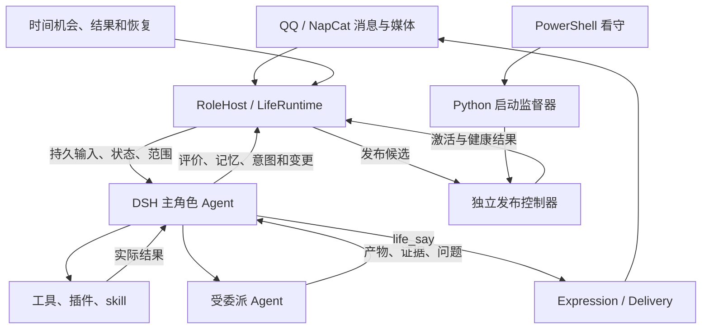

# QQ 自主角色：系统设计、接口与维护

本文件是项目唯一的设计与运行说明，整理于 2026-10-24，取代分散的架构稿、补充设计、交接稿和审查记录。下面的伪代码说明职责和一致性要求，不是可直接调用的 API；具体字段以代码和工具描述为准。

人格、skill 和角色积累的生活资料属于运行材料，不属于工程说明。保留 `persona.md`、`persona.example.md`、`personas/`、`self.md`、`skills/` 及有效生活数据；第三方依赖的说明和许可证由依赖自身维护。

Git 只保存程序、通用设计、空白配置/人格模板和合成回归测试。真实配置与密钥、人格、自我叙述、记忆/日志/媒体、动力参数、本机学习的 `skills/` 和生成的 `scripts/` 仅留在本机，由 `.gitignore` 排除。新增机器需创建本机 `skills/` 目录，不从另一部署复制私人方法。已被跟踪的私人文件还须从 Git 索引移除；忽略规则与新提交都不会擦除旧提交中的既有内容。

## 1. 目标和不变量

角色通过 QQ 与人相处，也能自主探索、学习、解决问题、发展方法和改变自己。核心循环为：

> 觉察状态和经历 → 理解意义 → 产生想法 → 选择尝试或休息 → 使用能力 → 检查结果 → 更新记忆、方法和打算。

大模型负责理解、情境评价和行动选择；程序负责持久状态、实际身份、时间推进、执行资格、真实回执和恢复。

- 一个逻辑主角色拥有最终选择权，可以有多个会话和执行线程。Python 不另建规划器、关键词情绪判定器或平行主动消息循环。
- 普通聊天、联想、想象和兴趣不要求先建立任务；需要跨轮次延续、委派或履行承诺时才保存意图。
- 自发探索无需外部交办。动机可以来自好奇、回忆和自身需要；动机、事实依据、操作授权分别处理。
- 聊天、研究和自主生活共享工具。插件提供能力，工具执行操作，skill 保存方法，子 Agent 承担委派。
- 人格、情绪和需要提供选择材料，不用“最大欲望必定执行某动作”的规则替她选择。
- 自修改必须分清写入、加载生效和行为改善；工具成功、目标实现和消息送达也分别验证。
- 新消息、用户停止、等待约定和私人范围必须影响实际执行。

这些是可观察的角色机制，不证明模型具有人类主观体验；写记忆、改提示词和 skill 不等于训练模型权重。

## 2. 架构与代码职责



DSH 是认知和执行载体，不是角色身份的名字。角色身份来自人格与持续记录；更换会话不等于更换主人格。

| 职责 | 主要文件 |
|---|---|
| 平台接入、身份、命令、启动与健康 | `bot.py`、`life/role_host.py` |
| 主角色上下文、生活工具、意图、委派归属 | `life/role_agent.py` |
| 输入去重、认领、回放、连接和中止 | `life/agent_session.py`、`life/services/dsh_bridge.py` |
| 事件、情绪、需要、确定性结算 | `life/runtime.py`、`life/state.py`、`life/drives.py`、`life/appraisals.py` |
| 关系、偏好、叮嘱、经历与遗忘 | `life/relationships.py`、`life/recollection.py`、`life/memory.py` |
| 媒体、音色、冻结表达、节奏与回执 | `life/media.py`、`life/asr.py`、`life/voice_catalog.py`、`life/expression.py`、`life/message_layout.py`、`life/delivery.py` |
| 思考时机、文字结果预算和用量 | `life/resource_policy.py`、`life/usage.py` |
| 自修改、候选验证、迁移与发布 | `life/self_change.py`、`life/dsh_changes.py`、`life/release*.py` |
| 进程监督和恢复 | `life/supervisor.py`、`lifesupervisor.py`、`supervise.py`、`tools/bot-watchdog.ps1` |

生产路径为 OneBot → RoleHost → DSH 主角色 → 类型化生活提交 → Delivery。`life/services/` 保留会话桥、工坊及编辑原语，不再组装平行 ServiceHub 认知。尚存的辅助/兼容模块不因此成为生产入口。

## 3. 数据、身份和范围

业务状态统一保存在 `data/life.db`；DSH home 保存自身会话日志；`data/life-control` 保存发布与监督状态。它们各有用途，不重复维护业务意图和记忆。

| 标识/记录 | 语义与约束 |
|---|---|
| `agent_id` | 稳定角色身份，跨重启和压缩保留 |
| `conversation_id` | 宿主绑定的私聊/群聊地址，不由模型任意改写 |
| `actor_id / participant_id` | 平台实际 QQ 账号，昵称、自称和引用不是身份凭证 |
| `session_id / generation` | DSH 上下文与世代，旧世代不继续写当前业务 |
| 事件 | 原始来源、发送者、外部 ID、发生/接收时间和派生关系 |
| `state_snapshots / state_journal` | 当前投影、版本和可重复结算证据 |
| `agent_inputs / agent_events` | 持久输入、处理状态和连续事件游标 |
| 意图与操作 | 范围、版本、检查点、执行归属和实际结果 |
| `deliveries / delivery_reviews` | 分片回执与重连后单次复核归属 |

角色共用一套情绪与内驱时钟；关系按角色与实际人物账号维护。同一个人群聊/私聊的关系对象一致，但可见经历不同。群中每条事件保留自己的说话人、引用、@ 和回复链。

主人身份由 `owner` 与实际 QQ 账号匹配。群受众进入模型前已过滤私人资料；主人出现在群里也不公开主人私聊。工具开放范围与熟悉程度分开。发送绑定不可变地址，不使用会被并发会话覆盖的全局 last_peer。

## 4. 主认知、插话与恢复

宿主给思考机会和当前事实，主角色选择表达、查资料、使用能力、委派、改打算或休息，不按关键词切换业务模式。

```python
async def receive_message(raw):
    scope = host.bind_actual_identity_and_address(raw)
    with repo.tx():
        event = events.ingest_once(raw, scope)
        item = inbox.enqueue_once(event, current_session(scope))
        attention.hold_new_side_effects_for_unhandled_input(item)
    await bridge.deliver_or_reconcile(item, mode="steer")

def commit_proposal(call, proposal):
    with repo.tx():
        require_current_scope_session_sources_and_versions(call, proposal)
        if life_calls.has_receipt(call.id):
            return life_calls.receipt(call.id)
        result = apply_typed_role_proposal(proposal)
        resolve_only_explicitly_handled_inputs(proposal.handled_input_ids)
        return life_calls.save_receipt(call.id, result)
```

accepted 只证明收到，consumed 只证明进入模型步骤；主角色通过 `handled_input_ids` 和相应活动变更确认处理。生成期间到达的新输入仍保留屏障。临时 RPC 失败由持久收件箱对账，不必等 worker 崩溃。

事件按 `(session_id, seq)` 去重，补齐缺口后推进游标。通知线程只解析入队，不跨线程直接共享 SQLite 写入；数据库事务内不等网络。DSH 日志和 Python 数据库不是原子事务，响应丢失先查稳定 input ID 的接收状态。

长工作优先异步委派。超过交接时间的步骤需保存进度、请求中止相关执行并保留新输入；`handoff_seconds` 是交接策略，不是网络硬实时保证。

## 5. 情绪、内驱力与念想

| 层次 | 含义和变化依据 |
|---|---|
| 人格、方法 | 身份、自我认识、习惯；通过明确纠正、长期经历和验证改变 |
| 快情绪 | joy 愉悦、concern 不安、frustration 恼、hurt 委屈、anticipation 兴奋；由事件意义、原因和恢复速度改变 |
| 慢心境 | 按真实时间积分的整体状态，不能随读取次数变化 |
| 内驱需要 | 探索、胜任、连接、亲密、性欲、连贯、自主、余量；分别具有动态与证据 |
| 对象关系 | 熟悉、信任、舒适、情感联结；由具体人物的经历形成 |
| 念想、打算 | 主角色理解状态、经历和情境后选择的想法与延续方向 |

愉悦不是依恋，需要连接不是已有深厚关系；亲密与性欲分别保存。提供数值时同时给含义、方向、原因和变化，不把裸数字当完整心理描述。

八项需要使用 drive_v2 的独立状态和参数。累计需要有界增长，任务/资源需要由事实推导；高位持续、内部缓解和恢复期按真实时间边界推进。activation_change、互动满足、验证任务满足、内部调节、偏好学习分开计证据。内部缓解不能冒充与用户新发生的互动；调用成功不能自动等于目标满足；满足抑制不再次扣除同一次满足。

念想不是每两分钟必然生成一条的作业。宿主便宜地检查时机；主角色被唤醒后可以探索，也可以没新想法而休息。一次“想联系某人”可延续为多条表达、等待、理解答复和后续交流。

### 5.1 语义评价与速度

主角色判断对象、关系、语境、实际意义、置信度及持续性；程序负责来源、时间、有限数值、去重、版本和事务。措辞力度不能直接换算伤害量。

普通任务没有关系意义时不产生关系增量。玩笑或亲密语境中的尖锐语言不自动等于伤害；明确不适、拒绝和边界变化也不能被场景标签吞掉。引用、否定和想象正确归因，不一律降权。

重要事件可以立即显著改变情绪，澄清也可以快速缓解相关感受；平复速度依据原因是否仍在调整。慢心境、对象关系和人格各有时间尺度。参数属于待校准的工程模型，不是心理学定律。

```python
def settle_appraisal(scope, proposal):
    with repo.tx():
        require_sources_and_versions(scope, proposal)
        roots = resolve_stimulus_roots(proposal.source_event_ids)
        if same_committed_proposal(roots, proposal):
            return previous_receipt()
        if proposal.supersedes_appraisal_id:
            state = replay_valid_history_replacing_interpretation(proposal)
        else:
            require_unclaimed_stimuli(roots)
            state = advance_old_parameters_to_commit_time()
            state = apply_bounded_affect_drive_and_relation_evidence(state, proposal)
        save_state_journal_claims_and_receipt_together(state, proposal)
```

固定参数段的恢复可表示为 `baseline + (value-baseline) * exp(-ln(2)*elapsed/half_life)`。参数修改从生效时刻向后使用，不重算此前全部时间。

context_refs 只帮助理解，不重复计刺激；音频与转写不能算两遍。误判修订替换旧解释并重放之后仍有效的评价，保留其他会话的后续经历；不简单取负旧增量、不重做外部行动。自发想象能影响自身感受，但不能被记为对方又做了一件事。模型不可用时保留待评价输入，不靠关键词永久抢先结算。

## 6. 关系地位、持久影响与区间语义

当前四项正向关系指标统一保存在 v2 metrics：familiarity、trust、comfort、bond。**主人每项 0.7～1，其他人 0～0.9。** 新增同类依恋指标应注册到同一政策，不能另开不受约束的数值。

边界表达身份位置，不授予权限，也不证明已经有亲密经历。初始值注明 policy_initialization；有经历再报告实际依据。触底不抹掉委屈、分歧和未解事项；触顶不阻止保存新经历。负面感受和人物事项不套用正向分数下限。

语义区间是 [0,.2)、[.2,.4)、[.4,.6)、[.6,.8)、[.8,1]，另外叠加身份边界。

| 指标 | 0～0.2 | 0.2～0.4 | 0.4～0.6 | 0.6～0.8 | 0.8～1 |
|---|---|---|---|---|---|
| 熟悉 | 了解很少，需要问 | 初步认识 | 知道部分习惯和经历 | 相当熟悉 | 共同背景丰富，仍允许变化 |
| 信任 | 有证据才表示戒心；无证据是未知 | 谨慎信任 | 有可靠经历，也有不确定 | 通常愿意信赖 | 稳定信赖，仍独立判断主张 |
| 舒适 | 拘谨紧张 | 能交流，较保留 | 日常自然，局部谨慎 | 通常放松，敢表达分歧 | 很自在，不必维持表面和气 |
| 联结 | 尚无稳定牵挂 | 轻度关心 | 值得维持，持续关注 | 关系重要，愿延续分享 | 深厚牵挂，短暂分歧不抹去联结 |

这些是参考，不是固定台词。熟悉不等于喜欢，信任不等于事实正确率，舒适不等于从无不满，联结不等于性欲。

主角色提交 relation_protocol=2、subject_actor_id、based_on_relationship_version 及每项 metric/direction/magnitude/confidence，不直接给绝对分数或 delta。direction 为 increase/decrease/unchanged；magnitude 为 slight/meaningful/major。

默认幅度 0.005/0.02/0.06，置信门槛 0.35，日累计预算 0.10；幅度、敏感度和日预算可校准，身份与 0.7/0.9 不能经普通动力参数修改。细节以 `life/relationships.py` 的版本化计算为准。

```python
def reduce_relation(current, evidence, policy, config):
    require_registered_metrics_and_actual_actor(evidence)
    result = copy(current)
    for impact in evidence.impacts:
        proposed = meaning_to_delta(impact, config)
        delta = limit_by_remaining_daily_absolute_budget(proposed, result, config)
        lo, hi = policy.bounds(evidence.actor_id)
        result.metrics[impact.metric] = clamp(result.metrics[impact.metric] + delta, lo, hi)
        record_proposed_applied_and_clipped_effect(impact, proposed, delta, result)
    return result
```

偏好、边界、约定、未解决事项和相处方法复用记忆及 relationship_annotation_links，保存对象、来源、范围、有效期、替代关系与修复状态。去重、修订、回放、重启和遗忘保持一致政策。

模型上下文应类似：“舒适 0.74，通常放松、可以表达不同意见；政策位置与经历共同形成；另有一项未解决分歧。”初始值不能伪装成历史亲密。

## 7. 自我认识、记忆和人格

自我认识由初始人格、当前真实能力与状态、经历形成的认识共同构成。写一行自我描述不能创造摄像头、身体、工具或账号权限。

区分实际输入/操作、感知结果、推断和情境表达。双方进行过一次亲密或角色互动，是可记住的真实交流经历，也可影响模拟情绪和关系；叙事中的身体动作仍保留情境性质，不生成实际物理感知记录。自然交流不必每句加免责声明。

记忆保存经历、事实、知识、解释、方法、日记与叮嘱，附来源、认识类型、有效时间、状态和替代关系。事件自动留痕，主角色选择沉淀内容；召回受范围、相关性和预算约束，记得不等于每次提起。

`persona.md` 是唯一生效人格源，persona:public 区与公共内容表达共享性格，persona:private 区保存私人设定。`personas/public.md` 是带源 hash 的派生视图；其他人格文件是可选素材，self.md 不作为第二份自动加载的人格权威。

“这次详细”只影响本轮；“以后少用客服语气”保存偏好。普遍性格修改人格，通用方法修改 skill，动力参数修改配置并重载；经历不无限追加进人格。说记住或改好了之前应取得写入与生效回执。

压缩/换会话保留角色、意图、检查点、已送达片段和未知操作。遗忘约束业务检索、旧会话、摘要与派生材料，废弃上下文不能继续生成和发送；物理删除外部服务副本需要单独核对完成程度。

## 8. 持续意图、商量与委派

一次性目标、持续兴趣、用户承诺、周期职责有不同生命周期。阶段成功不关闭长期方向；主角色可恢复自己暂放的兴趣，但用户明确暂停/取消的方向必须等用户恢复。

直接做、先告诉一声、先商量由主角色根据情境选择，不设置比例或逐工具申请。明确说好等答复，就保存 waiting、对应人物、事项和恢复条件；未回答/超时不是同意。普通告知不自动形成等待，无依赖的活动可继续。

系统权限申请与角色自主商量分开：前者依据实际权限系统找授权者，后者可面向有关对象；其他人的答复不能冒充主人的系统授权。QQ 说“可以”不会直接改变 Windows 文件权限。

子 Agent 接收目标、必要材料、产物和验收方法，继承范围与停止约束。它调查、编码和检查；主角色核对并采用结果。B 站等账号上的公开表达由主角色决定并执行，子代理草稿不会直接变成评论或 QQ 正文。使用用户账号时，平台展示的仍是该账号身份。

```python
async def cancel_intent(scope, ref, request):
    with repo.tx():
        intent = tasks.require_current(scope, ref)
        tasks.cancel_and_increment_revision(intent, request)
        wakes.cancel_for(ref)
        execution.revoke_new_dispatch(ref)
        runs = execution.bound_descendant_tree(ref)
        cancellation.save_requests(runs, request)
    for run in runs:
        await bridge.cancel(run, preserve_unrelated_inbox=True)
    return await reconcile_actual_stopped_or_unknown(runs)
```

停止要覆盖归属执行树，不能只停根 Agent。已发生效果仍记录事实，旧结果不复活目标；不可取消的在途工具保留未知。完成后的分享、遇到问题的求助由主角色选择，同时履行明确回复和结果交付约定。

## 9. 多模态、群聊与共享能力

QQ 输入保留文字、图片、音频、视频、文件、引用的顺序及来源。音频使用本地 Whisper；视频可按能力抽帧和转写，注明覆盖范围。未取得或没看清时不能声称已理解。异步感知是原素材的派生证据，不重复当作一次新发言。

输出统一走表达入口，由主角色选择文字、图片、语音组合。音色目录保存真实引擎、预设、参数、参考素材和可用状态；主角色或用户可添加、选择和切换，使用前真实试音。当前 Edge 引擎提供预设声音和参数，不代表已经支持任意声音克隆。

搜索、B 站登录/评论/字幕/留言、视频抽帧等均属于共享能力；具备与否以实际 profile 工具和登录状态为准。主角色可自行补缺，不能由文档直接宣称可用。搜索随时可以用于聊天，无需单独“学习模式”；推特/X 按用户约定仅浏览时，保持该范围。

允许参与的群无需固定 @ 门槛。主角色按话题、称呼、回复链、兴趣和场合决定参与或安静；高流量聚合只管理注意资源，不替她理解意义。进入上下文前做好受众过滤，不能只在最终表达时收敛措辞。

## 10. 连续表达、节奏与送达恢复

对外正文只从 life_say 进入 Expression/Delivery。内部草稿、模型流、子代理报告和普通 session 结束文本不自动发 QQ。一次联系可使用有序片段，或显式继续当前轮后追加，不限制为单条消息。

短聊天按非空白字数等待 2～5 秒，首条也遵守。回车可形成多条消息；mode=single 只保持当前短片段一条气泡。去首尾空白后达到 paste_threshold（默认 300 字符，含 300）保留回车整体发送，固定等 4 秒；代码、列表、引用、表格和 mode=artifact 也整体发送、等 4 秒。typing_chars_per_second 调整短聊天基准，等待仍在 2～5 秒。等待时继续收输入，过时表达重新核对。

答复归属用稳定 reply slot / logical_message_id，独立于工具 call ID；换 call ID 不能重复发送。明确的新表达和用户重新要求发送可有新归属。

| 状态 | 含义与后续 |
|---|---|
| pending / dispatching | 已准备/正在发送，按资格和片段状态推进 |
| confirmed | 已获平台确认，重试返回原回执，片段进入共同经历 |
| deferred | 确认请求尚未写出，恢复后交角色复核 |
| unknown | 可能已写出但回执丢失，先对账而非盲重发 |
| failed | 有明确失败结果，按证据调整 |
| superseded | 被复核或新表达替代，不自动再发送 |

```python
async def send_expression(call, proposal):
    with repo.tx():
        apply_input_resolution_and_validate_live_context(call, proposal)
        plan = expressions.freeze_once(stable_reply_slot(call), proposal)
    for segment in plan.remaining_segments:
        recheck_current_eligibility(plan)
        receipt = await delivery.dispatch_or_readback(segment)
        record_actual_segment_result(receipt)
        if receipt.status != "confirmed":
            break
    return plan.receipt()

async def review_after_reconnect():
    if not (channel.connected and startup_greeting_confirmed and role.running):
        return
    for expression in delivery.unreviewed_candidates():
        with repo.tx():
            event = events.create_recovery_input(
                original_time=expression.created,
                statuses=expression.segment_statuses,
                previews=expression.bounded_previews,
                reply_source_ids=expression.original_sources)
            inbox.enqueue_once(event)
            delivery.record_review_and_retire_known_unsent(expression, event)
        await inbox.deliver_or_reconcile(event)
```

复核事件、收件箱和 delivery_reviews 同事务保存，重启不重复通知。角色决定补未发部分、结合新消息回答或放下；unknown 的防重复约束保持。可用 life_read(kind=deliveries, logical_message_id=...) 查看。后片失败不抹掉前片已送达事实。

启动由角色自然打招呼，招呼前的平台旧消息按启动约定忽略；单独 QQ 重连不重复招呼。这与已生成未送达表达的复核分别处理。平台缺少可靠查询或幂等能力时，不声称端到端绝对恰好一次。

## 11. 能力扩展与自修改

能力扩展：察觉缺口 → 查真实工具和方法 → 尝试/搜索插件/委派实现 → 安装 Bot 专用 profile → 必要时重启 worker → 核对可见与可调用 → 用原问题验证 → 更新认识和 skill。

安装、服务就绪、工具可见、实际可用、原目标完成分开。桌面 UI 插件不一定支持 SDK。后台主动行为、直接发 QQ、独立记忆/情绪循环不能形成第二套主控。

可借鉴 fish-memory 的联想、feiyu-mood 的意义与原因、speak-up 的低成本机会、bili-subagent 的专业委派、qq-bridge 的来源与防回声、tts-bridge 的完整正文渲染；仍保持每种状态及发送的唯一权威路径，不固化历史版本。

人格/方法通过 life_change_self 的相应目标修改；共享人格使用 target=persona_public。代码 target=code 支持准确补丁、多文件、新模块、整文件写入/删除，以及兼容加表/加列/加索引迁移，实际参数以工具描述为准。

```python
async def apply_self_change(call, patch):
    require_current_scope_sources_and_base_hashes(call, patch)
    candidate = changes.prepare_once_and_validate(call.id, patch)
    with changes.activation_lock:
        recheck_base_hashes_and_current_intent(candidate)
        changes.mark_activating(candidate)
        replace_declared_files_with_recoverable_manifest(candidate)
        loaded = await activate_declared_revision(candidate)
        require_effective_hashes_match(candidate, loaded)
        changes.record_applied(candidate, loaded)
    return applied_receipt(behavior_validated=False)
```

文件和 SQLite 不具备跨资源原子性，prepared/activating 按真实 hash 恢复。新参数先在生效点衔接旧参数时间推进。

独立控制器完成候选验证、保存检查点、停稳所属进程、切换、重启、健康观察和原问题验证。小型 supervise.py 和独立验收基线不允许候选自行改成通过；核心控制器更新由启动器重载。代码回退不恢复旧生活数据；破坏性 schema 变更需兼容过渡或前向恢复。

早期重构的“旧数据重建、不备份”不代表日常整理可以清空现行记忆。本机原生执行不是 OS 沙箱，hook 不是不可绕过的系统隔离。已有进程操作叮嘱要求识别具体作业/PID/命令行/父子关系，避免按 python/node 名称或最近启动时间批量结束进程；作为持久方法提醒，不新增硬权限规则。

## 12. 用量统计与自主省耗

先减少无变化空转、重复上下文和无界工具结果，再由角色按任务价值决定阅读深度。不丢新消息、承诺、必要核对和多模态内容。

| resource_policy 配置 | 默认值 | 含义 |
|---|---|---|
| idle_base_seconds / idle_max_seconds | 900 / 7200 | 空闲思考间隔 |
| unchanged_per_tier | 2 | 连续两次无变化延长一档 |
| text_preview_target_tokens | 1500 | 文字预览目标 |
| text_result_max_tokens / text_result_max_utf8_bytes | 2000 / 12000 | 文字预览上限 |
| dynamic_context_target_tokens | 3000 | 动态材料目标预算 |
| memory_context_target_tokens | 1200 | 可选记忆初始预算 |

空闲间隔按档翻倍至上限；新消息、真实结果和明确短时安排不等空闲计时。life_rest.next_attention 支持 adaptive/after/event/none；相同语义机会合并，取消目标不复活。预算估算不是收费统计。

长日志先给关键片段、覆盖范围、总量和原文引用，再用 life_read(kind=observation) 搜索/分页；不反复灌入同一错误全文。原始结果可恢复，规范工具返回与视觉/音频不能被文字裁剪破坏。稳定人格与方法放稳定前缀，动态状态给完整小快照，旧材料按需召回。

life_read(kind=usage) 使用 DSH 实际调用投影，区分缓存读取、未缓存输入、输出与供应商定义的推理子项。一次实际尝试一份结算，累计样本更新原记录，重试另计；压缩、子代理与用途保留归属，不把已含于输出的推理项再加一次。

```python
def ingest_usage(report):
    evidence = decode_supported_provider_usage(report)
    if evidence is None:
        return mark_coverage_unknown(report)
    with repo.tx():
        key = canonical_actual_attempt_id(evidence)
        usage.replace_cumulative_sample(key, evidence)
        usage.advance_source_cursor(report)
```

缺失统计/价格保持未知，不当成零。费用需当时 provider/model、时段与有效价目，本文不固化价格。Bot 用量不混入 Codex；外部插件直连模型未上报时注明覆盖缺失。服务端缓存仍可能收费，不能只靠缩短输出省耗。

## 13. 运行、配置与日志

日常使用 一键启动.bat、状态.bat、停止.bat。主人私聊固定命令只有 **/状态、/重启、/清空记忆**；其他请求、控制和状态询问使用自然语言。

首次复制 config.example.toml 为 config.toml，填写主人、模型凭据与 NapCat 连接；复制 persona.example.md 为 persona.md 后设置角色。依赖安装：

```powershell
.\.venv\Scripts\python.exe -m pip install -r requirements.txt
```

DSH 工作副本、Node、独立 home 必须真实存在，通过 dsh --profile sdk 启动 Bot worker。桌面 DSH 会话、凭据和插件不是 Bot 清理目标。模型路由以实际运行记录为准。

动力参数由有效 life-dynamics.json / life_dynamics 提供；关系 relations 可校准幅度等，不能改身份政策。字段以配置加载器为准，未知/废弃字段报错。行动额度默认每小时 500、每日不限，0 表示不限；媒体根、大小、ASR 和 public_tools 见 config.example.toml。

登录需要时弹出二维码，更新后刷新，就绪后关闭并继续启动；启动窗口保留期间失效会再提示。/重启 重载 Python 和 Bot 专用 DSH worker，无需重复启动整套程序。

PowerShell 看守独立于 Python，异常退出后按 2～60 秒退避恢复，正常退出不拉起，同项目一个看守。停止先写 data/life-control/stop.requested，下一次显式启动清除。关闭外层窗口或直接运行 python supervise.py 不具备外层恢复。QQ 离线与进程/认知故障分别诊断，不能登录失效就反复重启角色。

DSH 会话策略和 Windows 文件权限分别生效；完全权限会话仍可能遭低完整性进程或 ACL 拒绝。应诊断实际 EPERM、完整性与文件权限，不能要求重复在 QQ 说“可以”解决系统层错误。

| 文件 | 内容 |
|---|---|
| data/conversation.log | 实际收到和确认发出的消息 |
| data/runtime.log | 运行、恢复、异常和角色启动 |
| data/logs/dsh-bridge.log | DSH worker 技术输出 |
| data/logs/watchdog.log | 外层看守、退出码和退避 |
| data/logs/supervisor-console.log | Python 看守及子进程控制台输出 |
| data/logs/lifesupervisor.log | 发布控制器、Bot 退出与健康失败 |
| data/supervise.log | 启动入口、控制器启动/退出/重载 |
| data/logs/napcat-login.log | 二维码提示过程 |

判断在线结合新鲜心跳、QQ 连接、认知就绪和真实回执，不能只看端口。运行日志保留并按现有机制轮转；导出时避免密钥、健康 token 和无关私人聊天。模型日志不是 QQ 已送达证明。

## 14. 验证与文档维护

统一离线回归：

```powershell
.\.venv\Scripts\python.exe -B -X utf8 tests/run_offline_suite.py
```

tests/ 保存可重复测试和夹具，drivetest.py 验证内驱；tests/manual/ 保留需明确调用的模型、媒体、假平台和发布集成脚本，不随普通单元测试自动触发。真实模型会消耗用量，真实 QQ 脚本与假平台脚本分别使用，不能在清理时顺手发送消息。

| 验收面 | 核心要求 |
|---|---|
| 自主生活 | 无指令可探索或休息；念想可延续交流；兴趣与承诺不同 |
| 情绪与关系 | 语境归因、快慢变化、身份边界、指标语义、持久影响和修订一致 |
| 插话与停止 | 输入实际处理；用户停止的方向及后代不自行恢复 |
| 投递 | 重试、部分成功、unknown、离线未发、重连复核不盲重复 |
| 记忆与隐私 | 偏好可召回、临时要求不永久化、私聊不串群 |
| 扩展与升级 | 安装/可用/目标成功分别验证；版本实际生效且可恢复 |
| 省耗 | 不空转、不无界读日志；未知统计不作零，必要工作不删 |
| 运行恢复 | 异常退出可恢复、明确停机不复活、QQ 离线独立报告 |

测试通过只证明覆盖机制。模型体验、账号登录、媒体质量、真实平台写入和第三方插件需相应实测，不以代码存在或旧报告代替当前验证。

以后继续更新本文件，不再堆平行设计稿或按日期写交付报告。可重复检查进入 tests/；临时输出使用可清理目录，不提交截图、数据库副本、探针日志和调试导出。现行记忆、人格、用户素材、运行日志和依赖模型按用途管理，不按扩展名一概删除。
