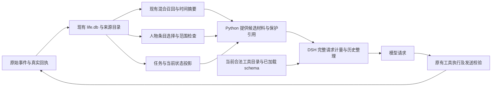

# 会话上下文优化：概要、详细设计与伪代码

日期：2026-10-27（北京时间）。状态：方案与本地实现记录，未部署。代码已通过 SSH 快进同步到 `ecb1612`；本地暂停的优化改动恢复后无冲突。远端新增的群聊材料和主动发言流程纳入保留范围。此前未提交的优化代码是半成品，不能作为本文全部已实现的证据。

用户确定的顺序：独立会话预算 → 历史去重与图片退出 → 短人物画像 → 工具结构化及按需加载。空闲退避不在范围内；不改变随机空闲间隔、群聊唤醒条件、持续任务、等待或停止约定。

本修订按用户最新要求替代 2026-10-26 文档中“不安排节省 token 工作”的约束，仅涉及一次模型请求的工作上下文。它不是每日 token 配额、总调用次数限制或任务总步数限制；费用仍由既有 spending 规则执行。

## 1. 概要设计

保留 Python RoleHost + DSH、`life.db` 事实中心和现有白守式记忆：原始经历即时保存，词法/向量混合召回，时间摘要、来源关联、修订及遗忘传播继续使用现有服务。借鉴 Coopanion 的上下文组织，不引入文件式主记忆、第二份人物事实库或另一套后台“梦”。

本次优化对象是“模型这一步看到的材料”，不是“角色还能保存多少经历”。画像与历史提要都是可重建投影，不能反向覆盖原始来源。



| 所有者 | 职责 | 保持的限制 |
|---|---|---|
| Python 宿主 | 人物、受众、记忆可见性、任务状态和候选材料 | 模型不能扩大范围或自报完成 |
| DSH 请求装配 | 计量完整请求、历史去重、图片选择、交接及 schema 呈现 | 所有影响模型的选择均可由会话记录重建 |
| 既有记忆服务 | 原文、混合检索、时间摘要、修订与遗忘 | 不因上下文超预算删除记忆 |
| 既有执行服务 | 权限、来源、任务版本、停止、费用、真实回执 | schema 是否展示不构成执行授权 |

一次请求的处理顺序：获取当前事实及版本 → 选择合法材料 → 复用已加载工具 → 整理历史/图片 → 计量完整请求 → 必要时交接 → 再次验证来源与执行屏障 → 冻结并发送。没有足够新材料时，不为本优化另外调用模型。

## 2. 独立会话预算

### 2.1 预算含义和起始配置

完整输入包括系统提示、工具 schema、历史消息、当前动态状态、召回材料、附件及提供方包装。输出额度在模型物理窗口中单独预留。调用次数、token 实际账单和工作上下文估算分别记录。

以下是首轮校准的建议值，尚非已应用配置；普通聊天与任务模式依据现有绑定/活动状态选择，不增加分类模型调用。

| 配置 | 初始建议 | 含义 |
|---|---:|---|
| `chat_input_target_tokens` | 32000 | 普通会话完整输入的工作目标 |
| `task_input_target_tokens` | 48000 | 已有工作任务的完整输入目标 |
| `pressure_ratio` | 0.80 | 进入整理的预警比例 |
| `recent_history_target_tokens` | 8000 | 最新对话目标，服从完整请求余量 |
| `handoff_target_tokens` | 4000 | 交接材料目标，包含来源和未决事项 |
| `profiles_target_tokens` | 800 | 所有人物画像合计目标，不是每人额度 |
| `retrieval_target_tokens` | 2400 | 复用现有召回目标，不叠加另一份 allowance |

这些额度不是分别填满后相加的要求。设模型容量为 `W`，真实输出预留为 `O`，提供方所需余量为 `H`：

```text
physical_input_capacity = max(0, W - O - H)
request_target = min(mode_target, physical_input_capacity)
optional_room = max(0, request_target - measured_protected_input)
```

`W` 未知时明确标注容量未知，以提供方验证和现有错误恢复为准，不伪造精确物理上限。图片计量使用 DSH/适配器能力；只有估计时记录估计方法和覆盖范围。`context_estimate` 目前只估消息，不能直接作为包含 schema 和视觉开销的完整计量。

### 2.2 材料优先级与溢出

保护集合包括：当前有效人格及关键规则、正在处理的用户原话、未处理输入引用、等待/停止事实、当前任务检查点、未知副作用回执，以及当前操作真正需要的证据或图片。检查点保存未完成目标和下一步，不能把“上一条调用成功”写成整个任务成功。

依次减少可选内容：重复快照 → 冗余工具读取 → 旧图片实例 → 无关画像/召回 → 较早的已结算过程。历史交接只在前述整理仍不足时使用，复用 DSH 的持久交接机制；不另启定时总结。

保护集合自身超过工作目标时记录 `mandatory_overflow`，可在物理容量和现有费用约束内临时超过软目标，不为了省 token 结束任务。若保护材料也无法进入物理窗口，先转为保留来源的可分页材料并仅装入本步所需片段；仍无法合法构造请求时，返回具体容量阻碍，不静默删除关键内容或循环压缩。

### 2.3 请求一致性与缓存

按最终提供方请求计量一次；整理后重新计量，版本变化则放弃该候选并重建。持续有新输入导致反复变化时，让出现有调度器并响应取消，不在装配函数内无界忙循环。保留现有 token meter，禁止 Python 和 TypeScript 各自维护不同的最终 token 结论。

固定提示和工具顺序保持稳定。画像版本不变时不重复生成文本；历史整理在预警或明确材料过期时执行，避免每一步改写最早的消息而破坏缓存。真实 `usage` 继续以提供方回执为准。

## 3. 历史去重与图片退出

### 3.1 去重规则

| 对象 | 可合并条件 | 必须保留 |
|---|---|---|
| 运行状态快照 | 同 scope、同对象的后续版本替代前版本 | 当前版本、来源及必要的变化事件 |
| 只读工具结果 | 工具身份、规范化参数、资源版本、受众和结果内容一致 | 最新可读引用及完整结果读取入口 |
| 内部重复通知 | 同一语义事件/操作身份且事实未变 | 次数或时间范围、实际未决状态 |
| 真实用户消息 | 仅同一平台事件的重复接收 | 不同事件、日期的相似乃至相同文字分别保留 |
| 写操作与发送 | 不按内容相同合并 | 操作编号、先后关系、确认/失败/unknown |

`snapshot` 与 `read` 等分类由宿主/工具注册声明，不由结果正文自称。无法取得资源版本的只读结果不跨步骤复用；工具版本、来源修订或遗忘后原复用条件失效。新查询不能仅因返回文本一样就假定资源没有变化。

DSH 使用已支持的持久 prune/替换记录更新模型历史，原始 session 事件不改写。调用和回执成对处理，不产生孤立 tool result；unknown 记录不因整理成为成功。历史提要不是新的外部事件，不进入记忆或指标重复结算。

### 3.2 图片保留规则

每个图片引用记录 `asset_id/hash/source_version`、原始来源、受众、实例引用及当前任务版本。图片是否进入请求与文件是否保留分开：退出请求不删除文件、既有观察或来源。

当前批次图片和当前任务明确引用的参考图优先保留；较早截图或已无当前用途的实例可替换为文字占位。占位只陈述可核实的素材身份、原观察及读取入口，不凭空补写视觉描述。人物/任务范围改变后重新核验引用；“沿用上一张图”“比较两张图”等要求形成任务级 pin，不能因新一轮消息出现就淘汰。

复用 DSH 现有 `image/offload` 事件与投影。当前实现主要在提供方拒绝后触发，设计需扩展为发送前按预算选取；不另写一个未记日志的消息过滤器。已退出的旧实例保持退出，再次查看应通过合法读取产生新的当前实例。重启、重放和换模型不恢复被遗忘素材，也不无条件重发全部旧图。

### 3.3 交接内容

交接携带当前目标、未答问题、暂停/停止与等待、未决操作、必要用户原话、有效来源引用及最近相关交流。旧过程先去重，再按时间保留；不递归复制上一份完整交接笔记。摘要、引用和覆盖标记不足时保持 `partial`，需要原文时走既有 recall/life_source。

## 4. 短人物画像

现有 `People.visible` 已按来源权限、有效期和主题修订筛选，当前上下文每人取前三条，单条保存上限 240 字符。本项复用该能力，优先调整选择和呈现，不增加 `PARTNER.md`、新的人物主表或每轮总结作业。

先按当前受众过滤，再按当前发言人、被明确提及的人和本步任务对象选择。排序先保留适用边界和称呼，再选择与当前话题相关的有效偏好/事实，最后补近期必要背景；不能为了排名把推断提升为本人明确陈述。对相同主题只保留当前有效修订。

投影缓存键至少包含 `agent_id + actor_id + audience_policy + profile_version + query_signature + forget_epoch`，值保留条目 ref、revision、origin 和 evidence_refs。人物变化、来源修订/撤回、过期、遗忘或受众变化立即失效；不按每个 tick 重新调用模型。首期直接选择已有短条目；需要自然语言凝练时只能接入既有有来源整理流程，结果仍是可重建派生物。

多人合计遵守画像目标；未展示的人物保留身份及详情读取入口，不声称“没有认识”。当前需要的边界不因低排名丢弃，可进入保护集合。群聊材料保留实际发言人与群来源，继续遵守远端新增的 `group_at_only`、`group_initiative` 与群材料范围，不借优化扩大跨场景披露。

## 5. 工具结构化与按需加载

### 5.1 定义归属

工具参数以版本化机器可读 schema 为主源，由 Python 宿主的工具契约目录提供；DSH 从可信宿主协商获取、转换为适配器支持的 schema。宿主使用相同定义做字段校验，再做既有业务、权限和来源校验，避免长描述与两个手写参数版本漂移。

第一阶段保留既有工具名和 `proposal` 外层，结构化其内部字段。按 `kind/action` 区分必填字段、类型、枚举和组合条件；schema 只描述已经实现的能力。提供方不支持某种组合语法时使用明确的兼容表达并验证，不能默默降为任意 JSON 后宣称仍有等价约束。

常用的 `life_read / life_say / life_rest / life_remember / life_intent / life_appraise` 提供日常操作所需字段。关系复杂评价、媒体、专项、代码自改、安装/外部平台等按操作族展开；稀有字段不能从文档删掉后让模型猜。基础字段不能在未知返回状态下默认成功、重复发送或自动解除等待。

### 5.2 目录与加载

工具加载状态是呈现状态，不是授权。复用当前 capabilities 目录及原执行门；列表只返回当前会话允许发现的名称、简述、schema_ref、版本和可用性，查询无需附带所有 schema。目录为空只表示当前安装范围没有匹配项。

在一次精确目录读取中请求 `load:true`，宿主校验当前作用域、工具身份和 schema_hash，DSH 在下一步原子提供完整 schema。返回只需短摘要、hash 和加载结果，避免在工具回执与下一次工具表里重复发送同一份完整文档；显式查阅长说明仍支持有版本分页。

状态为 `unloaded → loading → ready`；失败回到 unloaded，版本失效进入 stale 并重新读取。半份 schema、错误响应或失效引用不标 ready。普通调用与后续加载不必每轮重来，复用当前会话中仍有效的定义；会话交接时保留基础工具和当前未完成任务所需的有效定义，其余回到目录。

加载键包含 session/generation、audience、registry_version、schema_hash 和 forget_epoch。重启从真实请求记录恢复呈现，再核对当前注册表；不能拿旧权限和旧 schema 直接恢复。并发相同加载合并，同名不同版本不能互相覆盖；注册表变化时按本步版本检查重建请求。

完整参数进入实际模型请求时使用现有 request/header 等记录，确保重放一致。直接调用一个工具仍执行原有权限检查；不能把“工具已显示”当授权，也不能仅靠隐藏 schema 保障安全。协议未协商成功时使用现行完整定义，不发送模型无法发现的残缺工具集合。

### 5.3 减少不必要的模型步骤

当前动态状态已提供且版本有效时不要求重复 read。普通回复允许使用现有 say/rest 的 appraisal、handled_input_ids、profile_reviews 和 activity_changes 原子提交；确认 final say 已结束后不追加 rest。必要读取和未知结果对账保留。目录加载不调用额外分类模型，不以减少调用数为由强制提前结束持续活动。

## 6. 伪代码

下列代码表达职责和提交顺序，不是可直接运行的补丁。`commit_projection` 代表 DSH 现有持久记录接口；业务事实只经原有服务提交。

### 6.1 完整请求装配

```python
def prepare_request(binding, incoming, policy):
    for attempt in scheduler.allowed_prepare_attempts():
        check_cancelled(binding)
        stamp = capture_versions(binding)  # 受众、来源、任务、schema、forget_epoch
        facts = host.current_facts(binding, incoming)
        protected = collect_required_material(facts)
        profiles = select_visible_profiles(facts, policy.profiles_target_tokens)
        tools = valid_loaded_schemas(binding, stamp)
        candidates = existing_recall(facts, reuse_budget=True)

        plan = plan_history_projection(
            history=dsh.current_surface(binding), protected=protected,
            collapse_snapshots=True, deduplicate_verified_reads=True,
            image_policy=task_image_pins(facts))
        draft = assemble(protected, profiles, candidates, tools, plan)
        capacity = provider_input_capacity(output_reservation(), provider_margin())
        target = min_known(select_mode_target(facts, policy), capacity)
        meter = dsh.measure_provider_request(draft)  # 含工具与视觉，不冒充真实 usage

        if meter.above(target * policy.pressure_ratio):
            draft = reduce_optional_material(draft, target, preserve=protected)
        if dsh.measure_provider_request(draft).above(target):
            draft = handoff_once_if_useful(draft, protected, policy.handoff_target_tokens)
        if required_material_exceeds_target(draft, target):
            mark_mandatory_overflow(draft)  # 软目标不截断关键事实、不结束工作
        if not fits_physical_capacity(draft, capacity):
            return explicit_capacity_blocker_with_read_plan(draft)
        if capture_versions(binding) != stamp:
            continue  # 未付费发送；按最新事实重建

        dsh.commit_projection_and_request(draft, stamp)
        return freeze(draft)  # 实际调用前原有费用/停止检查仍执行
    return yield_to_existing_scheduler(binding, reason="sources_changed")
```

### 6.2 历史整理与图片选择

```python
def plan_history_projection(history, protected, image_policy, **options):
    plan = ProjectionPlan()
    for pair in valid_call_result_pairs(history):
        if pair.has_unknown_effect or pair.is_write_or_delivery:
            plan.keep(pair)
        elif pair.is_declared_snapshot:
            plan.keep_latest(pair.scope, pair.subject, pair.version, pair)
        elif pair.is_read and pair.resource_versions_are_known:
            key = (pair.tool_identity, canonical_args(pair), pair.scope,
                   pair.resource_versions, pair.result_hash)
            plan.reference_exact_duplicate(key, pair, keep_recovery_ref=True)
        else:
            plan.keep(pair)
    for image in image_occurrences(history):
        if image.in_current_batch or image_policy.requires(image) or image in protected:
            plan.keep(image)
        elif source_access_still_valid(image):
            plan.offload_via_existing_event(image, placeholder_with_source(image))
        else:
            plan.invalidate_via_existing_retention(image)
    return plan  # 不改原始事件，不把合并结果写成新的经历
```

### 6.3 人物投影

```python
def select_visible_profiles(facts, total_budget):
    result = []
    for actor in current_relevant_actors(facts):
        rows = people.visible_with_current_source_checks(facts.scope, actor)
        rows = latest_revision_per_topic(rows)
        ranked = rank(rows, boundaries_first=True, query=facts.current_topic)
        result.extend(take_with_shared_budget(ranked, total_budget,
                      preserve_origin=True, retain_detail_refs=True))
    return result  # 无 LLM 调用；必要边界另入 protected
```

### 6.4 工具加载与执行

```python
async def load_tool(binding, schema_ref, requested_hash):
    stamp = capture_catalog_versions(binding)
    contract = await scoped_catalog.read(binding, schema_ref)
    require_current_identity_and_hash(contract, requested_hash, stamp)
    schema = compatible_complete_schema(contract, provider_capabilities())
    require_complete_schema(schema)
    if capture_catalog_versions(binding) != stamp:
        return stale_context()
    dsh.stage_schema_for_next_request(binding, schema, stamp)
    return short_load_receipt(contract.name, contract.hash)  # 完整 schema 不再塞回执

async def execute_tool(binding, call):
    contract = current_contract(call.name)
    validate_fields(contract.schema, call.arguments)
    existing_scope_source_task_stop_and_budget_checks(binding, call)
    return await existing_executor(call)  # 不因 loaded 标记跳过实际校验
```

## 7. 验证、实施与恢复

先记录基线，不调用真实账号发送或为统计新增模型请求。使用相同模型、固定语料和相同任务，对照完整输入估计、真实非缓存/缓存输入、输出、模型调用次数、首响应/完成时间，以及任务和记忆回答质量。缓存收益与压缩收益分开报告；不能仅凭 JSON 字节数承诺费用下降。

| 验证场景 | 应保持的结果 |
|---|---|
| 连续普通聊天与复杂工作 | 固定目标生效，不随模型大窗口无限增长；工作不中途假完成 |
| 同文不同日期/人物 | 原经历均保留，召回不混人、不把重复表达当重复事件 |
| 重复快照和只读结果 | 模型侧重复减少，来源、版本和完整读取入口仍在 |
| 等答复、叫停、unknown 发送 | 交接与重启不解除等待、不复活目标、不盲重发 |
| 新图、旧图重引、双图比较 | 所需参考图保留/合法重读，已退出图片不被假称仍在视觉上下文 |
| 人物纠正、过期和遗忘 | 短画像和加载缓存同步失效，旧推断不恢复 |
| 群聊 @ 与自主查看材料 | 保留远端新行为和群材料受众范围，不改变唤醒节奏 |
| 工具加载失败/换版本/并发 | 不激活半份 schema，不跨会话继承，实际执行仍能拒绝越权 |
| 预算极小或 schema/当前输入极大 | 返回真实容量情况，不删关键内容、不无限交接 |
| 请求重放 | 呈现、图片选择、工具定义及计量能由持久记录重建 |

实施顺序：A 完整请求计量与绝对软目标；B 历史及图片的持久投影；C 现有人物条目选择和共享预算；D 契约主源、基础 schema 与目录加载。每阶段完成对应行为测试和请求样本比较，再部署；基线、设计、代码、加载版本和实际效果分别记录。

先前的 `compaction_threshold_percent=6`、仅压短说明而仍使用通用 JSON、只按成功 ref 就加入内存加载集合等半成品，不作为最终实现：分别需替换为绝对目标、完整 schema、带版本且可重放的加载。此前本地修改保留，后续实施时逐项对齐，不直接启动。

仅对派生呈现新增配置与版本记录，不迁移主记忆。回退时恢复旧呈现策略及其协议，保留原始事实、已确认副作用和来源屏障；已经记入会话的 prune/offload 选择继续按现有重放规则解释，不通过删除日志假装它们未发生。当前原文可按合法引用重新读取。

## 8. 关联与参考

- [总体概要设计](life-overview-design.md)、[总体详细设计](life-detailed-design.md)、[现有记忆运维](memory-operations.md)。
- 当前源码入口：`life/role_agent.py`、`life/resource_policy.py`、`life/people.py`、`life/life_recall.py`、`life/capability_view.py`；DSH 的 `qq-life-sessions.ts`、`qq-life-resources.ts`、compaction 和 image-offload 模块。
- [Coopanion 人物记忆](https://github.com/Pal-AI-Lab/Coopanion/blob/fcb735ec6761c670bf21f8dca95d485cf9807172/core/persona.ts)、[旧图片实例退出](https://github.com/Pal-AI-Lab/Coopanion/blob/fcb735ec6761c670bf21f8dca95d485cf9807172/packages/cortico-provider-coo/src/context.ts)、[Cortico 机械交接笔记](https://github.com/Pal-AI-Lab/Cortico/blob/cd41f48567fac115278d29cd06924151e7043503/bots/cormini/persona/handoffNote.ts)。只借鉴机制；本轮未复制其实现或替换记忆引擎。

## 9. 本地实现记录（2026-10-28）

本次修改同时覆盖 Python 宿主与仓库内 `vendor/dsh-bridge-work` 的定制 SDK。没有改真实账号配置、启动 Bot 或触发 QQ 发送。运行旧仓库外 DSH 的部署须先切换到本次配套源码并重建，不能只更新 Python 就视为协议已生效。

- 完整请求在 `agent/request-ready` 中检查：此时系统提示、当前输入、动态材料、工具表和提供方路由已写入会话；共享 token meter 是最终估算主源。普通聊天/任务目标为 32000/48000，输出与提供方余量另留。费用仍由原 spending 回调决定。`usage` 记录包含 `request_estimate` 与 `request_budget`，明确区分估算覆盖、未知容量、输出预留和 `mandatory_overflow`。
- 状态快照沿用已有持久 prune。完整输入仍超目标时，只对宿主明确提供的可选投影进行替换；召回、非必要画像和重复观察转为读取入口，边界、用户输入、等待、检查点和未知回执保留。只读去重首期仅处理宿主声明、带资源版本和工具身份的 `life_read` 成对记录；无版本、混合副作用、不同用户事件及写操作不按同文合并。替代引用保留原操作序号、版本与重新读取参数。原始事件、来源、记忆与回执不删除。
- 图片退出写入既有 `image/offload`，重放仍保持退出；合法重读产生新实例。默认保留最近两批图片，当前批次、有来源的参考 pin 和活动任务图片继续保护。活动任务的图片保留采用保守策略，不猜测旧截图已经无用。`reference_image_batches` 可配置，默认 2。
- 人物投影读取现有 `People.visible`，按当前发言人、平台明确提及对象、边界/称呼和话题相关度选已有短条目，多人合用 800 token。每次读取重查来源和有效期，不生成另一份人物事实或调用模型；详情仍可分页读取。来源修订、遗忘、人格、任务及当前输入变化参与最终戳校验。
- `life/tool_contracts.py` 提供版本化机器定义；DSH 和 Python 使用相同定义校验字段，组合条件及实际权限继续由宿主校验。六个基础工具常驻，其余按精确目录读取的 `ref + schema_hash + load:true` 加载。加载完成前验证完整 schema、当前会话/受众及实际 hash，再持久记录呈现状态。重启须重新核对注册表；失败或失效定义不进入 ready。完整旧说明通过精确目录与 schema 分页保留，加载回执不重复携带整份说明。普通交接后可选工具回目录，活动任务保守保留有效定义。
- 每次装配最多调用一次既有交接；交接失败保留已记录的表面并继续校验，不循环总结。保护材料超软目标仍可发送；不能满足已知物理容量时返回估计值、容量及既有来源分页入口。来源或注册表变化则本次不发送，交回原调度器重建。

保持既有随机空闲间隔、`group_at_only`、`group_initiative`、等待/取消、来源受众与真实送达回执规则；没有新增空闲退避、第二套记忆或后台总结。

验证记录以本次实际运行结果为准：固定合成语料的完整请求估算对照保存在 DSH `qq-life-context.spec.ts` 的内联快照中，覆盖同文不同事件、unknown 写操作保留及去重后的可恢复引用。该对照只说明此语料的模型输入估算变化，不代表提供方实际费用或缓存收益。真实账单、缓存率、首响应和任务完成时间未用真实账号测量。

### 最终本地验证

- Python 回归选集 129 项通过；最终契约与估算元数据复核 8 项通过。
- DSH 会话/上下文投影测试 41 项通过；固定语料共享 meter 输入估算由 2794 降为 1501，保留两个不同的同文用户事件及 unknown 写操作。此数字只适用于该合成语料，不代表真实账单或缓存收益。
- 最终 `build:artifacts` 7 个构建门禁与 `build:check` 的 Host/Client 两个类型检查全部通过；导出 JSDoc、README 规范、具名双语页、持久化类型历史与 Session 格式检查通过。原始 prune/offload 结构未迁移，新增归属标记有同版本兼容记录。
- 文档全量 `doc-sync` 运行过但未全绿。本次引入的说明、格式与目录问题已修正并复核；其余包括内嵌 DSH 的归档基线读取假设、原有 tools 显式入口与别名生成器的不一致，以及 Windows 不允许建立测试符号链接的 EPERM。为避免混用工具运行时，保留已有的显式 tools 源码入口。

本节记录提交前的本地验证；尚未部署，未修改真实账号配置。验证日志保存在本地忽略目录 `.acceptance/context-*.log`；升级须实际使用本仓库配套 DSH 源码并重建，再按原部署流程重启。
