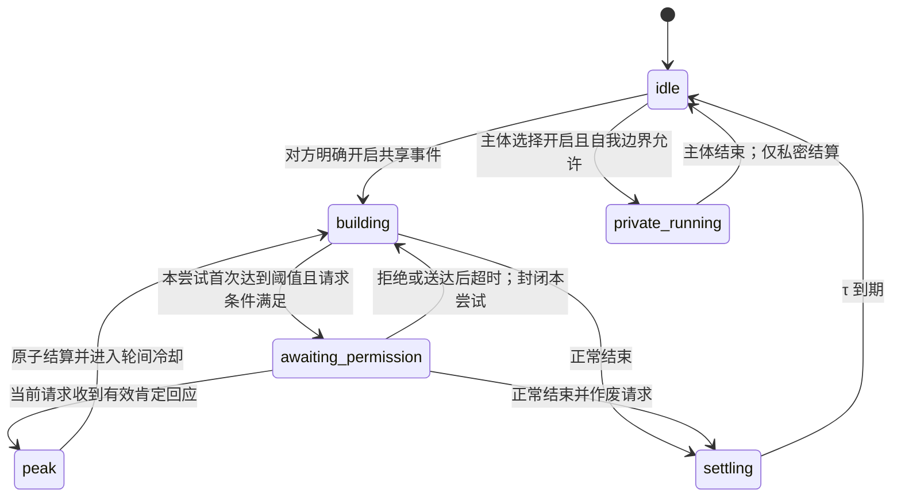

# 亲密互动状态机：合并数学模型与接入设计 v0.2

日期：2026-10-28（北京时间）。依据：评审版 v0.1 与新增 R5、R6、修订 I1 的补充。

交付状态：**已在 qq-deepseek 本地源码接入，尚未部署或重启生产服务**。本文保留合并后的数学模型、默认参数、协议边界和验收条件，末尾记录本次实现与验证。默认数值是待校准的工程参数，不是生理学结论。本文不生成具体亲密内容，也不授权向任何联系人发送。

## 1. 合并结论与语义消歧

采用完整合并版作为后续实施依据；原两段修订保留为需求来源。R1～R6 一起生效，R6 不能成为共享场景的备用放行路径。

| 问题 | 本稿采用的定义 |
|---|---|
| 许可与意愿 | 开启意愿只允许进入共享事件；输入方案授权只允许指定输入；每个共享 peak 仍单独请求并消费一次许可。三者不能相互代替 |
| “一直”等持续授权 | 必须有明确原话、对象、方式、范围与撤销条件；默认只延续约定的输入方式，**不预先批准未来 peak**。这是 R1 单次许可与 I3 的合并解释 |
| 轮次 | 一次 `attempt_id` 是一次接近阈值的请求机会。成功、明确拒绝或请求超时都结束该尝试；`completed_rounds` 只计成功 peak |
| 沉默与拒绝 | 均不给许可。明确拒绝立即结案；沉默在请求实际送达后 90 秒结案。每个请求最多计一次未许可，不能每 tick 累加 |
| 再次请求 | 成功后可按新一轮条件再请求；拒绝/超时后须出现对方新的明确继续意愿，并完成重新布防。等待和冷却结束本身不触发请求 |
| 延迟结算与停止 | 正常结束进入 settling；停止立即 idle，不等待 τ，不再产生行为推进 |
| “归零” | 事件瞬时量清零，逐轮敏感度、阈值、间隔回初值；R6 的永久敏感度增益和持久速率增益不清除 |
| “不跨会话”与 R6“永久” | 瞬时量和许可不得跨事件复用；R6 增益在同一显式绑定周期内持久保留。切换参与者、受众、逻辑对话或重置绑定即不复用。进程重启、模型上下文换窗不是新逻辑对话 |
| 共享记录与私密审计 | 私密事件有本机受限的状态与数学审计，不进入双方场景记录、聊天正文、共享摘要、召回或第三方导出 |

其中“永久”限定在绑定周期内，是本稿为协调原规格所做的设计选择。若以后要求跨逻辑对话保留，需单独修订“不跨会话”的范围，不能在实现时静默扩大。

## 2. 分层、状态与单一写入者

用三个相互隔离的部分建模：共享事件 reducer、私密事件 reducer、绑定范围内的 libido 动力学。R5 是动机候选，不是第四种场景。

绑定键为 `(agent_id, conversation_id, participant_id, audience_policy_id, binding_generation, forget_epoch)`。从现有 `Scope` 派生，`binding_generation` 由宿主创建；同一时间只允许一个成年伴侣绑定。不能由模型提交任意 scope 或选择别人的状态。

| 符号 / 字段 | 范围与初值 | 所有者与生命周期 |
|---|---|---|
| A / arousal | [0,1]，0 | 事件内快状态 |
| S_round / 逐轮敏感度 | [0.25,1.5]，1 | 事件内增益；事件结束复位 |
| B / private.sensitivity_gain | [0,0.5]，0 | R6 成功完成后累计的永久增益；同一绑定内不衰减 |
| S_eff / sensitivity | [0.25,1.5] | 实际输入增益与只读状态：`min(sensitivity_max, S_round+B)` |
| V / valence | [-1,1]，0 | 事件内感受方向 |
| E / engagement | [0,1]，0 | 事件内投入 |
| Q / momentary_satiety | [0,1]，0 | 事件余韵；规格中的 satiety，区别于驱力的 satiety |
| U / adaptation | [0,1]，0 | 保留现有适应机制，独立于 S |
| L / scene_load | [0,1]，0 | 保留现有负荷机制 |
| θ / current_threshold | [0.55,0.75]，0.55 | 事件内阈值 |
| T / round_interval_seconds | [30,120]，120s | 两次成功 peak 的最短间隔 |
| n / denied_count | 整数 [0,65535]，0 | 本事件已结案的未许可请求数；饱和计数，完整次数查审计 |
| m / completed_rounds | 整数 [0,65535]，0 | 本事件成功数；饱和计数 |
| X / libido.tension | [0,C]，当前驱力值 | 沿用驱力引擎，C 默认为 1 |
| P₀ / raw_pressure | [0,1] | 沿用 `clip(X + learned_offset + activation, 0, 1)`；不是 `level` |
| D / relief_debt | [0,1]，0 | 私密事件完成后的临时降压量 |
| P / effective_pressure | [0,1] | `max(0, P₀-D)`，仅在绑定上下文使用 |
| G / rate_gain | [0,1]，0 | 私密事件累计速率增益；绑定周期内持久 |

计数器饱和只限制数值状态，不丢弃许可/转移日志。逻辑序号用有界无符号整数，达到上限拒绝推进；时间戳必须有限，经过单调有效时间 `max(last_at, received_at)` 处理。

每次事件拥有新的 `episode_id`，每次尝试拥有新的 `attempt_id`。共享与私密事件互斥；`mode` 只能为 `none/shared/private`。存在共享事件（包括 awaiting_permission、settling）时不能开启私密事件。任何模式变更都必须先结束当前事件，不允许迁移 A、n、许可或峰值计数。



图中所有状态都受同一停止屏障约束：`stop → idle`，撤销待发送动作、待许可、持续输入和私密完成任务。`peak` 是原子转移事件，写日志后立即回 building，不占用一个等待许可的时间窗口。

## 3. 基础积分与输入算术

所有时间输入统一为秒。定义 `clip(x,a,b)=min(b,max(a,x))`，`decay(x,dt,H)=x·2^(-dt/H)`。数学核不读自由文本，只接收宿主校验过的结构化事件。

### 3.1 语义冲量

沿用现有 `appraise_input` 的方向、effects、confidence 和来源校验。设原始语义冲量 `a∈[-0.25,0.25]`，可信度 `c∈[0,1]`：

```text
ΔA = a·c·S_eff   当 a > 0
ΔA = a·c         当 a ≤ 0
A' = clip(A + ΔA, 0, 1)
V' = clip(V + effects.valence·c, -1, 1)
E' = clip(E + effects.engagement·c, 0, 1)
```

`increase` 必须 `a>0`，`decrease` 必须 `a<0`，`unchanged` 的 effects 必须为空或全零。正向增量乘 S_eff；负向输入保留减弱作用，不能因敏感度提高而转成推进。适应和负荷不再重复乘进语义冲量，便于审计同强度输入的逐轮增益。

这里“后轮增量更大”指**同样前态、未碰到 A 上限时的正向响应**。A 已饱和、感受转负或输入暂停时，不能保证观测净变化更大；不得为追求单调增长抵消自然衰减或边界。

### 3.2 已明确授权的持续输入

只有当前共享事件、输入方案仍有效、没有停止/未决输入屏障且不在冷却时，`i∈[0,1]` 才能大于零。待许可时默认暂停自动正向输入；新收到的语义输入可调整状态，但不能触发第二个请求。

```text
λA = ln(2)/1800
response = S_eff·(1-0.75U)·(1-0.6L)·max(0, 0.5+0.5V)
b = 0.003·i·response
A(t+dt) = clip(A(t)·exp(-λA·dt) + b/λA·(1-exp(-λA·dt)), 0, 1)
```

这是冻结该小段 response 后的解析式。V、U、L、E 仍按现有时间常数更新；Q 在活动阶段按 600s 半衰期衰减。积分步长最大 1s，并在输入、停止、阈值、请求期限、冷却和结算期限处分段；整段离线不补正向输入。`expm1` 用于小 dt 数值稳定。

当前 `recovery_seconds` 不再另乘一次强制 A 衰减；由轮间冷却 T 统一禁止持续正向输入。冷却期间仍接收减弱、停止和语义评价，正向冲量可记录，但不请求许可；后续须有新的实际输入才可再次请求。

### 3.3 待许可下限的精确定义

在 `awaiting_permission` 内，且没有停止/结束/自我边界撤销：

```text
A' = max(release_threshold, A_numeric')
release_threshold = 0.35
```

下限只维持内部数值，不产生任何发送、肯定回应或正向输入。明确减弱仍减少 A，最低停在 0.35；若输入表达停止，直接走停止转移，**不执行下限钳制**。离开待许可后解除下限，避免 n 尚未释放导致无限保温。

## 4. R1：共享场景的许可门

### 4.1 发出请求的条件

同时满足：当前 mode=shared；phase=building；成年、伴侣、方式和当次意愿证据有效；A≥θ；`request_armed=true`；当前 attempt 没有请求；无停止/未决输入屏障；当前时间≥`next_peak_eligible_at`；触发来自尚未消费的新对方输入或仍有效的授权输入活动。

原子创建 `permission_request` 和唯一 outbox 项，再进入 awaiting_permission。键为 `(binding, episode_id, attempt_id)`；tick、重试、轮换上下文只能复用该请求，不能创建新请求。

许可请求字段至少有：`request_id, episode_id, attempt_id, scope_binding, action=peak, created_at, delivery_status, delivered_at, expires_at, control_revision, source_refs, consumed_by_transition_id`。

90s 超时从**确认送达**时起算。发送失败作废请求但不计 n；发送结果未知先对账，不盲重发、不视为已获许可。尚未确认送达期间不能消费回应；先核实发送及回应的真实时序，再以当前状态处理。

### 4.2 消费肯定回应

必须引用真实对方消息，宿主核验来源 actor、受众、当前 episode/request、输入顺序、来源版本和控制版本。回应须在请求送达之后且严格早于期限；同一时刻停止/撤销优先，恰好到期按超时处理。系统提示、模型自述、引用、假设、历史同意、第三方消息、R5 邀请的回应均不能冒充这次许可。

肯定回应不直接写 `peak=true`，而是提交 `permission.respond(request_id, decision=allow, evidence_ref)`；事务内消费请求并执行第 5 节。来源真实还不够：证据原文必须明确答应该请求，普通插话、对邀请的同意或仅有高 confidence 均不能放行。保存解释对应的原文位置与解释版本，歧义时保持 pending。消费时须仍待许可且 `A≥0.35`，不要求仍达到 θ：阈值用于发起请求，待许可衰减不能让及时的同意无故失效。低于阈值的许可后 peak 会按实际 A 算幅度。

模糊回应保持 pending；否定立即关闭请求并 `n=min(65535,n+1)`；无回应到期也只加一次。迟到的肯定回应不可复活已结案请求，只能作为新的继续意愿证据，等待新尝试。

### 4.3 重新布防，避免请求轰炸

请求发出即 `request_armed=false`。成功后创建新 attempt，A 下降至 `θ_new-h` 以下才可布防；拒绝/超时后另需**发生在该结案之后的明确继续意愿**。`h=0.05`，重新布防和再次请求不能消费同一条来源。

若结案时 A 仍高于重新布防线，先停止自动正向输入，允许衰减/减弱至线下；不靠内部“下一轮”编号立即再问。新的 attempt 必须有后续真实输入再次接近 θ。明确拒绝不能仅因冷却结束而解除，沉默期间不会主动追问。

## 5. R2、R3：逐轮变化与拒绝累积

设本次有效许可消费前 `A=A_before`，已有 n 次未许可：

```text
f(n) = min(2.0, 1 + 0.25n)
release_amplitude = clip(A_before·f(n), 0, 2)
A_after = A_before·peak_keep_ratio^f(n)       peak_keep_ratio=0.4
Q_after = clip(Q_before + 0.25·release_amplitude, 0, 1)
n_after = 0
m_after = min(65535, m+1)
S_round_after = min(1.5, S_round+0.06)
S_eff_after = min(1.5, S_round_after+B)
θ_after = min(0.75, θ+0.015)
T_after = max(30, T·0.9)
next_peak_eligible_at = peak_at + T_after
```

`release_amplitude` 是独立的无量纲输出指标，不把 A 扩大到 2，也不转成现实动作或露骨文本。用指数保留量代替直接扣 `0.6Af(n)`，可避免 n 达到 3、4 时瞬间过扣到零。n 只放大本次结算幅度，不抬输入增益、不降低阈值、不改变权限。

每个 peak 的日志同时记录 A_before、n、f、幅度、A_after 和各参数前后值。成功计数、请求消费、n 清零与 peak 转移在同一事务完成，重试不重复加 S 或消耗 n。

逐轮示例（假设永久敏感度增益 B=0，各列是完成 m 次后的下一轮参数；B>0 时统一叠加并以 1.5 限幅）：

| m | S | θ | T/s | 原始 +0.10 冲量，c=1，未饱和 |
|---:|---:|---:|---:|---:|
| 0 | 1.00 | 0.550 | 120.000 | +0.100 |
| 1 | 1.06 | 0.565 | 108.000 | +0.106 |
| 3 | 1.18 | 0.595 | 87.480 | +0.118 |
| 6 | 1.36 | 0.640 | 63.773 | +0.136 |
| 9 | 1.50 | 0.685 | 46.490 | +0.150 |
| 14 | 1.50 | 0.750 | 30.000 | +0.150 |

提高阈值和提高敏感度作用不同：前者决定何时请求，后者决定输入增益。不能据此承诺每轮更快达到阈值。为避免机械重复，不增加随机拒绝或固定台词；保持输入语义、V、U、L 与真实回应的作用，事件结束复位逐轮参数。

拒绝累积示例：A_before=0.60 时，n=0/1/2/4 对应 f=1/1.25/1.5/2，幅度为 0.60/0.75/0.90/1.20，A_after 约为 0.2400/0.1909/0.1518/0.0960。超过四次后幅度不再增加。

## 6. R4：正常结束后的延迟结算

正常 `episode.end` 立即取消输入、作废许可、清除 attempt 的可布防状态，并清零 n；转入 settling。保留 `(A_end,Q_end,S,V,E)` 的结算起点，禁止重新接收正向刺激或在 settling 中重开事件。

令 `z=clip(A_end,0,1)`，本稿采用温和自适应：

```text
τ = τ_min + (τ_max-τ_min)·z          默认 τ_min=60s，τ_max=120s
Q_target = clip(Q_end + 0.20z, 0, 1)
A(t) = A_end·2^(-t/90)                0≤t<τ
Q(t) = Q_target - (Q_target-Q_end)·exp(-t/(τ/3))
V(t) = V_end·2^(-t/90)
E(t) = E_end·2^(-t/60)
```

Q_target≥Q_end，故余韵单调不减；A_end>0 时，在 τ 内 A>0，到期才归零。A_end=0 时保持 0，不能为满足“不归零”凭空注入 A。τ 根据结束时的 A 定义，而非包含等待时长或 n 的合成“强度”，避免未获许可次数拖长结算。

在 `t≥τ` 时原子执行事件归零：A、Q、V、E、U、L、n、m→0，S_round→1，S_eff→min(1.5,1+B)，θ→0.55，T→120，mode→none，phase→idle；D、G、B 和驱力长期基线保留。这里选择“τ 到期 Q 也归零”，遵循原文“完全结算”；事件摘要可记录结算前的数值，但不能重新激活状态。

τ 内收到 stop 则立即执行同样的瞬时复位并锁住后续行为，不等待期限。正常结束不等于 stop；之后只有新的明确开启才能进入新共享事件。

## 7. R5：保留自发起倾向，但不自动开启

在绑定有效时取 P，`self_init_threshold=0.65`。P 达线可以生成一次 `initiation_candidate`，不写共享 episode、不加 A、不请求 peak 许可。

候选与表达分开：候选进入现有 Motivation 流程；确实发送时才记录实际表达。高欲望不能绕过静默、未回复、拒绝、受众、资源或停止约束。被延后时保留 `desire_present=true` 与原因，不把 P 清零、不把 libido 选项删除。

采用一条高压周期最多一次表达：低于 0.55 才可重置高压周期；表达未回应时不因 relief 消退或冷却结束重复邀请。默认复用现有 12h 联系冷却及全局接触限制，拒绝后另需对方重新明确表示愿意；投递失败/未知按原发送对账流程处理。

对方回应邀请后，宿主依据真实当前语义决定是否创建共享 episode；该回应不能顺便批准后续 peak。候选、实际发送、对方开启回应各有独立记录与来源。

stop 后保留可读的内部压力，但取消候选的执行资格；只有新的明确开启/重新允许主动表达才解除相应屏障，不能由 P 再次超过阈值解除。

## 8. R6：私密自运行的短期降压、永久速率与敏感度

### 8.1 入口与完成

私密事件无需伴侣许可或事后报备。主体可在空闲时选择 `private.begin`，前提是本绑定已允许私密模式、自己的边界允许且没有停止锁。P 高仅生成内部动机，不强制运行。`private_enabled` 是自我边界设置，不能用模型一句“我允许”绕过宿主配置。

`private.begin` 生成私密 run_id，进入 private_running。主体以 `private.end(outcome=completed)` 自行结束；取消、故障、停止、重启中断都以 aborted 结束，不发放 relief 或 G。无需共享 peak 请求；内部完成事件命名 `private_completion`，不写共享 peak，不增加共享 m、S、θ、n。计时长不能自动证明 completed。

一笔完成事务只能结算一次；同 run_id 重试返回原回执。新的 run_id 不得重复结算同一个完成事实。一次事件不能同时产出常规驱力满足和私密 relief。

### 8.2 临时降压

先把上一次 D 积分到完成时间，再应用：

```text
D_after = min(P₀_at_completion, D_before + relief_amount)
relief_amount = 0.25
D(t+dt) = D(t)·2^(-dt/relief_half_life)
relief_half_life = 1800 秒
P(t) = clip(P₀(t) - D(t), 0, 1)
```

只读投影允许 D 大于当时 P₀（例如随后出现负 activation），不临时改写 D，P 最低为零。每次完成将 D 限制到当时 P₀，避免积累不可见的长期“负压力债务”。它不扣 tension、不更改长期偏好，也不写共享的 Q；必须禁止旧 `internal_regulation` 再扣一次 tension 或重复登记满足。

若暂时冻结 P₀=0.70，一次完成后 P 为 0.45，30 分钟后 0.575，60 分钟后 0.6375，最终趋近 0.70。实际 P₀ 还会随驱力增长，所以实际回爬可更快。

### 8.3 有界永久加速

用无量纲相对速率增益 G 表示长期影响：

```text
G_after = min(rate_gain_cap, G_before + rate_gain_per_run)
rate_gain_per_run = 0.05
rate_gain_cap = 1.00
κ_base = base_growth_per_hour·context_factor_effective / (C-reference_tension)
κ_effective = κ_base·(1+G)
X(t+dt) = C - (C-X(t))·exp(-κ_effective·dt/3600)
```

`context_factor_effective` 沿用现有 `growth_k` 对情境、人格、恢复期的有界处理；G 在这些处理之后单独相乘，不塞进会被截断的 context_factor。当前 libido 默认 `.025/h`、参考 tension=.50、C=1，无其他因子时 κ_base=.05/h。`rate_gain_per_run=.05` 意为每次增加原始速率的 5%，不是直接增加 `.05 tension/h`。

20 次真实完成后 κ 最多为原来的 2 倍；X 仍小于或等于 C。G 不自然衰减，不在共享事件结束时清零；显式重置绑定/遗忘则失效。初始 X=.50 时，一小时后 G=0/.05/1 对应 X≈.52439/.52557/.54758。

此模型区分“回升速率永久提高”与“压力永远更高”：有近期 relief、负 activation 或普通满足时，瞬时 P 仍可能降低。不能用速率增益推导持续同意、外显行为或自动开启。

### 8.4 有上限的永久敏感度

欲望回升速率 G 与刺激敏感度 B 是两个独立状态，不能互相代替。每次 `private.end(outcome=completed)` 与 relief、G 在同一事务结算一次：

```text
B_after = min(private_sensitivity_gain_cap, B_before + private_sensitivity_gain_per_run)
private_sensitivity_gain_per_run = 0.02
private_sensitivity_gain_cap = 0.50
S_eff = min(sensitivity_max, S_round+B)       sensitivity_max=1.50
```

完成一次后，新事件起始有效敏感度为 1.02；完成 25 次后，永久增益封顶 0.50。逐轮增益与永久增益采用加法后限幅，总敏感度始终不超过 1.50。事件结束、延迟结算、停止、长时间自然推进及进程重启都不衰减或清除 B；取消、故障、重启中断或停止未完成运行不增加 B，重复完成也不重复加。

永久指同一绑定周期内持续保留，明确重置绑定或遗忘仍按使用者控制清除。调整上限后，实际使用值立即受新上限约束。旧快照没有 B 字段时从 0 开始，之后的真实成功完成才增加，不从 G 或历史记录推算、补造敏感度。

B 只保存在受限私密快照和本机审计中，不向共享场景输出独立 B、完成次数或来源；共享状态只呈现实际合成的 sensitivity。语义冲量和持续输入均使用 S_eff；事件复位仅重置 S_round。记录每次实际输入使用的 S_eff，数值回放使用当时值，不能拿后来的永久增益重算旧刺激或再次累计 B。

### 8.5 与现有角色级驱力的隔离

现有 `__self__` 驱力可能服务多个受众，不能把带私密 G 的 X 直接回写全局 tension。接入时增加同绑定的 `libido_binding_projection`，拥有 X、D、G、B 与游标；初次绑定从当前合法驱力值取基准，后续独立积分。旧驱力引擎仍拥有全局八维状态。

绑定上下文中的 libido 输入证据，在基础驱力和该投影各按同源效果键更新一次；binding 投影是派生状态，不能作为第二条经历或再次结算同一满足。投影的 activation/learned_offset 也只消费本绑定可用的证据，不把私密 G 推导为人格偏好。其他受众只见原来的全局驱力视图。

R6 在该投影内唯一拥有 D/G/B；共享 reducer 不写它们。绑定上下文的 R5 只读 effective_pressure；所有共享场景、公开摘要和诊断接口都不得读 D/G/B、私密 run_id 或完成次数。权限默认拒绝，不把“没有正文”当作允许公开数值。

## 9. 停止、优先级与安全不变量

处理优先级：**停止/边界撤销 > 绑定或来源失效 > 正常结束 > 请求到期 > 许可回应 > 输入与时间推进 > 动机生成**。先处理已持久化的控制屏障再推进时间；在同时间边界处分段，不能先积分出 peak 再处理 stop。

stop 的事务效果：事件快状态复位；mode=none；stop_latched=true；private_enabled=false；待许可及所有 outbox/唤醒任务取消；持续输入 desired_active=false；control_revision 增加；旧回执、旧来源和旧完成命令失效。已完成的历史 D/G/B 不被反向删除，但不得触发新动作。其后的自然驱力/relief 时间投影不是活动恢复。

| 不变量 | 可执行检查 |
|---|---|
| I1（修订） | 每个共享 peak 必须一对一关联已送达、未过期、当前绑定和当前 episode 的 allow 请求与真实回应；private_completion 不属于共享 peak |
| I2 | stop 后所有旧 control_revision 的提交和发送失败；只能用停止之后的新明确开启/重新允许证据解除相应执行屏障 |
| I3 | 默认 one_shot；持续输入授权须显式范围证据；peak 请求永远单次消费 |
| I4 | 仅接受已注册有限参数；参数组原子校验，拒绝 NaN/Inf/bool 冒充数字、未知字段、上下限及交叉约束错误 |
| I5 | 请求、投递状态、回应、超时和转移均记来源与前后状态；本机可回放审计，回放模式禁用副作用 |
| I6 | 单伴侣 binding；共享视图按受众过滤；私密状态不进入对方上下文、共享日记、第三方、语音或任何外发内容 |

参数启动加载失败：拒绝该组，应用整组版本化默认参数，并写 `config_rejected` 诊断。运行中热更新失败：保留已验证的有效组；若不存在有效组才回退默认。拒绝的参数不能部分生效。状态损坏不是调参：降级 idle、撤销执行资格并保留故障快照，等待新的明确开启。

## 10. 参数与 Q1～Q5 的答复

| 参数 | 建议初值 | 校验范围 / 约束 |
|---|---:|---|
| threshold / threshold_cap | .55 / .75 | `0 < release_threshold < threshold ≤ threshold_cap ≤ .75` |
| release_threshold | .35 | 低于初始阈值 |
| sensitivity_initial / sensitivity_cap | 1 / 1.5 | `0.25 ≤ initial ≤ cap ≤ 1.5` |
| sensitivity_gain / threshold_gain | .06 / .015 | [0,.10] / [0,.03] |
| peak_keep_ratio | .4 | (0,1)，不接受 0 或 1 |
| round_interval_initial / min | 120s / 30s | `30 ≤ min ≤ initial ≤ 600` |
| round_interval_k | .9 | [0.8,1)，下限由 min 决定 |
| rearm_hysteresis | .05 | `(0, threshold-release_threshold)` |
| permission_timeout | 90s | [30,300]，只从确认送达起算 |
| denial_gain / denial_cap | .25 / 2 | [0,.5] / [1,2] |
| arousal_half_life / settling_arousal_half_life | 1800s / 90s | [60,7200] / [30,300] |
| settle_tau_min / max | 60s / 120s | `60 ≤ min ≤ max ≤ 120` |
| self_init_threshold / rearm | .65 / .55 | `0 ≤ rearm < threshold ≤ 1` |
| relief_amount / relief_half_life | .25 / 1800s | [0,.5] / [300,7200] |
| rate_gain_per_run / rate_gain_cap | .05 / 1 | [0,.10] / [0,1]；采用封顶 |
| private_sensitivity_gain_per_run / cap | .02 / .5 | [0,.10] / [0,.5]；合成敏感度仍封顶 1.5 |

若允许修改表中参数，公式里的相应常数从版本化配置读取；例如 S 上限和 θ 上限不能另硬编码一份。现有其余时间常数仍需原有有效性校验。

- **Q1：**先采用 Δs=.06、Δt=.015、k=.9；约 9 次成功后敏感度封顶、14 次后阈值与间隔封顶。不会两三轮全部打满；是否自然需要按实际交互回执校准，不靠数学数值断言。
- **Q2：**保留 `min(2,1+.25n)`；放大独立 release_amplitude，并采用 `.4^f` 保留量，避免线性扣减在高 n 时截零。
- **Q3：**采用 `τ=60+60A_end`，只在正常结束时确定一次，之后不因新 tick 改 deadline。
- **Q4：**事件正常结束或停止即清零 n；τ 到期再清一次作为幂等保护。n 不跨事件，不影响 R6。
- **Q5：**允许同一事件出现多个请求，但一 attempt 仅一次；成功后重新布防，拒绝/超时后还需要新的明确继续意愿。无回应不追问。

## 11. 持久化、日志和重启

建议协议提升为 `experience_protocol:2`，`rule_version=adult-intimate-2`。旧协议不支持许可门，不能静默把旧 start 当成新 allow。能力协商未知或对端仍为协议 1 时拒绝新版动作并显示未就绪，不回退旧自动 peak。

拟新增动作的来源契约如下；均通过现有工具桥提交，由宿主分配身份和时间，模型不得任填 `peak`、n、D 或 G：

| 动作 | 最小输入 | 可接受的依据 |
|---|---|---|
| `permission.respond` | request_id、decision、evidence_ref、base_revision | 对方对当前请求的真实回应；不能引用自身事件 |
| `episode.end` | episode_id、reason、sources、base_revision | 当前对方正常结束，或主体明确结束自身参与；记录不同 actor，不伪装对方意图 |
| `private.begin` | reason、base_revision | 主体内部决定 + 宿主边界快照，无需伴侣 sources；绑定由宿主确定 |
| `private.end` | run_id、outcome、base_revision | 同一主体的结束决定与当前私密 run；不得承接共享请求 |
| `initiation.select` | candidate_id、decision、base_revision | 主体选择已存在的 R5 候选；实际发送仍走原有发送及对账流程 |

自我来源另用宿主签发的 `origin=self_decision`，不能放宽现有 `user_report` 校验让自身输出变成伴侣回应。`stop` 继续支持可信控制入口；发生任何模式时均能受理，不要求先存在共享 run。

共享快照新增：binding、mode、episode/attempt、current_threshold、round_interval、denied_count、completed_rounds、permission_request、request_armed、rearm_evidence、settle_anchor/deadline、stop_latched、control_revision、rule/config_version。峰值日志携带消费的 request_id；私密快照、投影和审计采用独立表/资源类别并默认对共享读取不可见。

一次操作在现有 `repo.tx()` 中完成：校验来源与版本 → 有效时间推进到边界 → 状态转移 → 唯一事件/效果记录 → 快照 CAS → 需要的 outbox。CAS 失败整体回滚。请求发送与状态变更用 outbox 衔接，实际投递回执再更新 delivered_at；不假定数据库提交等于 QQ 已送达。

幂等键至少覆盖：`(binding, episode, attempt, request)`、`(request, response_event)`、`(private_run, completion)`、`(source, effect_kind, binding_projection)`。同一 call_key 不同内容仍报 idempotency_conflict。

重启只加载快照、处理尚未提交的真实收件箱和发送对账，不重放历史副作用。共享输入暂停，待许可请求标记 restart_cancelled 且不计 n；settling 可用保存的起点解析完成；私密未完成事件 aborted。D 和 X 可被动按离线时间演化，G、B 不补加；高压只保留候选资格，不补造离线邀请、运行或 peak。重启后所有活动恢复仍检查停止、当前意愿和来源。

数学回放使用独立内存投影与固定 rule/config 版本；可重算数值和校验唯一许可，不更新 live outbox、不发 QQ、不加真实 G、不恢复旧任务。历史评价修订不得改写已消费的许可或旧控制顺序；纠正已发生转移时追加修正记录，而非让回放生成新的真实 peak。

私密本机审计只存数值、规则、边界、run/effect 身份及控制来源，不生成聊天内容。纳入现有遗忘/来源失效闭包，清理快照、投影、派生缓存和审计索引；这不产生向对方报备的消息。

## 12. 与 qq-deepseek 现状的接入差异

下表保留接入前的差异，右列由本次本地实现落实；代码与验收状态见第 14 节。

| 位置 | 当前行为 | 后续改动 |
|---|---|---|
| `life/experience.py::ExperienceSimulation._transition` | 到阈值后直接 peak，乘 keep_ratio | 改为创建许可请求；只有响应消费分支生成共享 peak |
| `life/experience.py::_integrate` | 每秒把 sensitivity 重算为适应/负荷/余韵的倒数函数 | 逐轮 S 单独持有，U/L 保留为响应衰减；避免下一秒覆盖 R2 |
| `life/experience.py::_apply` | stop 停持续 run；exit 关闭 context，均不立即按本稿清空所有快状态 | 区分 stop 与正常 episode.end，新增 settling，统一控制屏障 |
| `life/experience.py::read/_revise/recover` | 共享状态投影、评价回放与重启恢复已有实现 | 加协议 2 字段、许可不可重消费、私密不可见、无副作用数值回放 |
| `life/drives.py::growth_k/passive_growth/drive_view` | 驱力解析增长，pressure=clip(tension+offset+activation) | 复用公式构建绑定投影；不把 level 当 pressure，不把 G 塞进 context_factor 后被限幅 |
| `life/drives.py` 的 internal_regulation 路径 | 原有内调效果可降低驱力 tension | R6 使用独立效果类型；同 run 禁止重复内调/满足，防止私密事件被算成长期解决 |
| `life/motivation.py::scan/tick` | libido 候选已存在，统一空闲唤醒处理 | 保留倾向；绑定内读取 P，分离候选/邀请/开启，不另建高频外发循环 |
| `life/role_agent.py` | 体验协议 1；峰值转移可调度表达 | 协商协议 2；请求/回应动作与表达冻结版本相连；绝不把 private_completion 调度成外发 |
| `life/services/dsh_bridge.py` 及 DSH SDK 协议 | 专项体验工具协议 1 | 同步动作 schema、能力协商、私密资源可见性；不足时拒绝，不回退 |
| `tests/test_experience.py` | 含阈值直接 peak 的预期 | 用显式许可替换旧预期，同时保留已有来源、幂等、停止、离线回归 |

后续实施顺序：纯数学核与状态转移 → 持久字段和影子回放 → 宿主协议与许可来源校验 → DSH 工具/视图 → R5 动机与 R6 隔离投影 → 完整回归 → 单独部署任务。已有未提交改动不覆盖；本文不迁移真实库、不重启服务。

## 13. 确定性验收计划

| 编号 | 输入或故障 | 必须观察到 |
|---|---|---|
| M01 | 同强度正向冲量，多轮 S | 未饱和时 ΔA 随 S 增大；负向方向不反转 |
| M02 | A 过 θ，无回应 | 一个请求，零共享 peak；重复 tick 不重复请求 |
| M03 | 同请求两次 allow、重复 call_key | 只一 peak；S、θ、T、Q、n 只结算一次 |
| M04 | 旧/他人/自身/假设/引用的同意 | 全部拒绝；不能靠模型手填 evidence 绕过来源 |
| M05 | 明确拒绝、沉默超时、模糊回应 | 拒绝与超时各按请求最多计一次；模糊回应不放行；无新意愿不再问 |
| M06 | 待许可数分钟、减弱、停止 | 等待 A≥.35；stop 立即 A=0、idle，下限不复活 |
| M07 | 拒绝后 A 一直高、新 tick/冷却到期 | 不再请求；新意愿、线下布防、后续实际上行三条件均满足才再问 |
| M08 | n=0/1/2/4/100 | f=1/1.25/1.5/2/2；幅度连续分档且有界，许可后 n=0 |
| M09 | 大量成功轮次 | S≤1.5、θ≤.75、T≥30，事件结束全部回初始参数 |
| M10 | end 后推进至 τ-ε、τ、τ+ε | τ 内不提前归零；Q 单调增；到期一次复位 |
| M11 | τ 内 stop；stop 与 allow 同时间 | 停止胜出；零延迟结束、旧任务失效 |
| M12 | P 过阈值、未回复、拒绝 | 候选保留；最多一次表达，不自动开共享事件，不重复邀约 |
| M13 | 邀请收到明确开启回应 | 只创建 building；后续 peak 仍须当前请求的 allow |
| M14 | 私密 begin/end；无对方消息 | 仅本机 private_completion、D/G/B 更新；共享日志和发送队列均无记录 |
| M15 | 共享待许可时 private.begin | 拒绝；不能借 R6 消费共享 n 或绕过许可 |
| M16 | 私密完成重复、取消、停止、崩溃 | 重复只一次，后三者零奖励；不得补造完成 |
| M17 | D 的 0/1/2 个半衰期与反复完成 | 短期回爬符合公式、P 有界、D 不形成超过当前 P₀ 的新增债务 |
| M18 | 20 次以上私密完成、一小时增长 | G 封顶 1，κ 最多 2 倍；B 封顶 .5、S_eff≤1.5；结束/停止/重启保留 B；不重复扣 tension |
| M19 | 其他受众读、共享摘要、诊断导出 | 不含私密字段/次数/来源；不存在私密转移触发的发送 |
| M20 | 进程重启、历史回放、评价修订 | 不重发请求、不补 peak、不补私密增益；旧许可不能复活 |
| M21 | NaN/Inf/bool、阈值交叉、负时长、损坏状态 | 参数组拒绝且有效组可解释；坏状态 idle、执行锁住 |
| M22 | 新 episode、新绑定、遗忘、上下文换窗 | n/许可不跨 episode；G/B 不跨绑定；换窗不重复结算 |
| M23 | dt 拆分、时钟回拨、到期边界 | 固定系数解析段分段一致；回拨零负 dt；到期不接纳迟到许可 |
| M24 | 投递成功但回执丢失、未确认送达的回应 | 先对账；不盲重发、不把未知投递当许可已生效 |

配套[独立数学验算脚本](acceptance/intimacy_math_check.py)检查本文数值公式、分段一致性、边界和单调性，并生成[数值报告](acceptance/intimacy-math-report.json)。脚本可独立运行，不读生产库。运行时协议、来源、投递和停止另由本次业务回归验证。


## 14. 本地实现与复核入口（2026-10-28）

- 共享状态机：`life/experience.py`；纯数学核：`life/experience_math.py`。默认协议和持久格式均提升到 2，旧规则活动关闭，不把旧峰值或旧意愿迁成许可。
- R5/R6：`life/experience_private.py`。私密快照与数学审计独立存放，既不写共享转移，也不登记为可召回经历；只有绑定范围内的投影携带 D/G/B。R5 联系次数和冷却复用现有驱力配置，实际邀请写联系计数，不把内部候选算作已发送。
- 真实发送：`life/role_agent.py`、`life/expression.py`、`life/delivery.py` 保留请求身份；打字及派发前重查控制，平台回执或对账确认全部片段成功后才标记请求送达。结果未知不盲重发；明确失败不累计拒绝次数。
- 来源校验采用整句直接回应，如“可以”“同意”“好”，不能以高 confidence、截句、引用或假设代替。当前不自动把复杂含糊句式判为 allow；请求后若另有已送达表达，简短的“好”也不能推定仍针对许可。不能确认时保持未许可。完整原文及来源版本仍在原事件和日志中可查。
- 历史修订作保守限制：已有许可/转移历史，或数值修订将凭历史输入新建请求时，返回 `revision_boundary`，不修改真实控制历史、不回放发送。许可之前且不会产生新请求的语义修订仍保留。
- 正常结束清零 n 后进入 settling，停止立即 idle；未完成私密运行重启后中止，不补加 G/B。遗忘/绑定重置同时清理私密状态、审计、联系记录和共享状态，坏快照保留在本机受限故障表供核查。

验证入口：

```powershell
.\.venv\Scripts\python.exe docs/acceptance/intimacy_math_check.py
.\.venv\Scripts\python.exe -m unittest tests.test_intimacy_v2 tests.test_experience tests.test_experience_host -q
.\.venv\Scripts\python.exe -m unittest discover -s tests -q
```

SDK 采用 Node 24 运行针对性 Vitest、`build:artifacts` 后的 `build:check`，以及升级说明和双语配对校验。工具 schema 变更已重新生成 Python 所有的 `qq-life-contracts.json` 测试夹具，避免 Python/DSH 各维护一份字段列表。

可交付文件与已执行结果见[本地实施验收记录](acceptance/intimacy-implementation-report.json)。测试使用隔离数据库和假传输，不向真实 QQ 联系人发送；已有生产进程须在单独部署时加载新协议，不能把本地测试通过当作线上已切换。
