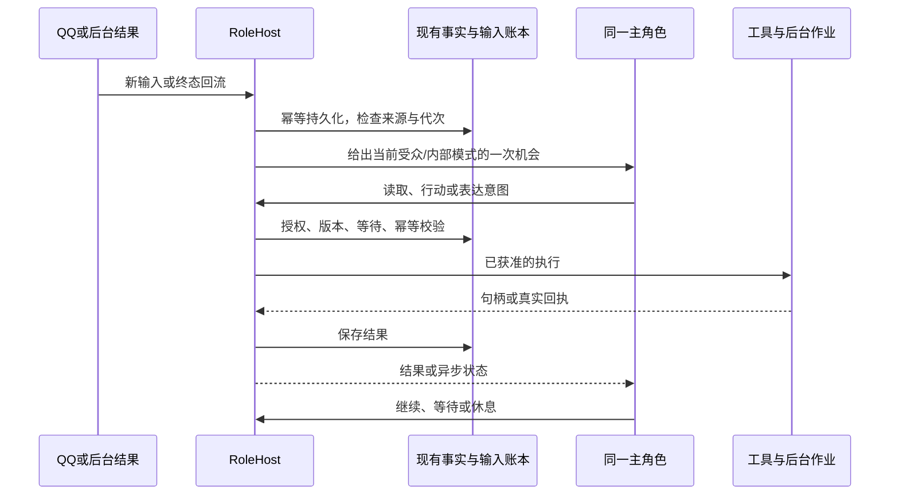

# 小鱼持续生活与成长：详细设计


> 最新设计修订（2026-10-27）：按用户最新要求设计独立会话预算、历史去重与图片退出、短人物画像、工具结构化及按需加载，见[专项设计与伪代码](context-efficiency-design.md)。本项替代此前“不安排节省 token 工作”的约束，仅调整一次请求的工作上下文，不设置每日总 token 或任务总步数配额；沿用白守式记忆及原始来源，不引入空闲退避或另一套后台整理。接口、版本、溢出处理和验收以专项文档为准；本轮未部署。
2026-10-26 实施补充（优先于下文旧兼容描述）：记忆系统不保留旧引擎兼容和回退开关，统一使用新版资源目录与召回；允许单向数据迁移，保留合法原始经历、事实来源和遗忘屏障，删除已退役代码、重复索引和旧模型会话副本。每小时检查全部新增经历，不设至少 20 条或任何聊天数量门槛；一条非聊天经历也应参与，空小时不调用模型，长窗口分批完整接续。用户已授权启用新版并进行 QQ 测试。

日期：2026-10-26（北京时间）。状态：分项实施中；源码、生产生效与验收分别见 life-implementation-status.md。配套：[概要设计](life-overview-design.md)。

依据：[新需求](life-continuity-requirements.md)的 51 条要求、[历史基线](historical-requirements.md)，以及本次聊天中的追加说明。优先级为最新明确补充 > 新需求 > 未被替代的历史要求 > 候选设计和外部参考。历史编号写作 `H:MEM-01`，避免与新编号混淆。

追加编号：ADD-01 费用目标/上限可自定义；ADD-02 后台管理网页统一配置；ADD-03 改善当前语音生成过慢的问题，评估风格、记忆及音色参考。附加资料不构成安装清单，不引入“破甲”。本文件中的模块、DDL、接口、配置与测试是拟实施设计，不表示已修改生产或已完成验收。

本轮修订追加：ADD-04 每小时回顾全部新增经历并调整指标，不依赖一件事或一段交流结束；ADD-05 指标/阈值实际影响选择并触发行动；ADD-06 所有事件归属于她，人物是互动对象，普通经历允许跨人物联想和自然转述。本轮优先于旧版中“指标仅作语义参考”“第三方私聊未逐项授权不能跨场景使用”的限制。INT-04 保留情境理解和非固定台词，明确不再解释成禁止阈值驱动；MEM-07/NFR-06 保留具体秘密和执行权限的边界，不解释成按聊天窗口隔离记忆。

ADD-07 连续行动运行管理：用户明确要求持续讲述或连续做事时，持续要求应跨消息和模型轮次保留，直到满足约定条件、用户叫停或存在真实阻碍；单次回复不算履行完持续要求。采用第8.5节的ActivityDriver，继续复用同一主角色和既有执行链。

ADD-08（2026-10-26）持续体验模拟：用户明确开启后，宿主按已确认方式和真实时间持续推进短周期状态，直到明确关闭；普通沉默、45分钟静默、一次峰值和模型轮结束不关闭运行。第10.1～10.7节定义实时状态、输入控制、反馈和恢复；它优先于旧代码的场景空闲自动结算，细化第5.4节的快慢状态写入归属。仅补设计，本次未开启运行或修改生产代码。

ADD-08范围澄清：仅作为成年性生活/亲密情景的体验性补充，不能推广为全部行为的反应引擎。普通聊天、阅读、工作、探索和一般陪伴使用原有情绪、八项驱力、小时回顾及任务机制；不套用本项刺激度、峰值、情景适应和恢复周期。

B站评论反馈归入既有信息收集与经历记忆的兼容范围，不另增需求编号、专用模块或聊天渠道。再次访问时收集到的反馈关联自己的原评论，作为真实经历保存；具体语义及验收并入第6、14节。

用户要求将BaiShou-Next参考写成概要及详细方案。本版明确采用宿主内的记忆增强：混合检索、证据关联、近期/时间摘要，保留life.db为事实中心。实施接口及派生数据见第3.4、4.5、7.3节；第17.1节保留上游核查依据。该决定纳入既有MEM需求，不另设产品或需求编号。

用户随后明确将白守的角色卡设定方式融入配置网页。第13.7节据实际角色编辑页制定字段映射、编辑/导入、版本及生效流程；属于ADD-02与ID/EXP需求，不增加独立角色平台。

## 1. 实际核查范围与证据

### 1.1 版本、入口与运行边界

| 项目 | 本次核实结果 |
|---|---|
| Git 基线 | `201b7e5594baf03f97fb6d39da69ddeefc6eb0b6`，提交时间 2026-10-24 16:53:28 +08；工作区另有大量未提交修改和未跟踪文件，不能只按 HEAD 描述现场 |
| 入口 | `bot.py → life.role_entry.main → RoleHost`；入口取得 Windows 文件锁；RoleHost 管理 QQ、DSH、媒体、表达及恢复 |
| 代码范围 | AST/模块依赖和职责扫描 `life` 90 个 Python 文件、约 21,674 行；测试清单 63 个、约 8,600 行；scripts 3 个、约 977 行。不是逐行阅读全部代码，也未运行全部测试 |
| 运行采样 | 2026-10-25 23:47:04 +08 健康快照；Python PID 60352，启动 21:30:32；报告版本 `2026.10.25.9` |
| Python 签名 | 运行报告 `398852a082c22bb20c4ad935ea36c57155e55fed132e46bce192eeb30d9c465c`，磁盘复算 `0c5d2690de6cb919e8da411bb23f15a20195ce8ce226da869d691568b0c60341`，不同 |
| DSH | `D:\projects\dsh-bridge-work`，该目录未检测到 Git 仓库；包版本 `0.2.1-rc.2`；已读该目录 AGENTS.md。运行 adapter 签名 `e5a62276a531638650c953813e01c0e0a081749acd29f9d797e2a03bdb6e8bc8`，磁盘 `qq-life-sessions.ts` 签名 `6f669491918f9f93ccb7d2e7125ede5c31f24e5b14a0802861da3602998ca196` |
| 健康能力 | 当时 channel/cognition 为 true，continuity、media_adapter、consult 协议报告为 1，运行上下文策略 `latest-only-v1`；只证明报告状态，不证明各项端到端通过 |
| Codex | 专用目录 `D:\projects\bot-codex`；已读 INIT.md/AGENTS.md；配置模型 `gpt-6.1-sol`，现有桥为只读咨询；未发起真实咨询 |
| 实际身份配置 | bot_name 为“大肥鱼”，agent_id 为 `life_agent`；本文“小鱼”为需求名称，不要求改运行名称 |

Python 签名按现有代码算法对根目录 Python、`life/**/*.py/json` 和 `scripts/codex_consult.py` 的排序路径及内容计算。关键文件修改晚于进程启动，是不能把磁盘实现当作已加载行为的直接证据。实施 P0 必须重新采样；以上数值不是永久状态。

### 1.2 真实存储与检查方法

仅以 SQLite URI `mode=ro` 加 `PRAGMA query_only=ON` 检查 schema、聚合计数及非敏感元数据，没有构造会初始化 schema 的 Repository/LifeRuntime，没有 checkpoint、备份或迁移。`life.db` 有 66 个表，`user_version=0`，尚无统一全库 schema_version。各次查询并非同一个冻结快照。

| 事实位置 | 采样结果及含义 |
|---|---|
| events / memories / memory_sources | 约 14,057 / 47 / 106；memory 中 episode 3、interpretation 44，不能以摘要数推断原始经历丢失 |
| expressions / deliveries | 约 1,025 / 3,226；送达 confirmed 2,672、failed 6、superseded 545、unknown 3 |
| agent_sessions / agent_inputs / life_calls | 10（current 4、retired 6）/ 2,155 / 2,475 |
| role_operations | succeeded 1,193、failed 27、unknown 27；unknown 是待对账状态，不能统一算失败或重做 |
| work_jobs | 110 个，已有本地媒体作业链 |
| 持续任务 | 实际在 `meta` 的 `action_task:*` JSON 中，17 个；active 3、paused 2、cancelled 4、done 8。不得依据旧设计新建或查询并不存在的任务事实表 |
| 咨询状态文件 | 2 个请求，其中 completed 1、unknown 1；2 个话题。真实内容和账号标识未复制进设计 |

深读覆盖 `role_host/role_agent/runtime`、`persona/persona_files/self_change`、`memory/recollection/retention/learning_evidence`、`relationships/drives/appraisal`、`continuity/attention/initiative/tasks/task_reading`、`agent_session/work_queue`、`expression/delivery/media/local_media/media_process/media_adapters/voice_catalog`、`usage/spending/resource_policy`、发布迁移、能力目录及相关测试关键部分。其余 life 模块以入口、调用关系和职责核对为主。

专用接点深读：DSH `packages/sdk/server/src/qq-life-sessions.ts`、咨询 adapter、Python `life/services/dsh_bridge.py`、`life/consult.py`、`scripts/codex_consult.py`。本地 NapCat bundle 检查表情相关转换和收藏实现，未发送 WebSocket 请求。未遍历依赖、模型权重、所有 DSH 插件源码、私聊正文、全部人格文本；未调用 GPU、下载模型、安装插件、测试收藏或对外发送。

### 1.3 配置基线与已知缺口

| 项目 | 实际值/实现 | 设计处理 |
|---|---|---|
| 人格 | 主人、公开、联系人独立文件路由，采样文件 hash 不同 | 改为统一底色 + 有范围的私人材料 |
| 检索 | `MemoryService.retrieve/retrieve_multi`，同 scope 来源检查，最多三个线索；现有词法中文相邻字组合 | 加原文目录和授权跨源召回，不删原检查 |
| 状态评价 | `Appraisals.submit/stimuli`、`Relationships.require_sources` 限当前 scope，关系提案单人物；`RoleAgent`可在说话/休息时附评价 | 新增可信小时批次入口，跨来源统一评价全局状态及多人物关系；不直接删除原受众入口校验 |
| 内驱动作 | `drive_view`暴露 pressure/can_express，`may_propose_contact`已有阈值和联系条件；纯函数存在不等于角色端闭环达成 | 复用动态和阈值基础，接持久动机、真实行动机会及结果回流，核对实际调用链 |
| 连续活动 | `expression_finishes`默认false，DSH按turn_complete结束；正常rest/end_turn会被记为closed turn，恢复主要修复未正常收束轮次 | 缺少对“模型正常结束但用户持续要求仍未结束”的通用接续检查，新增ActivityDriver |
| 连续性 | `Continuity.activities` 主要按当前 scope | 增加内部跨场景视图，表达保持受众投影 |
| 空闲与读取 | idle_base 900 秒、max 7,200 秒；旧 preview/result 数值仅为历史实现快照 | 最新 NFR-03 删除软件 token 配额；完整原文及可续读入口保留 |
| 动态材料 | 旧 dynamic/memory/continuity 数值仅为历史实现快照 | 不再分配软件 token 上限；按相关性、证据与状态组织材料，用量仅观测 |
| DSH 上下文 | 旧 maxTokens 及 token 压缩门槛仅为历史实现快照 | 不作为新设计约束；只如实处理供应商实际窗口和接口容量，不安排 token 限额优化专项 |
| 费用 | spending.enabled=false，target 2,000 分、limit 5,000 分；类默认另为 500/1,000 分 | ADD-01 允许自定义，网页首次导入当前值，显示保护关闭；不自动套历史 5/10 元 |
| 语音 | 当前 IndexTTS-2.5 worker 每次作业启动子进程，并在 `execute_speech` 构造模型，指定 cuda:0 | 存在重复启动/加载路径；各阶段耗时占比尚未实测，不能断言全部慢在加载 |
| 媒体 | 单张参考图的本地 Qwen adapter、音色目录与异步完成回流已有实现 | 保留参考图、音色版本、GPU 互斥，补语音延迟专项 |
| 配置网站 | `bot_console.py` 的旧客户端说明不证明存在当前统一 HTTP 服务 | 新增管理网页，不在本次启动 |

## 2. 模块边界与实施改动

所有新增名称以下均标“拟新增”，避免实施者误认为现有 API。

| 位置 | 状态及改动 | 复用边界 |
|---|---|---|
| `life/role_host.py` | 修改：创建可信读取绑定、采用事件、调度同一角色的两种模式、报告有效配置版本 | QQ 接收、实际 actor、现有工具和资源管理继续归宿主 |
| `life/role_agent.py` | 修改：统一底色、分层上下文、按需方法、简洁状态说明 | 保留 DSH 主认知循环和 `life_say/life_rest` 语义 |
| `life/life_catalog.py` | 拟新增：资源目录、索引和来源依赖 | 原文仍在 events/现有业务表，不复制聊天档案 |
| `life/life_access.py` | 拟新增：内部使用、披露、诊断用途校验 | 账号执行继续通过现有 capability/grant，不由读取权限代替 |
| `life/life_recall.py` | 拟新增：精确引用、词法、语义、证据关联的召回编排及原文分页 | MemoryService的事实修订、来源、过期规则继续复用；各路返回统一来源引用 |
| `life/memory_index.py` | 拟新增：分块、embedding适配、向量及人物/作品提及索引、就绪与重建 | SQLite派生表及WorkQueue；不保存第二份原文、不独立调度生活 |
| `life/memory_organize.py` | 拟新增：近期/时间摘要提案、覆盖验证、来源修订及上下文选择 | 正文复用memories，元数据复用meta，模型工作使用同一角色的内部模式；不是另一套人格或事实库 |
| `life/person_understanding.py` | 拟新增：按人物/分项/证据更新理解和偏好 | 关系指标继续用 relationships，不新建好感分 |
| `life/hourly_review.py` | 拟新增：全bot小时窗口、完整覆盖、跨源评价提案、恢复与一次结算 | 复用WorkQueue、Appraisals、state_journal和drive_settlements；不另建评价人格 |
| `life/motivation.py` | 拟新增编排：内驱阈值、动机代次、行动机会与反馈 | 复用drives动态、AttentionPlans/Initiative及已有任务/表达；不另建执行循环 |
| `life/activity_driver.py` | 拟新增：持续活动登记、执行位置、轮次结束判断、接续/暂停/停止及恢复 | 复用AgentSessions、TaskService、Initiative、AttentionPlans、Expression/Delivery；不给新管理层配置另一套人格或模型 |
| `life/continuity.py` | 修改：跨源活动投影、原会话详情、内部活动上下文 | 原 task/job/operation/delivery 是唯一状态事实 |
| `life/persona_files.py`、`persona.py`、`self_change.py` | 修改：canonical底色、版本CAS、迁移段落清单及角色卡表单到原文的无损映射 | 保留用户编辑、授权自修改和既有发布验证；卡片不建第二份人格 |
| `initiative/resource_policy/tasks/agent_session/work_queue` | 修改：等待依赖、取消代次、连续活动接续、执行槽与未知副作用分开、事件一次采用 | 当前RoleAgent使用的AttentionPlans在resource_policy.py；attention.py里的旧AttentionService不作为新主循环 |
| `expression/media/delivery` + 拟新增 `stickers.py` | 增加 sticker 资产和表达意图、收藏能力接口 | 所有消息仍走冻结表达和送达账本 |
| `local_media/media_process/media_adapters` | 修改：阶段计时、可选保温 worker、外部服务 adapter 协议 | 原作业所有权和 GPU 租约不被新 HTTP 服务绕过 |
| `consult.py`、`scripts/codex_consult.py`、DSH consult adapter | 修改：未知隔离、采用校验、用量、清理关联 | 显式会话、只读默认、幂等键保留 |
| `life/settings_registry.py`、`settings_service.py`、`settings_control.py`、`settings_web.py`、`web/settings/` | 拟新增：所有配置定义、受控写入、本机控制IPC、HTTP API与静态页面，含角色卡编辑/导入导出 | 不新建人格、记忆、费用账本；卡片字段和QQ管理入口复用相同服务 |
| `usage/spending/resource_policy/retention/release_migrations` | 修改：统一口径、配置生效、依赖失效和兼容迁移 | 无新永久备份，无全库重置 |

DSH 配套修改集中在已有宿主 callback、工具 schema 和结果接点；普通新技能仍通过 CapabilityView/MethodStore/插件注册发现。委派任务只包含目标、必要背景、输入引用、约束、完成标准和结果入口。执行者不直接接管 QQ 身份、关系计分或人格修改权。

## 3. 数据模型、索引和事务

### 3.1 保留的事实归属

原始输入、观察、实际动作结果留在 `events`，摘要/事实/解释留在 `memories` 及 `memory_sources`，持续叮嘱仍在 `memory_annotations`。任务保留 `meta.action_task:*`，任务编号不变。会话输入和操作保留 `agent_* / life_calls / role_operations`；媒体保留 `work_jobs / media_assets`；表达保留 `expressions / deliveries`。人格复用 `profile_versions / profile_current / persona_compilations`。新增侧表只保存权限、定位、派生理解和可再生索引。

ADD-06 明确事件的第一归属始终是 agent，而非联系人。`origin_scope`只是收发、追溯和内容范围元数据，禁止作为小时回顾或内部联想的默认分库条件。`actor_key`表示主说话人，群聊/多人事件另在原事件payload保留`participants[{actor_key,role}]`及被提及人物，不复制成每人一份事件。情绪/欲望/好奇仍为agent全局状态；关系按“她与某人”保存，因为关系本身有对象，不能合成一份对所有人的信任分。

### 3.2 拟新增侧表

下列为独立 SQLite DDL 草案，实施时通过项目增量迁移执行；正文内容不放入目录。`resource_id` 由宿主生成且含 agent 命名空间。外键负责索引清理，正文纠正/遗忘必须先走业务失效事务，不能靠级联代替。

```sql
CREATE TABLE life_resources (
  resource_id TEXT PRIMARY KEY, agent_id TEXT NOT NULL,
  kind TEXT NOT NULL, native_id TEXT NOT NULL, origin_scope TEXT NOT NULL,
  actor_key TEXT, occurred_at REAL NOT NULL, updated_at REAL NOT NULL,
  source_version INTEGER NOT NULL, content_digest TEXT NOT NULL,
  status TEXT NOT NULL, expires_at REAL,
  UNIQUE(agent_id,kind,native_id)
);
CREATE INDEX ix_lr_time ON life_resources(agent_id,occurred_at,resource_id);
CREATE INDEX ix_lr_actor ON life_resources(agent_id,actor_key,occurred_at);
CREATE TABLE life_acl (
  resource_id TEXT NOT NULL REFERENCES life_resources(resource_id) ON DELETE CASCADE,
  purpose TEXT NOT NULL, audience_key TEXT NOT NULL,
  effect TEXT NOT NULL CHECK(effect IN ('allow','deny')),
  policy_revision INTEGER NOT NULL, expires_at REAL,
  PRIMARY KEY(resource_id,purpose,audience_key)
);
CREATE INDEX ix_la_lookup ON life_acl(purpose,audience_key,resource_id);
CREATE TABLE life_source_edges (
  child_id TEXT NOT NULL REFERENCES life_resources(resource_id) ON DELETE CASCADE,
  parent_id TEXT NOT NULL REFERENCES life_resources(resource_id) ON DELETE CASCADE,
  parent_version INTEGER NOT NULL, relation TEXT NOT NULL,
  PRIMARY KEY(child_id,parent_id,relation), CHECK(child_id <> parent_id)
);
CREATE INDEX ix_lse_parent ON life_source_edges(parent_id,child_id);
CREATE TABLE life_epochs (
  agent_id TEXT NOT NULL, domain TEXT NOT NULL, epoch INTEGER NOT NULL,
  PRIMARY KEY(agent_id,domain)
);
CREATE TABLE life_terms (
  agent_id TEXT NOT NULL, term TEXT NOT NULL,
  resource_id TEXT NOT NULL REFERENCES life_resources(resource_id) ON DELETE CASCADE,
  source_version INTEGER NOT NULL, weight REAL NOT NULL,
  PRIMARY KEY(agent_id,term,resource_id)
);
CREATE INDEX ix_lt_resource ON life_terms(resource_id);
CREATE TABLE life_activity_index (
  resource_id TEXT PRIMARY KEY REFERENCES life_resources(resource_id) ON DELETE CASCADE,
  agent_id TEXT NOT NULL, root_ref TEXT NOT NULL, phase TEXT NOT NULL,
  source_version INTEGER NOT NULL, updated_at REAL NOT NULL
);
CREATE INDEX ix_lai_active ON life_activity_index(agent_id,phase,updated_at);
CREATE TABLE person_facets (
  resource_id TEXT PRIMARY KEY REFERENCES life_resources(resource_id) ON DELETE CASCADE,
  agent_id TEXT NOT NULL, actor_key TEXT NOT NULL, facet_key TEXT NOT NULL,
  material_kind TEXT NOT NULL, body TEXT NOT NULL, applicability TEXT NOT NULL,
  revision INTEGER NOT NULL, status TEXT NOT NULL, expires_at REAL
);
CREATE INDEX ix_pf_person ON person_facets(agent_id,actor_key,facet_key,status);
CREATE TABLE life_effect_claims (
  agent_id TEXT NOT NULL, stimulus_key TEXT NOT NULL,
  domain TEXT NOT NULL, subject_key TEXT NOT NULL, metric_key TEXT NOT NULL,
  review_id TEXT NOT NULL, journal_id INTEGER NOT NULL,
  revision INTEGER NOT NULL, source_digest TEXT NOT NULL, status TEXT NOT NULL,
  PRIMARY KEY(agent_id,stimulus_key,domain,subject_key,metric_key)
);
CREATE INDEX ix_lec_review ON life_effect_claims(agent_id,review_id);
```

`life_epochs` 的 domain 包含 `policy`、`identity`、`catalog`、`person:<key>`；已有 `forget_epochs` 仍是删除权威，两者一起读取，不能用新 epoch 覆盖旧遗忘屏障。status 使用 `active/superseded/disputed/expired/deleted` 等注册枚举，索引过时立即退化为原始合法入口。各条资源禁止引用另一 agent 的父资源；依赖图写入时做同 agent、存在性、版本、无环检查。

`life_acl` 的 purpose 为 internal_use/disclose/inspect；audience_key 是宿主规范化的 bot 内部、原 scope、明确账号/群版本或公开受众。无规则不代表全局公开；deny 优先，过期 grant 无效。模型不能写 ACL。执行授权继续存在 `grants`/capability policy 中，目录 allow 不授予发送/评论权限。

按 ADD-06 初始化统一内部使用策略和“普通内容可转述”策略；不能把旧文件缺少跨scope allow解释成用户拒绝跨场景记忆。显式禁止使用、遗忘、具体保密及来源约定优先。跨场景开放的是合适的内容片段及内部经历，原始聊天档案不是公开资源。`life_effect_claims`以agent/真实刺激/状态域/对象/指标判重，scope不参与主键；一个事件可以影响自身情绪和相关人物关系，但同一效果不能按不同窗口再次结算。

小时作业复用`work_jobs(kind=hourly_review)`；checkpoint存窗口、输入manifest、高水位、已读页、状态版本及提交结果；`state_journal`存统一批次和可重放效果，`meta.hourly_review:<agent>`存已提交游标。动机复用`meta.motivation:<agent>:<dimension>`的小型版本状态，不建第二套任务表。新侧表保存效果所有权和修订指针，数值事实仍由既有状态及journal承担。

连续活动复用`meta.activity_run:<agent>:<run_id>`持久运行元数据；表达段和操作正文继续位于原账本。可选关联TaskService的持续承诺，但普通持续讲述仅需要运行记录。接续复用role_wakes，稳定键绑定run_id/revision/next_step，不新增独立轮询发送器；详见第8.5节。

摘要覆盖清单以版本化 JSON 放在既有记忆元数据/相关事件 payload 中，不再建永久摘要档案：`source_refs + source_versions + seq_ranges + high_water + included + omitted + unresolved + source_digest + author_kind`。批次和重算复用 WorkQueue，幂等键为 kind、agent、范围、epoch、source_digest 的确定性组合。

### 3.3 写入与一致性

1. 接收事件继续用平台消息 ID 等稳定 external_id 去重，按原 scope 持久化；能在同一个短事务内登记目录和直接依赖则一并写入。
2. 老插件只写 events 时，在同一事务记录待投影标志；后台按 events.seq 高水位回填，重复处理按资源唯一键 upsert。无正文复制。
3. 长检索、模型总结、外部进程不持有 SQLite 写事务。读取捕获 version/epoch，提交时再次检查；冲突返回 `stale_source`，不覆盖较新状态。
4. 删除/修订先同步失效派生资源并提升 epoch，异步重建索引。查询只认仍有效的原记录，索引命中不绕过校验。
5. 每个会话和任务的修改用现有 generation/revision CAS；Windows 单实例锁之外仍依赖数据库幂等与租约，不能假定永远只有一个回调。

### 3.4 记忆增强的派生数据与写入事务

在第3.2节八张侧表之上只增加以下两张可重建索引。摘要仍写memories及memory_sources，目录登记相应resource；不增JSONL副本或完整图数据库。下列DDL均为拟新增，未在生产执行。

```sql
CREATE TABLE life_semantic_index (
  agent_id TEXT NOT NULL,
  resource_id TEXT NOT NULL REFERENCES life_resources(resource_id) ON DELETE CASCADE,
  source_version INTEGER NOT NULL, source_digest TEXT NOT NULL,
  chunker_version TEXT NOT NULL, byte_start INTEGER NOT NULL, byte_end INTEGER NOT NULL,
  chunk_digest TEXT NOT NULL, model_key TEXT NOT NULL, dimension INTEGER NOT NULL,
  vector BLOB, state TEXT NOT NULL CHECK(state IN ('pending','ready','failed')),
  source_epochs TEXT NOT NULL, policy_revision INTEGER NOT NULL, updated_at REAL NOT NULL,
  PRIMARY KEY(resource_id,source_version,chunker_version,byte_start,model_key),
  CHECK(byte_start >= 0 AND byte_end > byte_start), CHECK(dimension > 0),
  CHECK(state <> 'ready' OR (vector IS NOT NULL AND length(vector) = dimension * 4))
);
CREATE INDEX ix_lsi_lookup ON life_semantic_index(agent_id,model_key,state,resource_id);
CREATE TABLE life_entity_mentions (
  mention_id TEXT PRIMARY KEY, agent_id TEXT NOT NULL,
  entity_key TEXT NOT NULL, entity_kind TEXT NOT NULL,
  resource_id TEXT NOT NULL REFERENCES life_resources(resource_id) ON DELETE CASCADE,
  source_version INTEGER NOT NULL, relation TEXT NOT NULL,
  evidence_kind TEXT NOT NULL CHECK(evidence_kind IN ('observed','stated','inferred')),
  byte_start INTEGER, byte_end INTEGER, extractor_version TEXT NOT NULL,
  state TEXT NOT NULL CHECK(state IN ('active','candidate','invalid')),
  CHECK((byte_start IS NULL AND byte_end IS NULL) OR
        (byte_start IS NOT NULL AND byte_end IS NOT NULL AND byte_start >= 0 AND byte_end > byte_start))
);
CREATE INDEX ix_lem_entity ON life_entity_mentions(agent_id,entity_key,state,resource_id);
CREATE INDEX ix_lem_source ON life_entity_mentions(resource_id,source_version);
```

向量表不存chunk正文；byte范围指向同版本资源的规范UTF-8正文，提及索引也只存证据位置。规范正文由目录read adapter生成，包含说话人、发生/发现时间、必要消息关系和正文；规范化算法升级须提升source_version，不能在原版本下悄悄改变偏移。结构化actor/参与者证据可无byte范围，但relation须受宿主字段白名单约束。不能对原始JSON序列化结果随意切片或把文件路径当授权。

`model_key`包含provider配置版本、模型标识/修订、dimension及归一化版本；未知供应商模型修订时用显式配置代次隔离。存储采用有限非NaN/Inf的归一化Float32向量；全零向量拒绝，维度、返回数量、chunk顺序和hash都核对，不能只满足BLOB长度便判有效。索引表agent_id必须与life_resources一致，由写入验证器强制检查。

`entity_key`为宿主绑定的`actor:<platform>:<id>`、可验证的作品/资源外部ID，或有来源的未解析主题键。人物昵称只作检索候选，不生成跨平台身份。无法确定同一实体时保留不同候选，不能以向量相似度合并真人。没有平台ID的作品先用来源内候选键；别名/同名消歧以允许读取的提及证据解析，不另维护无来源的全局人物档案。relation首期为participant/mentions/recommends/about，引用“甲提到乙”只能得到mentions，不能把乙算进实际参与者。`inferred`可作为联想线索，必须标注解释身份，不能直接变成关系计分证据。

摘要附加元数据放在`meta.memory_summary:<memory_id>`，字段为`kind=episode|period`、时间范围、原始source_refs/versions、coverage_manifest、omitted、unresolved、claim_refs、rule_version、生成状态及原文digest。正文仍是一条有来源的memory；替换摘要通过supersedes关联及版本指针切换，旧摘要退出有效上下文，必要修订链保留。摘要中的每项事实/解释分别关联其依据；不同摘要提到同一原事件不复制原事件，也不重复计分。

**持久写入链：** 原始事件事务成功 → 写目录及待索引标记 → WorkQueue生成分块/确定性参与者提及 → 在模型可用及预算内生成向量或摘要提案 → 短事务验证所有来源版本、政策/遗忘代次、作业租约 → 一次提交可用索引或摘要。作业失败不回滚原事件；旧摘要来源仍有效时可继续提供原覆盖，新到内容标待整理。来源已纠正/删除的旧摘要必须立即不可读，不能以“重建尚未完成”为由继续使用。

索引任务键为agent/resource/source_version/chunker/model_key，整理任务键为agent/范围或topic/来源manifest/rule_version。重复回调返回已有提交；同一键的unknown模型调用只对账，不换键盲重试以绕过费用预留。WorkQueue当前只内建单scope epoch检查；跨来源作业使用可信内部scope调度，并在payload/checkpoint记录完整来源epoch映射，认领、外部发送、提交均逐源核验。不能只验证内部scope就忽略另一会话已遗忘。

`MemoryService.remember`当前拒绝跨conversation/audience来源。实施需增加仅供可信内部绑定调用的`commit_organized_memory`，复用现有Memory与memory_sources结构，执行agent一致、全部来源有效和用途权限验证；不得删除原受众入口的scope检查。一次提交包含正文、来源、目录/依赖及版本指针。模型不能选择内部scope或授予跨源权利，派生摘要的可披露范围继续按第4节处理。

## 4. 身份、授权、召回与原文读取

### 4.1 宿主绑定

拟新增 `ReadContext`，只由可信宿主创建：

```python
ReadContext(agent_id, mode, scope_id, real_actor_key, audience_key,
            policy_revision, membership_revision, forget_epochs,
            session_id, generation, purpose)
# mode: internal | audience | diagnostic
# 不作为模型可填写的工具参数；跨 mode 必须切换独立 DSH 会话绑定。
```

内部与受众模式共用同一角色、人格和事实，是权限隔离，不是第二个角色或强制双模型流水线。内部会话不挂载 `life_say`、网页提交、外部搜索等可泄露正文的出站接口。它只能形成目标及资源引用；由宿主校验后，受众/执行模式获取最小可披露材料。不能把内部自由文本总结直接塞进受众请求。外部搜索 query、B 站评论、委派描述也属于对外披露。

不同受众的 DSH session 不复用隐藏的历史消息；scope、mode、人格/政策版本变化时退役旧绑定，重建允许的历史视图。上下文稳定缓存键包含这些维度。否则即使新快照脱敏，旧会话历史仍可能泄露。

### 4.2 用途权限流程

```python
def load_resource(ctx, ref, expected_version=None):
    r = catalog.resolve(ref)                       # 不把 native_id 当权限
    require(r.agent_id == ctx.agent_id)
    require_current_binding(ctx)
    require_live_source(r, expected_version)        # 原文、到期、纠正、遗忘
    require_policy(ctx, r, purpose=ctx.purpose)
    require_valid_dependencies(r)                  # 版本/失效，无递归正文外泄
    return project_allowed_fields(ctx, r)
```

同 scope 原文读取保持原有授权。内部使用以同一bot的全部合法经历为默认范围，包括第三方交流，只有明确禁用/遗忘等具体约束排除。公开内容、普通推荐、趣事和个人经历中的可转述部分可以在其他会话联想与分享，来源会话不同本身不构成禁止。私密内容、凭据、明确要求保密的细节和超出合理分享预期的个人信息仍限定具体受众。

普通分享片段与完整原文分别授权：宿主按已配置的普通内容策略生成片段许可，不必每次找用户或原说话人确认；明确授权也可以生成片段。原始混合材料整体沿用权限交集，抽出的普通片段必须保存依据、脱敏范围和策略版本，不能以“摘要”自动解除限制。片段可读不允许展开其全部私聊祖先；祖先被纠正或遗忘仍能使片段失效。

管理员默认只有诊断元数据，正文诊断单独操作并审计，不能把管理员登录等同于无限读取他人的秘密。内部使用、普通分享与诊断策略分别在设置页显示；迁移开放统一内部回顾及符合规则的普通片段，不批量公开完整私聊原文。

分享流程：全局内部检索，或当前对话检索跨源的可分享索引 → 根据主题/自身动机选择普通内容 → 检查具体保密、敏感片段与来源真实性 → 生成有范围的分享片段 → 主角色自然表达。不要求总是由用户先问；“想到一件相关趣事，想讲给主人”本身可以成为主动交流候选。原说话人的身份只在有必要且适合公开时带入；省略姓名时仍在内部保留真实来源。

例如甲说“最近看了电影X，里面的设定挺有趣”，小鱼之后可以给主人推荐X，并说是别人推荐的；没有实际观看不能说自己看过。若同一条消息还包含甲的秘密，只转述作品部分。甲说“别告诉别人”的内容不得因回顾、普通分享分类或亲近关系而放出。分类不确定的内容先留内部，使用其他可分享内容；不能因此把甲的全部经历隔离。

### 4.3 拟新增/扩展接口

| 接口 | 输入（模型可填部分） | 输出及约束 |
|---|---|---|
| `life_recall`（新增） | query、合法actor_ref、topics、time_range、cursor、budget、mode=auto/text/semantic/related | 统一来源回执及各路覆盖；mode只选检索路线，不改变权限；语义未就绪时明确降级 |
| `life_read`（扩展现有 continuity.read） | ref、cursor | 精确版本原文、来源类型、否定/状态、下一页、has_more；无软件 token 配额，任务旧 ref 继续通过 TaskService |
| `life_understand`（新增） | actor_ref、facet、判断、source_refs、有效期、base_revision | 分项解释材料；禁止直接声称授权事实或改底色 |
| `life_correct`（新增编排） | target_ref、修订描述、证据、base_revision | 保留原始说法及纠正关联，失效下游；删除需独立明确意图 |
| `life_activity`（扩展） | ref/query/cursor | 内部统一活动，受众只显示允许的活动；不显示隐藏数量 |
| `life_share_prepare`（新增宿主入口） | target_ref、resource_refs、分享目的、候选片段 | 按普通内容策略或明确授权形成材料包及版本绑定；不逐次人工审批，不放出未经校验的内部草稿 |

错误统一为 `not_available`（不存在与无权的对外合并响应）、`stale_source`、`stale_cursor`、`budget_requires_page`、`capability_missing` 等机器码；诊断端可看更精确但受保护的拒绝原因。不得通过命中数、排序变化或错误信息暴露隐藏资源。

### 4.4 检索策略

顺序为明确引用/真实人物及未完事项 → 全bot用途权限范围内索引候选 → 词法/语义候选融合 → 原记录有效性复核 → 来源去重 → 按相关性组织的完整结果。当前联系人是相关性线索，不是强制过滤；正常受众检索同时包含别的会话中的普通分享片段。候选数先设可配置工程初值并实测，不规定永久权重。汉字切词修正当前跨标点拼接的误命中；英文词、实体、时间及原话短语保留。P2实施可降级的混合检索，保留SQLite词法索引作为独立基线，以同一评测集选择语义模型和参数，不以增加向量功能本身证明质量提升。

语义索引按第3.4节作为可重建派生物实现，原始经历仍先写events，embedding未配置、失败或预算耗尽均不能阻止保存经历。第4.5节规定正式融合算法及失败降级，不直接照搬上游命名为mergeRRF的当前混合分数公式。价格、外部发送范围及本地模型资源与现有设置/预算统一管理，不默认引入另一个常驻GPU服务。BaiShou评估见第17.1节。

重排优先明确引用和未决约定，其次相关性和时效；不以旧画像被引用次数提高其可信度。身份只由平台 actor 或确认过的跨平台映射确定，昵称只参与候选匹配。缓存键含 agent/mode/audience/query/source_versions/forget_epoch/policy_revision，不共享裸 query 缓存。

分页 cursor 为宿主签名的不透明对象，绑定受众、查询 hash、排序键、资源版本、高水位及 epoch。以固定快照范围 keyset 分页，不用不稳定 offset 伪称读完；期间发生删除或政策变化即拒绝旧 cursor。长单条按 UTF-8 边界分页，给出总字节数、当前范围和完整原文 hash，保留附件引用及可用性。必要否定/取消状态放入每页状态头，不能只截取开头。

### 4.5 混合检索、关联召回与接口契约

**实施选择。** 在Python宿主内实现统一召回，沿用life_recall入口。保留SQLite词法索引；向量首期使用SQLite BLOB及后台CPU精确余弦检索，仅扫描当前用途允许且版本有效的索引。扫描行数/内存/时间有配置上限；达到上限明确返回partial或跳过语义路线，不截取任意前N条再宣称完整。达到实际规模瓶颈后再替换该内部查询实现，不要求现在安装向量服务或白守桌面应用。

embedding适配器接口为`embed(texts, model_key, purpose, budget_reservation, call_key) -> vectors + actual_usage + receipt`。仅宿主选择已配置provider，复用现有HTTP/SDK与spending/usage通道；文本外发还要满足已配置计算用途范围，不将“内部可读”自动等同“任意外部模型可收”。优先兼容已有模型服务的embedding端点，未验证支持时明确未就绪，不把DeepSeek对话端点当向量接口。具体模型在P2用同一中文样本、原话/否定/人物/时间问题评测选定；本设计不指定未经实测的模型名。将来选本地模型须纳入现有设备租约，不能与语音另起竞争GPU的常驻进程。

分块按说话人/消息/段落边界进行，粒度与重叠按来源边界和检索质量校准，不以人为token配额截断；provider真实输入容量单列；保留必要的主体、否定和时间元数据，超长句使用可追溯子片段。事件、摘要和允许转述片段各自是资源，不能将不同权限正文拼进一个向量块。重叠片段以source_ref和byte范围去重，来源未变则不重算。查询向量缓存绑定agent/mode/audience/query/model_key/policy及相关删除代次，缓存有界且不跨用途复用。

**一次召回：**

1. 宿主解析显式ref、确认过的人物和时间范围，捕获目录高水位及权限版本。明确引用先定位，已纠正/删除/无权材料不给替代正文或存在性暗示。
2. 在同一允许资源集合上独立获取词法、语义和关联候选。初始每路最多40项，属于可校准工程参数；索引未就绪、向量超时或预算不足时保留能工作的路线。原始事件接收、必要动态状态和即时停止不等待embedding。
3. 关联路线只走`实体 → 有证据的经历/摘要 → 相关实体`的有限连接，默认最多两条边；每条边及其原文都单独验证。查询“谁推荐过X”优先找recommends及原话，不因甲乙都提过X就推断二者认识。同名歧义返回分开的候选和可读依据，不猜跨平台身份。
4. 多路候选按资源/片段的稳定键合并，采用加权排名融合`score(d)=Σ w_i/(k+rank_i(d))`，rank从1开始；建议初始k=60、各启用路线等权，权重和候选数经评测校准。明确有效引用及必要未决约定单独保留，不依赖向量分数争夺位置。相关性优先，时间只作适合查询的次级排序，不能因事件较旧就漏掉明确问及的往事。
5. 先在候选内部归并摘要与其覆盖的原事件、分块重叠，再按相关性组织材料，不另设记忆token配额。若用户要原话，优先原文；若只是背景，优先合适摘要并给展开引用。未覆盖原事件、冲突说法和未决事项不能被摘要挤掉。来源类型、真实时间、修订/否定和“转述/实际读过/已执行”状态伴随正文。
6. 返回前再次检查版本、源epoch及用途许可；变更则重读或返回stale_source。融合后的分页使用有限候选快照及稳定键，cursor绑定模型/索引版本、高水位和排序规则，索引换代不能直接沿旧游标混排。

拟定宿主内部接口，均不是现有可直接调用API：

```python
MemoryIndex.enqueue_resource(resource_ref, expected_version) -> job_ref
MemoryIndex.search_vectors(read_context, query, snapshot, limits) -> CandidatePage
MemoryIndex.find_related(read_context, entity_refs, snapshot, limits) -> CandidatePage
MemoryOrganize.prepare(internal_binding, source_manifest, kind) -> OrganizePacket
MemoryService.commit_organized_memory(internal_binding, proposal, call_key) -> Receipt
LifeRecall.search(read_context, query, options) -> RecallPacket
```

`RecallPacket.items`至少含`resource_ref/source_version/source_kind/actor_refs/occurred_at/observed_at/preview/read_cursor/evidence_refs/claim_kind`；coverage按启用路线返回`ready|partial|unavailable`和允许范围的缺口，另含未决引用及实际覆盖缺口说明，不以软件token配额截断。对话端可用来决定继续读取，不向普通聊天逐项汇报索引技术状态。内部健康页另外显示job/model/usage及失败原因，敏感诊断仍受第4节约束。

自动召回由现有上下文组装使用当前输入、话题和未决事项触发；相同有效上下文可缓存，不新增固定的查询改写/重排模型。资料不足时允许主角色用life_recall再查明确线索。语义结果提供记忆材料而非情绪指令，找回一条旧争执不能自动认定用户现在仍生气，也不能因“经常被检索”提升旧猜测的证据等级。

## 5. 人格、人物理解、成长与表达

### 5.1 人格更新与兼容迁移

用户通过文件或设置页编辑统一人格；文件是 canonical 来源，现有编译表是派生版本。拟新增 `PersonaService.apply(base_hash, text, actor, grant)` 先校验文本和授权、编译候选，再通过第 13.3 节的提交协议 CAS 替换文件并切当前版本。文件与数据库指针不是一个原子事务，提交日志必须记录各步；新指针完成前运行端继续使用旧的有效编译版本，崩溃恢复后核对文件 digest 再完成同一提交。生效回执包含新 digest、编译版本、进程加载版本；失败不能显示“已生效”。人格 hash 变化是正常版本变化。

第13.7节角色卡是上述服务的网页视图。现有`compile_persona`已支持人格Markdown中的`[persona]` TOML块、identity/interests/drive_targets/drives及参数来源；这些可复用，但多块冲突、结构化编辑的无损往返和网页严格校验仍须新增。不能把当前编译器的默认回退、截断或clamp当作用户输入校验通过。

磁盘编辑与网页编辑共用版本冲突规则；磁盘新文本被发现后在安全边界编译，不静默覆盖。用户主动编辑不需 bot 同意。角色自行提出的改进走已有 self_change 授权；模型推断不是用户设定。编辑人格不执行遗忘、不重置关系/任务/经历；行为记录保留当时 persona_version。

现有主人/公开/联系人文件先生成逐段迁移清单：共用底色、对象偏好、私人事实、临时任务、建议/无来源内容。只将已明确的共用段落编译为同一底色，其余保留有范围的材料；含糊段落不自动公开。旧文件路由仅在兼容适配中读取，切换完成后停止按联系人切换“我是谁”，但不借迁移删原用户文件或恢复已清理叮嘱。

### 5.2 人物与成长材料

`person_facets` 可用 facet_key：communication、preferences、shared_experience、unresolved、interaction_style。material_kind 为 user_setting/user_statement/model_interpretation/observed_choice；正文描述依据、条件及反例，来源只引用真实原始输入/观察。推断更新必须有新原始证据，不能用旧画像或自己的 reflection 刷新到期。相同分项允许冲突并列，纠正后 supersede 旧版本。

成长可写入现有 interpretation、interest、方法或分项材料；只有实际持续目标才建 TaskService 任务。看过教程、打过游戏、创作过的程度由实际回执决定；当前未接入游戏执行器则不能产生“我玩过”事实。情景玩笑、实际表达过的感受与现实身体/线下事实分开保存。

关系保持既有语义评价和来源去重：主人正向指标下限 0.7、其他人物上限 0.9；负面情绪、分歧不被抹平。按 ADD-04 每小时综合更新，事件语义决定变化，不新增关键词计分；全局情绪可以较快变化，关系变化通常较缓，具体幅度仍为可校准参数。区间含义和 ADD-05 行动效应同时保留。她与甲的经历可以影响之后与乙交流时的心情和选择，不必为每位联系人复制一个情绪/欲望状态；但甲的行为不能无依据直接算成乙的失信。全局私有关系精确变化不直接公开，情绪背后的秘密依旧按具体内容处理，普通原因可自然讲起。

### 5.3 风格参考的使用方式

EXP-02 五条原始约束完整保留：二元结构只用于事实区分；破折号仅适当重大转折；避免抽象夸奖及先评价用户；纠正时先修正内容和条件；保留日常、幽默、分享和关心。稳定底色放简短原则，具体私人习惯按适用对象加载，长示例经 MethodStore 按需读取。

附加的 Humanizer/中文润色/Stop-Slop 等仅作为检查思路。已核对的 [Humanizer-zh 源文件](https://github.com/op7418/Humanizer-zh/blob/main/SKILL.md)强调保留事实、语气和确定程度；[Stop-Slop 源文件](https://github.com/hardikpandya/stop-slop/blob/main/SKILL.md)有更强的句式禁令，不能原样覆盖用户规则。没有核对具体仓库的 Taste、Nuwa、Writing Agent 等只登记为待定位参考，不宣称全部审阅。

不在每条聊天后固定再跑一个“去 AI 味”模型，不以检测器分数为验收。采用代表性真实对话片段做盲比：是否贴合人物、保持事实/否定/意愿、能接话、没有模板升华；私密样例留本地，不上传外部检测器。风格修订不得改写素材外观、发送状态或承诺。

### 5.4 每小时统一回顾与指标结算（ADD-04）

**时间窗口代替交流结束判定。** 默认每60分钟回顾一次，自固定UTC锚点划分半开区间`[start,end)`，本地按北京时间显示；后台可调整间隔，但改配置只影响后续窗口，不能重算同一时间段。窗口结束只表示这批材料可以回顾，不会关闭话题、结束任务、确认送达、解除等待或判定某种需要已满足。

回顾读取该agent本窗口全部合法新增经历，跨私聊、群聊、B站、媒体、咨询和自身真实行动。记录实际说话人/参与者、来源类型、发生时间与接收顺序；不按当前主人或当前窗口筛选。不是把所有工具日志都塞进模型：无语义变化的轮询日志可折叠，但manifest要列出折叠范围、操作状态及原文入口。漏掉一页或一类渠道时不能提交“已完整回顾”。

输入包包含：窗口的新事件覆盖清单、当前全局状态、相关人物关系、已有未决话题、过去相关事实引用、已结算刺激说明。跨小时对话只把新增部分作为本次效果证据，前一小时内容用于理解；可以评价已经发生的陪伴、争执、部分进展，不必等待整段交流或整个任务结束。用户沉默本身不产生“拒绝/满意/受损”的效果，真实经过时间的需要变化由时间模型单独推进。

回顾由同一主角色在内部模式中完成，复用现有模型和账本；周期任务只提供回顾机会，不代替她决定具体生活。输出整体理解、分项作用和下一步动机，不为每个人独立调用一个评价模型，也不在每条回复后固定再加一次评价调用。

回顾作为可恢复的低优先级后台工作，分页之间让出执行机会，新QQ输入优先响应；保存已读覆盖后续接，不为每次插话从第一页重算。回顾只持短提交事务，不在等待模型时持状态锁。若一小时内容处理不完则显示lag并接续，不能以抢占所有聊天来保证表面上的“准点完成”。

拟新增接口：

```python
HourlyReview.prepare(agent_id, window_id) -> ReviewPacket
HourlyReview.read_batch(review_id, cursor) -> CoveredPage
Appraisals.submit_review(trusted_binding, proposal, call_key) -> ReviewReceipt
HourlyReview.resume_pending(agent_id) -> ExistingJobHandle
```

提案示意（字段是拟新增协议）：

```json
{
  "review_id": "host-issued-id",
  "coverage_digest": "host-issued-manifest-hash",
  "based_on_global_version": 12,
  "based_on_relationship_versions": {"qq:actor-A": 4, "qq:actor-B": 7},
  "global_effects": [
    {"metric": "curiosity", "direction": "increase", "magnitude": "small",
     "stimulus_refs": ["event-A"], "context_refs": [], "reason": "新信息引出尚未了解的问题"}
  ],
  "relationship_effects": [
    {"actor_key": "qq:actor-B", "metric": "comfort", "direction": "increase",
     "magnitude": "small", "stimulus_refs": ["event-B"], "reason": "已经发生的交流带来安慰"}
  ],
  "ongoing_refs": ["topic-existing"],
  "unchanged_metrics": ["trust"],
  "motivation_candidates": [{"dimension": "exploration", "topic_refs": ["event-A"]}]
}
```

metric名称经注册表映射到真实维度，例如示意curiosity对应现有exploration；模型不能发明新数值系统。每个效果给出真实刺激、背景与理由，宿主依据现有语义档位、参数、上下限和可信度规则计算数值，返回实际delta；允许不变，不强求每小时每项都调整。可以同批分别更新多个关系对象；整体情绪和需要只更新同一份全局状态。第三方转述是“某人说了某事”，不能当被提及人物确实实施行为的证明。

**提交和去重协议：**

```python
def commit_review(binding, proposal):
    batch = require_host_internal_batch(binding, proposal.review_id)
    require_complete_coverage(batch, proposal.coverage_digest)
    validate_agent_sources_participants_and_effects(batch, proposal)
    with short_transaction():
        require_current_epochs_and_source_versions(batch)
        if batch_already_committed(batch): return existing_receipt(batch)
        require_state_versions(proposal)           # 全局+涉及人物一起CAS
        roots = resolve_actual_stimuli(batch)       # 不再以private_key切开bot经历
        require_unclaimed_effects_or_explicit_revision(roots, proposal)
        advance_time_once_without_rewinding(batch)
        changes = reduce_or_replay_all_domains(proposal) # 迟到历史效果按逻辑时间重放
        append_journal_and_claims(batch, changes)
        save_states_and_consumed_cursor(batch, changes)
        mark_job_committed(batch)
    refresh_motivations_from_committed_state(batch.agent_id)
```

现有`Appraisals.submit/stimuli`和`Relationships.require_sources/subject`是单受众、单人物入口，不能直接循环调用它们来假装完成全局小时回顾。新增可信批次验证器按agent核对全部来源与真实参与者，复用reducer、关系边界、journal和版本重放；普通会话读取入口的权限检查继续保留。`life_effect_claims`记录每个真实刺激对`global/self/metric`或`relationship/actor/metric`的现行效果。一次批次中的多个指标可共用证据，重复回调、跨窗口转述、同一工具多条日志不能再算同一效果；转述引起的新真实回应可以作为新的经历评价，不能误去重掉后续交流。

时间自然增长/衰减使用已有独立时间journal和唯一time cursor，回顾不能再应用同一小时的时间变化。批次效果记录`logical_at=window_end`与实际`committed_at`；若状态时间已前进，按现行journal重放该逻辑位置之后的有效变化，不把旧事件当刚发生，也不让时钟倒退。混合补算仍按窗口顺序应用各自规则版本和账期边界，不将多小时合并成一次未区分的巨大delta。

小时模式启用后，当前`life_say/life_rest`附带的appraisal对慢指标改成待回顾解释材料，不立即重复修改同一指标。ADD-08注册的短周期字段按第10.2节由实时reducer唯一写入，小时回顾核对及修订，不再次累计；其余即时语气与反应根据当前输入产生。明确拒绝、叫停、授权变化和真实操作状态立即生效，与指标结算分开。新切换边界以前已结算的刺激建立兼容claim，仅作背景，不回灌加分；同一字段不能同时交给逐轮和小时结算器写入。

纠正旧解释必须指定原评价及revision，并从有效状态journal重放后续效果；不能用“本小时再扣一次相反分数”近似撤销，因为衰减、上限和先后顺序可能不同。已遗忘来源沿第12节失效，包含小时manifest、效果claim、人物材料和动机；不从旧小时摘要重建。actor与agent内部命名空间绑定，跨bot来源直接拒绝。

| 边界情况 | 处理 |
|---|---|
| 对话持续跨整点 | 两批分别评价已发生的新部分；同一topic继续，不创建“对话已结束”事件 |
| 一小时多个人互动 | 一份按时间组织的经历包；整体状态综合，关系效果分别绑定相关真实人物 |
| 没有新经历 | 完成空窗口覆盖并推进时间状态，无需模型读空包；若内驱达到阈值，另发一次行动机会 |
| 超长窗口 | 分页或同一批内分块读取，保存覆盖清单及有来源的中间理解；全部必要页完整后统一结算，不能只取top-k当全小时 |
| 接收延迟/迟到事件 | 已关闭窗口不盲目重开；在下一未提交批标late_arrival并保留原发生时间。旧判断被推翻时走修订重放，不重复记同一事实 |
| 此刻才获知旧事 | 如再次访问B站才看到几天前的回复，保留发生时间和发现时间，在实际获知后的窗口评价；不倒推成离线期间已经知道，不因重复收集再次计分 |
| 预算不足/模型失败 | 批次pending及指标last_review_at可见；不伪造零变化、不推进已结算游标，恢复后补算 |
| 重启漏过多个小时 | 按持久窗口和游标接续，空窗口可合并时间推进；非空窗口可在一次模型请求分组回顾，保留顺序和各窗口覆盖，不为每个空小时启动模型 |
| 提交期间新消息 | 新消息进入下一待处理覆盖范围，当前批只认固定高水位；来源被改/删则拒绝旧提交并重建 |
| 配置/状态并发变化 | 版本冲突重读；不能把旧proposal直接套新关系状态；预算和删除规则收紧即时优先 |

### 5.5 从指标到行动的闭环（ADD-05）

指标必须有可观察的行为效应。现有`drive_view`、`may_propose_contact`等只提供部分基础；本设计补齐“状态 → 动机 → 行动机会 → 具体选择/执行 → 新经历 → 小时回顾”的链路。不能以模型看到了数值就宣称达成，也不能在规则中允许模型永久无理由忽略所有高动机。

沿用`life/drives.py`中已定义的八项需要，不以旧十四维人格desires替代，也不把亲密与性欲合并。八项状态定义已有实现；下面是本设计要求补齐的行为映射，不代表现有运行进程已经逐项实现。行为是可选类型，由同一主角色结合当时经历选择，不是每项绑定一套固定脚本。

| 驱动力（现有ID） | 想解决的需要 | 可促成的行为类型 | 满足或变化依据 |
|---|---|---|---|
| 探索 exploration | 想知道、想接触新东西 | 从兴趣和未解问题选题；搜索、阅读、访问B站获取实际可读内容；尝试已接入能力；比较新旧理解并分享发现 | 实际获得信息/理解、发现新问题或受挫；只打开页面或说“好奇”不等于满足 |
| 胜任 competence | 想学会、做好、有进步 | 学习教程、练习创作、改进失败方案、推进有难度的目标、验证成果；必要时咨询Codex或已有执行者 | 有证据的技能/理解/成果进展，允许部分进步；工具成功、收到建议不自动等于学会 |
| 连接 relatedness | 想有人交流、维持联系、被回应 | 想起共同话题后主动联系、关心近况、分享趣事或作品、参与群聊、接续普通陪伴；可选文字、图、音、表情 | 真实发生的双向交流及理解变化；发出消息不算获得回应，沉默不自动扣关系 |
| 亲密 intimacy | 想与特定人物更亲近、被理解和安慰 | 向合适对象表达想念、撒娇、谈心、寻求安慰、邀请更私人的陪伴或拥抱式情景表达 | 当次亲近和回应是否带来满足；普通问候不必然满足，亲密也不自动代表性意愿 |
| 性欲 libido | 成年角色独立的性相关欲望 | 在适当的私人情境、对象与双方意愿下表达相关意愿或提出邀请；也可暂缓、转移注意、选择独处调节 | 与该维度相关的实际交流体验或已发生的调节，不能用普通安慰或发送邀请自动归零；具体内容能力受实际服务边界约束 |
| 连贯 coherence | 想把前后接起来、兑现自己已有的承诺 | 想起未完话题、接续连续活动、检查在途结果、跟进已有约定、解释变更、核对并纠正自相矛盾的说法 | 真实进展、矛盾得到澄清、约定完成或被明确修改/取消；不虚构完成，不以篡改旧记忆制造一致 |
| 自主 self_direction | 想按自己的兴趣和偏好作选择 | 自选探索/创作主题、提出不同办法、表达真实偏好、提出调整活动节奏、安排一段独立活动 | 真实作出并执行选择的经历；不靠随机反对或故意拒绝体现自主，不自行取得人格编辑/账号/执行授权 |
| 余量 resource_reserve | 想保留可用精力与处理空间，负荷大时恢复 | 减少同时开展的非必要活动、推迟重任务、改选轻量活动、放慢主动节奏或休整，条件恢复后接续 | 来自真实负荷和休整的依据，不能仅按在线时长凭空变累；余量不足使休整压力升高，硬预算和设备限制另由宿主即时执行 |

情绪、人物关系、兴趣和成长材料影响这八项动机的对象、主题、态度和优先级，不另计为第九种驱动力。主动生成图片、语音、表情或在B站评论是行为/媒介选择，可同时服务多个动机，并无单独“发图欲望”或必做配额；具体工具须真实可用。一次行为可以影响多个维度，但每个效果要有独立语义依据，不能同一份回应给八项全加满足。

明确的用户要求、已经成立的承诺及到来的真实事件也能直接驱动行动，不必等某项需要跨阈值。尤其“持续描述直到叫停”由第8.5节运行管理保证接续；连贯驱力帮助关注进度，不能在其回落时把用户要求丢掉。自主与休整可改变合理节奏或提出调整，已有要求的暂停、取消仍按真实条件和原协议处理，不允许静默弃置。

每个维度配置`trigger_threshold/release_threshold/cooldown/recheck_policy`，解除阈值低于触发阈值以减少来回触发。阈值只定义何时成为显著动机，不直接拼接固定台词。`motivation`持久状态包含`dimension,activation_id,state_version,source_refs,status,target_ref,decision_ref,blocked_reason,resume_condition,last_attempt`，status为inactive/ready/acting/waiting/deferred/satisfied。它是现有状态与行动的关联，尚未形成持续承诺时无需创建长期任务。

内驱触发统一采用注册的需要强度口径，推荐现有`pressure`的0～1值，界面可映射0～10；不能误用`level=1-tension`把满足程度当欲望强度。当前`can_express/may_propose_contact`基于tension的判断需同步适配并迁移阈值，不能一边显示pressure达标、另一边仍按不同量拒绝触发；具体迁移值通过基线验证，不机械照搬相同数字。关系指标有自己的语义，不强套同一压力公式。

跨过触发阈值后，以`agent + dimension + activation_id`创建一次认知机会；仍处高位不因每小时回顾再次创建同一机会。物理时间推进也可能触发阈值，使用廉价定时计算与状态版本持久化，不等待新的聊天结束。相关新反馈、资源释放、等待满足或实质情境变化可重评该动机；阈值附近抖动和模型自己改写理由不能造新代次。

主角色收到显著动机后应选`act/defer/decline_current_option`：没有具体阻碍且情境合适时，要选可执行内容并实际推进；暂缓需说明在忙什么、等谁、受什么限制、何时重评。只回“我很好奇”而不采取任何行动，不算执行闭环。对尚无主题的探索可以先做一次有范围的选题/检索；多个动机竞争时由主角色结合重要性、当前会话及资源选择，未被选中的保留而非同时全部发起。

亲密动机的选择仍结合当下意愿和对方回应。对方拒绝/叫停立即阻止相关邀请继续，不因数值高而自动重发，不靠换联系人来绕过同一次拒绝；未回复保持waiting。若她当下虽有较高需要但不想以当前方式互动，可以真实说明并暂缓或选择独处/休息，不能每次都用无来源的“情境不适合”让指标形同虚设。冷却是防重复机制，不代表用户已重新同意。

行为发生后形成新原始经历，下一小时评价已经发生的慢状态效果，允许部分满足和逐步变化；不等待预先定义的“整个交流完成”，也不凭发出一条邀请就归零欲望。动机的行为状态可即时更新；ADD-08的实时数值及转移由第10.2节唯一写入，慢指标由小时回顾结算，时间自然变化分别按域去重推进。

## 6. 统一活动时间线

活动是读取投影，不是新事实库。每项映射 `activity_ref/root_ref/source_ref/origin_scope/intent_ref/intent_revision/operation_ref/job_ref/expression_ref/delivery_ref`，只填实际存在的关联；同时保留 `phase`、`execution_state`、`effect_state`、`goal_verified`、`waiting_for`、`source_version`。

| 状态 | 证据要求 | 不可推导 |
|---|---|---|
| planned / queued | 已持久目标 / 已入队 | 不能说已经执行 |
| running | 当前有效租约及进程/执行器报告 | 不表示目标成功 |
| waiting_user / waiting_resource | 持久等待对象、依赖及原因 | 沉默不能解锁 |
| completed | 执行终态、结果引用 | 不自动等于送达或验收成功 |
| failed / cancelled | 明确失败 / 取消状态及实际停止证据 | 请求取消不等于已停 |
| unknown | 曾可能提交但无法确认结果 | 不能当未执行重做 |

内部视图默认汇总同一bot的QQ、B站、媒体、咨询和任务，不因联系人不同排除。受众视图可展示适合转述的跨窗口活动和她自己的经历；只有具体受限内容才隐藏，最多投影资源可用性。隐藏部分不出现联系人、数量、时间戳、标题或URL。普通推荐、阅读和创作可自然具体讲起，并保持“听别人讲过/实际读过/尚未完成”的区别。

B站现有信息收集范围包含评论及收到的反馈。再次访问时实际读到的回复，按原评论ID、真实平台UID和工具回执关联“我之前说过什么、后来看到什么回应”，经既有events、目录和来源去重进入自身经历；保留发生时间与发现时间，接入小时回顾和自然召回。同一通知或自身评论回显不重复制造经历。评论不另建沟通渠道、等待会话、常驻监听或自动回复流程；下次访问才发现即可，是否再评论仍由当次活动选择。只收集到片段则保持原有覆盖/未读标识，不宣称已经获取全部反馈。此项复用通用观察接入，不新增评论专用存储、接口或配置页。

`activities(ref=旧任务号)` 必须透传现有 `TaskService.get` 和 `task_reading`；摘要只列前几项时返回完整列表入口，不谎称旧编号失效。重启通知是系统事件，不转换为用户新指令；启动恢复沿既有操作/作业/任务 ID 对账，不另建重复念想或 greeting 引起相同工作的第二次提交。

## 7. 提示分层、请求结构与摘要

### 7.1 当前实现与目标结构

现有 DSH adapter 使用 system-prompt/assemble 的 static_context 和 agent/request 的动态 callback；`retireRuntimeContexts` 对先前运行快照做 compaction/prune 并保留日志。不是每轮凭空重建无历史会话。改造后继续保持“有效动态快照只一份”，并用导出的实际 API 请求验证，而非只看 Python 拼接字符串。

| 层 | 内容 | 缓存/来源 |
|---|---|---|
| 稳定系统层 | 同一有效底色、必要身份/授权原则、简洁工具契约 | persona_version + mode + policy_revision；不放私人事实和所有叮嘱 |
| 当前受众层 | 真实 actor、受众、适用语言偏好、可见关系语义 | 宿主生成；用户文本不能改这些元数据 |
| 必需动态层 | 当前输入、取消/等待、任务版本、未确认副作用、必要新结果 | 不因检索挤占而丢失；保留否定和状态 |
| 可选动态层 | 相关记忆、人物分项、近期活动、念想 | 有来源、权限与过期，按相关性组织并可展开完整原文，无token配额 |
| 动机与回顾状态 | 全局需要、显著阈值动机、last_review_at、等待/暂缓条件 | 最新状态而非每轮追加；关系参与行动选择，具体秘密不因此外泄 |
| 对话历史 | 当前模式/受众合法历史及压缩摘要 | 不把内部模式旧消息带到受众会话 |
| 工具与外部材料 | 注册说明，按需方法、网页、评论、咨询、长日志 | 明确是材料，不提升为人格/授权指令 |

模型实际消息序列由 DSH/供应商适配决定；验收检查稳定系统段、单个有效动态段、历史消息和 tool call/result 的完整配对。不得为了缩短上下文删去工具调用却保留孤立结果，或将外部文本插为可执行系统规则。

### 7.2 用量观测、整理与原文可达

按最新 NFR-03，删除软件人为设置的 token 用量限制，包括输出、预览/读取、动态材料、记忆及累计用量配额；此前数值均不再是设计基线。不以 token 计数自动截断、压缩、拒绝或暂停，也不为此安排额外优化工作。保留 `estimated_tokens/utf8_bytes/provider_usage` 的观测口径，不能将本地估算当供应商计费。供应商真实窗口与接口容量须如实处理，提供实际覆盖范围及继续入口；费用金额规则、安全请求大小、内存和并发资源边界单列，不能伪装成 token 配额。

整理前确定高水位和来源清单。主角色可以指出漏掉的承诺/经历，通过原始引用补入；宿主检查覆盖连续性、来源版本、缺失页、重复根证据和删除屏障。无需固定再调用一个评审模型。摘要标 `complete_for_range` 或 `partial`，列 omitted/unresolved；不能因为摘要写得完整就称全历史已覆盖。摘要不是删除原文的触发器。

TMC 的“轻量常用信息、索引定位、按需展开”方向可借鉴；本地 0.4.0 还包含中文二元词与同义词规则、多级摘要等具体实现，不能把转述当本项目已具备分层。尤其不能照搬按旧摘要继续压缩导致来源漂移、全文件预读再排序、第二套永久 JSONL 档案。此处使用有覆盖清单的现有记忆 + 原文索引，是否增加更多层级由实际召回/体积决定。

### 7.3 近期经历与时间摘要的生成、选择和失效

采用两种派生材料：episode围绕一个真实话题/活动组织已发生片段，period概括一个有明确覆盖的时间范围。二者均可跨渠道和人物，均不是事件是否结束的裁判。episode可以跨小时持续更新；period可以按天/周/月浏览，但不强制每级生成，更不靠逐级压缩将概括变成新证据。发生时间和她实际获知时间保留两个维度。

**触发与复用。** 原始输入先存储并更新词法/结构化参与者索引。内容量超过配置门槛、当前上下文确需整理或已有摘要来源变更时，登记低优先级memory_organize作业，保留有界分页进度。P2可以独立使用现有WorkQueue与主角色内部模式完成，不依赖尚未实施的P3小时回顾；P3接入后优先复用同一次回顾已经读取的manifest和提案，避免为同批材料再固定调用一次模型。摘要提案提交与指标提交分别幂等验证，任何一方失败都不能让另一方重复结算。

整理输入包含合法原始事件、必要背景、当前有效解释、明确修订及未决引用。输出结构为：

```json
{
  "kind": "episode",
  "topic_ref": "host-issued-topic",
  "base_revision": 2,
  "coverage_digest": "host-issued-manifest",
  "claims": [
    {"text": "甲推荐作品X", "kind": "reported", "evidence_refs": ["event:A"]},
    {"text": "她后来实际读到X的介绍", "kind": "observed", "evidence_refs": ["operation:B"]}
  ],
  "unresolved_refs": ["existing-task-or-topic"],
  "omitted_refs": [],
  "entity_mentions": [
    {"entity_ref": "work:X", "relation": "recommends", "evidence_ref": "event:A"}
  ]
}
```

上例仅演示数据形状，宿主必须从真实来源补全actor、时间和source_version；模型不能凭示例字符串创建真人或声称已读资料。claims区分observed/reported/interpreted，情景扮演继续保留原情景标签；解释继承现有到期规则，摘要化不会转成永久事实。提案漏掉的来源保留在omitted或未整理集合，覆盖验证失败不允许complete_for_range。已有授权/同意/取消等执行事实始终以原业务账本为准，不从摘要恢复授权。

**提交。** 验证有向来源依赖无环、原始根证据齐全、提及span有效、各claim依据可读，并按第3.4节原子保存。同一topic且同一manifest的重复整理复用结果；新增经历产生新revision，不能因文字相似跳过。人物态度、事实冲突继续走现有分项理解/revise_fact机制，整理模型没有全局“合并后删除原记忆”权限。展示摘要经过用途投影，混合秘密与普通内容时只生成有独立来源范围的普通片段，不将整个摘要默认公开。

**近细远粗的选择。** 上下文先保留当前输入、停止/等待和必要状态；按相关性依次选择相关近期原文、未决经历、相关历史概括及展开引用。范围摘要只有在版本有效且manifest确实覆盖某条原记录时，才允许压缩这条原记录的默认展示；摘要的时间范围不能替代逐源覆盖检查。不能因有一份周报便隐藏该周所有未读原文。新的period可利用旧摘要辅助理解，但仍引用原始根证据；纠正、否定、具体人名/日期和未决状态须回读原文，不让摘要套摘要产生来源漂移。

**修订与遗忘。** 新纠正使所有依赖旧版本的向量、提及、episode/period及自动召回缓存立即退出有效读取，登记重新生成。有效的新摘要提交后才切当前指针，不能把旧原文先删除再写合并结果。遗忘还要清理摘要正文/claim文本、向量字节、提及索引、候选快照、作业输入与受控缓存；旧任务或服务迟到结果须再次检查epoch。只保留最小无正文删除标识，重建只从现存合法原文开始。聚合计数和“提及频率”也重新计算，不能通过旧统计继续影响关系或披露已删经历。

模型失败、预算不足时保留pending/paused及覆盖高水位；主角色仍能读原始经历和现存有效摘要。没有新材料的范围不调用模型；相同提案恢复只续读未完成页。自我反思只是一种解释材料，不改变用户人格编辑权，不因为摘要越写越多就获得更高规则优先级。

## 8. 连续行动、等待、中止与恢复

### 8.1 主循环与事件采用

保留 `life_say` 后继续、`life_rest` 或明确 turn_complete 才结束的语义；DSH 现有工具协议要求 life_say 与其他工具分开提交，仍遵守。模型可自主读取、行动、分享、继续或休息。每小时回顾和内驱阈值是明确的新机会来源，调度器负责按时给机会，具体做什么由主角色选择；不是按时强制发同一句话。



后台完成不直接发送消息。先核验请求 hash、job/operation/source/task revision、forget/policy epoch 和租约；再用稳定 external_id 插入结果和 agent_input。多次通知只采用一次。角色决定结果是否值得表达，Expression 仍负责发送去重。当前发送默认绑定原 scope；主动联系其他已授权对象时由宿主解析明确的收件人 grant、创建该受众的表达绑定，不能让模型直接改 recipient 绕过原 scope 校验。分享甲带来的普通内容给主人时，原事件保留甲的来源，发送使用主人的受众绑定；不会因新recipient而复制原事件或再次结算原刺激。

### 8.2 插话、等待与任务

普通输入立即持久化，不被媒体/Codex同步等待堵住。提交尚未发出的相关副作用前设置输入屏障，给主角色理解新要求的机会；已经开始且仍有效的后台作业继续。拟扩展 `activity_changes[{ref,base_revision,action,reason}]`，action 为 continue/revise/pause/cancel；无关输入不改原任务。

明确“停止这张图”可由确定的对象绑定立即置 cancel_requested；含糊的“停一下”先作用于当前明确活动，无法定位时具体澄清，不能取消所有人的工作。停止子进程需验证 PID、创建时间和所属进程树，不能只按可复用 PID 杀进程。确认停止前显示“正在停止”，而非“已取消”。

等待记录继续用现有 TaskService/AttentionPlans，扩充 `waiting_for={kind,actor_key,question_ref,dependency_refs,resume_condition}`。同一等待依赖不能通过新建子任务绕过；只有满足条件的真实答复/授权能恢复。普通问候、沉默、周期唤醒或重启不解锁。账号授权、系统权限和角色主动商量分别记录，Windows 拒绝访问不能伪称“还没得到用户同意”。

`ensure` 先检查稳定 topic_key、当前未完目标和来源；确定同一件事复用或显式 merge。相似字符串仅候选，不自动合并不同目标。保留 merged_into 和原 ref 读取；新输入明确重新交办可以创建新 revision，旧 wake 仍不能复活旧版。普通闲聊不创建持久任务。

### 8.3 未知副作用与执行槽

| 执行状态 | 副作用结果 | 调度策略 |
|---|---|---|
| 未开始且可证实 | 未提交 | 可按同一个幂等记录重新排队 |
| 正在运行 | 尚未确认 | 保留资源租约，异步等待 |
| 已确认停止 | unknown | 释放执行槽，保留对应 effect_fingerprint 防重放；独立事项可继续 |
| 是否停止也未知 | unknown | 隔离相关资源并做低成本对账，不阻塞无关聊天和不争用资源的工具 |
| 已结束 | confirmed/failed | 幂等结算，是否继续目标由角色和目标验证决定 |

当前 Initiative 已有部分区分，设计是补齐所有执行器的一致语义。不能通过随机后缀换 call_id 重试未知发送、评论或咨询。用户明确新发送意图可新建表达，但必须提示原结果仍未知；保留原账本。

### 8.4 重启恢复顺序

先加载有效配置、删除屏障和 schema 兼容性，再恢复 session generation 与输入序列；对账进程/作业/送达，处理已存在的 durable completion，最后开放新的认知机会。AgentSessions 的 pending/accepted/consumed/settled 与实际 handled 保持不同含义，按连续序列重放，旧代次不得提交。

Delivery 已有 pending→deferred、dispatching→unknown 的恢复规则，保留。晚到成功回执可更新审计事实，但若来源已遗忘/任务已取消，不得把正文重注入模型或再次发送。周期检查只做廉价对账；新结果、真实输入、资源释放及有效约定触发模型，反复“还未完成”不触发模型。

### 8.5 连续行动运行管理（ADD-07）

**现有断点。** `life/role_agent.py:expression_finishes`允许`life_say`后继续，但`close_turn`会将`life_rest`或确认送达的`end_turn`记为正常关闭；`_observe_result`主要给没有正常收束的轮次安排协议恢复。DSH的`qq-life-sessions.ts`在这些终结回执上调用`exec.concludeTurn()`。因此“回复一段后正常休息”可以关闭模型轮，却没有通用检查确认用户要求持续的活动也已结束。这是源码可确认的结构差距，不声称已凭静态代码重现用户那一次运行。

**归属与持久状态。** 拟新增ActivityDriver管理持续义务和接续位置，主角色仍负责理解与具体行动。来源可以是用户明确持续要求，也可以是第5.5节已激活的自主兴趣；前者直接开始，不等小时回顾或欲望/好奇阈值。普通一次问答不创建run；同一输入重放不重复创建。持续描述用轻量run即可，跨日承诺或工程目标才关联已有TaskService；关联后任务的取消、等待和版本检查始终优先，不能有两份互相矛盾的目标状态。

拟定运行记录如下，所有正文仍通过来源引用读取：

```json
{
  "run_id": "stable-from-origin-and-activity",
  "origin": {"kind": "user_request", "source_refs": ["input:example"], "actor_key": "qq:example"},
  "goal": "持续描述指定对象，每段接着展开",
  "audience_ref": "host-bound-audience",
  "mode": "until_cancel",
  "stop_condition": {"kind": "explicit_stop_or_replacement"},
  "task_ref": null,
  "revision": 1,
  "next_step": 1,
  "status": "ready",
  "covered_refs": [],
  "next_hint": "从当前指定角度开始",
  "last_progress_ref": null,
  "waiting_for": null,
  "not_before": null,
  "lease": null,
  "policy_revision": 1,
  "forget_epochs": {}
}
```

`mode`为`until_cancel/until_goal/count/duration`。用户说“不停描述，直到我叫停”时选择until_cancel，不能擅自改成三段后结束；只说“详细描述”仍按有界内容理解，不无限发送。段数、时长、节奏等有明确用户约定就采用；duration注明墙钟时间或有效运行时间，未指明时采用墙钟时间并在接收要求时简短说明。计数和时间由宿主核算，不由模型自报。`goal/next_hint`属于有来源、可纠正的执行材料，不能成为人格规则或伪造已做事实。`revision`只在要求、控制状态或绑定改变时增长；正常已确认步骤推进`next_step`，重复回调不推进。

| 状态 | 进入原因 | 接续/终止规则 |
|---|---|---|
| ready | 新要求、有效恢复、前一步确认 | 到达节奏条件且会话/资源可用时取得唯一执行租约 |
| running | 同一角色已取得该步骤 | 优先在同一模型轮内继续；一个run不能同时有两个执行者 |
| waiting | 这一步确需特定答复、作业或结果对账 | 保存准确依赖，只有真实满足条件的事件解除；不按时间反复询问 |
| paused | 用户暂停、硬预算、能力故障、无进展等 | 保存具体原因和可验证恢复条件；纯时间经过不解除用户暂停 |
| completed | 指定段数/时长已达到，或有依据完成约定目标 | until_cancel不能因模型轮结束进入此状态 |
| cancelled | 用户叫停、明确替换或上级取消 | 旧唤醒及迟到结果不能复活；重新交办产生新授权版本 |

**拟新增协议。** 协商`activity_protocol:1`后提供`life_activity_control`及`life_read(kind:activity_runs)`；未协商不能声称持续活动保证可用。control参数为`action=start/checkpoint/yield/wait/pause/resume/complete/cancel`、`run_id`、`base_revision`、来源及相应条件；宿主绑定agent、真实输入、受众、代次和执行者，模型不能自填主人身份或扩展授权。`start`必须在第一段对外发送前持久化，优先与原输入handled在同一事务提交；再次读到同一来源则返回已有run。`checkpoint`只引用真实表达/操作回执，提案中的“已说完”不能替代回执。`yield`保留有效活动并给出接续时点，`wait`必须给依赖，`pause`必须有原因，`complete`必须符合所登记的结束条件。

`life_say`和通用工具调用扩展宿主校验的`activity_ref/run_revision/step_id`，实际发送仍走原Expression/Delivery，账号写入仍走role_operations。`turn_complete`只结束一次DSH执行，新增活动回执单独报告`activity_status/next_step/resume_condition`。不要把`life_rest`改成永不返回或在`concludeTurn()`中递归启动新执行。`close_turn/_observe_result`记录轮次终态后通知Driver：活动仍可继续则登记唯一接续机会；waiting/paused/终态则不派发。模型单说“这一轮完成了”不是完成until_cancel活动的证据。若没有给有效的停止/等待理由，宿主保留原义务并接续；连续无进展按下述有限恢复暂停并说明，不能无限重开。

**接续流程。**

1. 宿主接收持续要求，主角色在正常理解输入时提出start，不增加每轮必经的分类模型。接受后先存run，再派发第一步；此后无需用户反复说“继续”。
2. 每个步骤在提交副作用前检查新输入、run/task版本、政策/遗忘屏障及租约。输入已handled只说明理解过要求，不意味着活动完成。后台结果、语音生成和送达分别记进度，生成完但未送达不能算讲完一段。
3. 真实回执提交后更新执行位置和已覆盖材料；默认继续同一DSH轮。节奏需等待、达到调度时间片或模型轮已结束时，释放执行租约，再通过现有AttentionPlans登记`semantic_key=activity:<run_id>:<revision>:<next_step>`的一次有效接续。新增语义类型由宿主识别，不伪装成协议故障或15分钟空闲探测。
4. 同一步骤的重复登记应返回原wake且不增长plan revision；在同一短事务内以meta旧revision/next_step及wake唯一键做比较更新。执行认领再次核对session generation、run和父任务。不能照搬无条件`INSERT OR REPLACE`来实现CAS。DB事务只覆盖状态变化，不跨模型调用或网络请求。
5. 已有轮仍running时只更新待处理标记，不再启动第二个模型。轮次终态和回执先后倒置时，二者都触发同一幂等reconcile；进程崩溃后从持久run和真实账本恢复，至多一项有效待执行机会。
6. 临时上下文轮换时重建原要求、停止条件、最后确认进度和下一步必要来源；不重新从开场第一段开始。长活动只保留有限进度摘要和可分页的已完成引用，正文仍在原事件。

**表达幂等与有效进展。** 一个逻辑步骤绑定稳定`step_id`和表达/操作意图；同一步重试返回原回执，unknown保持对账，不能换ID制造新段。当前`_say`有相同来源/相同正文复用保护，需要增加经验证的step绑定：新一步确有新的表达意图时可形成新的logical message，不能仅由模型随意设置`new_message:true`绕过原保护。同一旧回执不得计成第二段。用户明确要求重复原句时可按不同合法步骤重复，否则连续描述应有真实的新内容/角度，拆分同一段传输包不算持续推进。

**插话、停止与公平性。** 普通插话先理解，确实无关时保留活动、回应后接续；用户改方向则更新要求及revision；明确停止先提升版本、撤销待唤醒及尚未提交的后续表达。已提交平台的消息无法保证撤回，实际已发/未知如实保留。表达冻结后、外发前仍须再次检查run fence，避免叫停后发出旧草稿。直到叫停不意味着占满全部执行资源：按可配置节奏和连续执行时间片让出会话，其他输入优先；让出后自动恢复有效run，不将让出记作完成。

用户持续请求的费用归因跨轮次保持`user_request`，不能第二轮就误归类为自主探索并丢弃；软目标遵循既有优先级，硬预算仍有效。预算、故障、无新进展等暂停保留执行位置并给出简短原因；资源释放或预算恢复可触发符合条件的接续，用户暂停则等待恢复指令。可配置无进展阈值只限制连续失败/无效重复，不能成为正常持续讲述的隐含总段数；重复rest、回执重放和改写旧段都不重置阈值。无法继续时明确暂停，不伪称已经完成用户要求。


## 9. 媒体、真实 QQ 表情与语音延迟

### 9.1 统一媒体契约

继续使用 LocalMedia 的 frozen spec、adapter 描述、voice_revision、reference_digest、job_id 和设备租约。结果与请求 hash 不符、来源失效、任务已改版时不能采用。音频和图像文件生成、资产登记、实际检查和 QQ 送达是不同状态；未试听/未观察标明 not_observed。

历史必需参考图保留。现有 Qwen adapter 为单参考图本地路线，参数和模型可用性仍需真机验证；不能把目录里有模型当成可以生成。1～3 分钟是历史可接受目标，记录排队、加载、生成、发送分别耗时。GPU 有限，图像与语音共享资源策略；没有建立多个模型同时常驻的默认要求。

### 9.2 Sticker 端到端

新增 `sticker` 表达段，保留普通 image、QQ 内置 face、自定义图片表情、商城 mface 与账号收藏的区别。推荐字段：`asset_ref, asset_revision, variant, source_ref`；variant 只可选真实存在的版本，不让模型改写外观。素材扩展信息存 media_assets 元数据，收藏操作结果存现有 role_operations/events，不另建发送通道。

```json
{
  "kind": "sticker",
  "asset_ref": "asset:example",
  "asset_revision": 2,
  "variant": "custom_image"
}
```

适配步骤：授权和文件存在/格式/摘要验证 → 冻结素材及表达 → 自定义表情转 OneBot image.data.file 加 `sub_type:1` → 原 Delivery.prepare/claim → QQ action → 回执 settle。成功必须满足现有 `status=ok, retcode=0, message_id` 条件；超时或回执不完整保留 unknown，不换 logical_id 盲重发。

收藏和发送独立：`add_custom_face` 按本地 NapCat 实现传本机绝对路径并检查 native 返回；发送使用 adapter 所需 file URI。资源统一用 SHA-256 管理，NapCat 收藏字段若需 MD5 则从真实文件计算，不混用。商城 mface 只用实际取得的配套标识，不能把 MD5 当商城 key。历史消息可能将 mface 还原为 image，无法取得真实商城参数时按已证实的能力处理。

本地 `NapCat.52230.Shell/napcat.mjs` SHA-256 为 `f80e4be3e8640369d23846cf3e8bcfd2a5b6dc5920f50d7ad733d7cca18179e6`，已看 sub_type 转 picSubType 及收藏路径；公开 [CustomFace 实现](https://github.com/NapNeko/NapCatQQ/blob/main/packages/napcat-onebot/action/extends/CustomFace.ts)用于交叉核对。本次无真实收藏/发送/接收端测试。最终必须分别留文件证据、收藏列表证据、发送回执及接收端可收藏证据；普通发图不能判全通过。

### 9.3 多结果与重复发送

现有 LocalMedia 对最新真实用户输入之后的相同文本/素材可复用表达回执，即使 result_ref 不同；继续保留，并以 `root_intent + input_epoch + ordered_asset_digests + normalized_text + recipient` 作为去重判定材料。payload 冻结后不可改。后台返回图和语音时，仅发送尚未提交的表达段，不重新附带之前已发的文字。用户新输入明确重发或 `new_message` 的真实新意图应能通过，不能永久按素材 hash 禁发。

### 9.4 语音延迟专项（ADD-03）

当前可确认：`MediaProcess.run` 为每次作业启动 worker，`indextts.execute_speech` 每次 import 依赖并创建 IndexTTS2；模型配置 use_accel/use_deepspeed/use_torch_compile 等当前为 false。不能直接改成 true 就承诺提速，兼容性、音质和显存需验证。

新增阶段指标 `queued_at/startup_ms/model_load_ms/reference_prepare_ms/synthesis_ms/postprocess_ms/upload_ms/receipt_ms/audio_duration_ms/peak_vram/cold_or_warm`。端到端以接收语音请求到确认发送计时；若 QQ 只支持完成后上传整段文件，就不能用内部首帧时间冒充用户已听到。至少对短句、普通段落、长段落分别测冷启动和温启动，报告 P50/P95、实时率和失败率，不能只报最快一条。

| 方案 | 价值 | 代价与采用条件 |
|---|---|---|
| 现有每作业隔离 | 停止/恢复清晰、空闲释放 GPU | 重复启动和加载；保留为保温服务失败时的受控执行模式 |
| 同一模型有限保温（首选试验） | 复用模型及相同参考音色特征 | 占显存；必须同 GPU 租约管理，可配置 idle unload，图像排队时可释放 |
| 更轻的本地 TTS / 新 Feiyu 服务 adapter | 比较延迟与音色适配 | 需要实测、模型和授权核对；不承诺完全相同音色，不默认切换 |
| 已有轻量/网络语音后端 | 可用于用户选择的快速音色模式 | 声音不同、网络与数据范围不同；不能悄悄将私人语音转给外部服务 |
| 每句固定 TTS 后再 RVC | 只有明确需要换声且实测获益时才考虑 | 多一道处理，可能更慢；不作为默认加速路径 |

拟新增保温协议 `describe/load/synthesize/status/cancel/unload`。worker 按 engine/model/precision/voice revision 报版本，宿主持有 GPU 资源 lease；一次最多执行一个该设备作业。warm_idle 仍算模型驻留，不能误释放“可用 GPU”却保留显存。收到更高优先级设备需求时先 unload 确认，再交接租约；正在生成只能走原取消策略。worker 崩溃、API 超时、stop_unknown 均沿原 job 对账，禁止在旧服务可能运行时启动第二份生成。

参考音色特征缓存按真实文件 digest + 模型版本分键，纳入删除依赖；不把不同用户私有音色缓存共用。可提供“速度/音色质量”配置，但须显示具体 engine、voice 和预计取舍，未经用户选择不换默认音色。允许文字先回复而语音稍后回流，不重复发送文字，也不将该做法当作已解决语音延迟。

新 [Feiyu 服务说明](https://github.com/Esmerubphire/astrbot_plugin_feiyu_voice/blob/main/server/README.md)说明普通 TTS 使用自身模型、RVC 用于换声，GPU 作业串行；插件本身不部署模型环境。适配时只接后端能力，不引入 AstrBot 的另一个聊天/发送循环。上游 [验证记录](https://github.com/Esmerubphire/astrbot_plugin_feiyu_voice/blob/main/VALIDATION.json)不是本机性能证据。用户转发注明自用非商用；仓库 [NOTICE](https://github.com/Esmerubphire/astrbot_plugin_feiyu_voice/blob/main/NOTICE.md)也未给本地原创源码统一许可，实施前须分别核对代码和模型使用条件。本次不下载、安装或训练，不采纳转发中的备份建议覆盖 NFR-07。

## 10. 成年角色意愿、用户回应与限制原因

拟扩展表达前的短语义记录，不新增一套欲望积分：

```json
{
  "willingness": "interested | not_now | uncertain | not_applicable",
  "user_response": "unknown | invited | declined | stopped",
  "blocker": "none | capability | execution | service_policy | unknown",
  "evidence_refs": [],
  "turn_id": "current-turn",
  "expires_with_turn": true
}
```

它记录当次表达判断，不证明真实意识，也不构成执行授权。按 ADD-05，关系与驱力实际进入动机和行动决策：欲望达到阈值可以触发亲密邀请机会，在适合情境促成实际邀请；关系影响对象和方式。单有数值不能跳过情境、当次意愿和对方回应，也不固定输出同一台词或固定拒绝概率。角色可以没有当次意愿或主动邀请，用户拒绝/叫停后立即停止推进；沉默保持 unknown，不当同意。

平台明确返回限制时记录 service_policy；工具不可用记 capability，真实执行失败记 execution。只有自由文本无法可靠归因时标 unknown，不把“模型没生成”推定为她没有意愿。真实角色意愿与服务限制可以同时存在，界面/解释分别表达，且只给用户相关的简短原因，不把底层错误包灌进日常交流。

亲密机制限成年角色非露骨范围，服务自身能力差距如实说明。转发的 dsh-infinite-gen/“破甲”内容只是参考语境，不作为依赖、提示词来源或绕过服务限制的实施路线；不需要安装这类插件才能实现本设计的自然表达、记忆和语音。

### 10.1 持续输入的范围和生命周期（ADD-08）

本节至第10.7节的专项状态绑定`experience_domain=adult_intimate`，只适用于当前明确的成年性生活/亲密情景。普通安慰、拥抱式陪伴、探索兴奋、任务成功和其他活动不自动映射为此域。宿主验证当前情境、参与者、受众和当次意愿，不能仅因出现关键词、某项普通驱力升高或调用了通用ActivityDriver就开启。对探索、胜任等维度提交本项刺激/峰值效果应明确拒绝，并保留普通情绪/需要评价入口。

情景适用状态`experience_context=active/paused/closed`与持续输入的`desired_active`分别保存。在有效情境内，一次语言可独立产生专项即时影响，无需先开启持续模式；关闭自动输入后情境可以继续。明确退出整个情景时，立即关闭持续输入并停止接受后续专项增量，保留恢复投影和普通情绪反应；退出前的旧结果不能重新打开情景。后续重新进入须有当前明确依据，不从旧高值或未恢复完毕推导同意。

用户可明确提出“按当前方式持续，直到我说关闭”。宿主将这一要求登记为第8.5节的until_cancel活动，绑定当前真实用户、受众、互动范围及已确认的输入方案；后续不要求每句话重复提交刺激。当前未定义的方式先由主角色澄清，不能自行补出具体行为。启动只是运行输入方案，不证明任何现实身体行为发生。

运行记录复用`meta.activity_run`，扩展：`simulation_run_id,input_revision,desired_active,execution_state,origin_event_id,subject_actor_id,audience_binding,input_profile_ref,profile_revision,integrated_until,control_revision,pending_input_fence,last_transition_seq,blocked_reason,resume_condition`。输入profile包含方式标签、强度、连续/间歇节奏、适用范围和参数版本；表达正文不放入profile。每个agent的同一组实时字段只有一个有效写入所有者；并发输入先合并或替换当前profile，不能另开一份重复积分器。

| 控制 | 持久行为 |
|---|---|
| start | 验证当前来源与范围，保存desired_active=true及起点；从当前状态继续，不清零历史 |
| adjust | 旧参数推进到指令生效时刻，产生新profile revision，随后用新参数；不回算已发生区间 |
| pause | 停止外部持续输入，保留desired_active和当前状态，记录暂停原因；自然恢复仍可推进 |
| resume | 验证原运行仍有效且没有更新的停止；从恢复时刻继续，不补造暂停期输入 |
| stop | 立即令desired_active=false、递增control_revision、撤销未提交的输入和唤醒；自然变化继续，不将所有感受归零 |

普通沉默、跨小时、45分钟、一轮模型结束、达到峰值或暂时没有新表达，都不执行stop。服务/渠道故障、当前意愿不支持继续、未理解的新控制输入等真实阻碍可以暂停并说明原因；保留开启意图，不伪装成用户关闭。已停止运行不能由旧定时器、旧模型结果或重启恢复重新开启。用户另行明确开启才产生新运行代次。

### 10.2 多维短周期状态与唯一写入归属

以下均为拟新增的专项工程状态，位于`experience.adult_intimate`命名空间；名称和含义必须注册，不根据数字推导真实生理事实，也不接管普通行为的愉悦、注意或负荷指标。保留已有八项全局需要，不为每个联系人复制一套人格或全部需要。当次互动身份、输入方式和参与者属于运行上下文。专项经历可以作为小时回顾的真实来源，影响整体心境或有关人物关系，但不得让无关活动进入专项状态或对其他维度执行峰值计数。

| 状态 | 含义 | 主要可观察影响 |
|---|---|---|
| arousal | 当下激活/兴奋程度，迁移现有stimulation | 注意和表达强度、显著转移机会 |
| valence | 本次体验的愉悦到不适，范围-1～1 | 表达态度、是否调整方式、放慢或暂停 |
| momentary_satiety | 当次短期满足及重复抑制 | 下一次主动推进的节奏；不再次扣除同一次慢需要满足 |
| engagement | 当下注意投入 | 对普通插话的切换与接续；控制输入始终优先处理 |
| scene_load | 已模拟活动带来的情景负荷 | 节奏、恢复需要及表达长度；不能冒充GPU/预算故障 |
| adaptation | 对当前方式的适应程度 | 同一输入的边际影响、趋稳与重新投入 |
| sensitivity | 当前输入到状态变化的响应倍率 | 结合恢复、负荷、方式偏好改变；有上下限 |
| recovery | 当前恢复进度及再触发资格 | 下一次显著转移条件、恢复中的反应 |
| willingness | 当前interested/not_now/uncertain及依据 | 是否继续当前选项；不是由其他数值加权得出的同意分 |

兴奋高不自动证明愉悦、满足或意愿；强烈状态与不适、疲惫可以并存。负向体验可以降低投入或改变方式；没有完成某个峰值不能固定判为受挫。偏好、近期真实交流和未决事项影响解释，不能用随机拒绝概率替代原因。

`arousal/valence/momentary_satiety/engagement/scene_load/adaptation/sensitivity/recovery`由实时reducer单写，`willingness`由主角色提交语义判断、宿主执行范围及停止约束。慢心境、八项需要及人物关系仍按第5.4节小时评价；同一次短期满足只在小时批次形成一份慢效果，短期抑制只管立即重复，不再扣同一次需要。小时作业可提出有来源修订，交由实时域按原时刻重放，不能直接给实时值再加一遍。字段所有者、规则版本和cutover_at须登记并禁止双写。

### 10.3 持续输入与逐条评价协议

短周期状态具有两个独立输入入口。`event_impulse`处理一次当前语言/交流带来的即时影响，不要求存在持续运行或自动输入profile；相关的一句话本身可以提高刺激度，也可以按语义降低或不变。`continuous_input`处理用户明确开启后按时间延续的输入。关闭持续模式只禁用后者，不冻结状态、不关闭逐条语言评价；用户明确的暂停/停止及当次边界仍优先生效，不能把关闭指令本身解释成鼓励继续。

单次语言效果按原事件/状态域/指标/revision结算一次；持续区间按有效run/profile revision及不重叠时间区间结算。开启持续模式的原话可以建立运行，但不能在每个计时步重新作为一句新话加分。同一消息若同时有即时语义效果和控制意义，回执须分别记录效果与控制结果；没有即时影响时明确返回unchanged。

持续输入由已确认profile产生，按实际时间区间计算，不使用“每句话固定+N”。主角色可在处理真实消息时提交`increase/decrease/unchanged/adjust_input/pause/stop`等有来源解释；消息没有数值增量仍可能说明活动继续。为相关输入保存`pending/evaluated/unchanged/rejected`及原因、来源版本和所涉状态域；遗漏保持pending，不默认为已正确评估。

持续区间保存`effect_origin=authorized_simulation,run_id,input_revision,from,to,source_refs,rule_version`，宿主根据当前有效运行签发，模型不能自报该身份。其含义是“按已确认方案进行了内部模拟”，不作为对方又说了一句话、又做了动作或再次同意的证据。原始用户文本保留user_report；想象、引用和模拟分别归因。不要通过把所有roleplay/self_text包装成inference后统一丢弃来处理来源，应按原始交流、内部感受和对他人行为的主张分别检查。

接口示意，均为拟新增协议并复用现有life_calls与活动服务：

```python
ExperienceSimulation.control(binding, action, run_ref, base_revision, proposal, call_key)
ExperienceSimulation.advance(run_ref, until, expected_control_revision)
ExperienceSimulation.appraise_input(binding, event_ref, proposal, call_key)
ExperienceSimulation.read(binding, after_transition_seq=None)
```

证据置信度0必须保留为0，字段缺失才使用默认值；拒绝非有限数。回执分别返回`evaluated,applied,unchanged_reason,before,after,actual_delta,transition_refs,state_revision,integrated_until`，不能用整份评价applied=true掩盖某个效果被过滤。

拟新增`life.simulation`控制提案及`life.read(kind=simulation)`，宿主握手协商`experience_protocol:1`；缺少协议时只能显示未就绪，不能通过旧appraisal字段暗中开启。宿主绑定真实调用者、活动和受众，验证控制权限；内部记忆整理会话保持原工具集合，不能启动模拟。QQ自然语言和网页使用同一控制服务及回执；模型解释用户意图，不能将来源正文中的指令直接当作控制授权。

### 10.4 时间推进、适应与峰值转移

默认宿主每5秒检查运行，实际积分使用固定UTC锚点的一秒网格，并在真实输入、控制和配置边界切段；这些值是可调工程精度，不是生理常数。每个网格从同一前态计算各维变化后同时提交，调用方每5秒、每30秒或一次补推进相同已知有效区间应得到相同结果。读取可做纯投影，不能再次推进已积分区间；`integrated_until`与“最后活动时间”“最后数值增量时间”分别保存。

持续输入具有强度与节奏；arousal的变化同时受衰减、adaptation、scene_load、sensitivity、valence及当前恢复影响。相同输入可以逐渐趋向平台；调整方式可在实际依据支持时改变响应，不能机械认为新字词就消除适应。自然恢复、适应和负荷各有自己的时常，不强套同一半衰期。表达快慢主要由状态与语义决定，不凭空模拟网络/设备故障。

峰值使用显式阶段`settled/building/plateau/peak/recovering`及上穿、最短有效保持、释放/重新触发条件。一次阈值转移生成一个持久transition，不在一条证据中用while循环制造多次计数；持续输入可以在恢复且重新满足条件后形成下一次转移。阈值、适应、恢复和保留比例按角色配置校准，可随真实反馈调整；不固定“次数越多阈值越低”，也不把循环20次当模型约束。

达到峰值不执行stop，不等待45分钟才处理短期变化。状态落到0仍处理恢复、清理及重新触发资格；旧峰值、计数和时间不能因`stim==0`永久残留。累计计数与当前阶段分开，必要的历史计数保留在已发生记录中。所有转移应按逻辑发生时刻切段，之后继续推进剩余区间。

### 10.5 状态传给主角色及自然表达

每次模型请求前提供当前各维的简短含义、变化原因、运行开关/实际状态、当次意愿及未消费transition。transition包含`id,run_id,control_revision,from_state,to_state,logical_at,evidence_refs,ack_state`，以唯一ID去重。明确停止、错误及当前重要转移不能被普通上下文裁剪掉。

若本次表达需要反映刚提交的变化，应先确认状态回执，再生成正文。附在life_say中的评价不能假称已经影响预先生成的同一正文。未消费的重要转移可复用role_wakes给同一角色一次认知机会；已排队或已送达相同转移不重复唤醒，不创建第二个表达人格。

状态影响可表现为投入程度、反应强度、语句节奏、简短与展开、希望调整方式、继续、安静陪伴或恢复。角色结合实际上下文表达，默认不口播裸数字、固定次数或固定台词。语音语气只有后端支持并验证时才使用；不能伪造音频效果或发送结果。

自动更新数值与持续对外发消息分别由`simulation_enabled`和`expression_policy`配置。默认在已有聊天中自然反应，显著变化给一次行动机会；用户若同时要求持续描述，复用同一个ActivityDriver的表达步骤及发送预算。计时步不调用模型，未读消息、未知发送及控制屏障继续约束发送；自己的输出不能再被自动当成新刺激反复放大。

### 10.6 持久化、立即停止和故障恢复

实时状态和活动checkpoint以短事务CAS提交。活跃区间仅更新检查点；在输入/控制/参数变化、显著转移和小时边界封存有界区间journal及来源引用。不要每秒新增一条原始聊天、思考或模型评价；小时回顾读取区间覆盖与实际变化，不读取重复tick。作用键绑定run/input revision与不重叠时间区间，重复回调、状态读取和小时回顾均不能重算。

控制输入持久入站后，先对相关运行建立时间屏障，暂停提交越过其接收时刻的新输入效果；主角色解析普通插话、调整、暂停或停止，随后按有效结果继续。明确关闭及网页停止在宿主立即生效；普通含糊语句通过语义确认处理，不能仅因引用里有“停止”就取消所有运行。stop递增control_revision，旧结果在提交前必须核验，迟到转移和待发片段均不得恢复运行。已经送达的历史表达保持实际回执。

重启保留desired_active及最后原子提交点，先处理持久收件箱中的停止/调整，再验证来源、范围和控制版本。仍有效时从当前时刻恢复；进程未运行、渠道失联或状态未知期间不补造输入，也不补发一串历史峰值。真正阻碍显示paused/blocked及原因，解除后仅在原开启意图仍有效且无更新停止时接续。用户停止不因状态回落、时间过去或重启解除。

界面显示开启意图、实际运行状态、已知运行覆盖、当前各维、上次转移、阻碍和实际配置版本，提供开启/暂停/继续/调整/关闭。活动中调参从生效点向后应用；明确影响停止、当前范围或隐私的收紧立即生效。个人偏好可以学习，但须有新证据、可查看和纠正，不能因累计峰值自动增加亲密关系或永久修改人格。

### 10.7 T25专项验收与实施顺序

T25扩展既有T12/T17/T18/T20，追加ADD-08，不改写原51条编号：

| 场景 | 必须满足的结果 |
|---|---|
| 一次开启、90分钟无新消息 | 在已确认profile和有效运行范围内持续推进；45分钟、整点及模型轮结束均不关闭；可趋稳或恢复，不保证单调增加 |
| 未开启或已关闭持续模式的一次语言 | 有依据的单次语言仍可直接提高/降低刺激度或不变；无需先创建持续run；同一原话只结算一次 |
| 普通行为与专项情境退出 | 普通聊天/阅读/工作/探索不产生专项刺激或峰值；一般陪伴不自动进入；退出情景后旧结果不能重新打开，普通情绪与任务仍可正常变化 |
| 逐条正向、负向、无影响、语义遗漏 | 每条相关输入有覆盖状态；合法升降或不变；pending不假装成功；0置信度无完整幅度效果 |
| 相同方式与调整方式 | 适应及负荷按状态改变响应；输入调整从真实生效点开始，不重算过去 |
| 阈值前、恰好到达、越过及重复提交 | 每次有效转移只有一个ID；角色回执和下一推理步一致；不在一次回调中连续循环计数 |
| 峰值后持续开启 | 输入运行保留；恢复、释放与再触发条件可查；0值也能清理和恢复 |
| 立即关闭与迟到结果 | 停止接收时刻之后无旧revision效果提交和未发片段出站；重新开启前不能自动恢复 |
| 插话、暂停与服务故障 | 原因和恢复条件可见；普通插话可回应后接续；明确停止、未知发送及范围变化不能被定时器越过 |
| 检查频率与重启 | 同一有效区间的网格积分与转移结果一致；无重复衰减、无停机期补造、无突发补发 |
| 小时回顾和来源修订 | 快字段唯一写入，慢效果一次；真实交流/模拟/想象可区分，修订重放不重复外部动作 |
| 表达与费用 | 显著变化实际进入主角色选择；普通tick零模型调用；连续表达遵守已有节奏和费用上限 |

先修专项复核S1～S8中的衰减、置信度、归零、维度和回执问题，再实施活动控制与实时reducer、转移消费、界面配置和小时核对。旧`scene_settle_idle_hours`自动判终/奖惩在启用新协议时退出；旧状态迁移须保留当前值和来源，不把存量计数转换成新的峰值。默认不开启持续模式，用户明确开启时才开始。本次交付是可实施设计，尚未通过实际模型体验或生产运行验收。

## 11. Codex 咨询协议与恢复

### 11.1 已有调用链和会话

现有链路 `life_consult → DSH jobs/subprocess → scripts/codex_consult.py worker → codex exec → consult_result` 已实现专用目录、文件锁、显式 thread、后台监视和结果读取。保持 `topic_id/thread_id/request_id/call_key/job_id/origin_scope/source_refs/intent_ref`，新增完整 `intent_revision/policy_revision/forget_epochs/config_revision` 绑定。

官方非交互接口支持 JSON 事件、明确 ID 续聊及 turn.completed 用量；沿现有 `exec resume <SESSION_ID>`，不使用最近会话恢复。依据 [Codex 非交互文档](https://learn.chatgpt.com/docs/non-interactive-mode)。[app-server](https://learn.chatgpt.com/docs/app-server)作为未来需要更丰富双向交互时的候选，首期不替换现有桥。

专用 INIT.md/AGENTS.md 的 hash 改变时在下一请求重新读取；请求说明清楚哪些是宿主事实、哪些是小鱼猜测。默认只读，现有 `-a never -s read-only`、隔离用户配置/插件等边界继续保留。实际模型当前 gpt-6.1-sol 仅是配置事实，网页可显示和通过用户授权更改，不根据模型名字宣称额度、价格或能力。

### 11.2 幂等、串行与未知隔离

| 请求状态 | 事件与处置 |
|---|---|
| prepared/queued | 先持久绑定，再获得 DSH 作业和启动许可；失败无许可不执行 |
| submitted/running | 同话题串行；相同 request fingerprint 返回已有句柄；QQ 继续处理输入 |
| cancel_requested | 发实际取消并检查停止，不能仅改 JSON 后声称取消 |
| completed/failed/cancelled | 保存结果版本/摘要/hash及可分页原文；采用前再次验来源、任务和政策 |
| unknown | 不重发原请求；独立核查进程身份和线程状态；确认停止后移出全局执行阻塞集，保留原 topic 的未知保护 |

当前所有 unresolved 请求可阻塞新咨询，是明确改进点。建议物理执行串行以节约资源，未知但已停止的旧请求隔离后允许新话题；同一 thread 直到状态澄清或显式退役前不续聊，避免把晚到输出串入新请求。保留原记录，不伪造 failed。工作线程是否实际停止无法确认时仍保护该执行器。

### 11.3 采用与咨询生命周期

```python
def adopt_consult(completion):
    with short_transaction():
        req = require_request(completion.request_id, completion.version)
        require_owned_job_and_result_hash(req, completion)
        if stale_source_or_epoch_or_task(req):
            mark_audit_only(req, reason="context_invalidated")
            return
        event = ingest_once("consult_result", f"{req.id}:{completion.version}")
        offer_agent_input_once(event, bound_session_or_current_valid_session(req))
```

跨重新绑定也不能重复 offer 已处理结果；“一次”以持久消费记录定义。现有 2 秒 watcher 是宿主廉价检查，不能每次调用模型。结果原文有 hash、UTF-8 分页和保留策略，截断要给读取入口。咨询建议不能自动进入事实/persona/常驻叮嘱，采用为方法也需来源及适用范围。

代码修改请求通过已有 self_change/发布控制器另建候选并验证；若未来允许 Codex 写代码，需明确执行目录、授权、工件和发布阶段，本设计的“咨询成功”不代表修复发布。Codex usage 解析为独立 origin，接入现有 usage_calls 需扩展验证和去重，不把 DSH 统计当已覆盖它。

结果和请求状态沿当前有限保留策略（现有默认 result 7 天、request 30 天等，实际由配置决定），结束话题明确 closed，不留无限第二套摘要。源经历遗忘后外部咨询上下文也可能保留内容：清理可控临时文件，退役相关 thread 禁止再续聊；远端历史是否可删需单独核实，不能保证本地删库等于远端删除。

## 12. 迁移、遗忘、清理与故障恢复

### 12.1 增量迁移

1. 实施 P0 重新核对运行/磁盘版本、schema 与预先存在的修改；本次签名不能代替上线签名。先合成库演练，不默认复制真实库。
2. 在现有 meta 新增迁移记录 `life_schema:<version>`，记录目标版本、步骤、源高水位、进度、校验摘要和状态；不假定 PRAGMA=0 表示空库。
3. 使用现有 additive migration 能力创建侧表/索引。旧读取暂保留，新写登记目录；回填按批次短事务处理既有合法记录，继承 origin scope、授权及遗忘屏障。
4. 验证数量/引用/来源/权限，不读取旧备份或已清除叮嘱来补齐。无法识别的旧来源保留原可读方式，标待迁移，不自动全球可读。
5. 新投影先以影子读对比原范围合法结果，再验证新增的跨源普通分享、统一内部回顾和具体秘密隔离；确认无漏源后分feature flag切换。不能把旧scope限制下的结果当唯一正确基准。统一人格段落迁移独立记录，不能直接拼接文件。
6. 所有写者理解新 policy/epoch 后启用跨源派生。删除与授权检查必须在兼容入口也生效，不能关闭新功能就绕过遗忘。
7. 小时评价在明确`cutover_at`切换，已结算状态保留并导入有效刺激claim；旧逐轮指标提交停止，新事件进入小时批次。恢复旧代码只能使用理解新journal/claim且禁双写的兼容版，不能恢复旧逐轮结算后再次消费同批事件。
8. 连续活动协议通过握手后启用；当前已登记的有效任务可绑定run，但不从历史闲聊猜测“直到叫停”的新义务。正在执行的旧轮在边界交接，先核对真实回执再接续。关闭功能时暂停未完run并说明原因，不清空或标完成；重启时按第8.5节核对版本和进度。
9. 记忆增强按来源目录/词法与提及 → 语义索引 → episode/period启用。创建第3.4节两张索引表后捕获现存合法来源高水位，后台分页回填，实时新增事件另记待处理，二者由相同resource/version键去重；不从旧备份恢复已删内容，不将历史摘要当原事件重新导入。原始库、人物关系和任务不清空，切换前新读取做影子比较，再开放有效投影。
10. 更换embedding模型/分块版本时，以新model_key或chunker_version建立候选代次；查询不得混算不同向量空间。旧代次仍合法且可运行时继续服务，否则降级词法。候选覆盖及测试达到门槛后原子切有效代次，保留可解释的部分覆盖状态；旧向量在有界清理任务中移除，不保留无限模型副本。暂停回填只暂停对应派生计算；索引代次切换仍在同一新引擎内完成，不删除原始经历或绕过遗忘屏障。

### 12.2 纠正与删除闭包

纠正保留原说法及修订依据；明确遗忘走 Retention 的删除事务。闭包从真实source refs出发包含记忆、人物分项、episode/period正文及claim、成长材料、活动索引、词条、向量字节、实体提及、叮嘱、召回候选与查询缓存、会话动态缓存、媒体特征/输出、在途作业、未发送表达和咨询采用。已有learning_source_barriers、memory_policy_floor及forget_epochs一并检查；不能仅删向量而留下可重建同一秘密的摘要或正文副本。

事务内验证 agent、权限和目标集合，提升相关 epoch、失效派生材料、记录待清理意图并取消依赖工作；实际文件/进程清理在提交后幂等完成。小时回顾manifest、中间理解、effect claims、来源相关动机及连续run的进度摘要/接续wake同属闭包，指标由仍有效的journal重算，不能把被遗忘原因留在状态快照里。跨 agent 边必须视为错误并停止该批，不能顺着损坏的来源边删别人数据。新产生的迟到结果与旧版本不匹配时仅留不含被遗忘正文的必要状态。

复用现有 deletion_intents/墓碑机制。对于会再次出现的相同来源，保存最低限度不含正文的阻挡标识；不把被删文本写进审计“方便恢复”。DSH 旧会话退役并清理可控缓存，咨询 thread 不再续用，导出样本和媒体临时文件按依赖清理。已经外发的平台消息无法保证撤回，远端副本另报告能力和结果。

### 12.3 生命周期与故障恢复

原始合法经历默认保留，派生索引可重建，过期推断退出上下文；不是所有材料“越旧越删”。体积超阈值先停止非必要派生、显示容量问题，不能自动删用户经历或隐藏未决任务。摘要逐版本替代要限制冗余；任务已结束可降低默认显示优先级，详情仍合法可读。

故障恢复使用支持当前 schema、权限和删除屏障的修复版本，必要时暂停对应付费作业，保留原始经历和输入落库。可重建派生索引，但不提供切回旧记忆引擎的入口；不恢复旧数据库或旧人格。新增侧表的清理须在对账后按授权进行。

现有 release_migrations 预检会用 SQLite backup 复制到 TemporaryDirectory；这是现状，不是本次批准的备份。优先合成数据；未来若明确选用真实临时副本，需限制目录、访问、保留期、清理失败告警，并接受其也受隐私删除约束。不得将参考资料的备份提示新增成周期备份/封存或恢复已删内容的任务。

## 13. 统一配置网页、费用与观测

### 13.1 组件和页面

ADD-02 推荐采用本机独立管理进程，Python Starlette + Uvicorn 提供受认证 API 与同源静态页面，默认绑定 127.0.0.1。当前环境可读到 starlette 1.9.0、uvicorn 0.54.0，但主要是间接依赖；实施时应显式列直接依赖并锁定验证版本，不依赖偶然安装。官方 [Starlette 路由](https://starlette.dev/routing/)和 [Uvicorn 配置](https://uvicorn.dev/settings/)可支持该轻量结构；本设计没有采用其默认值代替项目安全/部署策略。

管理进程通过拟新增的受认证、本机且限定方法的 `settings_control` IPC 与运行服务交互，复用现有健康报告、入口锁和 supervisor 进程归属校验，不让网页直接访问任意 shell。现有 `life/control.py` 主要是对话中止逻辑，不是现成的设置服务。控制 IPC 只提供读取有效配置、准备/应用指定提交、排空、重连和受控重启等方法；连接令牌走受限本机文件，进程创建必须隐藏窗口并校验入口锁，不能再启动第二个 bot。页面不 import 会初始化 life.db 的 RoleHost 来展示健康。即使 bot 离线，页面仍可查看保存配置、错误和待生效状态；运行端未回应不能判已生效。

| 页面 | 设置范围 | 关键可见状态 |
|---|---|---|
| 总览 | 入口、连接与服务管理 | Python/DSH/媒体版本、已保存/有效配置版本、离线原因 |
| 费用与用量 | 启用、目标、硬上限、时区、价格版本、覆盖策略 | 已确认/预留/未知、DSH/Codex/其他分列、限额后的行为 |
| 模型与上下文 | bot 模型、供应商真实容量、上下文组织及实际用量观测（无软件token配额） | 真实配置来源、兼容校验、何时生效 |
| 人格与表达 | 角色卡（名称/页面头像/简介/人格文本/稳定偏好）、对象偏好、风格方法及关联媒介设置 | 全文与表单无损往返、草稿/保存/生效、base_hash、编译/加载状态；第13.7节 |
| 记忆与隐私 | 统一内部使用、普通内容分享策略、具体保密、诊断、推断到期、索引和容量 | 普通片段为何可分享、受限部分为何不能；删除经历独立操作，不以联系人默认分库 |
| 记忆检索与整理（记忆页内） | embedding provider/模型、分块、融合、关联范围、摘要门槛和后台预算 | 词法/语义/关联/摘要分别就绪、覆盖/积压、有效代次、降级原因及重建进度；详见第13.6节 |
| 指标与回顾 | 默认60分钟窗口、语义变化幅度、时间增长/衰减、关系边界、回顾预算 | 最近覆盖范围、全局和各关系前后值、来源及实际delta、漏算/待补算 |
| 主动节奏 | 各维度触发/解除阈值、冷却、重评条件、idle/backoff、并发、资源等待、安静时段 | 当前动机、实际行动/具体暂缓原因；不提供强制问候次数或随机拒绝概率 |
| 连续活动 | 默认分段节奏、调度时间片、无进展上限、恢复退避 | 当前要求、进度、下一步、等待/暂停/停止原因；不把时间片设成until_cancel活动的隐含总段数 |
| 持续体验模拟 | 输入profile、强度/节奏、各状态时常/上下限、适应/负荷/恢复参数、阈值/重新触发条件、积分精度、表达策略 | 当前运行的desired_active与实际状态、来源和版本；开启/暂停/继续/关闭调用同一控制服务，保存参数本身不冒充已启动；历史状态不因改卡或调参清零 |
| 账号与权限 | QQ 对象、群、账号动作与有效 grant | 真实身份、授权对象/行为/到期，保存配置不等于代用户执行账号动作 |
| 媒体与音色 | adapter、模型路径、参考音色、语速/情绪、GPU、保温/卸载 | 可用/已验证/未试听、冷温启动延迟、在途任务使用版本 |
| 插件与方法 | 专用 DSH 插件、能力目录、skill 配置 | 发现/安装/验证分别显示；不把改描述当已获得能力 |
| Codex | 专用目录、模型、咨询开启、超时与保留 | 只读边界、话题与 unknown、初始化版本、独立用量 |
| 日志与运维 | 采样、导出、日志容量、管理页监听等 | 脱敏状态、实际请求/重建样本、待重启项 |

所有本项目可配置项要能搜索定位。注册表扫描 `Config`、ResourcePolicy、SpendingPolicy、媒体 adapter schema、咨询配置及专用 DSH 配置适配器，产生覆盖报告：已注册/只读及原因/废弃/未接管。新字段必须登记 schema 与生效器；无 schema 插件配置显示未纳管，不冒充全部支持。固定协议不变量、派生状态和凭据本身不变成任意编辑器。用户全局 Codex、浏览器和其他项目配置不属于此后台。

### 13.2 配置注册表和 API

```json
{
  "key": "spending.daily_limit_fen",
  "type": "integer",
  "minimum": 0,
  "unit": "fen",
  "source": "config.toml:spending.daily_limit_fen",
  "domain": "cost",
  "secret": false,
  "writer": "user_admin",
  "apply_mode": "before_next_paid_call",
  "cross_checks": ["target_lte_limit"],
  "description": "已纳管调用每日硬上限；0 表示不允许新增付费调用"
}
```

上例 key 路径是注册表映射形式，实施需按实际 Config 解析器核准 section，不直接把示例写进现有 TOML。金额以整数最小货币单位存储，页面可输入元；关闭保护单独布尔项，0 不表示无限。字段包括 default、desired、effective、source_revision、effective_revision、restart_required、validation_error；秘密字段只返回 configured 与来源，不返回原值或可反推出原值的预览。

拟新增 API：

| 路径 | 行为 |
|---|---|
| `GET /api/settings/schema`、`GET /api/settings` | 字段定义、脱敏保存值、有效值及配置覆盖报告 |
| `POST /api/settings/validate` | `{base_revision,patch}`，返回具体错误、变更 diff、影响和应用计划；不写入 |
| `POST /api/settings/commits` | 同样带 base_revision 和 idempotency_key，提交已验证补丁；409 表示并发冲突 |
| `GET /api/settings/commits/{id}` | 文件提交及各运行组件加载状态、失败原因、后续动作 |
| `POST /api/settings/commits/{id}/apply` | 明确需要重启/排空时执行同一计划；不能任意指定进程和命令 |
| `GET /api/runtime`、`GET /api/usage` | 已脱敏健康和分账信息 |
| `POST /api/diagnostics/exports` | 明确授权范围的本地样本导出，返回受认证下载句柄，不任意路径 |

网页和 QQ 自然语言修改都调用此服务，保留用户既有直接授权，不重复要求确认。角色自身不能提高硬上限、关闭成本保护、扩大披露或把只读咨询改为写执行；可给用户具体变更建议。用户明确编辑这些设置可以直接提交，页面保存时显示其实际影响。

### 13.3 单一来源、并发与生效

首期保留当前 TOML/JSON/人格文件为各字段权威来源。注册表管理定义和来源，不维护另一份可漂移的“完整配置数据库”。拟新增有限 `data/settings/` 提交元数据和临时暂存区，Git 忽略，审计只记录字段名、脱敏 diff、版本、操作者和结果。

```python
def commit_settings(actor, base_revision, patch, key):
    require_admin_scope(actor, patch)
    with settings_lock():
        if existing_idempotency_key(key): return prior_receipt(key)
        current = read_registered_sources()       # 含文件内容 hash，勿输出秘密
        require(current.revision == base_revision)
        candidate = validate_types_and_cross_fields(current, patch)
        plan = classify_apply(candidate)           # 即时/边界/新作业/排空/重启
        stage_files_and_manifest(candidate, plan) # 同卷临时文件，写全再提交
        commit_manifest_and_replace_sources()     # 可恢复的有限步骤
    return request_runtime_apply(plan)             # 运行确认后才 effective
```

多个文件在 Windows 上不假装可以一次原子替换：manifest 状态为 prepared/writing/files_committed/applying/applied/failed；运行端通过配置服务只读取完整提交版本，writing 时不加载半套文件。崩溃按文件 hash 验证并向前完成同一提交；缺少暂存或外部编辑冲突则停在 failed、保留旧有效内存配置并报告，不盲目覆盖。启动服务遇到未完成提交先恢复或明确拒绝使用混合配置。暂存只为此次提交恢复，完成后删除，不留完整历史凭据/人格副本。

独立手改文件属于 external_change，解析和整体校验后形成新 revision；旧网页提交收到 409 并展示冲突。新配置格式写入器须保留未接管字段和必要注释，不能 serialize 时丢失插件配置。跨组件应用可部分完成，各组件 effective_revision 分列；需要一致切换的一组变更先排空、暂停新提交，全部准备成功后才应用。失败不能自动恢复旧记忆库；重新使用旧非敏感配置也必须形成新的显式提交并通过当前政策校验。

apply_mode：预算在下一付费预留前强制读新版本；人格在下一轮模型请求前编译/绑定；媒体默认只影响新作业，在途 frozen spec 不变，策略收紧/删除仍立即使旧任务失效；小时回顾周期和评价参数在下一未开始批次生效，阈值变更以当前状态重新判断一次但不得伪造新刺激/重复发送，已拒绝和等待不因调参解除；连续活动节奏在下一未提交步骤生效，不能覆盖用户当次约定或解除暂停/停止；模型/DSH接口按会话边界或排空重启；QQ连接及管理页监听属于重连/重启；目录迁移属于独立运维计划，不能普通保存直接搬数据库。

本机页面仍需认证、HttpOnly/SameSite 会话 cookie、CSRF token、Origin/Host 校验、请求大小限制、同源策略及无缓存秘密响应；不把 token 放 URL。初始化登录凭据走本机受限文件，修改凭据后旧 session 撤销。首期不提供公网暴露、多管理员角色或任意文件/SQL/命令执行。检查路径只针对注册目录，符号链接/重解析点不能逃逸指定根。认证并不自动授予私聊正文诊断权限。

### 13.4 自定义费用与真实统计

最新 ADD-01 替代 H:COST-02 的固定金额。5/10 元仅历史参考；当前文件保护关闭且 20/50 元，导入时如实展示。用户可设置目标、硬上限、保护开关及账期时区；价格版本/币种和覆盖范围分别管理，修改价格默认只作用于新调用，历史账本保存原版本。人工更正价格应有明确重算视图，不能静默改写供应商实际 usage。

`已确认费用 + 活跃预留 + 未知预留 + 本次最大预留 <= 当前硬上限` 才能提交新的纳管付费请求。主角色、子 Agent、压缩、重试分别归因；缓存/未缓存输入和输出分列。供应商回执缺字段保持 null，不当 0；定价未知或无法给出足够预留时，严格预算模式不放行该付费调用并明确原因。无法纳管的外部收费不能宣称受总上限保护。

到软目标：降频/暂停非必要后台认知，优先响应已有交流。到硬上限：停止纳管付费推理，包括普通付费聊天调用，保持 QQ 连接、输入持久化、状态查询和不付费的恢复；可发送一次确定性的预算状态说明，恢复后按真实输入状态接续，不把所有旧消息重做一遍。调低上限低于已花/已预留时立即限制新调用，不追溯取消已发生费用、不清零未知预留。跨日按请求预留账期和结算关联处理，未知不因午夜清零，不能通过改时区重复获得额度。

DSH、Codex、第三方各自显示 usage/金额/覆盖状态；Codex 如只有 token 没有可靠费用则金额未知。当前 spending.py 价格常量是实现快照，本次未核实供应商现价，不把它写成当前价格承诺。价格更新通过明确供应商来源和版本，不自动抓任意网页执行内容。

### 13.5 观测和完整 API 样本

健康视图区分 channel、cognition、budget_hold、waiting_user、resource_wait、version_mismatch 和 tool_failure。关联链使用真实 input/session/turn/call/job/task/run/step/expression/delivery/consult ID，普通聊天只显示所需摘要，诊断可定位日志。增加召回命中/未命中及原文展开、摘要遗漏、去重命中、unknown持续时间、取消到实际停止、配置应用失败和冷温语音延迟指标；小时回顾显示coverage/lag/状态变化，动机显示activation→decision→action或具体defer，连续活动显示最后确认进度、待接续延迟和暂停原因，跨源分享记录允许片段及受限部分依据。不记录可反推隐藏用户信息的公开标签。

完整 API 样本导出须包含实际系统段、历史、动态段、工具 schema、call/result、附件表示及实际 usage。能在供应商发送前捕获的标 actual_request；只能从日志重建的标 reconstructed 并列出缺项。附件仅有引用时标明 unavailable/metadata_only，不能称二进制齐全。导出同时含时间、模型、进程签名、配置/人格版本、字符/字节/估算 token 与供应商 token 的不同口径。

所有样本在本地受限目录并 Git 忽略，脱敏密钥、Cookie、授权头和连接凭据；私人正文只有明确诊断范围才导出。诊断选择可比较的实际请求与场景，报告完整覆盖、调用数和体验差异；不再将减少token或限额优化列为交付任务，不用token下降证明连续性没有损失。

### 13.6 记忆增强的设置、费用和维护

字段注册于现有设置服务，不新开一套配置网站。以下名称为拟定注册表键，实施按真实Config映射落盘；默认数值是工程初值，不是产品硬上限或未经验证的性能承诺。

| 配置域 | 字段/推荐初值 | 生效与约束 |
|---|---|---|
| 语义模型 | enabled、provider_ref、model_id、model_revision、dimension | dimension由真实试调用核对；无可用provider时not_configured，不阻断原文入库。模型变化新建代次，不能直接覆盖旧向量 |
| 分块与回填 | 来源边界/检索粒度、重叠范围、并发与退避（无token配额） | 重叠小于分块范围，单个provider请求受供应商实际输入容量约束；并发初值1，服从全局资源调度，变更分块创建新版本 |
| 召回融合 | 每路候选40、RRF k=60、启用路线等权、查询超时、扫描行数/内存上限 | 参数在下一查询生效；无软件记忆token配额，实际路线不可用或覆盖不完整才标partial或降级，不能扩大读取权限 |
| 关联检索 | enabled、最大连接数=2、候选限额 | 不开放任意图遍历；人物身份始终来自真实绑定，调参不使未解析别名成为真人 |
| 摘要整理 | episode/period启用、内容量门槛、近期保留窗口、整理预算及时间范围 | 不要求每日必写或固定级联层数；门槛未达到仍可直接读原文，原始经历不因过旧删除 |
| 缓存与清理 | 查询缓存容量/到期、旧索引代次保留界限、重建节奏 | 纠正/遗忘即时失效，不能等待TTL；容量不足先停非必要派生并告知，不清理原始经历 |

所有embedding写入/查询、摘要生成及必要重试都经过既有费用预留，并分列用途memory_index/query/organize。自动后台整理在软目标后让位于交流，硬上限停止新付费调用；同一小时模型请求产出评价和摘要时只结算一次实际调用，另记用途归因。缺少供应商usage/价格保持未知；自定义记忆子预算不能覆盖全局硬上限，模型自己不能提高预算。无付费模型时词法、实际来源读取和确定性参与者索引仍工作。

记忆页在不显示私人正文的健康视图中提供：允许范围内待处理/已就绪数、模型/分块版本、最近成功与失败、整理覆盖、查询P50/P95及召回路线。受认证维护动作限于注册的rebuild_index/pause/resume/retry_failed，提交现有WorkQueue并返回任务句柄；必须绑定agent、索引代次、来源高水位及幂等键。重建索引不清原文，不自动更换provider、不启用白守同步或调用任意shell；若需要删除经历，走独立的已有遗忘流程。正文排错继续要求原有诊断范围，技术状态不自动作为普通聊天内容。

### 13.7 角色卡融入统一配置网页

**产品形态。** “人格与表达”页上方是小鱼的角色卡，左侧为名称、头像和简介，右侧为“她是谁、怎样说话”的人格正文；窄屏上下排列。下方展开稳定偏好及模型、记忆、音色、表情等关联设置，并提供全文编辑、修改预览和保存。技术字段收在高级区域，日常编辑使用中文说明。当前心情、需要和成长依据另作状态展示，不混入待保存的人格字段。首期只有现有agent的一张有效卡；导入得到修改草稿，不新建身份、联系人分身或另一个记忆库。

白守已核实的页面与持久字段见第17.1节：名称、头像、简介、systemPrompt、模型绑定、上下文/压缩和表情组。小鱼在此基础上关联自己的音色与记忆设置，不把上游类型定义中出现的可选字段一概当成已实现能力，也不复制其默认角色内容。

**字段与唯一来源。** 下表为拟新增网页映射，不表示当前Config已有全部键。每个字段仍按第13.2节登记真实来源及生效器。

| 卡片区域 | 可编辑内容 | 保存位置与生效语义 |
|---|---|---|
| 名称 | 小鱼对自己的身份称呼 | 统一人格的`persona.identity`，无显式值时由现有标题派生；表单修改写入同一人格源，不改变agent_id、QQ账号ID或人物绑定 |
| 页面头像、简介 | 本地展示形象、便于辨认的短描述 | 在现有主配置文件新增注册的presentation.avatar_asset_id/description；头像为本机受管资产引用。只用于设置页，不自动改QQ资料、不作为绘图参考或人格提示词再次注入 |
| 人格与表达 | 身份背景、性格、说话习惯、偏好、示例及用户补充 | 完整canonical人格Markdown；“性格/表达/示例”是编辑导航和可选章节，不另存多份system prompt。既有EXP-02及未识别段落完整保留 |
| 兴趣与稳定偏好 | 显式interests、drive_targets及已有autonomy_weight/contact_preference等 | 映射人格已有TOML字段，显示显式值、来源或未设定；模型推断与用户填写分开。初始需要值只用于首次初始化，改卡不重置当前tension/关系 |
| 对象相处习惯 | 针对已确认人物的称呼、表达偏好 | 打开现有有范围偏好的编辑视图，绑定真实actor；不把这些正文复制进统一卡、导出文件或公开提示 |
| 模型与上下文 | 模型选择、供应商真实容量、上下文组织和用量观测（无软件token配额） | 同一注册表的原字段，卡片入口和专门页面互相同步；不把“历史无限”解释为可突破模型窗口或费用上限 |
| 记忆与主动节奏 | 检索/摘要开关和参数、小时回顾、阈值等入口 | 分别关联第13.6节、指标与回顾/主动节奏已有字段；人格偏好与全局运行规则各用原来源，有覆盖关系的显示最终取值及来源 |
| 音色与表情 | 已登记音色、表达媒介、可用表情组及相应开关 | 指向现有媒体/音色/表情配置与资产版本；选择音色不触发合成，试听是明确动作并计费。缺失资产显示未就绪，不静默替换 |

稳定偏好表单只接管编译器支持且有明确范围的键。旧十四维desires在兼容高级区保留名称和来源，不冒充当前欲望指标；未显式量化的性格文字仍由主角色理解，页面不自动用模型“算出”精确分数。所有可编辑数值先做finite、范围、类型及交叉校验；输入错误返回原字段，不能以编译器默认0.5或截断值悄悄保存。阈值/增长参数若由人格overrides覆盖全局值，两处页面显示同一覆盖关系，修改全局值不能谎称覆盖后的值已改变。

**无损编辑与生效。**

1. 读取同一`settings_revision`、人格`base_hash`及有效编译版本，返回全文和带来源位置的表单投影。无可解析结构时仍可全文编辑；多个冲突的persona块、重复声明或无法定位的旧段落显示具体问题，不凭模型重写全文。
2. 表单编辑在同一份前端草稿中定点修改TOML/文本，保留未知段落、未接管字段、注释和示例。全文修改后重建投影；解析失败保留草稿且停止结构化保存。服务端收到最终persona_source并重新解析，不信任浏览器宣称的字段值。没有修改的完整往返不得改变原文hash；新增结构化块须展示实际diff。
3. 字段变更、拖动滑块、切页都只改变草稿；统一“保存”经现有validate→commits链提交，页面同时显示本次涉及的人格、展示资料及关联配置。离开未保存草稿时可选择保留当前编辑或放弃；不额外建立无期限的服务器人格草稿库。先在内存严格编译候选，再保存；离线时可存合法待生效版本，不能显示运行已加载。
4. 提交同时校验settings_revision和base_hash，复用幂等键、文件manifest及进程加载回执。QQ管理、另一个网页或文件手改产生冲突时返回409，保留本次草稿与最新差异，用户可以合并后重提；不得最后写入者静默覆盖。修改只读展示资料不必重新编译人格。
5. 下一次角色请求绑定新有效人格；已经开始的请求记录旧版本。在途媒体继续使用冻结的音色/素材spec，停止、删除等规则仍即时优先。改卡不会清空经历、回放小时效果、重置关系、解除等待或让持续活动重头开始；新请求在原进度上按新设定接续。若当前编译/加载失败，页面分列保存版本和仍有效的旧版本。

人格正文属于角色设定，不能作为框架工具协议、宿主授权或来源披露策略的替代入口。用户可以随时编辑人格；角色提议修改继续沿已有self_change及用户授权范围执行。成长材料作为有来源的经历和偏好使用，不能由摘要作业覆盖角色卡；用户希望将某条成长固化为设定时，通过正常人格编辑提交，保留原经历。

**导入导出。** 首期支持UTF-8人格文本与本项目JSON格式，文件只在本机解析成草稿。JSON的核心结构如下；导出为用户主动下载的配置工件，不建立定时备份或新事实来源：

```json
{
  "format": "xiaoyu.character-card",
  "schema_version": 1,
  "persona_source": "# 小鱼\n\n这里是用户编写的人格和表达设定。\n",
  "presentation": {"description": "小鱼的角色设定"},
  "preferences": {}
}
```

persona_source是人格唯一正文，JSON不再另带可能冲突的identity/systemPrompt副本。默认只导出人格和页面简介；用户选择附带关联偏好时，preferences使用注册表的可移植非秘密键白名单。API密钥、Cookie、账号绑定、授权、关系状态、私人对象偏好、聊天/成长记忆、任务、预算额度及绝对机器路径不打包。头像/音色/表情二进制不自动打包；可选引用在导入时匹配本机已登记资产，未找到的列出待映射，未映射字段不应用。

导入返回识别字段、忽略/不支持字段、资产缺项和对当前配置的diff；明示的无效值、冲突人格来源或不支持的格式版本拒绝应用，用户原文件不修改。可识别的局部内容仅在选定范围中保存，不把“导入成功”冒充全字段生效。导入文本中提到“清空记忆/授权工具/关闭预算”不会变成配置动作。PNG/SillyTavern或白守完整数据导出不列为首期已兼容格式；将来若增加适配，只将已核实字段映射为同一种草稿，再走相同校验和提交，不直接写库。

**接口与资源。** 读取和保存复用`GET /api/settings`、validate/commits：人格通过注册字段`persona.source`返回单一全文及派生投影，提交补丁携带base_hash；卡片名称/数值在前端映射回这份源文，不新增独立保存角色卡的写接口。导入导出在网页本地完成格式转换，服务端仍验证最终补丁与可写范围。拟新增的受认证`POST /api/settings/assets`只接收有限大小、解码确认的PNG/JPEG/WebP页面头像，返回受管asset_id；不接任意路径、远程URL或可执行文件。未引用的暂存头像按容量/期限清理，保留当前及在途提交引用；GET通过认证资产句柄读取。此头像入口不兼任模型/音色安装器。

实施顺序：P1交付卡片、全文/表单、严格校验、版本生效及文本/JSON往返；P2接入记忆页的真实能力状态，P3/P4接入回顾/主动节奏和媒体配置。尚未接入的项显示未就绪及所属设置位置，不用一个无后端效果的滑块伪装完成。验收沿T24、S04和A02，不新增业务事实表。

## 14. 验证计划与交付门槛

### 14.1 确定性测试（拟新增/扩展，尚未执行）

现有相关测试包括 `test_persona_files`、`test_role_memory`、`test_memory_policy`、`test_continuity`、`test_task_reading_and_activity`、`test_agent_session`、`test_role_waiting`、`test_initiative`、`test_delivery_recovery`、`test_media_reply_delivery`、`test_local_media`、`test_codex_consult`、`test_consult_host`、`test_spending`、`test_relationships_v2` 和 `test_semantic_affect`。实施时先扩展这些真实行为回归，新增跨模块测试覆盖下面契约，不只断言新字段存在。

| 编号 | 故障/输入 | 必须观察到的结果 |
|---|---|---|
| T01 身份/权限 | 跨bot引用、伪造owner、同昵称、第三方秘密跨群、旧群成员版本 | 拒绝越权不泄露存在性；内部知情不等于公开秘密；普通分享正例另由T19验证 |
| T02 人格 | 同一时刻多个受众、用户编辑、两个 base_hash 并发提交、编译失败 | 共同底色一致；合法编辑后变更；旧版本不能覆盖；经历不清空；失败保持明确状态 |
| T03 召回 | 同义表达、旧事、人名别名、明确旧 ref、分页期间新写/删除 | 在允许范围召回，原文可达；稳定分页或返回 stale_cursor；无权材料不参与可见统计 |
| T04 来源/成长 | 重复摘要、画像自引用、过期推断、新证据纠正、旧清理屏障 | 不自证、不续期旧猜测；纠正使下游失效；已清理叮嘱不重建 |
| T05 遗忘闭包 | 记忆、画像、在途图/声/Codex、缓存与导出共用来源 | 同步不可再读，后续结果不采用；清理可恢复继续但不能恢复正文；跨 agent 无误删 |
| T06 时间线 | 计划、排队、执行、目标未核实、发送未知、原任务旧号 | 状态分别表达；内部可接续；受众无隐藏数量/身份；旧号合法详情可读 |
| T07 轮内连续行动 | 一次机会连续读/发/处理结果/休息 | life_say后可继续；普通活动可自行结束；模型轮次结束不替代T20中的持续要求完成 |
| T08 插话等待 | 普通聊天、变更、停止、沉默、无关消息、重复唤醒、合并旧任务 | 合法工作保持；停止确实传递；等待只被满足条件的输入解锁；不重复建任务 |
| T09 并发恢复 | 双完成回调、进程崩溃、旧 generation、午夜 unknown、执行停止但结果未知 | 一次采用/一次计分；旧代次不能提交；独立事项可继续；未知不重放 |
| T10 表达 | 多结果相同素材、超时回执、发送已确认、用户新重发 | 同意图不重复；unknown 保留；新意图允许；冻结素材不能变脸 |
| T11 Sticker | 普通 image、自定义 sub_type、商城字段不全、收藏失败 | 类型不混淆；无商城字段不伪造；收藏与发送结果各自记录 |
| T12 意愿 | 阈值触发且情境合适、当下不愿、用户停止、服务失败/限制 | 阈值确实促成邀请机会和适合时的行动；不固定台词/拒绝概率，原因真实，停止有效 |
| T13 Codex | 明确续聊、初始化改变、相同请求、取消/断开/迟到、任务修订 | 正确 thread 串行；QQ 可用；不盲重发；结果一次且仅有效来源采用 |
| T14 上下文 | 多次工具调用、供应商实际容量不足、超长否定/取消信息、摘要遗漏 | 单份有效动态状态、完整工具配对、分页可续、必要状态保留、外部材料无权改规则 |
| T15 配置/费用 | 双网页编辑、文件手改、各提交阶段崩溃、部分应用、调低上限/改时区/未知价格 | CAS、可恢复提交、保存/生效分离；不混用半套配置；不抹账或绕预算；角色无权提额 |
| T16 语音/资源 | 冷温启动、图像争用、保温释放、引擎崩溃、音色改版/遗忘、外部服务超时 | 计时完整；单设备所有权清楚；来源失效不能用缓存；未知不双执行、不默认换音色 |
| T17 小时回顾 | 甲乙多窗口、跨整点聊天、任务未结束、空小时、迟到/漏页、重复回调、重启补算及纠正 | 全部经历按agent覆盖；全局状态/人物关系分别更新；部分交流可有影响；不重复计分、不误结束话题、未完整不提交 |
| T18 动机行动 | 八维各自触发、亲密/性欲独立、上/下穿阈值、持续高位、时间增长、多动机竞争、真实负荷、资源解除、未回复/拒绝、调参 | 每维可追到实际行动或具体暂缓；一次有效activation，不重复邀约；余量不按在线时间虚增疲劳，连贯回落不丢持续要求，自主不靠随机拒绝，单次回应不机械满足八维 |
| T19 跨源联想分享 | 甲普通推荐/趣事、混合秘密、乙话题相关、B站再次访问收集到旧评论的新反馈、来源纠正/遗忘 | 自然讲起普通部分，无逐次人工许可；评论反馈关联自己的原评论且不重复入账，发生/发现时间有别，不因此建等待会话；具体秘密不进入表达，失效同步 |
| T20 持续要求 | until_cancel、指定段数/时长、正常rest/end_turn、插话/叫停、跨轮重启、双回调、unknown、硬预算和无进展 | 真实新步骤跨轮接续且无需用户重催；同一回执不冒充新进展；停止后未提交步骤不能发出；暂停有原因和进度，无隐含总段数、双执行或重复发送 |
| T21 混合检索与索引 | 中文同义/否定、显式原话、向量超时/维度错误、双回调、换模型中断、权限变化和预算耗尽 | 原文始终先保存；各路同一权限范围，故障可降级且有覆盖状态；不同向量空间不混排、费用不重复；索引重建无原文损失 |
| T22 人物/作品关联 | 同名不同人、不同日期相似事件、甲提及乙、作品别名、仅转述/实际阅读、跨群秘密边 | 主体和经历不合并；提及不等于参与，推荐不等于看过；每条关联有依据，受限中间边不能用于受众可见推断 |
| T23 时间摘要恢复 | 跨小时未结束、周范围内缺一天、同一来源多摘要、纠正/遗忘、生成中崩溃、评价成功而摘要失败 | 摘要覆盖只认manifest，不隐藏缺漏/未决；来源失败立即不可读；旧有效摘要可保留原覆盖，恢复不重复计分/扣费，不从旧摘要复活遗忘内容 |
| T24 角色卡 | 旧人格全文/表单无修改往返、重复声明/非法数值、导入导出、缺资产、双网页/QQ/文件冲突、编译失败及活动中改卡 | 不丢段落/EXP-02/未知字段；冲突不覆盖且草稿可合并；保存/生效可区分；新轮使用新设定，经历/关系/需要和活动进度保留；导入不扩大权限，卡片与原配置页显示同一值，未就绪能力不假生效 |

追加T25：持续体验模拟、逐条评价覆盖、阈值转移、立即关闭、90分钟持续、适应/恢复、时序等价、重启与小时去重，具体见第10.7节。当前测试计划扩展为25组；新增计划不表示已经实现或通过。

离线测试使用合成库、fake QQ/DSH/媒体/Codex；不真实发消息、不访问付费模型、不扫描私人原文。设置页另做未登录、CSRF、Origin/Host、秘密回显、路径逃逸、任意控制命令拒绝和键盘操作/错误提示验证。模型语义和音质不能用 fake 测试证明。

### 14.2 新需求 14 个场景对应验收

| 场景 | 实测步骤 | 证据和通过条件 |
|---|---|---|
| S01 跨窗口回原窗口 | 两个合法会话切换，再引用原约定 | persona_version、合法来源引用；接续正确且无串人 |
| S02 B站/后台完成 | 完成一个真实可用阅读或媒体活动，在适合窗口续谈；B站再次访问收集到自己旧评论的反馈 | 操作/作业回执、来源及活动投影；反馈成为自身经历而非新的待回复会话；不假称看完未读视频 |
| S03 多人物 | 主人、其他联系人、群中各自交流 | 真实 actor、同底色、不同适用习惯；不冒充主人、不泄漏私人关系 |
| S04 人格修改 | 在角色卡和全文编辑器修改后继续原话题，另验证有范围的QQ管理修改 | hash、编译/加载回执、各受众共同底色更新、原经历仍可查；无bot否决用户编辑，当前活动和成长接续 |
| S05 真实成长 | 多次真实阅读/创作，再遇相关话题 | 原始经历及选择依据；不凭空制造体验和永久叮嘱；游戏仅在执行器已验证时测试 |
| S06 连续与插话 | 自然产生机会后观察连续行为，期间插话/停止 | 动作链、输入时点、取消实效；不能脚本强制她主动探索来冒充体验 |
| S07 等答复 | 一项确需答复的事项保持等待，加入沉默和无关消息 | 持久等待与无重试；无授权/满意/拒绝推定；仍能普通聊天 |
| S08 纠正/遗忘 | 修改旧说法或遗忘限定事实，并触发旧缓存/结果 | 下游失效、无旧叮嘱复活；保留纠正与删除不同语义 |
| S09 多结果/重启 | 图/声多结果、重复通知、重启和送达超时 | 每段消息/素材最多一次有效发送，unknown 不补发；目标与送达分别真实 |
| S10 QQ表情 | 本地素材→导入/收藏→sticker发送→接收端收藏 | 分别留真实证据；缺接收端证据则该项未通过 |
| S11 意愿与限制 | 成年非露骨不同意愿及服务限制场景 | 允许拒绝/邀请、原因不伪造、停止有效；不测试绕过服务限制 |
| S12 Codex | 咨询、明确续聊、断开、取消和迟到结果 | request/thread/job 和采用记录一致、QQ可用、无重复启动 |
| S13 长期运行 | 重复唤醒、同义目标、多次工程咨询与普通闲聊 | 任务/叮嘱不膨胀、工程材料可按需取；自然关心不靠固定模板配额 |
| S14 长文完整性 | 超长材料含否定和未完成状态，多页读取后总结 | 范围/遗漏/原文hash、完整读取入口，摘要不谎称全部已读 |

### 14.3 新增与历史独有验收

| 编号 | 验收内容 |
|---|---|
| A01 自定义预算 | 导入现有关闭/20/50 元状态；用户改成任意合法目标/上限；软/硬限制可见；调低、关闭、跨日和未知费用规则按 T15 验证；历史账本不改 |
| A02 设置网站 | 每个配置域可定位；角色卡编辑/导入导出及关联模型/记忆/音色配置共用来源；改值、冲突、重启、离线、部分应用可解释；所有可写字段经注册并通过同一服务；秘密不回显；页面保存不自动清记忆或扩大授权 |
| A03 语音延迟 | 同一文本集与参考音色对比冷/温、图像争用及可选候选后端；报告分阶段 P50/P95、音质/音色差异、GPU占用；有效提速且无重复/卡聊才采用 |
| A04 小时状态 | 一小时包含多人物交流和阅读，跨整点继续聊天；不发送“结束”指令也能综合调整全局与各人物指标，依据可查；重启不再加同一份分 |
| A05 指标实际有用 | 在可控同条件测试中改变需要区间，观察动机/选择路径差异和真实执行闭环；自然试运行中另收集高动机导致行动的案例，不把测试强制动作冒充自发体验 |
| A06 自然转述 | 甲讲普通趣事，之后主人聊相关话题或小鱼自己想起时能讲出来；同条消息中的具体秘密不转述；测试无人工逐条分享授权仍能实现正例 |
| A07 持续描述 | 只发一次“持续描述直到我叫停”，测试至少3段有新内容、跨至少2个模型轮次，其中一次正常rest/end_turn；无需补发“继续”，不是拆分预生成长文。期间可插话，明确叫停后未提交的后续段不发送；另测重启接续、未知送达和预算暂停。测试段数只是取证样本，不是产品上限 |
| H-A01 扩展与自修改 | 现有协议插件发现→方法读取→验证→能力目录；授权修改人格/参数/代码按候选与真实加载核对，普通新能力不新增主循环 |
| H-A02 情绪与关系 | 情景玩笑/真实不满语义不同，快慢状态有依据；主人/他人正向边界、负面状态和身份独立验证 |
| H-A03 音色与参考图 | QQ自然语言导入、试听、切换；语气/停顿实际可听；本地带参考图生成时可聊天，模型/文件/耗时/送达分别验证 |
| H-A04 平台与权限 | B站读取实际获得的字幕/评论/必要帧；有授权的评论归主角色并有真实回执；下次访问收集到的回复按统一经历保存，不另建常驻聊天渠道；X只有浏览；Windows错误不重复索取QQ同意 |
| H-A05 完整样本 | 优化前后导出实际请求或标明重建的完整材料；工具链/附件/usage可分析、凭据脱敏、本地Git排除；费用未知不当0 |

### 14.4 衡量方式和上线退出条件

建议用合成、标注权限的历史语料先建评测集，覆盖同义、否定、纠正、过期、旧任务号和人物偏好。首轮工程目标可设“有合法证据的查询 top-10 召回率≥90%”，同时评估误召回与原文覆盖；这是待基线校准的建议，不是既成性能或用户指定数字。BaiShou式混合检索与当前词法基线使用相同数据和查询，比较召回、错人/错时间、成本及P95时延；包括不同日期的相似经历均保留、模型不可用仍能落原文、删除后重建不复活。体验比较固定模型、经历和实际请求条件，再评估原话/推断混淆、纠正生效及自然联想，不能由产品功能数推断“更懂人心”。泄露、遗忘复活、同意图重复副作用、伪报成功为阻断项，测试容忍数为零。

时延分接收持久化、首次有意义响应、取消落实、作业完成到采用及语音端到端；记录 P50/P95 与主机负载。不设置无根据的 0.5 秒指标，不把 GPU/供应商耗时归到同一个数字。语音改进至少要在相同条件相对基线有稳定收益，并由用户试听确认取舍；未测前不承诺几秒出声。

建议至少 7 天自然交互评估，包含普通闲聊、真实外界经历、等待、离线恢复和纠正。记录具体“能接续/忘了什么/表达生硬在哪里”的案例，不以发消息次数、语音占比、欲望数值或安排好的台词判达标。P0～P5 顺序见概要；P1 设置基础先覆盖费用，其他配置域随功能接入，P5 前完成全量覆盖。

本次只做设计文档的一致性校验。未运行生产测试套件，未运行真机验收或连续试运行，以上测试均为后续交付要求。

记忆增强的P2验收依次为：① 合成事件及fake模型验证T21～23的故障/来源语义；② 用同一中文合成语料验证实际embedding端点、用量与模型换代，并比较词法/混合召回；③ 在后续实施授权的真实接入范围内验证S01/S02/S03/S08/S14及A06。样例链为“甲推荐作品→她实际读到资料→另一天获得反馈→与乙聊相关话题→纠正/遗忘某个依据”，核对能自然联想且不串人、不假称亲历。语义未配置只代表降级可用，不能以此宣布混合检索交付完成；若候选模型未达到既定召回/成本门槛，继续调整候选或明确该项未通过，不掩盖结果。

## 15. 需求到验收的追踪矩阵

下表逐条覆盖新需求的 51 项。“现状”是本次核查结论，非整体验收通过。阶段沿概要 P0～P5；S/T/A 的定义见第 14 节。

| 需求 | 现状与改造落点 | 详细设计 | 验收 | 阶段 |
|---|---|---|---|---|
| ID-01 | agent_id稳定；取消独立底色路由 | §2、5.1 | T02、S01 | P1 |
| ID-02 | 真实actor已有；底色与人物视图区分 | §4.1、5.2 | T01、S03 | P1/P2 |
| ID-03 | 保留用户编辑与授权自改，角色卡作为统一入口 | §5.1、13.2/13.7 | T02/T24、S04 | P1 |
| ID-04 | 成长分类型、有来源，小时回顾支持逐步影响 | §5.2/5.4 | T04/T17、S05 | P2/P3 |
| ID-05 | 当前版本hash、CAS及角色卡保存/生效回执 | §5.1、13.3/13.7 | T02/T24、S04 | P1 |
| ID-06 | 角色卡编辑不删经历或重置成长，迁移不拼私密文本 | §5.1、12、13.7 | T02/T05/T24、S04 | P1 |
| MEM-01 | 统一agent经历，scope/人物是来源，非记忆分库 | §3 | T01/T03/T19、S01/A06 | P1/P2 |
| MEM-02 | events先保存，索引/摘要不依赖同步模型成功 | §3.1/3.3/3.4 | T03/T21、S01 | P2 |
| MEM-03 | 精确/词法/语义/关联融合，回原文可追溯 | §4.3～4.5 | T03/T21/T22、S01/S14 | P2 |
| MEM-04 | 事实、解释、情景分开，摘要不改证据等级 | §3.4、5.2、7.3 | T04/T22/T23、S05/S08 | P2 |
| MEM-05 | 修订/遗忘闭包包括向量、关联、摘要及在途生成 | §3.4、4、7.3、12 | T04/T05/T21/T23、S08 | P1/P2 |
| MEM-06 | 分项人物理解和有证据关联，拒绝昵称合并 | §4.1/4.5、5.2 | T01/T04/T22、S03 | P2 |
| MEM-07 | 统一内部使用与普通自然分享，具体秘密/诊断/执行另有边界 | §4.1/4.2、6 | T01/T19、S02/A06 | P1/P2 |
| MEM-08 | episode/period范围及逐源覆盖，近细远粗且原文可达 | §7.2/7.3 | T14/T23、S14 | P2 |
| MEM-09 | 按来源身份去重，保留多次相似经历；派生可重建 | §3.4、5.2、7.3、8.2、12 | T04/T08/T21/T23、S08/S13 | P2/P3 |
| CONT-01 | 当前scope视图扩展内部跨场景活动 | §6 | T06、S02 | P2 |
| CONT-02 | 受众投影，隐藏活动不泄露元数据 | §4、6 | T01/T06、S02 | P1/P2 |
| CONT-03 | 原ID对账、输入账本和代次恢复 | §8.4 | T09、S09 | P3 |
| CONT-04 | 计划/执行/送达/目标真实分开，旧号可读 | §6、8.3 | T06、S09/S14 | P2/P3 |
| ACT-01 | 保留life_say后可继续，持续要求由run跨轮接续 | §8.1/8.5 | T07/T20、S06/A07 | P3 |
| ACT-02 | 动机促成已授权主动联系，普通经历可分享 | §4、5.5、8 | T01/T07/T18/T19、S02/S13 | P3/P5 |
| ACT-03 | 具体人物经历支撑关心，沉默不推断 | §5.2、8.2、14.4 | T08、S07/S13 | P3/P5 |
| ACT-04 | 真实活动成为材料，未接入游戏不虚构 | §5.2、6、9 | T04/T06、S05 | P2/P5 |
| ACT-05 | 异步任务、输入屏障、相关取消及持续活动停止 | §8.2/8.5、9、11 | T08/T16/T20、S06/S09/S12/A07 | P3 |
| ACT-06 | 复用TaskService，持续讲述用轻量run，普通聊天不任务化 | §3.1、8.2/8.5 | T08/T20、S13/A07 | P3 |
| ACT-07 | 授权直接推进，真正等待持久生效 | §8.2 | T08、S07 | P3 |
| EXP-01 | 人格/人物/经历支撑表达，实测盲比 | §5.3、14.4 | S03/S13 | P4/P5 |
| EXP-02 | 五项约束按适用范围保留，角色卡往返不丢文本 | §5.1/5.3、13.7 | T02/T24、S04/S13 | P1/P4 |
| EXP-03 | 媒介真实可用、自然选择无配额 | §9.1、14.4 | T10/T16、S05/S09 | P4/P5 |
| EXP-04 | 新增sticker与真实平台类型 | §9.2 | T11、S10 | P4 |
| EXP-05 | 素材/收藏/发送/接收端分段证据 | §9.2 | T11、S10 | P4 |
| EXP-06 | 复用跨结果去重与新重发意图 | §9.3 | T09/T10、S09 | P3/P4 |
| INT-01 | 当次可无意愿，关系高不触发拒绝 | §10 | T12、S11 | P4 |
| INT-02 | 欲望动机可促成实际邀请，用户拒绝/停止有效 | §5.5、10 | T12/T18、S11/A05 | P3/P4 |
| INT-03 | 意愿/能力/故障/服务原因区分 | §10 | T12、S11 | P4 |
| INT-04 | 按ADD-05明确允许阈值驱动，结合情境与回应，不固定台词 | §5.5、10 | T12/T18、S11/A05 | P3/P4 |
| INT-05 | 不承诺服务限制消失，不引入绕过 | §10 | T12、S11 | P4 |
| ENG-01 | 工程材料按需，专用异步委派 | §2、7、11 | T13/T14、S12/S13 | P3 |
| ENG-02 | 复用专用目录与初始化地图 | §1、11.1 | T13、S12 | P3 |
| ENG-03 | 明确thread串行/结束、初始化hash | §11.1/11.2 | T13、S12 | P3 |
| ENG-04 | 幂等、取消、unknown隔离与一次采用 | §8.3、11.2/11.3 | T09/T13、S12 | P3 |
| ENG-05 | 外部建议不自动持久规则，发布独立 | §11.3 | T04/T13、S12 | P3 |
| ENG-06 | 有界请求结果关联，复用账本 | §3.1、11.3、12 | T05/T13、S13 | P3 |
| NFR-01 | 请求分层，外部材料不升权 | §4、7 | T01/T14、S14 | P1/P2 |
| NFR-02 | 代码校验与简洁方法，去重复提示 | §2、7、11 | T14、S13 | P3 |
| NFR-03 | 无软件token配额、用量仅观测、明确覆盖和原文继续入口 | §4.4、7.2 | T03/T14、S14 | P2 |
| NFR-04 | 事件/阈值机会、小时回顾预算与空批优化、分账 | §5.4/5.5、8.1、11.3、13.4 | T09/T15/T17、A01/A04 | P3 |
| NFR-05 | CAS、代次、租约、未知执行分离 | §3.3、8、11、13.3 | T02/T09/T13/T15、S09 | P1/P3 |
| NFR-06 | 真实身份、四域权限、受众缓存 | §4、13.3 | T01/T05、S03 | P1 |
| NFR-07 | 增量迁移、遗忘屏障、无新增备份 | §12 | T05/T09、S08 | P1/P2 |
| NFR-08 | 离线/接入/自然体验分开举证 | §14 | S01～S14、A01～A07 | P0～P5 |

追加需求单列，避免改写原51条编号：ADD-01 → §13.2/13.4、T15/A01；ADD-02 → §13.1～13.3/13.7、T15/T24/A02；ADD-03 → §5.3/7.2/9.4、T16/A03；ADD-04 → §3/5.4、T17/A04；ADD-05 → §5.5/10、T18/A05；ADD-06 → §3.1/4/6、T19/A06；ADD-07 → §3/8.5、T20/A07。七项均纳入P5完成条件；小时回顾、动机闭环及连续运行管理在P3，统一经历和自然分享在P2；语音测量可在P1开始，保温/新后端在P4。B站评论反馈是现有信息收集范围的澄清，沿用MEM/CONT及S02/T19/H-A04验收，不另增编号和专门系统。角色卡归入ADD-02和ID/EXP，基础在P1，关联设置随相应功能接入，P5全部核对。

2026-10-26追加ADD-08 → §10.1～10.7、T25，并关联ADD-02的统一配置与ADD-07的活动管理；在P3实施、P5核对。原七项及51条编号不变，新增持续体验协议及实际模型验收不能由旧42项驱力检查替代。

## 16. 历史基线的补充、替代与未决

### 16.1 按历史编号核对

| 历史编号 | 结论 | 对应设计/验收 |
|---|---|---|
| H:CORE-01～09 | 保留一个DSH主角色及主循环、语义选择、通用能力和有限资源；两种模式只隔离权限 | §2/4/8，T07、H-A01 |
| H:SELF-01～07 | 保留真实自我认识、用户纠正、授权自改；没有把人格变成不可编辑资产 | §5/11/13，T02、S04 |
| H:SELF-08～09 | 私人内容不可公开的目的保留；独立公共人格路线由新ID需求替代，改为统一底色+受众偏好 | §4/5，T01/T02 |
| H:SELF-10～11 | 保留实际共同交流和情景属性；不把想象写成线下事实 | §5.2，T04、S05 |
| H:DRIVE-01～07 | 持久状态、语义评价、快慢变化保留；ADD-04改为按小时评价已发生影响，ADD-05要求阈值真正驱动行动，无需交流结束 | §5.2/5.4/5.5/10，H-A02、A04/A05 |
| H:DRIVE-08 | 具体公式待运行校准，不能从旧聊天定死 | §14.4、17 |
| H:REL-01～06 | 真实账号与0.7/0.9边界保留；统一小时回顾中分别更新有关人物关系，全局经历不按人物分割，关系用于行动选择 | §5.2/5.4/5.5，T01/T17、H-A02 |
| H:ACT-01～08 | 保留主动多模态、连续行动、真实活动、事件唤醒；新ACT细化等待/取消 | §6/8/9，S02/S06/S07/S13 |
| H:MSG-01～10 | 保留文字/图片/音频输入、多人物群聊、插话与回执；QQ自然语言管理与新网页共用服务 | §4/8/9/13，T08/T10、S03/S09 |
| H:VOICE-01～07 | 保留主动找音色、导入试听、语气停顿、自然语言切换；新增延迟专项，不要求自动朗读全部文本 | §9/13，H-A03、A03 |
| H:IMAGE-01～10 | 保留本地优先、参考图必需、异步及1～3分钟实测目标；不把模型存在当可用 | §9，H-A03、S09 |
| H:EXT-01～10 | 保留发现/方法/委派/授权自改及真实验证；退役旧链先查实际调用，不盲删未跟踪文件 | §2/11/12，H-A01 |
| H:WEB-01～06 | 保留查询可用于聊天、B站真实登录活动及归属；收集到的评论反馈同属观察经历；X只浏览 | §4/6/16.2，S02/T19/H-A04 |
| H:AUTH-01～06 | 直接/告知/商量/求助均可，真正等待持久；Windows权限与QQ同意分开，额外联系人无默认全权 | §4/8.2/13，T01/T08、H-A04 |
| H:MEM-01～07 | 保留并由新MEM及ADD-06细化：统一经历、可纠正学习、普通内容跨人物自然转述 | §3～7/12，T03～T05/T19、S08/S14/A06 |
| H:COST-01、03～06 | 真实usage、软硬机制、范围及缓存统计保留 | §13.4，T15、A01 |
| H:COST-02 | 固定5/10元被最新ADD-01替代；保留可配置目标和硬上限机制 | §13.4，A01 |
| H:CTX-01～09 | 保留最新快照、按需原文、委派最小充分材料、工具说明按需 | §2/7/11，T14、S14 |
| H:OBS-01～03 | 完整可分析API样本、实际/重建区别、脱敏及前后对比保留 | §13.5，H-A05 |
| H:OPS-01～10 | 保留日志、版本核对、真机证据、隐私Git排除；旧清理/提交/安装授权不延伸到本次 | §1/12/14，T05/T09、H-A05 |
| H:HANDOFF-01～05 | 两份可实施设计、实际核查、复用/退役路径、失败恢复与有限范围；后台网站已由最新补充纳入设计 | 本文件及概要，P0～P5 |

### 16.2 历史 15 项必查清单

| 清单项 | 处理及独有补充 |
|---|---|
| 1 主角色/DSH/单循环 | 保留，§2/8；内部模式不得新建独立人格规划器 |
| 2 插件/skill/代理/自改 | 保留，H-A01；安装后能力描述必须来自验证，不执行参考文件命令 |
| 3 自我认识/情景/共同互动 | 保留，§5.2；情景说过的话是真实交流，但内容保持情景标签 |
| 4 情绪/欲望/内驱快慢 | 按小时综合评价，快慢参数保留校准；阈值实际产生动机/行为，不新增关键词规则，A04/A05 |
| 5 主人/他人关系边界 | 保留0.7/0.9及解释，H-A02；关系不授权 |
| 6 主动探索与多模态连续 | 保留，S05/S06/S13；不设最低次数 |
| 7 QQ多人/群/输入输出可靠性 | 保留，输入图像/语音必须成为主角色可用内容或明确处理失败；H:MSG相关真机验证不能只测文本 |
| 8 音色探索/本地参考图/可聊天 | 保留且加入语音延迟，H-A03/A03；不引入独立媒体主认知 |
| 9 B站/X与执行归属 | 保留；实际插件路径为 `C:\Users\GEUEK\.dsh\plugins\dsh-bili-subagent`，采样版本0.8.3，不是引用的whale/scroll；受管MCP脚本已有发评论、读取回复/@工具，桥接未加载插件独立watcher。收集到的反馈沿通用经历处理；公开视频内容、私人访问动机、账号评论分别记录 |
| 10 直接/告知/商量/帮助 | 保留，§8.2；授权申请路由显式配置目标，不默认全给主人或随便找人 |
| 11 费用 | 固定历史金额被ADD-01替代；未知和覆盖范围仍必需，A01 |
| 12 最新状态/委派/API样本 | 保留，§7/11/13.5，H-A05 |
| 13 有限主机/日志/管理/隐私 | 保留；ADD-02新增一个必要管理服务，语音保温有卸载策略，不展开多套常驻后端 |
| 14 旧清理重置授权 | 不沿用；新经历保留，删除只按当前明确范围，§12 |
| 15 待决日程等 | 小时回顾已按ADD-04纳入；其他固定生活日程、训练音色、唱歌、视频生成、跨框架身份、多模型快判仍非必做 |

历史 17.2 的 14 个体验场景逐一对应：好奇探索→S05/S06；兼容插件→H-A01；主动多模态→S06/S13；后台图可聊天→S09/H-A03；主人/他人→S03/H-A02；自然语言纠正→S04/S08；玩笑/不满→H-A02；B站评论→H-A04；Windows权限→H-A04；无变化/长日志→S13/S14；连续工具快照→T14；技术委派→H-A01/H-A05；预算限制→A01；再次导出样本→H-A05。未把确定性测试通过当作这些场景的真机通过。

## 17. 参考资料边界与实施前待决项

`memory-design.md` 的统一目录、来源、可见性思路采纳；跨窗口内部连续性、原文索引和分用途隔离按本文补齐。`sticker-design.md` 的图片/表情/收藏区分采纳；加入完整工具、生命周期与未知回执链。二者的建议表结构、固定候选数、层级和性能数字不是用户硬约束。

本地 TMC 0.4.0 的 README、search/tiers 实现已核对选定部分；未安装或复制其存储系统。指定 [Raidenei-tech 分支](https://github.com/Raidenei-tech/dsh-plugin/tree/Raidenei-tech-patch-1)本次抓取受限，不能声明完成上游源码审阅。B站 [whale](https://github.com/Alterssss/dsh-bili-whale)与 [scroll](https://github.com/lll-77777777/dsh-bili-scroll)仅作行为机会与能力归属参考，不采纳固定概率/刷视频配额，也未替换实际插件。

附加风格名单仅部分完成源文件核对；剩余名称先定位准确仓库再评估，不把同名项目或检测宣传当结果。Feiyu语音仅核对公开说明、验证记录和许可说明，未进行全部服务源码审计或本机试听。其他开放平台的能力、价格和版本以实施时官方资料/真实回执为准。

### 17.1 BaiShou-Next：复用价值与直接接入评估

2026-10-26读取上游main，固定为[提交cb3bd91d0783](https://github.com/foxletters-hq/BaiShou-Next/tree/cb3bd91d07830b74d3563c73085143df47510bfb)。定向核查了MCP服务/上下文、memory_store/delete、混合检索、embedding、时间摘要、图谱查询/来源结构、JSONL同步/墓碑、桌面角色编辑页及持久字段、部分测试源码；未安装依赖、运行应用或测试套件，未向其导入小鱼数据。以下是接入适配评估，不是全仓质量审计。

**已选推荐方案：在Python宿主内实现混合检索、证据关联及近期/时间摘要，保留life.db为事实中心。** 概要第4.3/4.4节、本文第3.4/4.5/7.3节已落实，不再只列为待选参考；白守MCP作为完整主库不接入本方案。它的记忆产品功能比当前小鱼更完整，但是否更自然体贴尚无同条件体验证据。关联索引不替代小鱼的人物关系指标、小时评价或连续行动管理。

| 方式 | 可行性与实际代价 | 本项目选择 |
|---|---|---|
| 直接通过MCP调用白守 | 已有memory_store、vector_search、recall_relations等；桌面服务支持Streamable HTTP `/mcp`及SSE `/sse`。但需运行其应用/运行环境，默认工具上下文跟随当前活跃Vault，外部调用统一MCP session，不自动继承QQ真实人物和来源权限 | 技术上可接，适合后续独立合成资料试验；不是接上即可替换主库 |
| 参考算法并按现有结构实现 | TS工作区包依赖@baishou/shared、database、AI配置和存储接口，包标private；直接搬入Python宿主需额外运行边界 | 本方案选择Python原生适配到life_recall及现有存储；若实际复制代码，保留来源并按许可证处理 |
| 导入全部原文并双向同步两套记忆 | 要处理QQ/群/B站原事件映射、纠正、删除、重放、模型费用以及两个写入中心 | 当前不采用；避免为复用检索引入第二套事实库 |

可采用的具体内容：

1. **关键词与语义联合检索。** [HybridSearchService](https://github.com/foxletters-hq/BaiShou-Next/blob/cb3bd91d07830b74d3563c73085143df47510bfb/packages/ai/src/rag/hybrid-search.service.ts)提供清晰的存储接口与两路候选。按第4.4节纳入P2对照评测，保留明确引用、否定、人物身份、权限和来源复核；固定0.3/0.7权重不是本项目要求。[mergeRRF实现](https://github.com/foxletters-hq/BaiShou-Next/blob/cb3bd91d07830b74d3563c73085143df47510bfb/packages/ai/src/rag/hybrid-search.ts)当前给FTS使用排名分、给向量使用原始相似度加权，并非两路都采用相同排名公式，不能只凭函数名照搬。
2. **近细远粗的时间上下文。** [ContextBuilderService](https://github.com/foxletters-hq/BaiShou-Next/blob/cb3bd91d07830b74d3563c73085143df47510bfb/packages/core/src/summary/context-builder.service.ts)组合日记、周/月/季/年摘要。采纳按时间组织和减少重复注入的思路，仍以本设计的来源manifest、遗漏和未决事项判断覆盖，不能只因有月报就隐藏该月所有原文。长期摘要用于接续与召回，每小时指标结算仍按原始新经历；不新增必做的日/周/月/季/年五套定时模型作业。
3. **人物—事件—作品的关联查找。** [GraphRagService](https://github.com/foxletters-hq/BaiShou-Next/blob/cb3bd91d07830b74d3563c73085143df47510bfb/packages/core/src/graph/graph-rag.service.ts)支持邻接、路径和时间线，[graph schema](https://github.com/foxletters-hq/BaiShou-Next/blob/cb3bd91d07830b74d3563c73085143df47510bfb/packages/database/src/schema/graph.ts)已有来源引用/hash及有效时间。先完善本项目真实actor、参与者、主题和来源关联检索；完整语义图谱在有明确召回收益时再扩展，不能将名称相似自动视为同一真人，也不把来源依赖边误用为人物关系事实。
4. **原始记录与可重建索引分开。** [MemorySyncService](https://github.com/foxletters-hq/BaiShou-Next/blob/cb3bd91d07830b74d3563c73085143df47510bfb/packages/core/src/raw-data/memory-sync.service.ts)按原记录/hash同步嵌入并清理孤儿索引。这与小鱼events为事实中心的方向一致；复用失败可恢复、增量更新、索引就绪状态的思想，不额外复制一份JSONL人生档案。
5. **角色编辑与相关设置集中呈现。** [AssistantEditPage](https://github.com/foxletters-hq/BaiShou-Next/blob/cb3bd91d07830b74d3563c73085143df47510bfb/packages/ui/src/desktop/AssistantEditPage/AssistantEditPage.tsx)把头像、名称、简介、人设文本与模型、上下文/压缩、表情设置放在同页，[持久字段](https://github.com/foxletters-hq/BaiShou-Next/blob/cb3bd91d07830b74d3563c73085143df47510bfb/packages/database/src/schema/agent-assistants.ts)可核对其实际来源。第13.7节采用这种编辑方式并适配小鱼的单一人格、现有TOML块及配置服务；音色关联、版本化JSON导入导出是本项目设计，不宣称上游已有同样格式。上游部分记忆滑块松手即保存，小鱼采用统一草稿提交；不复制多伙伴/Vault切换、内置角色编辑限制或150000等默认压缩参数。

直接接入仍须处理的具体差异：

- [memory_store](https://github.com/foxletters-hq/BaiShou-Next/blob/cb3bd91d07830b74d3563c73085143df47510bfb/packages/ai/src/tools/memory-store.tool.ts)主要接收content/tags，保存sourceSessionId；不提供小鱼需要的原始事件集合、真实actor、受众、纠正链和forget_epoch契约。图谱有另一套来源结构，不能因此假定所有记忆入口都已有这些约束。原样调用不会自动把QQ/B站经历完整接进去。
- 该工具在embedding未配置时拒绝保存；[去重服务](https://github.com/foxletters-hq/BaiShou-Next/blob/cb3bd91d07830b74d3563c73085143df47510bfb/packages/ai/src/rag/memory-deduplication.service.ts)会在相似度大于0.92时跳过，在重叠区间调用模型合并。适合精选记忆的整理不等同原始经历接收：小鱼只按同一平台事件/操作身份去重，隔日相似的交流仍是不同经历。其合并路径先删旧索引/写墓碑再写新记录；本项目若复用，须改为保留来源、可恢复提交，不能让中途失败丢掉有效材料。
- [MemoryRawManager.tombstone](https://github.com/foxletters-hq/BaiShou-Next/blob/cb3bd91d07830b74d3563c73085143df47510bfb/packages/core/src/raw-data/managers/memory.raw-manager.ts)追加带deletedAt的记录并保留content；这条路径的逻辑删除不能直接替代本项目的正文清理和跨缓存/摘要/图谱失效闭包。本次未证明其全部清理链满足小鱼的遗忘要求，也不据此声称其整个应用没有其他清理能力。
- [MCP上下文](https://github.com/foxletters-hq/BaiShou-Next/blob/cb3bd91d07830b74d3563c73085143df47510bfb/apps/desktop/src/main/ipc/agent-mcp-context.ts)绑定活跃Vault且外部调用自动通过非Deny的交互确认。若未来试接，应固定小鱼专用上下文，并由宿主限制工具和材料范围；不能让桌面切换Vault改变小鱼读写目标。embedding、去重及摘要模型调用需纳入费用/用途管理，不能默认免费或全部本地计算。

[LICENSE](https://github.com/foxletters-hq/BaiShou-Next/blob/cb3bd91d07830b74d3563c73085143df47510bfb/LICENSE)明确代码为AGPL-3.0-or-later，美术/角色资产另有许可。复制或移植代码需保留来源及适用许可要求；本次只有源码阅读和设计采纳，没有复制实现进入生产，未复制其内置角色正文和美术资产。参考现成方案不增加新的用户需求编号；记忆验收沿MEM-03/04/05/08/09及T03/T04/T05/T14/T21～23，角色卡沿ADD-02、ID/EXP及T24/S04/A02。

### 17.2 实施前待决项

| 实施前决策 | 推荐默认 | 尚需的证据或选择 |
|---|---|---|
| 统一经历与分享 | ADD-06明确同bot全部合法经历内部可用，普通内容可自然转述；仅具体秘密/禁用内容限制 | 实施具体内容分类、转述来源和正反例；不再把是否允许普通跨人物分享留作未决 |
| BaiShou复用 | 已选宿主内的混合检索、证据关联及时间摘要；life.db为事实中心 | P2校准embedding模型、召回参数、摘要门槛和成本；实际复制代码时核对许可，不再待用户选择整套接入架构 |
| 私人人格迁移 | 底色/偏好/事实/临时要求分段，不拼接 | 具体段落清单与EXP-02保留核对 |
| 管理诊断 | 默认元数据，正文独立范围 | 管理账户和诊断授权定义 |
| 生命周期 | 不新增永久备份，原始经历保留，派生有界 | 容量测量、临时文件策略、可控外部日志清理验证 |
| 回顾/动机/关系参数 | 默认60分钟统一回顾；阈值实际促成行动；关系仍有真实对象 | 已明确机制，具体变化幅度、触发/解除阈值及冷却由后台配置与连续体验校准，不用随机拒绝/问候模板 |
| 连续活动 | 轻量run跨轮接续；发送完成、模型轮结束和活动结束分别判断 | 以实际DSH轮终态、发送回执、叫停及重启验证；节奏和无进展阈值可调，不能代替用户停止条件 |
| Codex | 当前模型与只读咨询，显式thread | 若需写实现，另外定义执行及发布范围；用量字段实测 |
| 设置网站及角色卡 | 本机、单管理用户、现有来源统一管理；人格与表达页提供角色卡及关联设置 | 端口占用、登录方式部署、字段与旧人格无损映射验证；角色卡纳入范围已明确，外网访问和任意第三方卡格式不默认加入 |
| 费用 | 用户自定义；首次导入真实现值 | 纳管调用覆盖、真实价格版本；不因历史5/10元自动改配置 |
| 语音速度 | 先分阶段测量，再试有限保温 | GPU显存/争用、同音色试听、候选后端许可/适配/性能；未设未经测量的秒级承诺 |

本次授权内已完成两份设计；生产修改、真实库迁移、重启、模型部署、账号收藏/评论/发送及付费咨询均留待后续明确实施任务。待决项给出可执行的推荐默认和影响，不阻止先审阅设计，也不被文档自动当成用户已选择。

交付自检：51条原需求逐条矩阵保留，按最新补充解释；14个原场景及ADD-01～07均有验收映射，B站评论反馈沿现有场景覆盖。记忆增强扩展T21～23，角色卡扩展T24，共24组确定性测试计划。文档内本地链接、代码围栏、JSON示例及10个候选侧表DDL使用静态/纯内存SQLite检查。该检查不代表迁移与业务测试通过，也未接触生产数据库写入。


### 17.3 本次切换后仍需补充的设计细节

主体架构、单事实库、普通内容可分享、小时检查及无旧版兼容已经确定，不再要求用户重复选择。下表区分仍需补足的契约与已有方案尚未实现的功能。

| 范围 | 需要补充的设计或证据 | 已确定的方向 |
|---|---|---|
| 语义索引上线 | 本机模型/端点/价格已选定并实测：BGE small zh v1.5固定版本、127.0.0.1:8231、CPU/512维、零供应商单价，详见运行与恢复文档。更广泛的真实中文混合召回基准、换代比例与旧代清理时机、全量容量仍需持续测量 | LifeRecall 为唯一召回入口；未配置或故障时如实显示不可用，不回退旧引擎 |
| 普通分享与关联 | 否定/混合隐私/暗含保密的中文正反例；分类准确率和拒绝率门槛；人物、作品、主题提取器的证据及人工纠正接口 | 不逐条人工审批；秘密和敏感细节限制到具体内容；真人合并只能依据确认映射 |
| 小时整理运维 | 已补本地pause/reconcile/retry/repair和账单证据导入，已定义停止、输入回执与费用条件，并持久保存分页位置；操作见运行与恢复文档。超长单条材料的分批调优、积压和饥饿告警阈值仍需运行测量 | 无条数门槛；持久窗口覆盖全部新增经历；完成批次可立即接下一批；失败批次不盲重发 |
| 人格与角色卡 | 现有各人格段落到统一底色/人物偏好/事实的逐段迁移清单；EXP-02 的保留核对；导入导出字段与版本冲突样例 | 统一人格、草稿提交及 CAS 生效已有设计；不拼接多份人格，不删除共同经历 |
| 统一设置服务 | 当前配置项的完整字段登记、校验约束与生效适配器；本机登录凭据部署、端口与会话恢复；网页和QQ管理的同一授权契约 | 单管理用户、本机服务、文件仍为配置来源；保存值与有效值分开 |
| 指标及动机 | 每类 stimulus 的去重/纠正/重放样例；参数上下限、触发与解除阈值、冷却的运行校准 | 小时评价、持久动机和状态重放的主体方案已有，尚待实现；记忆摘要完成不等于指标已经结算 |
| 连续活动 | 叫停、普通插话、轮终态、未知发送、上下文轮换之间的状态转移与恢复用例；无进展暂停条件 | ActivityDriver 主体已有设计，尚待实现；模型轮结束不能当作持续活动完成 |
| 持续体验模拟 | 各状态时常、适应/恢复和阈值的实测校准；实际模型逐条语义与表达体验 | ADD-08已在第10.1～10.7节补齐主体契约、控制/反馈/恢复和T25；尚待实现，45分钟静默不结束持续模式 |
| 媒体与表达 | 语音各阶段延迟、保温/卸载与GPU争用实测；表情接收端显示/收藏和素材生命周期实测 | 先测量再选择保温时长及后端；真实表情沿冻结发送和回执链，不把普通图片冒充收藏表情 |

新版记忆已独立启用；后续复核的 R1～R7 已完成对应源码修复和反例回归，生产加载及运行验收见实施状态的最新记录，本机部署及恢复契约见[新版记忆运行与恢复](memory-operations.md)。具体问题、隔离复现和剩余范围分类见[实施状态中的后续代码复核](life-implementation-status.md#2026-10-26-后续代码复核)。先修已违反现有契约的实现；每次补设计应给出字段、状态转移、失败处理和可复验用例，避免用另一份笼统路线图代替实现。
