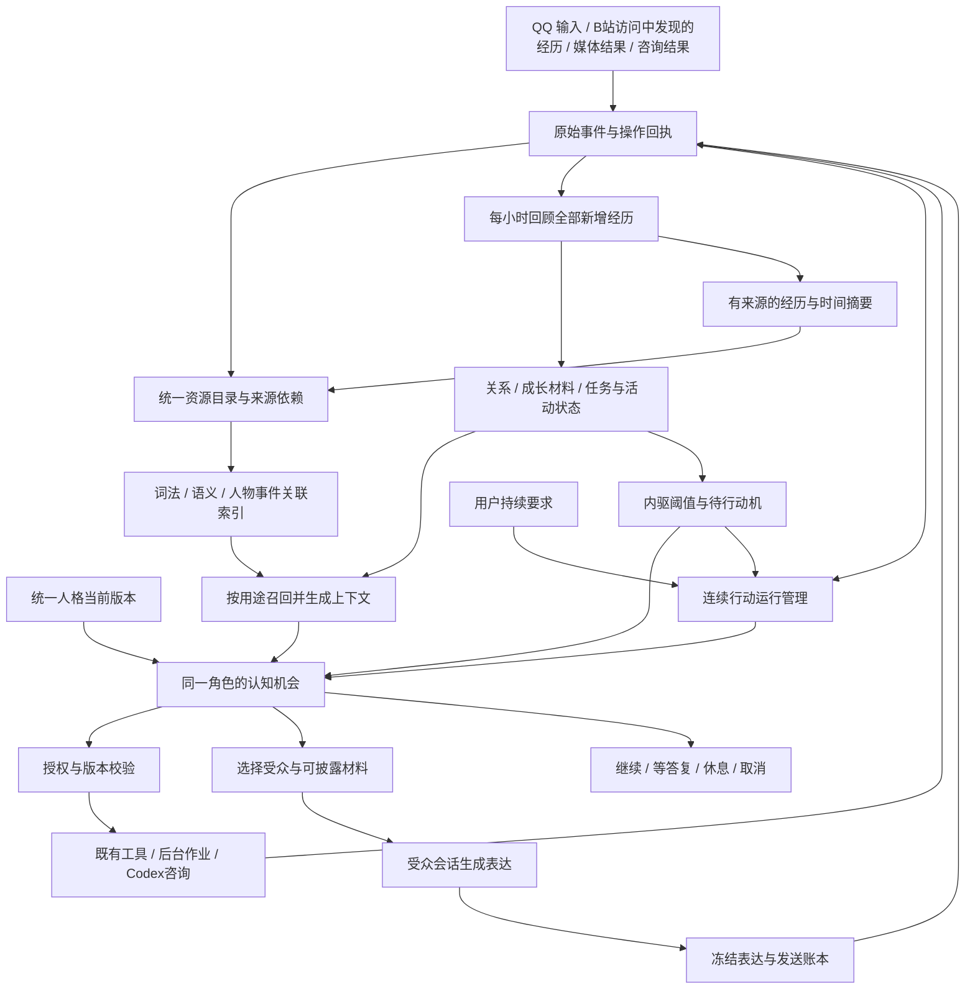

# 小鱼持续生活与成长：概要设计

> 最新设计修订（2026-10-26）：软件不设任何人为 token 用量上限；旧输出、读取及上下文 token 数值不再作为约束，也不安排节省 token 的额外工作。实际 usage 仍观测；供应商真实容量、费用金额规则和安全/设备资源边界分别说明。历史实施报告中的数值只是当时事实。
2026-10-26 实施补充（优先于下文旧兼容描述）：记忆系统不保留旧引擎兼容和回退开关，统一使用新版资源目录与召回；允许单向数据迁移，保留合法原始经历、事实来源和遗忘屏障，删除已退役代码、重复索引和旧模型会话副本。每小时检查全部新增经历，不设至少 20 条或任何聊天数量门槛；一条非聊天经历也应参与，空小时不调用模型，长窗口分批完整接续。用户已授权启用新版并进行 QQ 测试。

日期：2026-10-26（北京时间）；主要代码与运行证据采样于 10 月 25 日，版本见详细设计第 1 节。\
状态：分项实施中；实际生效和验收见实施状态文档。\
依据：[需求规格说明](life-continuity-requirements.md)，尤其是第 1、5、8、9 节；补充参考[历史聊天需求基线](historical-requirements.md)。重复或冲突事项以新需求为准，历史未被替代的明确约束继续保留。用户随后补充“费用可自定义、后台服务网页集中管理所有配置”，记为 ADD-01/02，优先于历史固定费用值；语音过慢及附加风格/记忆/音色参考记为 ADD-03。\
配套：[详细设计](life-detailed-design.md)。本文件说明职责、取舍和交付顺序；接口、数据及逐条验收以详细设计为准。

最新修订：ADD-04 按小时回顾统一经历、调整指标，不依赖一件事或一段聊天结束；ADD-05 指标和阈值实际驱动行动；ADD-06 所有事件都是她的经历，普通内容可跨人物联想和自然分享。本次修订替代先前“指标只作参考”和“其他私聊未逐项授权就不能跨场景使用”的过度限制，原始需求文件保留，实施以本修订说明为准。

ADD-07：增加连续行动运行管理。“不停描述这件事”等明确要求应在一次模型轮次结束后仍然有效，按用户规定的范围、时长或叫停条件持续推进；不能只回复一段即视为完成。此项仍为设计修订，尚未修改生产实现。

ADD-08（2026-10-26）：增加持续体验模拟。用户明确开启后，按已确认方式连续推进短周期状态，直到明确关闭；普通沉默、跨小时和一次峰值不自动结束。即时状态由专用 reducer 单写，小时回顾处理慢变化及修订，不能重复加分。具体见第6.4节及详细设计第10.1～10.7节；当前仅设计，未开启运行。

ADD-08范围澄清：本项是成年角色性生活/亲密情景的体验性补充，仅在相应明确情境中适用。普通聊天、阅读、工作、探索和一般陪伴继续使用原有情绪、八项驱力、小时回顾和任务机制；不套用本项刺激度、峰值、情景适应及恢复周期。

B站评论反馈属于既有信息收集与经历记忆的兼容范围，不另立追加功能。再次访问时收集到的反馈关联自己的原评论，去重后作为经历保存；不据此建立常驻沟通渠道或待回复会话。

本次将BaiShou-Next参考落实为记忆增强方案：混合检索、时间摘要和人物/事件/作品关联纳入P2交付，接续既有小时回顾。选用Python宿主内的增量实现，life.db继续作为唯一业务事实中心；不安装白守整套应用、不经MCP双写另一套主记忆。详细协议见配套文档第3.4、4.5、7.3节。

最新补充：吸收白守角色编辑页的组织方式，把小鱼的角色卡纳入统一设置网页“人格与表达”。它是同一人格和配置的编辑入口，属于ADD-02及ID/EXP要求；保存、生效和经历保留规则见第5节、详细设计第13.7节。

## 1. 目标、范围和设计结论

目标是让同一个 bot 能接续真实经历、理解具体人物、发展兴趣、主动交流，并可靠处理等待、插话、未知结果和重启。用户始终可以修改基础人格。成长是有来源、可纠正的经历材料及选择变化，不是让模型总结逐渐取得人格设定权，也不以是否具有意识作为验收结论。

推荐在当前 Python RoleHost + DSH 主角色之上增量改造，保留 `life.db` 为业务事实中心。统一的是身份、经历归属和生活状态；消息收件人、来源、披露权限及执行授权继续明确区分。重计算复用现有后台作业，发送复用现有 Expression/Delivery，咨询复用已存在的 Codex 桥，摘要增强接入现有记忆存储，不另建规划器、任务事实库或第二套聊天档案。

本次范围包括 QQ 私聊/群聊、已接入 B 站工具、后台媒体、人格/关系/记忆、上下文、活动和任务、用量、专用 DSH/Codex 接口，以及统一配置管理网页。游戏与新渠道提供统一经历接入协议，但没有已验证执行器的能力仍标为未接入，不能凭设计宣称已经会玩游戏或完整观看视频。

本次仅新增两份设计文档。生产代码、人格、配置、数据库、账号、收藏及对外发送均未修改或操作。后续迁移与真实账号验收是另外的实施工作；本文中的 DDL、配置和接口均不是执行指令。

## 2. 核实后的现状与差距

核查包含 Python 模块清单及依赖、生产入口和关键函数、真实 SQLite 结构与聚合状态、运行健康快照、专用 DSH 接口源码、Codex 桥及初始化文档、NapCat 本地 bundle、两份候选设计和相关测试。详细设计列出深读、结构扫描及未验证范围，不将静态检查称为全仓运行验收。

| 领域 | 当前实际基础 | 本次差距及处置 | 需求 |
|---|---|---|---|
| 身份与人格 | `agent_id` 稳定；情绪/驱力共享；人格按主人、公开和指定联系人文件路由 | 收敛成可编辑的统一底色，私人习惯与人物材料另行受控投影 | ID-01～06 |
| 关系与内驱 | 关系按 `agent_id + actor_id` 保存；情绪/驱力共享，已有阈值候选和评价去重 | 按小时统一回顾、全局状态与各人物关系分别结算；阈值实际产生动机和行动 | ADD-04/05、ID-02、MEM-06 |
| 经历与记忆 | `events`、`memories`、来源、词法检索、叮嘱、推断过期均已存在 | 打通合法跨源经历；增加词法/语义混合召回、有来源时间摘要、人物/事件/作品关联及索引恢复 | MEM-01～09 |
| 连续性 | 当前会话的活动、念想、小结、原文读取已实现 | `Continuity.activities` 仍按 scope 筛选，不能提供 bot 的跨窗口活动知觉 | CONT-01/02 |
| 主动行动 | `life_say`默认继续；`life_rest`/显式end_turn可正常结束，已有等待和防空转 | 补连续行动运行管理，将用户持续要求与模型轮次结束分开；复用原循环和发送链 | ACT-01～07、ADD-07 |
| 任务与恢复 | `meta.action_task:*` 是实际任务存储；列表分页、合并、版本、来源检查已存在 | 保留合法旧编号；跨窗口只增加可授权视图，不建立第二份任务事实 | CONT-03/04、ACT-06 |
| 媒体与送达 | 异步媒体、冻结表达、分片发送、回执、未知保护、多结果去重已有实现 | 新增真正表情意图及收藏管理；接收端可收藏尚未验收 | EXP-03～06 |
| 语音延迟 | 每次本地作业启动进程并构造 IndexTTS 模型，存在重复加载路径 | 先测排队/启动/加载/合成/发送，再试有限保温与候选后端；不承诺换插件即可更快 | ADD-03 |
| 意愿 | 驱力、关系与语义评价已存在；无完整结构化意愿/阻碍原因协议 | 欲望阈值可促成邀请；结合对象、情境和意愿执行，停止/拒绝及时生效，原因如实区分 | INT-01～05、ADD-05 |
| Codex | 已启用专用只读咨询、明确 thread、异步作业、结果采用和初始化 hash | `unknown` 会占用全局咨询入口；补结果采用时的来源/任务校验、用量和清理链 | ENG-01～06 |
| 提示与用量观测 | DSH 使用最新运行快照，有输出分页和独立用量记录 | 删除软件自设 token 用量限制及限额优化任务；估算与真实 usage 仅观测，不能将短摘要当完整证据 | NFR-01～04 |
| 生命周期 | 删除屏障、版本、任务取消、发布控制器已有实现 | 扩展跨来源依赖失效和外部缓存清理；单向迁移与故障恢复必须保持遗忘屏障 | NFR-05～08 |
| 统一设置 | 配置分散于 TOML、JSON、人格文件及专用桥配置，尚未核实到统一设置网站 | 增加本地管理服务和配置注册表，展示保存值/生效值，支持校验、并发编辑与分阶段应用 | ADD-01/02 |

运行核对存在重要限制：健康文件报告的 Python 源码签名与磁盘重新计算值不同；DSH 已加载 adapter 签名也与当前对应源码不同。因此“代码存在”“配置启用”“当前进程执行该代码”“用户体验通过”分别记录，不能互相替代。工作区已有大量未提交更改，本次未覆盖或清理。

## 3. 一个角色下的职责划分

| 对象 | 唯一职责 | 变化方式 |
|---|---|---|
| 人格底色 | 我是谁、基本性格、稳定表达方向 | 用户授权编辑或用户给予的明确编辑权限；hash 标识当前版本 |
| 人物关系 | 我和这个真实人物的关系状态 | 每小时在完整经历中理解各人物影响，复用去重、版本及重放机制 |
| 情绪、欲望与好奇 | 所有经历共同影响的自身状态，实际影响接下来想做什么 | 每小时综合调整；时间变化连续推进，阈值触发动机与行动机会 |
| 人物理解 | 我依据哪些经历怎样理解和对待此人 | 从原始证据生成分项判断；可纠正、有适用范围和到期时间 |
| 经历与知识 | 发生了什么、材料说了什么、我当时如何解释 | 自动保存真实事件；摘要、事实和解释分别处理 |
| 兴趣与成长 | 我经历了什么、选择有什么变化 | 使用可撤销的解释/偏好材料；只在确需持续推进时关联任务 |
| 活动时间线 | 刚做了什么、在等什么、结果是否确认 | 从现有事件、操作、作业、任务和送达记录投影 |
| 任务 | 跨轮次承诺、目标、当前版本和结束条件 | 继续使用 TaskService 和任务编号；普通聊天不建任务 |
| 连续活动 | 当前持续要求的执行位置、接续条件与停止条件 | 轻量运行记录；可关联任务，但普通持续讲述不强制变成长期工程任务 |
| 执行与发送 | 是否有权操作、真实运行与副作用状态 | 宿主校验、租约、账本、回执与恢复，模型不能自报成功 |

人物理解不再增加一套好感分；同一个人的多种可见视图不构成多个人格。共同经历默认不会因人格编辑被清除，历史行为关联当时人格版本即可追溯。

## 4. 统一记忆、内部连续性与披露

### 4.1 四种问题分别回答

1. **归属：**所有合法接收并允许保留的事件都是她的经历，统一按 `agent_id` 检索、回顾和影响自身状态。人物、会话和渠道只说明与谁、在哪里发生，不划成互不相通的人生。
2. **内部使用：**同一 bot 默认可以联想自己的跨人物经历；明确的保密要求通常限制对外讲述，而不是强迫她内部忘掉。显式禁止保留/使用和遗忘要求仍单独生效。
3. **对外披露：**普通话题、趣事、推荐和她自己的感受可以因相关性自然分享，不要求原说话人每次逐项批准；明确秘密、敏感个人细节和凭据保持具体边界，不能把整个私聊通道都一概视为秘密。
4. **管理诊断：**管理员默认看健康、版本、计数和状态；敏感正文诊断使用独立授权与审计，不把诊断结果自动带回普通聊天。

推荐把内部认知和受众表达做成同一角色的不同执行模式。它们共用人格与事实，权限上下文不同。内部模式没有直接对外发送通道；需要分享时提交目标与资源引用，由宿主依据普通内容分享策略生成可转述材料，再交受众会话表达，不新增逐次人工批准。普通对话也可直接召回跨会话的可分享片段。受众会话不能通过工具参数取得受限原文。

这增加了少量编排成本，但避免将全部私聊原文塞入一个可直接发群消息的模型上下文。仅用提示词“请保密”或生成后检查不能可靠替代此隔离。内部处理器不是新的生活规划者，不复制任务、人格或记忆，也不要求每次聊天先多调用一个模型。

### 4.2 跨窗口投影粒度

| 材料 | 内部认知 | 当前受众 |
|---|---|---|
| 当前会话原文与未决事项 | 合法使用 | 原范围可读 |
| 别人推荐作品、普通趣事和可转述发现 | 作为自己的经历参与统一理解 | 可相关召回并主动讲起，按需要保留“别人告诉我”的来源，不虚构亲历 |
| 其他私聊中的秘密、敏感细节和完整原文 | 默认可在合法留存范围内部理解；另有禁用要求时遵守 | 限制具体内容；可分享部分单独提取，不连带放出完整聊天 |
| 不可披露的在途活动 | 可以读取真实目标、来源和状态 | 最多提供预先定义的资源可用性，如“可回复/后台占用”；不提供隐藏数量、人物、标题、时间和链接 |
| 公开视频内容 | 可读取实际获得的字幕/帧/评论 | 正文公开性与私人访问原因分别校验；不得把只读字幕说成看完视频 |
| 可分享的一段经历 | 按原记录使用 | 普通分享策略或明确授权均可形成有来源片段；不能因此读取全部祖先私聊 |
| 人物态度与称呼 | 内部完整判断 | 从当前可见依据生成适用视图；默认不暴露全局关系数值及变化 |

例如，甲推荐一部电影，她后来和主人聊到相似题材时，可以说“之前有人给我推荐过一部……”，也可以在觉得有趣时主动分享。她记得是甲推荐，不能改说成自己已看完；如果甲同时说了不愿转述的私事，只限制那部分。验收既检查不泄露具体秘密，也检查确实能自然讲起其他窗口的普通经历，不能仅证明“没有泄露”就算记忆打通。

B站同样如此：她发过评论，下次访问时看到别人回应，可以记住“我当时这样说，后来看到有人这样回应”，之后因相关话题向主人讲起。保留评论发生时间与她发现的时间，不能说成离开B站期间一直在交流；反馈只在实际读到后影响记忆和回顾。

群受众按宿主策略和成员版本处理；普通内容可转述不等于开放群完整记录或成员隐私。跨平台人物只能通过经确认的账号映射关联，昵称和关系分数不能授予账号操作权限。

### 4.3 吸收白守能力后的记忆组织

采用“原始经历保真、摘要帮助接续、索引帮助找回”的结构。保存经历不依赖模型是否判断值得记忆；相同平台事件重复回调只记一次，不同日期发生的相似事情分别保留。回忆时既能找到概括，也能回到当时原话与真实操作结果。

| 材料 | 保存什么 | 何时使用 |
|---|---|---|
| 原始经历 | QQ交流、实际读到的B站内容、自己的动作和结果，保留人物、时间与来源 | 回原话、处理纠正、核实是否真正做过 |
| 近期经历摘要 | 重要片段、还没结束的话题、当前理解及原文引用 | 继续聊天和活动，不要求用户重复解释 |
| 时间摘要 | 一段时期的有来源概括，明确覆盖、遗漏和未决事项 | 长期接续时减少重复注入；需要细节时展开 |
| 混合检索索引 | 词语、语义向量及版本，正文仍读原库 | “之前说过类似的事”即使换了说法也有机会找回 |
| 人物与事件关联 | 谁参与、提到哪部作品、与哪件经历有关，各自有证据 | 从人物想到作品，再找到相关经历；不会把提及当亲历 |

原始事件落库后，现有后台队列更新索引。小时回顾可以同时提出近期摘要和关联，不再每句话额外调用一次整理模型。跨日的持续事项可更新同一摘要；日/周/月只是可选的浏览和压缩范围，不据此认定交流结束，也不强制生成五级报告。较远历史按内容量、查询需要和后台预算整理，完整原文始终保留。

检索同时考虑明确引用、词语、语义和人物/事件关联；每条路线先确定允许使用的材料，合并候选后再次核对来源、纠正与删除状态。近期相关原文和未决事项优先保留，远期摘要补充背景。自动联想复用已有上下文组装，不增加一个固定的“理解用户”模型调用；信息不足时承认不确定，不把相似经历补成事实。

例如，甲推荐过电影X，小鱼后来实际读到有关X的资料，又在B站下次访问时发现别人对自己评论的回应。以后主人聊相似题材，她可以联想到X，并分清“甲推荐过”“我读过哪些资料”“我后来看到哪条回应”。主人纠正其中一个说法时，相关摘要和索引立即失效并重建，不会继续引用旧概括；具体秘密仍按第4.1节处理。

### 4.4 实施取舍与可观察结果

先实现宿主内的混合检索与有证据的关联索引，复用现有SQLite、MemoryService、WorkQueue、用量和来源目录。语义向量存入可重建侧表，小规模先使用后台CPU精确余弦查询；向量生成通过可替换的embedding适配器，具体模型由同条件样本评测选择。不额外默认常驻GPU进程，避免加重当前语音显存争用。embedding未配置或超预算时，继续保存经历并使用词法/人物检索，页面明确标出语义能力未就绪，不能把降级状态当作全部验收通过。

摘要正文继续放在既有memories中，人物/作品关联只新增轻量引用索引，不引入完整图数据库。读取次数不会增加某条猜测的可信度；语义相似不会自动删除旧经历、合并两个人或改变人格。先验证“同义找回、时间准确、人物不串、能自然联想”，再考虑复杂图遍历或向量数据库。修订与遗忘对摘要、向量、关联和在途生成同时生效；重新建索引只能读取现存合法原文。

P2交付分三步：打通来源及无模型也能工作的基础召回；加入混合检索和证据关联；加入近期/时间摘要及故障恢复。每步用同一组多人物、跨时间、纠正和遗忘案例验证。后台展示各部分实际就绪程度、费用和积压，角色自然交流中不输出索引状态。推荐方案已选定，具体参数通过实施测量校准，不把架构选择重新交给用户判断。

## 5. 人格设定与成长

统一有效人格采用一份 canonical 来源与当前版本指针。已有 `profile_versions/profile_current/persona_compilations` 承担版本，不新增不可变人格锁。用户编辑后 hash 正常变化；并发提交依据 `base_hash` 做比较更新，拒绝旧版本覆盖新版本。旧 hash 的作用是解释旧行为，不是阻止编辑。

迁移时逐段区分：共用身份与底色、特定人物的表达偏好、私人事实、临时要求、模型自己的建议。当前 `persona.md`、公开文件和联系人文件不能拼接。保留 EXP-02 的全部表达约束及适用范围；基础约束进入统一设定，私人称呼/相处习惯进入受保护偏好，当前任务要求仍属任务。

成长材料区分 `user_setting`、`user_statement`、`model_interpretation`、`observed_choice`，有原始来源、适用对象和版本。一次学习不能自动成为常驻规则；已清理叮嘱受 `learning_source_barriers` 和既有清理时间屏障约束，不从历史原话重新“学回”。人物画像不能成为自己下一次重算的证据。

统一网页以角色卡展示“她是谁、怎样说话、喜欢什么”：名称、页面头像与简介、人设正文、表达习惯和示例；高级区域展示有来源的稳定偏好参数。模型、上下文、记忆检索、音色及表情设置可以从卡片进入，并绑定原设置项。当前心情、欲望和关系变化放在独立状态区域，显示依据和最近变化，不混成人格保存时要覆盖的表单默认值。

卡片正文直接编辑统一人格来源，保留完整文本编辑和修改预览；不把旧人格强行自动拆成会丢内容的若干标签。用户编辑、从文件导入和QQ有效管理指令都经过同一配置服务，显示草稿、已保存及实际生效状态。保存后下一次角色请求使用新版本，经历、人物关系和持续活动仍接续。初期支持本项目版本化JSON及人设文本导入导出；第三方格式先明确映射，不承诺任意角色卡文件都兼容。

采用白守角色编辑的交互思路，角色设定仍由用户编写。网页不因选了一张卡就创建另一个小鱼，不照搬其多伙伴/Vault切换及内置角色限制，也不把保存卡片解释成修改QQ头像、发送开场白或清空记忆。

## 6. 主动生活与事件驱动执行

### 6.1 每小时回顾与指标更新

采用每 60 分钟一次的回顾批次，覆盖这一时段她接收到的全部经历，包括私聊、群聊、阅读、B站访问中发现的评论反馈、实际行动和结果。小时是计算窗口，不标记聊天或事情结束；跨小时事项继续存在，下一批只评价新增进展，旧内容作为背景，不再次加减同一份分数。

回顾同时产出两类更新：她全局的情绪、亲密需求、好奇、满足感等；她与实际相关人物的关系变化。例如与甲争执可能让她整体低落，并影响她与甲的关系；之后与乙得到安慰可能使她平复、加深与乙的联结。不能把第一件事机械算成乙失信，也不能让乙窗口完全感觉不到她的状态。

已发生的交流本身可以带来部分满足、挫折或理解变化，不必等“整段交流结束”；工具尚在执行则如实保留未完成状态。即时回复和明确叫停仍立即处理，不等整点。每小时回顾复用主角色及现有状态账本，不建第二个评价人格；空小时只推进必要时间变化，不为读空包付费。去重、漏页、迟到事件、重启补算及纠正重放见详细设计第 5.4 节。

### 6.2 指标实际参与行动

指标从“显示/参考”改为有明确效果的动机输入。亲密需要与性欲分别影响相应的交流和邀请倾向；好奇进入较高区间时，产生探索动机并寻找可以实际开展的题目。达到可配置阈值会形成一次持久行动机会，在没有具体阻碍且情境适合时进入工具使用或邀请表达，不能永远只挂一个数值。

保留现有八项驱动力及其独立状态：探索促成求知与尝试，胜任促成学习和改善成果，连接促成交流与分享，亲密促成亲近与情感陪伴，性欲作为成年角色独立维度影响相应意愿与邀请，连贯促成接续和兑现，自主促成按兴趣与偏好作选择，余量不足促成减负和休整。亲密与性欲分别评价；余量依据真实负荷与休整，不仅凭在线时长增长疲劳。情绪、人物关系和兴趣影响具体选择，不额外算作驱动力。逐项行为与反馈见详细设计第5.5节。

用户明确要求和真实事件也能直接触发行动，不要求先把某个数值积满；连续活动由运行管理保证，不能因连贯需要暂时回落就停止。多个动机可共同促成一次行为，例如探索后因连接需要主动分享，也可竞争优先级，不能每个高值同时各发一条消息。

关系状态参与选择向谁联系、分享什么、邀请方式及相处态度。模型负责把动机落到具体人物、主题和方式，代码负责已授权范围、等待、资源与发送可靠性。暂缓必须有具体原因和重评条件；同一动机不每分钟或每小时重复发邀请。触发/解除双阈值、未答复状态和适当间隔防止重复；欲望回落依据实际交流反馈，不能仅因为“发出了邀请”就宣称满足。

欲望有影响不等于对方自动同意；明确拒绝或叫停会阻止继续推进。整体需要可以继续存在，不以切换联系人绕过已经表达的边界。细节见详细设计第 5.5、10 节。

### 6.3 连续执行与恢复

需要明确区分四件事：一段内容发完、一次模型调用结束、一段连续活动结束、长期目标完成。当前代码已有“发送后可以继续”的能力，但对模型选择rest/end_turn后的正常结束，缺少检查持续要求是否仍然有效的通用接续层。因此只改提示词或把一段话拆成多个气泡不足以解决问题。

拟新增ActivityDriver，承接用户持续要求和内驱动机，保存目标、已讲/已做部分、下一步线索、受众、节奏、版本及停止条件。模型负责下一步具体内容，运行管理负责仍有要求时重新给行动机会。比如“继续描述这件事，直到我叫停”，会保留一个until_cancel活动，每段结束后继续展开新的内容；没有新消息并不意味着结束，也不需要用户不断说“继续”。

优先在同一DSH轮内自然继续；若模型轮结束、上下文轮换或短暂让出资源，则按持久记录接续。不会每发送一次就额外启动一个并行模型，也不等下一小时回顾或15分钟空闲唤醒。每段之间检查新输入，普通插话先回应再按意图继续，明确暂停/停止即时阻止尚未提交的后续表达。

达到用户规定的段数/时长/内容范围可以完成；开放式持续要求由叫停、明确替换或具体阻碍结束/暂停，不能因回复了一段、输入已标处理或模型说“本轮完成”而完成。预算、渠道故障、未知送达或反复无新内容需要如实暂停，保留进度和原因，不无声放下，也不无限重复。详见详细设计第8.5节。

保留当前的行动选择方式：收到真实消息、结果或已约定唤醒后，主角色可以读、思考、操作、发送并继续。发送成功不等于本轮结束，作业完成不等于目标完成。她可以改变方向、休息或开始一个确有依据的新兴趣；不设关心消息配额、视频数量或强制情绪。

普通插话先持久化，再阻挡尚未提交的相关副作用；已开始的有效后台工作继续。理解输入后按 `activity_changes` 选择继续、调整、暂停、取消或无关。明确停止要作用于目标及其子工作，保留已发生的操作事实，迟到结果不得恢复被取消的任务。

明确等待答复是持久业务状态。定时器、沉默、无关消息以及自己新建的子任务均不能解除等待。它只阻挡有依赖的事项，其他聊天和独立活动仍可继续。任务使用既有 `topic_key/ref/revision`，同义目标合并，结束和合并后的记录不被旧唤醒复活。

资源分两层：执行槽反映进程或设备是否仍占用，副作用账本反映是否知道结果。原操作结果未知时保留对该操作的防重放保护；确认进程停止后可释放执行槽让无关工作继续。无法确认进程停止时保留隔离状态，只允许不会争用该资源的工作。

每小时回顾作为明确新增的周期工作，与真实输入、结果回流和内驱阈值触发共同提供认知机会；现有自适应空闲检查继续退避，避免叠加重复唤醒。便宜的宿主对账和阈值检测不反复调用模型。节奏优化以真实连续交互与用量为依据，不能把固定概率和固定关心话术写成自主性。

### 6.4 持续体验模拟与多种反应（ADD-08）

本节仅用于成年性生活/亲密情景的体验性补充；一般行为不进入此状态模型。适用情境由当前明确交流、对象与当次意愿共同确定，普通亲近、问候或陪伴不自动进入。通用ActivityDriver仍可管理其他连续任务，但其他任务不因此拥有刺激度和峰值机制。

在适用情境内，短周期反应有两个独立入口：一次语言/交流可以直接产生一次有来源的即时影响，无需先开启持续模式；持续模式额外提供按真实时间延续的输入。关闭持续模式只停止自动输入，仍评价情境内随后新消息带来的升高、降低或不变；退出整个亲密情景则停止该专项输入，一般情绪反应继续。同一句话不因持续模式开启而每个计时步重复加分。

用户可明确开启“按当前方式持续，直到我说关闭”的运行。持续输入作为有来源、有版本的活动保存，复用ActivityDriver；程序按真实经过时间推进，无需用户每句话重新申请。输入方式、强度和节奏可随新指令改变；普通沉默、45分钟静默、模型轮结束和一次峰值均不关闭运行。明确停止立即撤销持续输入，保留当下状态，再自然恢复；重启和实际故障按详细设计恢复，界面显示开启意图与实际运行状态。

采用多种独立状态共同影响反应：当前兴奋、愉悦/不适、短期满足、注意投入、情景负荷、适应程度和恢复进度；意愿作为独立语义判断。相同输入可逐渐趋稳，也可能因不适、分心、适应或负荷改变而回落。参数属于可校准的角色模拟，不宣称复现人类生理，也不以随机拒绝和固定高潮次数制造差异。

| 变化机制 | 可观察表现 |
|---|---|
| 积累与延迟 | 反应有前后过程，数值变化率和表达节奏受当前状态影响 |
| 平台与适应 | 相同输入持续后可能趋稳；变化是否有效由实际方式和语境决定 |
| 混合感受 | 兴奋、愉悦、满足和当次意愿分别表达，可以同时有期待与疲惫 |
| 短期满足与恢复 | 显著转移后进入个体化恢复，持续模式仍保留；不在一次回调中循环制造多次峰值 |
| 注意与打断 | 普通插话可以回应后接续；明确暂停/关闭立即生效，未理解的新输入先挡住相关推进 |
| 余韵与延续 | 停止输入后原有状态逐步变化，能够接续共同话题、安静陪伴或休息 |

实时状态和阈值转移直接进入下一次主角色上下文；显著转移产生一次有来源的行动机会，由同一角色决定自然表达。数值计算使用廉价宿主逻辑，不按每个计时步调用模型。连续数值更新与持续发消息分别配置，既有发送预算、插话和未知回执规则继续适用。

小时回顾核对来源与覆盖，评价慢心境、关系、需要的长期变化；实时字段不再被小时作业重复加分。自动模拟记为已授权的内部模拟经历，保留真实起止时间与输入来源；自己生成的表达不能自动当成对方的新动作或新同意。具体字段、控制协议、时序和T25验收见详细设计第10.1～10.7节。

## 7. 表达、真实表情与亲密意愿

表达改进依靠上下文、共同经历和适用语言习惯，不能单靠缩短回复。EXP-02 的二元句式、破折号、评价套话和被纠正后的表达要求纳入真实对话评估；不按正则机械改写所有文本，也不把每次纠正转成工程汇报。

新增 `sticker` 表达意图，经受控素材解析为 OneBot `image + sub_type:1`；普通 `image` 继续有独立语义。账号收藏、素材导入、平台接受发送、接收端显示与可收藏逐项验收。商城表情只使用真实配套字段，不从本地图片 hash 编造商城 key。沿用冻结 payload、分片账本、未知送达不重发和用户明确重发的新意图机制。

成年角色意愿是受欲望、关系和当前交流影响的当次判断。欲望升高并达到阈值，应实际提高寻求亲密交流的倾向，在合适情境促成邀请；不被孤立成永远不影响行动的数值。她也可以当下没有意愿；高信任不触发故意拒绝，用户叫停后不继续。服务限制、能力不足和执行故障分别说明，没有可靠原因时标未知；不承诺提示词消除服务限制。

用户追加的风格、分层记忆和音色资料均作为候选参考，不自动安装，不引入“破甲”。风格方面选择性吸收保留事实、减少模板措辞的思路，优先遵守用户自己的表达约束；记忆方面采用轻量索引与按需原文，不照搬另一套分层档案。

语音先记录完整阶段耗时，以当前音色建立冷启动/温启动基线。推荐优先试验同一模型的有限保温，空闲或图像需要显存时可靠卸载；候选轻量后端与 Feiyu TTS/RVC 服务通过现有媒体 adapter 比较。新服务不等于不用 GPU，也不保证更快；普通 TTS 与换声分别评估，不默认多加 RVC。音色取舍、冷温启动延迟、显存占用和保温时长纳入设置页，未经选择不悄悄替换音色。详见详细设计第 9.4 节。

## 8. 工程工作与 Codex

现有咨询链为 `life_consult → DSH jobs/subprocess → Python consult worker → Codex exec/exec resume → consult_result`。专用目录为 `D:\projects\bot-codex`，初始化已包含 bot 身份、工程地图及核对方法；配置模型当前为 `gpt-6.1-sol`，本设计不擅自换模型。

继续复用明确的 `topic_id/thread_id/request_id`。同话题串行，初始化内容 hash 变化时重读；不通过“最近会话”定位。相同请求复用记录，未知不重发，完成结果幂等回到主角色。新增恢复规则将已停止但结果未知的请求隔离，不让它无限占住所有新话题。

咨询默认解释、诊断和设计，保持现有只读执行边界。建议可以影响后续决策，但不自动成为人格、事实或永久叮嘱。代码修改仍由现有有效授权、候选验证和发布控制器负责；如未来授权 Codex 实际实现，另绑定执行授权和候选工件，不把只读咨询无声升级为写权限。

用量分别显示 DSH 已报告用量和 Codex 已报告用量，缺失字段保持未知。依据用户最新补充，日目标、硬上限及是否启用保护均可自定义；5/10 元仅为历史参考值。采样时实际配置为保护关闭、目标 20 元/上限 50 元，首次接入设置网页必须如实导入，不静默换成历史值。覆盖范围单独显示，不能默认涵盖 Codex 和未纳管第三方收费。原结果在必要恢复期内保留可分页证据，结果正文与操作、来源关联即可，不新增无界的“第二套 Codex 聊天记忆”。

### 8.1 统一配置管理网页

推荐增加本机后台服务及网页，默认仅本机访问。页面集中提供运行概览、费用与用量、模型与上下文、人格与表达（含角色卡）、记忆与隐私、指标与回顾、主动节奏、连续活动、账号与授权、媒体与音色、插件/方法、Codex、日志与运维设置。配置项可搜索，标明用途、范围、保存值、有效值及生效方式；未知插件字段需登记 schema 后才能编辑，无法安全编辑的字段明确展示为只读并说明原因。

网页和 QQ 自然语言管理复用一个配置服务。首期保持现有配置文件为各字段的唯一来源，注册表只管理字段定义、来源和应用方式，不复制一份互相冲突的运行配置。每次修改经过类型及跨字段校验、版本比较、配置提交和运行端确认；重启、重连、人格编译、新作业生效分别显示，保存不能冒充全部生效。

费用面板支持自定义目标/上限、币种与时区、有效价格版本、纳管模型范围和未知用量提示。调低上限不抹除已用费用或在途预留；超限后停止新的纳管付费调用，保留 QQ 连接及输入持久化。角色不能自行提高上限或关闭保护；用户在网页或有效的管理指令中修改后才生效。管理界面不把费用历史记录变成可随意改写的配置。

采用轻量 Python 服务和静态前端，作为受监督的独立管理进程，避免聊天重启时设置页同时失联。它只管理本 bot 及专用 DSH/Codex 配置，不接管用户其他 Codex 项目。认证、敏感值隐藏、修改审计与局部失败恢复见详细设计第 13 节；本次不启动服务或开放端口。

### 8.2 历史基线的补充与替代

历史编号与新需求有重名，配套文档以 `H:编号` 表示历史条目；不加 H 的编号均为新需求。

| 历史内容 | 处理方式 |
|---|---|
| 一条主认知循环、通用插件/skill/代理/自修改 | 保留；内部模式与受众模式只作权限隔离，不增加独立规划器或每轮必经模型 |
| 主人正向关系 ≥0.7、其他人 ≤0.9、区间解释 | 保留现有关系政策；负面感受不被该下限抹掉；数值不授权，也不强制亲密意愿 |
| 按事件或交流结束结算、指标只作参考 | 按 ADD-04/05 改为小时统一回顾及真正的动机触发；指标更新不依赖自然交流结束 |
| 按联系人隔离经历、跨私聊内容默认不可分享 | 按 ADD-06 统一经历与内部联想；普通内容可自然转述，仅限制具体秘密和敏感部分 |
| 情景表达与真实事实分开 | 保留；实际说过、回应过的共同互动进入经历，情景设定不转为现实身体或线下事实 |
| 私人/公共人格与风格学习 | 用新 ID-01～06 替代独立人格路由；私人偏好仍有范围，统一底色不公开私人文件 |
| 音色探索、语气/停顿、QQ 自然语言控制 | 保留现有音色目录及 adapter；新增音色需试听、登记、核对实际发送，不自动朗读全部文字 |
| 本地优先、参考图必需、约 1～3 分钟可接受 | 保留为媒体验收范围和实测目标，不擅自切换付费云端，不要求多引擎常驻 |
| B站真实阅读/评论，X 仅浏览 | 保留；现有收集范围包含再次访问时发现的评论反馈，按统一经历处理；授权和回执按账号动作绑定，X写操作不在历史授权内 |
| 日目标 5 元、上限 10 元，完整 API 样本 | 固定金额被最新“费用可自定义”替代；目标/硬上限机制与完整样本保留，样本区分实际请求、日志重建、附件缺失和脱敏 |
| 历史安装、重启、清理、Git 提交 | 属于当次操作，本次不重做；新经历不能套用旧重置授权 |
| 仅一个设计文档、固定日程等早期讨论 | 交付两份设计；统一配置后台和小时回顾按最新要求纳入。其他固定生活日程、训练、视频生成及额外常驻服务仍非默认必做 |

历史 15 项必查清单和独有验收另列于详细设计第 16 节，避免只完成新 51 条而遗漏既有约束。

## 9. 可选方案与取舍

| 决策 | 未选方案及问题 | 推荐方案与代价 |
|---|---|---|
| 记忆统一 | 删 SQL 的 scope 条件会绕过来源、披露及遗忘检查 | 保留原记录，加用途权限与资源目录；需要统一所有读写入口 |
| 跨场景连续性 | 只检索当前受众材料仍缺内部知觉；全库直注入又会暴露私聊 | 内部模式 + 受众投影；必要时多一次表达交接，普通对话不增加固定模型轮 |
| 检索 | 单靠词法可能漏掉同义经历；直接换向量库也不能解决来源与权限 | P2实现可降级的混合检索、证据关联和时间摘要；用对照评测选择模型及参数，原文和纠正仍由现有库管理 |
| 归档 | 照搬 L1—L5、五分区及永久 JSONL 会多出事实副本 | 原始事件保留，摘要带覆盖清单，原文分页；领域标签只做分类 |
| 人物理解 | 将画像写进人格，或以旧画像继续总结 | 独立分项材料，从原始证据重算可见视图；需失效与来源检查 |
| 主动执行 | 新建固定巡逻/问候循环会抢占现有角色选择 | 复用 AttentionPlans、Initiative、WorkQueue，并完善事件回流 |
| 持续要求 | 只靠提示词容易随模型轮次结束而丢失，拆消息也不构成连续推进 | 持久run与步骤回执，复用同一模型轮及必要接续机会；增加停止、去重和公平调度检查 |
| 指标结算与行动 | 依赖对话结束难以稳定切分；仅展示分数无法保证行为影响 | 固定小时覆盖、按真实刺激去重，阈值形成动机并实际进入选择；需补批次及行动追踪 |
| Codex 接入 | 直接改用 app-server 将增加部署和恢复工作 | 先完善现有 CLI 桥；需要更丰富流式交互时再评估官方 app-server |
| 存储迁移 | 全库重置或恢复旧备份会丢经历或复活删除内容 | 增量侧表、事务投影、可中断回填和派生重建；不保留旧记忆引擎开关，不新增备份任务 |
| 配置后台 | 直接暴露任意文件编辑难以校验；全部迁入新库会扩大改造 | 注册表统一现有来源，轻量本地网页调用同一配置服务；需补提交日志及运行端确认 |
| 角色卡 | 独立保存另一份人设/运行参数会产生冲突，按联系人切卡会分裂身份 | 在人格与表达页提供卡片编辑、全文及关联设置；保留单一人格来源、成长经历和当前状态 |

参考设计的采纳范围：记忆设计中保留原 scope、来源链、权限交集、可纠正人物理解的方向采纳；仅当前 scope 的活动视图、永久备份、固定层级和未经测量的参数不照搬。表情设计的四种能力区分及验收链采纳，并补 DSH 工具入口、生命周期与跨作业幂等。

用户追加的[BaiShou-Next](https://github.com/foxletters-hq/BaiShou-Next/tree/cb3bd91d07830b74d3563c73085143df47510bfb)已核对关键源码，第4.3/4.4节已给出正式推荐方案。其MCP技术上可接，但工具绑定活跃Vault，记忆写入/去重/删除约束与小鱼不同，本方案选择在现有记忆层内吸收能力。具体采纳范围、源码证据和AGPL许可见详细设计第17.1节；没有安装或接入应用，也没有新增第二套记忆事实中心。产品更完整不等于已经证明更“懂人心”，自然体验仍需同模型和经历对比。

## 10. 分期、依赖和退出条件

各阶段的“退出”表示可以进入下一阶段，不等于全部 51 条需求完成。表中的账号操作与迁移待后续实施授权，本次只制定验收方法。

| 阶段 | 交付与依赖 | 可观察行为 | 退出条件 |
|---|---|---|---|
| P0 基线 | 冻结待发布版本；重新核对磁盘/进程；整理实际 schema、旧清理屏障和授权配置 | 版本、状态和未知结果不再互相混用 | 版本差异有解释；基础回归范围明确；所有生产写入尚未发生 |
| P1 统一底色、读取权限及配置基础 | P0后增加权限/来源目录、统一人格、兼容层及设置服务，交付角色卡基础编辑与文本/JSON导入导出 | 各场景底色一致；角色卡保存后原经历接续，设置页能改费用并核对生效，旧配置完整导入 | ID和ADD核心验收；T24角色卡、人格并发、跨bot/受众拒绝、遗忘闭包及配置故障恢复通过 |
| P2 连续经历与检索 | P1后分步实现原文目录、混合检索、证据关联、时间摘要、活动投影及上下文组装 | 换说法也能找回；人物/时间不串；能自然讲起其他窗口和B站普通经历；知道后台进展 | MEM/CONT与ADD-06正反验收及T21～23通过；实际embedding/摘要有接入证据，降级不能冒充全部完成 |
| P3 主动生活与咨询恢复 | P2后接入小时回顾、阈值动机、连续活动和持续体验模拟，完善取消/等待/执行槽/咨询 | 状态影响行动；持续讲述及体验跨模型轮接续且可插话叫停，未知不堵住独立事项 | ADD-04/05/07/08、T25及ACT/ENG/NFR并发故障通过；真实连续行为及QQ响应证据齐全 |
| P4 表达媒介与意愿 | 可与 P2/P3 局部并行；依赖 P1 权限与既有 Delivery；语音计时可在 P1 开始 | 真正表情可发送与收藏；意愿和服务限制可区分；语音延迟较基线有稳定改善 | EXP/INT 确定性及真实接入证据、ADD-03 同条件计时与试听完成；不能只凭源码判通过 |
| P5 连续体验与收敛 | P1～P4完成后，建议至少7天自然交互试运行，补齐所有配置域及角色卡中的关联设置 | 经历影响选择、持续要求不丢、交流自然、状态不膨胀；所有设置均可定位和管理 | 新51条按最新修订解释、14场景、历史补充和ADD-01～07证据齐全；不能用消息数替代体验 |

建议检索和时延目标见详细设计第 14 节；它们是待基线测量校准的工程门槛，未冒充用户硬性指标。隐私、重复发送、遗忘复活及假完成是必须为零的阻断项。

## 11. 风险、待决事项和故障恢复范围

| 需求第 9 节决策点 | 当前推荐 | 待决影响 |
|---|---|---|
| 内部使用、自然分享、管理诊断 | 经历默认参与她的统一内部理解；普通内容自然分享，具体秘密受限；管理员默认元数据 | 需要实现具体内容分类和转述来源，不能退回整会话隔离；不把主人身份解释成无条件读取他人的秘密 |
| 设定与成长冲突 | 用户设定优先；经历判断进入可纠正材料；覆盖设定需人格编辑 | 含糊的旧段落暂停迁入统一底色，不能凭模型判断公开 |
| 私人表达偏好迁移 | 逐段分类、保存原始依据和适用对象，保留 EXP-02 | 需要在后续实施时审阅具体迁移清单，本次不修改原人格 |
| 体积与生命周期 | 不复制完整聊天档案；可再生索引有界；有效经历不因配额自动删除 | 原始事件增长需实测容量；空间不足明确停新增派生作业并报告，不能隐式遗忘 |
| 节奏与成本 | 60分钟回顾，真实事件和阈值动机触发；空小时无需额外模型调用 | 后台可调回顾间隔/触发阈值；通过试运行校准，不设主动联系最低次数 |
| 设置网站范围 | 本机管理全部本项目配置，优先复用现有文件来源 | 远程/公网、多管理员及手机外网访问未被要求，首期不扩展；费用数值由用户设置 |
| 语音延迟与音色 | 先测当前链路，优先试验有卸载能力的保温加载 | 新音色/引擎须实际试听和计时，Feiyu代码及模型使用条件分别核对，不默认更快 |
| Codex 模型与权限 | 保持当前 `gpt-6.1-sol` 与只读咨询；用量分列 | 实际实现权限、服务可用性和价格需独立核实，不能根据配置名承诺 |
| 评估指标 | 确定性测试、真实接入、自然连续体验分别出证据 | 产品体验由连续案例判断，0.5 秒与固定检索权重均非既定要求 |

最主要风险是跨权限材料被普通会话读取、旧结果绕过删除屏障、取消后迟到结果复活任务，以及磁盘/运行版本不一致。故障时暂停对应的付费作业，保留原始经历和输入落库，使用支持当前 schema、权限与删除屏障的修复版本恢复。记忆召回只使用新版引擎；索引重建不恢复旧人格或旧数据库。已经删除的数据不属于可恢复资产。

现有发布预检会制作临时数据库副本，这是当前实现事实，不是本设计批准的新备份。推荐先用合成库完成设计和迁移测试；若未来沿用真实库预检，临时副本的用途、目录、访问限制和销毁必须单独明确，不能默认永久保存。现有日志、DSH/Codex 会话和平台远端副本的清理能力也需分别验证，不能承诺本地删除能撤回已发送给他人的消息。

完整逐条追踪、协议、迁移和验收证据要求见[详细设计第 15 节](life-detailed-design.md#15-需求到验收的追踪矩阵)。
