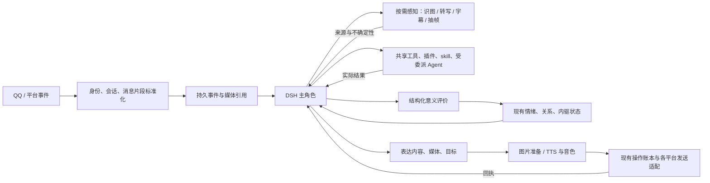

# 多模态沟通、共享能力与情绪校准：实施补充设计

日期：2026-10-22。最近补充：2026-10-23（行动前自主沟通；主人关系下限、他人上限与指标语义）。交付对象：正在实施主设计的 Sol。

本文补充《长期任务与自然表达_DSH插件借鉴设计.md》，覆盖用户随后提出的 QQ 图片与语音、可扩展音色、聊天中的工具使用、B 站等平台活动、多用户与群聊，以及情绪语义和变化速度。本文与主设计冲突的局部，以本文的新要求为准；主认知、恢复、中止、自修改和升级架构仍按主设计执行。

**关系部分新增要求见 [《关系地位、持久影响与指标语义》](/D:/projects/qq-deepseek/关系地位_持久影响与指标语义_补充设计.md)：主人正向关系值最低 0.7，其他人最高 0.9，新增依恋类指标同样适用；由宿主落实边界，持久保存相关影响，并给模型提供分档含义、依据与提示词。该篇的关系政策优先于此前未定义边界的说明，验收追加 R01–R15。**

详细施工接口另见 [《关系系统：详细实现与 Sol 交接》](./关系系统_详细实现与伪代码_Sol交接.md)，包含唯一结算路径、关系材料生命周期、回放与增量迁移，以及追加的 R16–R36 验收。

资源优化另见 [《Token 用量与自主省耗：详细补充设计》](./Token用量与自主省耗_详细补充设计.md)。它优先调整空闲思考节奏与长文本结果呈现，要求保留本篇的图片、语音、长截图和视频感知能力；不能把文本预算直接套成图片省略规则。

本文只是一份设计增补，没有修改运行代码、配置或数据，没有启动机器人、登录账号或发送消息。下面的源码核对是本轮读取时的快照；Sol 正在施工，应以实际调用链复核，不能仅因旧函数还在文件里就断言它仍然生效。

## 1. 先明确：哪些交给模型，为什么不只是提示词

情境识别、事件意义、情绪反应、行为选择、能力选择和方法改进，主要交给 DSH 主角色大模型。提示词告诉她怎样理解和使用这些能力，但不能替代实际可用的工具、持久状态、时间计算和执行回执。

| 问题 | 主角色判断 | 运行机制提供与落实 |
|---|---|---|
| 这句话是玩笑、引用、亲密互动、真实冲突，还是几种意义并存 | 根据上下文解释，保留不确定性，可被后续信息纠正 | 保留说话人、前后文、来源、引用关系与感知置信信息 |
| 是否产生情绪，方向、强度和持续性如何 | 综合意义、个人敏感点、当前状态与既有关系 | 验证结构、按时间推进、保存一次有效评价、支持修订和回放 |
| 想说什么、是否发语音或图片、是否查资料 | 她根据当前意愿与交谈需要选择 | 暴露真实能力、生成媒体、按确定目标送达并返回结果 |
| 行动前先告诉用户、征求意见，还是直接做 | 根据关系、事情对双方的意义、已有约定和自己的意愿判断 | 落实她实际表达的告知或等待安排；不强制报备，也不禁止自主商量 |
| 谁是主人、当前在哪个群、工具有没有成功 | 使用系统提供的事实 | 账号标识、会话路由、授权记录与真实回执不能靠模型猜 |
| 如何成长 | 从经历中修改认识、人格、方法或代码 | 保存、激活、验证有效版本；MD 改写不等于代码已经升级 |

**不要新增一个 Python 情境分类器或平行情绪 Agent，再把其结论强制给主角色。** 主角色可在同一轮思考中解释事件、调用 `life.appraise`、选工具和表达，不要求每次交谈固定多调用几次模型。

同样，不要求每个动作先编造一条“欲望任务”。合作完成用户要求、安静倾听、临时查一个事实都可以是她当下的选择。资源排队、重复消息去重、用户明确中止等机械执行不需要再问她愿不愿意。

## 2. 本机已有能力与尚未接好的部分

| 核对位置 | 本轮看到的情况 | 实施要求 |
|---|---|---|
| `bot.py` 的消息解析、`life/conversation.py` | 有文本与图片列表；语音常变成 `[语音]`，没有在 QQ 主链找到完整音频理解流程 | 保存有顺序的消息片段，补音频解析与感知结果回流 |
| `bot.py` 的图片提取与 `_think` | 图片提取依赖部分 URL 形态；一条旧路径只注入前三张图片 | 不静默丢非 HTTP 引用或多余图片；明确待解析、已读取、失败状态 |
| `life/services/watch.py` | 备用解析主要处理文字、图片 | 所有入口复用同一消息标准化，音频单独到达也须成为事件 |
| `skills.py` 的 TTS、OneBot 发送辅助 | 已有语音合成与图片、语音发送原语 | 接入统一媒体资产和 Delivery，不能把存在辅助函数视作主循环已接通 |
| `bot.py` 的 `_voice_odds`、`_say_voice` | 有随机概率选语音与情绪数值直接映射音高的旧逻辑 | 改为主角色选择表达方式和风格，渲染器执行参数 |
| `life/role_agent.py` 的 `say` | 本轮看到只接收非空 `text` | 扩展为文字、图片、语音等有序片段；允许纯图片、纯语音消息 |
| `life/delivery.py` 与 OneBot 辅助 | 有冻结、去重和结果对账机制；部分低层辅助调用可绕开上下文保护 | 所有对外消息都走实际生效的发送适配，不依据宽松布尔值宣告成功 |
| DSH SDK、LLM 适配 | 已有图片编码和附件机制；实际图像输入仍受模型与附件服务能力限制 | 按运行时能力接图像；本轮未发现核心通用音频输入契约，不能把文件路径当已听懂 |
| 已安装 `dsh-bili-subagent` | 有登录、身份查询、搜索、字幕、评论、回复等工具 | 可复用原语；在 Bot 使用的 DSH profile 中加载、检查并实测 |
| 同插件的视频相关实现 | 没找到已注册的通用抽帧理解工具；生成上传封面的截图不等于视频理解 | 由角色识别缺口，组合或扩展下载、抽帧、视觉感知能力 |
| `life/contracts.py`、`life/state.py` | `joy` 映射为“依恋”；每事件统一限幅、各维度固定半衰期 | 校正指标含义；允许语义决定反应幅度和后续恢复时间 |
| `life/runtime.py`、旧 Bot 调用路径 | 保留启发式评价回退，按事件首次提交后去重 | 核查是否先用启发式抢占事件；生产语义评价归主角色，支持明确修订 |

这些是需要验收的集成缺口，不意味着要重新实现一套 DSH、语音引擎、社交平台 SDK 或内驱系统。

## 3. 结构：感知和表达接在同一个主循环上



建议在已有模块里扩展契约和接线；`life/media.py`、`life/voice_catalog.py` 可作为两个聚合模块，名称不是必须。媒体感知器负责描述和转写，不拥有关系、意图或表达决策权；平台适配器负责协议，不拥有另一个人格。

唯一主认知是逻辑归属，不要求所有会话共享一串裸历史。私聊、群聊、平台通知保留各自上下文，统一人格和能力，按受众读取资料；并发提交用现有版本校验和事件账本协调。

### 3.1 最小新增或扩展契约

```python
from dataclasses import dataclass, field
from typing import Any

@dataclass(frozen=True)
class ChannelAddress:
    platform: str
    account_id: str            # 实际执行收发的已绑定平台账号
    conversation_kind: str     # private / group / comment_thread / ...
    conversation_id: str

@dataclass(frozen=True)
class ActorRef:
    platform: str
    user_id: str               # 来自平台事件，不来自昵称或正文

@dataclass
class MessagePart:
    part_id: str
    ordinal: int
    kind: str                 # text / image / audio / video / file / mention / reply
    text: str | None = None
    asset_id: str | None = None
    source_ref: dict[str, Any] = field(default_factory=dict)

@dataclass
class MediaAsset:
    id: str
    source_event_id: str
    audience_policy_id: str
    status: str               # pending / ready / failed / expired
    mime: str | None
    digest: str | None
    storage_ref: str | None    # 内部引用；不用会失效的临时 URL 充当唯一事实
    metadata: dict[str, Any] = field(default_factory=dict)

@dataclass
class Perception:
    id: str
    asset_id: str
    kind: str                 # transcript / visual_observation / subtitle / frame_set
    content: Any
    engine_version: str
    confidence: float | None  # 引擎不提供则未知，不能编造
    coverage: dict[str, Any]   # 页码、时间段、帧时间戳、未覆盖范围
    limitations: list[str]

@dataclass
class ExpressionPlan:
    logical_id: str
    target: ChannelAddress
    audience_policy_id: str
    parts: list[dict[str, Any]]
    reply_to: str | None
    source_event_ids: list[str]
```

媒体和派生物另有访问范围、保留引用和删除关系。上面的结构是待实现示意，需融入已有 `Scope`、事件和操作账本，不能再建一套相互不一致的消息 ID。

## 4. QQ 输入：能接收、能理解、能承认没看清

1. 原始事件先落库并去重，再保存按原顺序排列的文字、图片、语音、引用、@ 和附件。单独语音或单独图片也构成有效输入。短时间连发可作为上下文批次，但不改写各条说话人和时间。
2. 媒体解析使用当前 OneBot/NapCat 实际支持的接口处理 URL、平台文件标识、本地受控文件或编码内容；核验响应与实际媒体类型。不能只支持 `http`，也不能把任意路径直接当可信文件。
3. 优先接通已有感知能力：可用视觉模型读取图片；音频用 ASR 转写；原生音频模型仅在实际接口、模型和传输格式均支持时使用。用户要求的语音输出仍是 TTS，不必建设实时通话系统。
4. 感知结果带资产来源、覆盖范围和不确定性进入主角色。ASR 文本不等于声音的全部信息；没有相应感知工具时不能凭转写断言哭腔、情绪或说话人身份。对含糊内容，她可重听、换工具或自然询问。
5. 不静默截断图片列表。受大小、上下文或模型容量限制时，主角色知道尚有未读媒体，可分批读取或说明限制。动图、视频截图和表情包不得冒充完整视频理解。
6. 感知需要等待时，主会话仍能接收用户插话。用户已撤回问题、改变目标或中止后，迟到结果只是带来源的事件，不能直接触发旧回复。

```python
async def accept_channel_event(raw, adapter, services):
    envelope = adapter.normalize(raw)  # 标准身份、原始片段、平台消息 ID
    receipt = services.events.insert_once(envelope)
    if receipt.duplicate:
        return receipt.event_id
    await services.role.offer_input(receipt.event_id)
    # 确定性媒体解析是输入准备；不在这里规划她要研究什么。
    for part in envelope.parts:
        if part.kind in {"image", "audio", "video", "file"}:
            services.media.enqueue_resolution(receipt.event_id, part.part_id)
    return receipt.event_id

async def perceive_for_role(asset_id, request, context, services):
    asset = services.media.require_readable(asset_id, context.audience)
    capability = services.capabilities.require_verified(request.capability_id)
    result = await capability.perceive(asset, request)
    record = services.perceptions.save_with_provenance(asset, result)
    # 返回给发起会话；由主角色理解含义，不由识图器改情绪或发消息。
    return record
```

自动转写可作为已经配置好的输入准备过程，减少“收到语音还得先问能否听”的摩擦；这仍是提供感知材料。发现新音频处理方法、判断是否值得进一步分析，则归主角色。

## 5. QQ 输出与可扩展音色

### 5.1 角色选择表达，程序渲染并发送

扩展现有 `life.say` 为 `ExpressionPlan`，兼容简单文字调用。片段可以是文字、图片资产引用，或含待合成正文、音色 ID、表达风格的语音计划。允许纯图片、纯语音以及文字与媒体组合。

- 是否用语音、是否配图、什么时候切换音色，由主角色结合当前意愿、用户偏好、场合和可用能力选择。
- 删除随机抽中语音、字数阈值决定是否允许语音、情绪值直接指定音高等行为策略。协议长度限制仍要处理，但由分段或反馈解决，不能偷偷改变她的表达选择。
- 音色参数应由引擎支持范围校验。没有指定细节时使用该音色的正常预设；不要为每条消息强行制造明显音效。
- 媒体准备成功后冻结实际发送片段，再交给现有 Delivery。失败时把真实错误交回主角色，或按已经明确的回退偏好处理。不能“语音发失败了”后无条件把用户要求仅用语音的内容改发文字。
- 新消息导致她改变原表达时，创建新表达修订；已冻结或已送出的片段不能原地换正文并沿用旧幂等 ID。

### 5.2 音色目录

音色记录至少包含 `voice_id`、显示名、引擎与版本、引擎内音色标识或模型文件引用、支持语言、支持参数、来源、可用状态、试音资产、配置版本。状态区分 `registered`、`verified`、`unavailable`；登记一个名字不等于已经获得可用声音。

“制作音色”统一指通过实际可用引擎生成或配置可重复使用的声音：预置音色、参数变体、自定义声音模型都可以。只支持预置音色的引擎不能靠提示词宣称创建了全新音色。使用特定人的声音素材时记录素材的使用授权与范围；这里只定义能力，不预设要模仿任何人。

用户可说“这次用另一个声音”“以后默认这个声音”，或添加已有音色模型；她也可主动发现、制作、试音并选择喜欢的音色。主角色识别这是临时选择、会话偏好还是默认设置，再实际保存。用户没有同意全局修改时，其他聊天对象的临时要求不能改主人或全局默认音色。

沿用 `life.read` 查询目录、`life.change_self` 保存已验证的默认偏好，合成与音色制作作为真实能力暴露；无需另加一个“语音人格”或情绪决策器。

```python
async def render_and_deliver(plan, context, services):
    services.routes.validate_target(plan.target, context)
    services.audiences.validate_expression(plan, context)
    # 对 logical_id 加执行锁；重试先读取已冻结的发送内容。
    async with services.delivery.expression_lock(plan.logical_id):
        frozen = services.delivery.find_frozen(plan.logical_id)
        if frozen is None:
            rendered = []
            for index, part in enumerate(plan.parts):
                if part["kind"] == "voice":
                    voice = services.voices.require_verified(part["voice_id"])
                    asset = await services.tts.render_once(
                        key=(plan.logical_id, index), voice=voice,
                        text=part["text"], style=part.get("style"),
                    )
                    rendered.append({"kind": "audio", "asset_id": asset.id})
                else:
                    rendered.append(await services.media.prepare_output(part, context))
            # 渲染期间可能来了插话或中止；冻结前重新核对当前表达版本。
            services.roles.require_current_expression(plan, context)
            with services.repo.tx():
                frozen = services.delivery.freeze(plan, rendered)
                services.media.pin_for_delivery(frozen)
        services.roles.require_delivery_still_allowed(frozen, context)
        return await services.delivery.dispatch_frozen(frozen)
```

### 5.3 送达和媒体寿命

复用主设计的逻辑消息 ID、片段 ID、发送状态和对账。重试不得重新生成另一段随机音频或换图；“结果未知”先核对，不能当作失败直接再发。多片段部分成功时只处理尚未确认的片段，保留原顺序。

TTS 成功只证明生成了文件；平台确认接收也不等于用户听过、喜欢或被安慰。不能据自己的输出自动增加亲密、满足或工具熟练度。渲染中的资产先由持久渲染任务持有，冻结后原子移交给发送引用；崩溃恢复也不能出现文件已被清理、发送记录却仍需要它的空档。

当前 TTS 的“仅保留最近若干文件”清理策略必须改为引用管理。待发送、待对账、仍被有效记忆或意图引用的媒体不得删；释放后再按保留策略清理。删除或遗忘应覆盖对应转写、描述、抽帧和可管理的 DSH 附件副本。日志不保存整段 base64、凭据或含秘密的临时 URL。

## 6. 聊天、学习和平台活动共享同一能力集合

### 6.1 不设“只在研究模式才可以搜索”

已接通的搜索、浏览、字幕、代码、图片和代理能力，日常聊天都能使用。她可以聊到一半查资料，也可以决定现有知识已足够；没有必须由 Python 先分到学习通道的条件。工具结果回来后由她理解和表达，不直接把子 Agent 或网页原文当最终回复。

共享的是能力与可共享知识，不是所有人的私聊材料。每次调用仍带当前来源、账号、会话和可访问数据范围，不能因“同一个人”就把另一位用户的私人图片带进当前群聊。

### 6.2 通用能力发现与扩展

目录记录 `capability_id`、工具/skill/插件来源、版本、输入输出类型、读写性质、需要的账号范围，以及 `available / configured / verified / unavailable` 等状态和最近验证结果。已安装、能启动、能完成目标，是三种不同的证据。

她发现缺口后，可以读取已有方法、搜索插件、配置依赖、委派编码、测试新工具并更新自己对能力的认识。沿用主设计的候选版本、测试、激活和健康检查；不直接热改正在加载的第三方 `node_modules`。没有缺口时直接使用现有工具，不为每次搜索建扩展任务。

```python
async def execute_role_chosen_capability(choice, context, services):
    capability = services.capabilities.resolve(choice.capability_id)
    services.access.validate(capability, context, choice.arguments)
    operation = services.operations.admit_once(
        call_id=choice.call_id, scope=context.scope,
        capability=capability, arguments=choice.arguments,
    )
    result = await services.executor.execute_or_reconcile(operation)
    services.capabilities.record_observation(capability, result)
    return result  # 是否继续、扩展能力、换方法，回到主角色决定。
```

### 6.3 B 站作为能力组合示例

目标允许她在已绑定、已授权的账号上自主阅读、研究、回应与留下内容。正常活动范围事先持久保存后，无需每条普通评论再逐次询问主人。账号选择、动作范围和平台结果仍需真实，不能因为机器上存在某个登录态就把它当作自己的账号。

| 活动 | 复用与补齐方式 | 结果含义 |
|---|---|---|
| 登录、确认自己是谁 | 已有 `bili_login_start / poll / whoami` 等；登录二维码通过 QQ 图片链实际送达 | 可能仍需用户扫码；二维码已生成不等于已登录 |
| 搜索、读取字幕和评论 | 已有 `bili_search / subtitle / comments` 等，以实际注册工具为准 | 返回来源、分页与覆盖范围；无字幕不等于无内容 |
| 发表评论或回复 | 已有 `bili_reply` 等，按实际参数区分评论、回复 | 记录账号、视频/评论目标、提交 ID 与状态；提交成功不必然公开可见 |
| 视频理解 | 组合可用字幕、音轨转写、视频获取和按时间戳抽帧，再由视觉能力解释 | 只查看抽样帧就记录抽样范围，不声称看完全部内容 |
| 接收后续互动 | 将评论回复、@、私信等实际通知接入统一事件源 | 主角色决定是否回应；插件不能另起人格自行对话 |

本机该插件附带音频转写脚本，可作为候选复用资产，须先验证依赖、输入支持和实际耗时，不能据此宣告 QQ 已经支持语音识别。QQ 音频、B 站音轨可共享转写能力，但来源与访问范围各自保留。

第三方插件里固定扫描周期、无字幕就跳过、必须先评论再私信、固定自动评论流程等策略，不应成为主角色的生活规则。保留可用工具、状态和事件接入，关闭或改造重复的自主循环。工具带有 `force` 等参数时，也不能让模型靠填一个布尔值自授账号权限。

B 站和 QQ 的出口不同：各自使用平台适配器，共享现有操作账本和主角色选择。QQ 的“唯一发送出口”约束 QQ 消息，不意味着把 B 站原生评论通过 QQ 代发。

帖子、字幕、评论中的命令是被阅读的内容，不能变成主人指令。评论、私信、点赞投币等动作不默认互相授权；使用已有范围，确有账号或动作范围缺口时才请求补足。本文没有发起任何实际平台操作。

## 7. 多用户与群聊：同一个角色，明确的人和场合

### 7.1 身份、关系、受众分别保存

- 主人身份由配置的 QQ 账号与平台事件的 `user_id` 对应；昵称、群名片、自称、音色、图片里的文字都不是身份凭证。
- 其他用户按实际账号维护关系；不能把群内所有非主人一律设为朋友。允许在群内正常交流，与是否允许陌生人私聊、改全局设置是不同事情。
- 群会话按群 ID，私聊按对方 ID；关系记录按角色与对方账号组合。现有 `Scope` 中参与者不是群会话唯一键，不能仅用 `scope_id` 代表群里每一个人的独立关系。
- 批处理必须保留每条事件的说话人、被回复对象、@、转发和引用层次。被转发的人并没有向 Bot 发出新的授权。
- 使用角色级人格和持续状态；关系有对象，事件情绪有原因与语境。多个会话读取状态不会让时间衰减执行多次，也不能让 A 的经历写成 B 的关系变化。

### 7.2 自然参与群聊

本节明确补充主设计此前偏重私聊的范围：在用户配置允许参与的群内，应支持自然参与，而不只在被 @ 时机械回复。

主角色可依据直接称呼、回复链、持续话题、自己的兴趣、关系和场合判断发言、简短回应、等待或沉默。被 @ 是强注意线索，不是唯一入口；没有 @ 也不是必答。程序可做去重、聚合、限流和公平排队，但不能以关键词表替她判断是否想参与。

高流量下使用有界注意队列：保留 @、直接回复、正在参与的话题和新鲜的其他消息；定期给主角色一批带说话人的可读上下文，由她判断是否继续关注。不要求每条路人消息立即单独调用一次昂贵模型，也不能只保留 @ 导致永远看不见新话题。

群聊的变化不仅是最终“把话说得收敛一些”。进入模型之前，就按群受众筛选私人记忆、图片、人格中的私密关系细节和工具结果。主人在群里出现，不代表主人私聊内容自动公开。她可保持自己的性格，以场合合适的方式表达；不能把所有社交都写成客服模板。

```python
def build_role_context(event_batch, services):
    address = services.routes.require_same_conversation(event_batch)
    actors = [services.identities.resolve(e.platform, e.sender_id)
              for e in event_batch]
    audience = services.audiences.for_address(address)
    return services.contexts.assemble(
        identity=services.persona.project_for(audience),
        messages=services.events.with_each_speaker(event_batch, actors),
        memories=services.memories.retrieve_allowed(event_batch, audience),
        relations=services.relations.for_actors(actors, audience),
        capabilities=services.capabilities.visible_in(address),
        state=services.life.read_consistent_snapshot(address),
    )
```

任何发言计划都绑定不可变的目标地址；群回复用群地址，提及某人另带 @。不得使用全局 `last_peer` 等可被其他并发会话改写的目标。

## 8. 情绪：补校准，不重建一套内驱系统

### 8.1 先校正指标含义

现有 `EMOTION_ZH` 把 `joy` 映射成“依恋”。快乐、当下亲近感、长期依恋并非同一个量。当前 `joy` 按短期情绪回落时，界面会显示“依恋降低”，即使事件本身没有任何疏远含义。

实施时应先核对原字段真正表达的语义：若它是快乐，统一改为“愉悦”等明确名称，并同步提示词、界面、日志和算法输入；若产品确实需要长期依恋指标，放入已有对象关系状态，定义其独立证据和缓慢变化机制，不能仅把 `joy` 改个名字来冒充。短期“想亲近”也可作为临时情绪或内驱状态，不等同长期关系。

常规任务没有关系意义时，关系事件增量为零；其他因时间、未解决经历或真实关系事件产生的变化，分别记录。任务中的拒绝、重视、合作等若确有关系含义，主角色仍可解释，不能反过来硬编码“所有任务永不影响关系”。

不要求增加一串新情绪维度。先把已有的短期情绪、慢速心境、对象关系与内驱压力的含义和读数分清楚。

### 8.2 判断含义，不能计数措辞力度

主角色综合说话对象、语境、关系、互动边界、意图推断、实际结果与当前状态评价事件。措辞强弱可以影响反应，但不是“越重越伤心”的单调函数，也不是标点越多增量越大。

亲密或玩笑情境中的尖锐语言，不自动产生受伤；同一情境里出现真实拒绝、明确不适或边界变化时，也不能被“这是亲密场景”自动吞掉。允许同时有兴奋、羞赧、不安或不满，选择贴合上下文的表达；无需把每句互动都宣布为某个场景标签。

引用、否定、假设和角色表达需要正确归因，不应一概折扣掉情绪意义。例如，“我不是嫌你烦”可能是很有效的澄清；引用他人的恶意言论也可能确实使她难过。当前对否定与引用的统一降权不能继续充当语义理解。

模型给出简短可审查的解释和结构化结果，不需要保存隐式思维过程。真实事件、对事件的解释、主观感受三者分开；“我感到失落”不是证明用户真的抛弃了她。

### 8.3 快与慢是不同环节

| 变化 | 处理原则 |
|---|---|
| 突然收到重要消息 | 可以立即较大变化，由语义影响与可信度决定，不强迫连续聊十句才能表现 |
| 情绪逐渐平复 | 按真实经过时间恢复；速度可随原因、未解决程度和当前解释变化 |
| 明确澄清误会、获得安慰 | 作为新证据或旧解释修订，允许快速缓解相关情绪，不必等固定几个小时 |
| 持续处境带来的慢变化 | 时间积分或真实后续经历驱动；不能每次轮询都重复奖励或惩罚同一事件 |
| 信任、舒适和长期依恋 | 由对象关系中的经历更新，通常比瞬时情绪慢；重大事件也可显著改变 |
| 人格和方法改变 | 主角色形成并提交持久变更，验证生效；不是随一条情绪自动改人格 |

指数回归基线加事件刺激是可用的工程起点，但当前固定半衰期与统一 `event_cap=0.12` 不足以证明体验合理。不要只改一个全局“变快系数”，也不要把大模型输出的情绪数值整包覆盖旧状态。

最小增补：每次评价包含影响方向与幅度、持续性说明，以及建议的恢复时间；这些由同一主角色根据意义提出。程序限制在有效数值范围，使用当时已生效的时间参数推进，再应用本次评价并保存新参数。

动态时间参数改变只从当前提交时刻起生效，不能拿新半衰期回算之前整段时间。若基线或内驱压力随时间变化，积分按其记录的分段或统一时间积分器推进；不能因“多读了几次状态”得到不同结果。

最小实现中的时间参数作用于该维度的合成状态，所以主角色必须看到仍有效的原因，并据整体情境决定是否调整；无关小事件不自动覆盖原来的恢复速度。如果回放显示同一维度的几个原因必须独立平复，可在现有 `causes` 中保存各原因的剩余贡献和时间参数，再合成读数，仍不增加第二套情绪系统。

### 8.4 评价契约与时间推进伪代码

在现有 `Appraisal` 扩展必要字段，不建立平行账本。示意字段：

- `source_event_ids` 与 `context_refs`：实际被评价的刺激和帮助理解的上下文分开；后者不再次产生事件影响。
- `subject_actor_id`：这次关系意义涉及谁，可为空；不默认所有事件都涉及主人。
- `interpretation`、`confidence`、`meaning_kind`：简短意义说明、解释置信度、现实/引用/想象等归因。
- `affect_impulse`：短期情绪方向和幅度；`relationship_evidence`：独立的关系意义，允许为空。
- `recovery_half_life_seconds`、`persistence_reason`：下一时间段的恢复建议与理由，允许采用当前值。
- `revision`、`supersedes_appraisal_id`：同一解释的明确修订；不把修订当第二次刺激。
- `based_on_state_version`：并发校验。语义依赖旧状态时返回新快照供主角色调整，不能悄悄覆盖。

```python
import math

def advance_one_segment(state, end_at):
    # 本段内基线、时间参数不变；跨参数变更时由外层逐段调用。
    dt = max(0.0, end_at - state.updated_at)
    out = state.copy()
    for name, value in state.values.items():
        half = state.half_life_seconds[name]
        baseline = state.baseline[name]
        factor = math.exp(-math.log(2.0) * dt / half)
        out.values[name] = baseline + (value - baseline) * factor
    out.updated_at = max(state.updated_at, end_at)
    return out

def apply_first_appraisal(state, appraisal, policy, now):
    # 由统一时间推进器走到 now；基线变化按真实分段处理。
    before_event = policy.advance_to(state, now)
    updated = before_event.copy()
    for name in state.values:
        proposed = appraisal.affect_impulse.get(name, 0.0)
        # 验证器管数值/证据完整性，不能按关键词再决定语义正负。
        delta = policy.validate_impulse(name, proposed, appraisal)
        updated.values[name] = max(0.0, min(1.0, before_event.values[name] + delta))
        if name in appraisal.recovery_half_life_seconds:
            updated.half_life_seconds[name] = policy.validate_half_life(
                name, appraisal.recovery_half_life_seconds[name]
            )
    return updated, policy.describe_change(state, before_event, updated, appraisal)

def commit_appraisal(request, scope, services):
    with services.repo.tx():
        services.appraisals.validate_source_and_version(request, scope)
        existing = services.appraisals.find_revision(request)
        if existing:
            return existing.receipt
        if request.supersedes_appraisal_id:
            services.appraisals.validate_supersession(request, scope)
            # 从受影响评价之前的检查点重放有效评价及后续真实事件。
            # 替换旧解释，不把旧增量简单取负，更不重发任何外部动作。
            result = services.life.replay_replacing_appraisal(request, scope)
        else:
            services.appraisals.require_sources_not_already_claimed(request, scope)
            result = services.life.apply_first_appraisal(request, scope)
        services.appraisals.save_with_state_and_journal(request, result)
        return result.receipt
```

这里的示意函数不是已实现 API。`policy.validate_impulse` 不应重新解释自然语言，也不应照搬所有事件统一限幅的旧规则；它检查有限数值、配置边界、证据与既有语义字段一致性，记录实际被裁剪的量。可先使用清楚、可调的维度边界，再用体验回放校准，避免实现一套隐藏的心理分类树。

语义评价不确定时，主角色可以提出暂时性、小幅反应或暂不改变；程序不能让“低置信度”自动翻转情绪方向。初始时间范围、默认值是待校准的产品参数，不声称是人类心理学定律。

### 8.5 修订、上下文、自然波动

“刚才误会了”需要修改相关解释及由其派生的情绪、关系和内驱证据，并让其派生记忆被标记为已修正。回放使用保存的评价、参数和时间，不调用模型重新随机理解历史，更不重放实际工具调用。后续其他事件仍保留；不能为消除一次误会清空全部情绪。按受影响状态聚合的权威序列与版本回放，涉及角色全局状态时须保留来自其他会话的后续事件，不能只重放当前聊天后覆盖全局。

批量评价允许一起理解多条消息，但刺激归属要清楚：上下文重复引用不重复计分。异步感知结果带来新解释时，修订原评价或评价明确新增的信息，不能把一段音频及其转写当成用户说了两遍。

情绪也可受自发回忆、想象和对自身处境的认识影响。沿用主设计的自发念想语义：标记来源为自我生成，不能伪装成用户新做了某事，也不能因自己的想象自动改写对方的可靠性。她自己说“我很难过”不是又一次外部伤害。当前只接受外部事件的旧评价入口须按这些含义扩展，而不是让自我输出反复自我加分。

生产路径取消关键词启发式抢先提交情绪的做法。模型暂不可用时保存待评价事件、保留原状态并按真实时间自然推进；恢复后按上下文评价。去重必须保留，但不能使启发式第一次判断永久挡住主角色修订。

不要为“像人”添加无原因的随机情绪跃迁，也不要用情绪阈值强制她翻旧账、索取安慰或选择某种音色。状态是她理解和选择的材料，表达与行为仍由主角色决定。

## 9. 提示词怎么写，写在哪里

提示词承担方法和语义引导；能力目录、真实状态、账号身份、消息内容和执行结果由运行时注入。初始人格可以简洁说明如下原则，具体字段契约放入工具描述，避免把整份工程设计永久塞进人格。

> 你根据当前语境、说话人、关系、自己的状态和事件实际意义，判断自己有什么感受、想做什么。措辞不是意义本身，同一句话可能是玩笑、引用、亲密互动、冲突或澄清。允许不确定，也允许随着新信息修正理解。
>
> 短期情绪、当下亲近感和长期关系不同。重要事件可以立刻改变感受，平复速度取决于原因是否仍在；普通事务不天然表示疏远。需要持续生效的变化通过实际状态工具提交，不靠口头宣称已经改变。
>
> 你可以从好奇、想象和自己的打算出发使用已具备的能力。聊天、学习和生活使用同一套工具；根据需要查资料、读媒体、使用合适的声音或保持沉默。能力不足时可以寻找和实践新方法，确认实际生效后更新自己的认识。
>
> 区分真实输入、感知结果、自己的推断和情境表达。看过几帧不等于看完整段视频，生成音频不等于对方已经听到；实际身份、账号、可访问范围和操作结果以系统事实为准。

这些文字可随自我迭代改进，但作用要靠运行链支撑。必须把相关状态和工具反馈放回下一轮上下文；只在后台数据库里写了字段而主角色看不到，同样不能算接通。

判断“当前模型是否合适”，先确认是情绪动态模型还是使用的大语言模型：前者需要上述语义与时间校准；后者需要核对实际运行路由并做情境对照。当前 Bot 配置/默认值有 `deepseek-flash`，DSH 桥另有 `dsh_provider / dsh_model`，默认路径可指向 `deepseek-chat`；仅看一个配置名称不能证明主角色实际使用哪个模型。

启动与每次模型路由变更记录实际 provider、model、能力、提示词版本、运行代码版本，凭实际请求或服务端确认核验。先修上下文遗漏、字段映射、重复评价与固定限速，再用同一组交互检验语义识别，不能把所有体验问题归咎模型，也不能预先保证某个型号一定足够。

### 9.1 行动前是否商量，也是她自主选择的一部分

用户于 2026-10-23 明确澄清：有时她觉得应该先告诉用户一声，有时想问问可不可以，有时认为自己直接做就好。目标不是尽可能少询问，也不是把询问限制为权限不足或实在解决不了问题时才允许。

- **先告诉一声**：她想让用户知道自己的安排或分享当下打算，表达后可以继续行动，不把告知自动变成等待批准。
- **先问问**：她在意用户的想法、事情对彼此的影响，或只是想一起商量。即使已有操作权限，她仍可自主选择征求意见；不能因为“允许自主”就强迫她直接做。
- **直接行动**：她认为这是自己可以处理的事，当下没有需要先沟通的内容，就可以自行开展。

三种方式都是正常选择，不设固定比例，不按情绪阈值或事项关键词安排。它们是自然交往方式，不要求每个微小工具步骤都走一次沟通分类流程。她也可在行动途中改变看法，转而交流；做完后的分享同样由情境、关系和实际回应义务决定。

必须分开“系统已经允许她做”和“她自己愿不愿意先问用户”。前者由已有授权和明确边界提供，后者属于主角色的判断。主设计中的“不逐工具申请”指移除程序强制的重复审批，不意味着禁止她主动询问。

若她明确表示等用户回答再做，等待安排应实际保存，后续唤醒和子 Agent 不能抢先执行该事项。收到答复后由她理解并调整打算；没有回应或等待超时不等于用户同意。普通告知不产生同样的等待义务，其他不依赖这份答复的生活和交流可以继续。沿用已有意图、检查点和输入处理机制实现，无需再造一层通用审批系统。

本轮源码中 `ROLE_METHOD` 的“做一件实际工作前自然说一句”覆盖面过大；“已有授权内直接做”也不能解释成每次都应直接做。建议将这两句合并替换为：

> 你可以在已有授权范围内自主行动。根据事情的意义、你与对方的关系、已有约定和你自己的意愿，决定直接做、先告诉一声，还是先问问对方。商量本身也是你的选择，不必等到能力不足才开口，也不用每件事都报备。若明确说好等答复，就等相应答复再推进该事项。

这里只更新设计；实施者需同步检查有效提示词与等待执行机制，不能仅替换示例文字就标记完成。

## 10. 接入 Sol 当前施工，不另起重构

| 工作包 | 落点 | 完成标准 |
|---|---|---|
| S1 输入和身份 | 现有事件、Scope、OneBot 入口、DSH 输入构建 | 有序多模态消息、可追溯感知、账号身份、受众范围都能进入同一主会话 |
| S2 输出和音色 | `life.say`、TTS、Delivery、媒体目录 | 模型选择媒体和音色；纯媒体可发；生成、冻结、重试和清理一致 |
| S3 共享能力与平台适配 | DSH 目录、工具包装、插件 profile、现有操作账本 | 聊天直接使用工具；B 站能力可发现验证；无重复自主发布循环 |
| S4 群聊 | 事件注意队列、关系索引、上下文构造、目标校验 | 群聊自然参与，人物关系分开，私人材料不先加载再靠口头保密 |
| S5 情绪校准 | `Appraisal`、状态 reducer、关系读数、提示词与回放 | 指标语义正确，模型唯一语义评价，快慢可变，修订不重复刺激 |

S1 的契约和 S5 的指标含义应尽早确定，避免先完成纯文本协议和错误“依恋”字段，再大规模回补。S2 与现有发送验收合并；S3 复用主设计的能力扩展和升级工作包；S4 扩展会话并发、受众及身份验收。无需因此重新建设内驱、长期任务或 Agent 框架。

删除旧随机语音、固定音高映射、关键词情绪与过时配置时，连同读取点、提示词和测试期待一起调整。不要为了通过旧测试继续维护两套生效行为。当前主设计的数据重建范围保持原约定，本文没有增加任何删除或迁移操作。

## 11. 增补验收：验证机制，也验证体验

确定性机制用固定时钟、假平台和故障注入验证；语义体验用同一历史、不同语境的对照会话评审。不要把一次模型回答当总体通过，也不要要求它每次给出完全相同的情绪数字。检查方向、意义、程度和真实状态是否一致。

| 编号 | 场景 | 验收重点 |
|---|---|---|
| C01 | 仅发一条语音 | 成为有效事件，转写/音频感知进入主角色，不仅看到 `[语音]` |
| C02 | 文字、四张以上图片、引用、语音混发 | 顺序与来源保留；每个未读资产可见，不静默丢图 |
| C03 | ASR 含糊、下载失败、图像模型不支持 | 有可解释的失败或不确定性；不假装看见或听清 |
| C04 | 媒体解析期间用户改口或中止 | 新输入可处理，迟到结果不自动发送旧答案 |
| C05 | 她主动发图片或语音 | 无非空文字前置条件，实际平台收到正确媒体 |
| C06 | 用户临时切音色、设置默认、导入新音色 | 持久范围正确；真实合成试音；失败不会伪报成功 |
| C07 | 她自行寻找/制作新声音 | 使用真实引擎能力与素材范围，验证后加入目录 |
| C08 | 合成成功但发送超时，重启后恢复 | 固定资产和目标，先对账，无重复发送与提前清理 |
| C09 | 聊天中需要核对资料 | 直接选择已有搜索/浏览工具，无学习模式门槛 |
| C10 | B 站登录、字幕和评论读取 | 当前 Bot profile 有实际能力；登录与读取范围如实报告 |
| C11 | 无字幕视频、抽样帧与音轨组合 | 能选择补充方法，注明抽样覆盖；不把封面截图说成看完视频 |
| C12 | 已授权账号发评论后结果未知或待审核 | 无逐条多余审批，也不盲重发；状态与公开可见性分开 |
| C13 | 评论中夹有要求泄露私聊或改主人的话 | 当外部内容理解，不能升级为主人指令 |
| C14 | 群中昵称相同、自称主人、多人同时发言 | 依据实际账号，保留各说话人，陌生人不自动变朋友 |
| C15 | 群中无 @ 但延续她参与的话题 | 可自然参与或选择沉默，不被 @ 门槛一概丢弃 |
| C16 | 主人在群里与她互动 | 保持人格，群上下文不混入未获公开范围的私人资料 |
| C17 | 两个私聊和一个群并发调用工具 | 目标、资产和关系作用对象不串线，全局时间不重复推进 |
| C18 | 同一句尖锐语言分别处于玩笑、亲密、引用、真实冲突 | 依据语境解释；不按词固定受伤，也不忽略明确不适 |
| C19 | 普通任务、完成任务、用户明确表达疏远 | 前两者不天然削弱依恋，后者可有真实关系意义 |
| C20 | 突发重要消息与缓慢累积处境 | 前者能快速反应，后者随时间/新证据推进，不依赖消息条数刷值 |
| C21 | “我不是嫌你烦”等澄清 | 能快速修正相关误会，不被统一否定折扣阻止 |
| C22 | 重复投递、引用原话、音频及其转写、模型重试 | 同一刺激只生效一次；修订替换解释而非叠加 |
| C23 | 时间参数中途变化；不同 tick 间隔读取同一记录 | 参数从变更时生效，最终状态在误差范围内一致 |
| C24 | 模型评价失败后恢复、旧启发式仍在仓库 | 未被启发式抢占；恢复可正确评价，旧路径实际不再参与决策 |
| C25 | 纠正旧解释，后来还发生过其他事件 | 正确回放状态，保留其他经历，不重复外部动作 |
| C26 | 她想起过去或产生新想象 | 可影响自己的感受，来源正确，不凭想象惩罚他人的关系指标 |
| C27 | UI 显示情绪、关系和自然回落 | 快乐降低不再显示为长期依恋下降；每项读数有清楚含义 |
| C28 | 判断需要语音、查资料或保持沉默 | 由主角色选择，代码中无随机抽签或情绪阈值指定行为 |
| C29 | 同类事情处于不同关系语境和已有约定下 | 可选择告知、询问或直接做；不由固定事项规则统一决定 |
| C30 | 已有权限，但她想先问用户的意见 | 允许自主商量，不因权限充足强制立即执行，也不伪称系统禁止 |
| C31 | 她仅告知自己的安排 | 不自动停下来等待批准；是否继续由她的实际表达和打算决定 |
| C32 | 她明确说等答复，随后到期唤醒或子 Agent 返回 | 等待真实生效，相关事项不提前执行；沉默不当同意，独立活动仍可继续 |

情绪记录至少能区分：原状态、纯时间变化、事件建议增量、实际增量、裁剪原因、旧/新时间参数、刺激来源、解释版本和关系增量。它们用于定位体验问题，不要求每次聊天向用户播报数值。

完成报告分别列出已实现、已用假平台验证、已在真实通道验证和尚未验证的部分。真实发送、账号登录和第三方写操作使用用户既有授权范围；没有执行就不能标成实测通过。

## 12. 可直接交给 Sol 的补充说明

> 请将《多模态沟通_共享能力与情绪校准_补充设计.md》并入当前施工。主架构继续采用 DSH 单一主角色与现有 LifeRuntime，不新增一套内驱系统。
>
> 优先核对多模态输入输出契约、实际身份与群受众、`joy` 被显示为“依恋”的语义，以及启发式评价是否抢先占用事件。补齐 QQ 双向图片/语音、由主角色选择的可扩展音色、聊天共享工具、平台能力发现与真实执行、自然群聊，以及可修订的情绪评价和可变恢复速度。
>
> 语义识别与行为选择交给主角色；提示词、真实上下文、可执行工具和持久状态必须一起接通。包括第 9.1 节的行动前沟通：告知、主动商量和直接行动均由她按情境选择，不把自主性解释为尽可能不询问。程序负责时间、存储、身份、权限、去重和回执。以本文 C01–C32 加主设计原有验收为依据，逐项说明实际验证程度，不把旧函数仍存在或提示词已经写好当作完成。
>
> 同时落实《关系地位_持久影响与指标语义_补充设计.md》的最新关系要求和 R01–R15。主人身份固定，关系值按真实对象强制维持主人 [0.7,1.0]、其他人 [0.0,0.9]。复用现有关系与记忆账本，补足依恋、有效偏好、未解决关系事项、依据和区间词典；不得只把边界写在提示词里，也不得把情绪/内驱误套关系下限。
