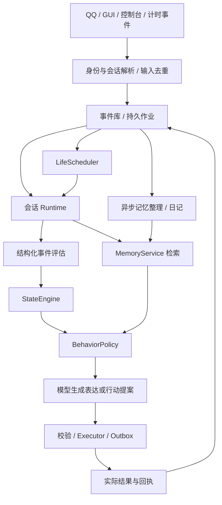

# QQ-DeepSeek：生命感与可维护性设计、接口与伪代码

> 2026-10-22 设计更新：当前施工主设计为 [自主角色主设计](./长期任务与自然表达_DSH插件借鉴设计.md)。本文保留历史方案及可复用的状态、记忆和执行算法；涉及认知归属、迁移、人格自改和授权的冲突，以新主设计为准，不叠加实施旧规划器。

设计日期：2026-10-21。范围：当前工作区静态代码审查及目标设计。

**本次仅创建和完善本文档，不修改原始代码、配置、人格文件、数据库或旧设计文档。** 本文中的结构、参数、接口和验收用例是待实施方案，不代表已经实现或已经通过测试。没有启动 bot、调用其模型/QQ 服务，也没有读取私人运行数据库及真实配置。

用户目标：让 bot “活起来，有真实感，并且可维护”，并具有主动发展能力：能够发现自身不足、调用工具、拓展插件、学习方法、修改自己并持续进化。本文把它落实为：同一个角色跨天、跨通道仍然连贯；变化有原因；共同经历能找回；答应的事情会继续；有可持续的兴趣与分寸；能力改进有验证和回退；维护者能解释和修复行为。这里讨论可观察的行为连续性，不把模拟状态等同于生物感受。

## 1. 核心判断与阅读顺序

目前缺的不是更多情绪名称，而是贯通的因果链：

```text
真的收到/观察到什么
  → 这件事对当前关系、承诺、兴趣意味着什么
  → 状态怎样改变
  → 为什么选择这次回应或行动
  → 实际发生了什么
  → 留下什么记忆与未完成事项
  → 下一次因此有什么不同
```

建议保留现有可用部件，以单进程、SQLite、少量明确模块逐步改造。先修复来源、作用域、状态提交和执行结果，再增加慢心境、关系修复与持续兴趣。不需要一开始引入微服务、图数据库、向量数据库或多个互相聊天的“人格代理”。

本文阅读路线：第 2 节核对现状；第 3–5 节定义架构与状态；第 6–10 节给出主流程和算法；第 11–14 节给出恢复、迁移、验收与取舍；第 15 节定义主动能力发展、插件生命周期、自修改和发布伪代码；第 16 节定义自主网络知识学习。

### 1.1 “有生命感”如何验收

| 希望看到的体验 | 对应机制 | 不采用的替代办法 |
|---|---|---|
| 隔了几天仍然认得共同经历 | 有来源的事件记忆、按问题检索、跨天时间线 | 把所有历史塞进提示词 |
| 会高兴、失落，也能缓过来 | 事件评估、时间衰减、明确的修复事件 | 无缘由随机生气 |
| 对不同人有不同距离，但还是同一个角色 | 全局稳定人格 + 分关系状态 | 每个联系人长出一套互相矛盾的人格 |
| 答应的事有下文 | 承诺状态机、恢复点、发送回执 | 说“这就去”之后忘掉 |
| 有自己的兴趣和近况 | 少量持续项目、真实活动证据、有限主动性 | 空闲时编造生活经历 |
| 碰到不会的事，之后能学会或修好 | 能力缺口、工具发现、实验工坊、可验证发布 | 把“写了经验”“装了插件”直接当作已经进化 |
| 有时主动、有时安静 | 开口收益、对方可用性、授权、冷却 | 为增加互动量而追问或催回复 |
| 出错后能修好 | 可回放状态、版本、来源链、结构化诊断 | 继续追加提示词和特殊分支 |

### 1.2 十条必须保持的约束

1. 一个被接受的输入事件只产生一次状态影响；重启、重试和多通道重复上报不重复加情绪或亲近度。
2. 提取、总结和反思只能增加解释，不能把原始证据改写成另一个事实。
3. “用户说了 X”“网页写了 X”“我猜 X”“X 已验证”是四种不同记录。
4. 私聊、群聊、不同联系人默认隔离；模型不能自行选择更宽的记忆作用域。
5. 情绪改变语气和注意力，不改变事实正确性、授权范围或发送对象。
6. 亲近程度不授予工具权限；角色标签、关系体验、操作权限分别管理。
7. 没有确认结果的动作保持 `unknown/partial`，不能写成“已完成”。
8. 读取状态、组装提示词、打开状态页，不产生新的情绪或关系变化。
9. 反复召回不等于重复发生；自己生成的文字不能反复自证。
10. 删除请求使关联原文、摘要、索引和待执行任务一起失效；后台任务不得把它们重新写回来。

## 2. 当前系统审查与旧文档取舍

### 2.1 当前实际结构

```text
bot.py
  Config / Brain / DeepSeek / Bot
  ├─ WS / 旧 GUI / agentic GUI / console 入口
  ├─ 对话、人格、情绪、关系、记忆、日记、发送
  └─ Evolution
       ├─ Cognition：注意 → 念头 → 意图 → 执行 → 反思
       ├─ Identity / Consent / Budget
       ├─ Outbox / TurnState / ContextVar
       └─ tools / device / skills / workshop

brain.db：msg、fact、diary、sighting、agenda、emo_event、bond、kv
evo.db：thoughts、intents、episodes、traces、identities、outbox 等
```

`Bot.run()` 的 `evolution` 与旧 `autonomous` 分支是 `if/elif`（`bot.py:1529`），并非两套空闲循环必然同时运行。真正的问题是多种对话入口、自主执行入口和状态写入方式没有完全统一。

值得保留：`evo/affect.py` 已抽出纯函数；情绪已有时间半衰期；人格漂移已有每日预算；`TurnState` 已区分应声和交差；`ctx.py` 使用 ContextVar；Outbox、身份表、经历和行动证据已有雏形。优化应接住这些成果。

### 2.2 经代码核对的关键问题

下列行号对应审查时工作区，之后实现若改变行号，应以函数名定位。它们是静态可达风险，不表示已经观察到线上事故。

| 优先级 | 依据 | 问题及体验影响 | 目标设计 |
|---|---|---|---|
| P0 | `bot.py:1912`、`:1924`、`:2451`、`:2650` | 群聊、私聊都用发送者 `uid` 作为记忆 `peer`，同一人的私聊内容可能进入群聊上下文 | 以会话和受众限制读取，人物 ID 单独存 |
| P0 | `evo/watch.py:98`；`channel.py:313`、`:885` | 多人消息进入同一 inbox，批量拼接文本时只保留最后一个人的标识，可能混写历史及情绪 | 入站后先按真实会话分桶，再合并同会话碎片 |
| P0 | `evo/channel.py:1188`、`:1395`、`:1595` | 默认回复函数忽略传入目标，固定发往 owner；图片也有固定目标路径 | 回复携带不可变收件路由，所有媒介进入统一 Outbox |
| P0 | `bot.py:4144`，`Brain.drop_old():348` | 压缩先读快照，等待模型后按当时最新 N 条删除；等待期间的新消息可能既没摘要又被删除 | 固定批次游标，提交摘要与游标；不按变化中的总数删除 |
| P0 | `bot.py:4115`、`:369` | 整理事实后整批替换，可能覆盖等待期间新增事实，且来源和原时间消失 | 逐条有版本的事实修订，保留来源 |
| P0 | `evo/think.py:287`、`:311` | 模型说“成功”就可能判成功，再写入经历和经验 | 预期后置条件 + 独立结果证据 |
| P0 | `evo/outbox.py:39` 起 | `unknown` 复查未确认后仍可继续发送；重启后的 `sending` 也缺少明确恢复协议 | 结果不明先核实，不确定时禁止自动重复发送 |
| P0 | `evo/identity.py:96`、`:128` | 配置撤权可回退旧关系；空标题/昵称包含匹配可被认作 owner | 权限以当前有效配置/授权为准；不明确身份保持未知 |
| P1 | `evo/affect.py:93`–`:99` | 先限幅后乘敏感度，实际刺激可越过单步上限；`walked` 不含回落、截断和噪声，却被当作实际变化 | 最后限幅；分开记录刺激、时间回落和最终变化 |
| P1 | `bot.py:1738`、`:4507`；`affect.py:107` | 子串推欲望、每条消息回流长期倾向；容易形成反馈环，长对话比真实经历更能改人格 | 事件去重、按时间/独立经历结算、慢变量限额 |
| P1 | `affect.py:22`–`:40`；`bot.py:4444` | 单字匹配可把“操作、亲戚、抱怨、硬盘”等误判；当前消息还可能同时出现在近期上下文中 | 对否定、引用、说话对象和场景作结构化评估 |
| P1 | `bot.py:515`、`:2533` | 情绪原因只取最近正向 delta，未限定情绪、关联事件和修复状态 | 有对象、有来源、可被修复的原因记录 |
| P1 | `evo/core.py:530` | `recall_text(query, peer)` 没使用 query，实际上仍取最近几条 | 真正使用主题、实体、时间和作用域检索 |
| P1 | `bot.py:379`、`:2192` | `/重置` 只删 msg/fact，日记、情绪原因、自主经历等仍存在 | 明确“清会话 / 忘一件事 / 重置关系”的不同语义 |
| P1 | `bot.py:4747`–`:4792` | 日记依赖命中特定分钟；输入最近 60 条而非当天事件范围 | 持久化每日作业，按本地日期窗口生成，漏跑补做 |
| P1 | `evo/core.py:714`；`think.py:343` | 立即执行与周期执行缺少统一任务领取；等待设备忙超时后仍可能继续；中断状态与恢复查询不一致 | 持久任务租约、统一状态机、退避和设备独占 |
| P1 | `evo/core.py:350`；`consent.py:191` | 计划授权保存了目标，但匹配未完整绑定计划、会话和资源对象 | 授权绑定 intent ID、收件人/资源、实际副作用 |
| P2 | `bot.py:1668`、`:1717`；`core.py:485` | 人格按 peer 漂移；聊天和自主分别全量读取/截断人格 | 一个版本化人格内核，关系只产生局部表达差异 |

另一个确定的边界：事实整理最多输出 25 条，却要求输出不少于输入条数的一半；输入达到 52 条时，当前规则无法通过（`bot.py:4134`–`:4138`）。这是长度规则冲突，不应误写成“记忆太少永远无法产生”的死锁。

### 2.3 如何继承《记忆系统设计.md》

| 旧方案 | 保留部分 | 需要补全或修订 |
|---|---|---|
| 原话层 | 作为可追溯依据，退出上下文不等于删除 | 原话不默认永久保留；区分存储期限、召回期限、用户删除 |
| 事件层 moments | 一件经历关联原话、情绪、结果 | 明确事件边界、合并依据、来源 ID、解释与事实分离 |
| 事实层 | 有时间、有来源、矛盾不直接覆盖 | 加主语/谓词、有效时间、修订关系、证据类型和冲突状态 |
| 自我层 | 角色需要连续的自我叙事 | 自我解释不直接成为人格更新；多个独立经历才形成变化建议 |
| “翻一下” | 支持主动查找原话 | 自动检索兜底 + 显式 recall 工具；不要求模型每次记得翻 |
| 情绪作为记忆注脚 | 保存当时状态与变化原因 | 回忆最多产生一次受限影响，避免不断重播强化 |
| 想起一次加一 | 反映近期使用需求 | 改成有限的有效使用统计，曝光不加权、重复提起会降权 |
| “身体记忆” | 记录表达倾向及其语境 | 无传感器的角色描述标为 `imagined/interpretation`，不得冒充实测或真实线下经历 |
| 两小时内同类合并 | 避免重复记录 | 时间相近不等于同一事件；以共同来源/任务/事件段为主，时间仅辅助 |

旧文中的数据库条数是历史快照，本次没有重新统计。旧审查所说的“6% 记岔”也不能当作当前默认：`Config.misremember` 现为 `0.0`（`bot.py:167`），`_misremember()` 操作的是列表副本，非直接写坏数据库；但 `_system()` 仍有配置大于零时启用的分支，注释声称的“硬拦”并未体现。新设计直接取消故意篡改事实的路径，用有根据的不确定表达体现记忆局限。

## 3. 目标架构：保持单体，明确责任

### 3.1 七个职责边界

| 模块 | 唯一主要职责 | 不承担的职责 |
|---|---|---|
| `ConversationRuntime` | 标准化输入、会话排队、轮次生命周期、取消和恢复 | 不计算人格，不直接修改记忆 |
| `StateEngine` | 纯函数推进情绪、心境、关系、精力；产出事件化变更 | 不调用模型，不发消息 |
| `MemoryService` | 来源、事件记忆、事实修订、检索、遗忘 | 不给自己提权，不自由改人格 |
| `BehaviorPolicy` | 根据任务、关系和状态决定表达及行动约束 | 不把词数/情绪规则当成对话内容 |
| `LifeScheduler` | 恢复承诺、推进少量兴趣、判断是否值得主动 | 不绕开执行器抢设备 |
| `ActionExecutor` | 授权、预算、工具执行、后置条件、Outbox | 不用模型宣称代替验证 |
| `Repository` | 事务、事件、快照、索引、作业、版本和诊断 | 不写角色台词或业务心理规则 |

LLM 是可替换依赖：它提出“解释、候选记忆、意图、表达”，代码验证范围并提交。工具是适配器，QQ/GUI/控制台都进入同一轮次接口。权限模块与身份解析作为 Runtime/Executor 的依赖存在，不需要独立服务进程。

能力发展按第 15 节接入这些边界：`EvolutionPlanner` 属于 LifeScheduler 的规划策略；`CapabilityRegistry/PluginManager` 为 ActionExecutor 提供可调用能力；`Workshop` 产生候选版本。生产版本切换由独立于候选 bot 的小型 `ReleaseController` 完成，避免正在被修改的代码兼任唯一恢复器。这不要求把业务拆成微服务。

目标持久化可逐步扩展现有 `evo.db`，完成迁移后让认知相关状态由同一 SQLite 事务管理。旧 `brain.db` 迁移期间保留；不依赖两个数据库的“恰好同时写成功”。实现时选用独立数据库写入队列，短事务，SQL 参数绑定；模型与网络调用始终在事务外。

### 3.2 数据流



### 3.3 单一权威来源

`Event` 保存“系统收到了什么、执行或观察到什么”，不是宇宙真相。`user_report` 只能证明用户作出该陈述；`tool_observation` 的可信范围取决于工具和验证方式。状态快照、摘要、日记、检索索引都可以从仍有效的来源及已记录解释重建。

模型解释也作为带版本的事件保存。回放时使用当时记录的解释，不重新请求模型，以免把重放变成另一段历史。升级算法时在影子快照中重算，不悄悄覆盖当前状态。

## 4. 共用数据契约

以下为语言无关伪类型；UUID、时间和枚举的具体存储形式由实现决定。

```text
Scope {
  agent_id                     # 哪个 bot 实例/账号
  conversation_id              # platform + account + private/group/console + channel_id
  participant_id               # 发言人；不能代替 conversation_id
  audience_policy_id           # 谁可以看到/被告知；服务端解析
}

Event {
  id, scope, kind
  source_kind                  # user_report | tool_observation | self_output | inference
  external_id?                 # 平台真实消息 ID；没有时明确为空
  occurred_at_utc, received_at_utc, ingest_seq
  actor_id, payload_ref, source_event_ids[]
  source_reliability            # 类别/范围，不把模型自报概率当真值
  schema_version, redacted_at?
}

Turn {
  id, scope, input_event_ids[], causal_event_id?
  origin                       # user_request | initiative | scheduled_commitment
  status                       # queued | assessing | generating | awaiting_action | done | cancelled
  generation, lease_owner?, lease_until?, context_revision
  policy_epoch, forget_epoch   # 防止撤权/删除后提交旧结果
}

StateSnapshot {
  aggregate_id, version, last_applied_seq, updated_at_utc
  profile_version, payload
}

DecisionRecord {
  turn_id, input_event_ids[], memory_ids[]
  appraisal_id?, state_version_before, state_version_after
  behavior_plan, action_id?, outcome, reason_codes[]
  policy_version, prompt_version, model_id, tokens, duration_ms
}
```

`DecisionRecord` 只保存短的决策依据、状态变化与证据索引，不要求生成或保存逐字的私密思维过程。解释“为什么”应能回答“哪件事、哪条规则、做了什么”，而不是展示长篇内心独白。

### 4.1 作用域规则

- 私聊记忆默认只在该私聊使用。群聊中的每条发言同时记录群与发言人；同一个人出现在群里，不意味着可读取其私聊。
- 同一真实会话通过 WS/GUI 观察到，需可靠绑定后才共用 `conversation_id`；不能仅凭昵称相似绑定。
- 多条来源合成的记忆，其可见受众取各来源许可的交集，不取并集。
- 关系资料也按受众投影：私聊学到的称呼、偏好、分歧原因不能因为 `participant_id` 相同就进入群聊；全局人物索引不包含可直接披露的私密正文。
- 公开知识、公开角色偏好可以单列公开域；从私事推得的摘要、日记和自我解释继承原作用域。
- 操作者维护权限与“聊天时能向谁披露”分开。管理员身份不自动让所有私密内容进入当前聊天提示词。
- 初期不做私聊到群聊的自动脱敏分享；需要分享时生成明确的分享记录及范围。

所有 `search/get/update/delete` 接口必须显式接收服务端生成的 `AccessContext`。缺少作用域直接拒绝，不能退回全库查询。

## 5. 人格—欲望—情绪—念想：角色的主驱动系统

### 5.1 状态分层与时间尺度

| 状态 | 内容 | 作用域与更新频率 |
|---|---|---|
| `CharacterProfile` | 由人格文件确定的身份、性格底色、价值取向、表达例句、边界 | agent 全局；人格文件是初始设定的权威来源，结构化内容是其编译视图 |
| `DesireState` | 想要什么、长期倾向、当前激活、满足程度 | 全局人格基线 + 受众隔离的情境状态；激活可快变，长期倾向慢变 |
| `MoodState` | 总体愉快度、激活度、可用精力 | agent 全局；有界时间积分，小时级变化 |
| `AffectState` | 当前喜悦、担心、受挫、受伤、期待及原因 | `(agent_id, conversation_id, relationship_id)`；事件驱动，分钟到小时级 |
| `RelationshipState` | 熟悉、信任、相处舒适度、待修复分歧、称呼偏好 | 按关系；由独立互动证据缓慢变化 |
| `InterestState` | 有证据的兴趣、当前项目、进展、下次可做的一步 | 自主生活；跨天延续 |
| `Thought/Want` | 注意到什么、为什么想做某件事、是否愿意付诸行动 | 事件或有效空闲机会驱动；选择后才转成持久意图 |

内部强度统一为 `0..1`；愉快度如用有符号数，明确为 `-1..1`，长期偏移单独定义有符号范围。界面需要 10 分制时只在展示层换算。**保留现有欲望作为独立动机层，不用兴趣或性格特征替代它，也不把它解释成实测生理量。** 现有十四维可以继续使用，但数值更新、满足和行动选择改为有来源、有时间尺度的规则。

“精力”表示数字活动的节奏与处理容量。没有真实传感器就不声称经历了真实睡眠、疼痛、饥饿或身体触碰。可以自然说“我先缓一会儿”，具体经历仍需来源。

```text
Appraisal {
  id, turn_id, scope, source_event_ids[]
  target_relationship_id
  status                       # valid / retracted / superseded
  supersedes_appraisal_id?
  event_type                   # praise / correction / failure / repair / ordinary / ...
  relevance, goal_congruence, certainty, novelty
  interpretation               # 简短解释；明确这是解释
  quoted_or_hypothetical, negated
  proposed_affect_delta{}
  relation_evidence?           # 提案；不能直接提交权限或人格变化
  resolves_cause_ids[]
}

AffectState {
  scope, relationship_id
  intensity{joy, concern, frustration, hurt, anticipation}
  causes[{id, appraisal_id, emotion, target, strength,
          created_at, last_reactivated_at?, resolved_at?}]
  updated_at, version
}

RelationshipState {
  relationship_id, audience_projection_id
  familiarity, trust, comfort
  preferred_address, conversation_preferences
  open_repairs[], last_meaningful_interaction_at
  evidence_ids[], version
}
```

### 5.2 事件评估，不从单字猜情绪

评估输入必须包含当前话语、说话者、引用/否定标记、最近少量语境、尚未修复的原因及相关承诺。模型输出受限 JSON；枚举、有限数值、来源 ID、目标关系均由代码校验。

“我不是在怪你”和“他昨天说‘别理我’”不能等同于用户当前拒绝 bot。低置信度时保守不更新，或只保留解释候选。不能先把当前消息追加两次，再让重复证据抬高场景置信度。

普通闲聊若没有明确情绪信息，变化允许为零。消息数量本身不是被在乎、被伤害或值得信任的证据。

### 5.3 快情绪推进伪代码

以下常数均为调试起点，不是心理学测量结果：单事件刺激上限可先设 `0.12`，原因最多保留少量活跃项；半衰期按情绪类型配置并回放调优。

```python
def reduce_affect(previous, appraisal, now, config, desire_snapshot):
    # 纯函数：不读库、不调用模型、不改变传入对象
    effective_now = max(now, previous.updated_at)
    dt = effective_now - previous.updated_at
    baseline = bounded_affect_baseline(config, appraisal.target_relationship_id,
                                      desire_snapshot)

    decayed = {}
    for emotion in EMOTIONS:
        decayed[emotion] = baseline[emotion] + (
            previous.intensity[emotion] - baseline[emotion]
        ) * 2 ** (-dt / config.half_life[emotion])

    reliability = validated_evidence_weight(appraisal)
    repetition = independent_event_weight(appraisal)  # 重复事件为 0
    stimulus = {}
    result = {}
    for emotion in EMOTIONS:
        proposed = appraisal.proposed_affect_delta.get(emotion, 0)
        weighted = proposed * bounded_sensitivity(emotion, desire_snapshot) * reliability * repetition
        stimulus[emotion] = clamp(weighted, -config.event_cap, config.event_cap)
        result[emotion] = clamp(decayed[emotion] + stimulus[emotion], 0, 1)

    causes = update_causes(previous.causes, appraisal, result - decayed)
    causes = resolve_valid_repairs(causes, appraisal.resolves_cause_ids)
    return AffectChange(
        state=AffectState(result, causes, updated_at=effective_now),
        decay_delta=decayed - previous.intensity,
        stimulus_delta=stimulus,
        applied_stimulus_delta=result - decayed,
        applied_delta=result - previous.intensity,
        source_appraisal_id=appraisal.id,
    )
```

修复事件既可使受伤程度下降，也可关闭特定原因；程度恢复和信任恢复不必同速。情绪淡了不自动宣称分歧解决，道歉也不一口气重置全部历史。原因查询只能返回当前关系、对应情绪、仍未解决且确实有关的原因。

`stimulus_delta` 是最终限幅的拟施加刺激，`applied_stimulus_delta` 是碰到 0/1 边界后的真实事件影响，`applied_delta` 才是包含时间回落的总变化。原因强度使用真实事件影响记录；关系与人格不直接跟随任一情绪读数累加。

“之前理解错了”与“事情真实发生，后来道歉”分别处理。前者追加解释撤回/替代事件，使错误 appraisal 及其心境、关系贡献失效，按有效来源重建；不能只关闭原因却保留无依据的信任扣分。后者保留真实经历，按修复证据逐步恢复。重建只改派生状态，不抹掉已经发送的话，也不重放外部动作。

拒绝恢复、继续担心等表现必须由具体事件支持；不得因为对方下线或迟回，就持续扣信任、惩罚性冷淡或追问。缺席只改变“现在是否适合联系”的估计。

### 5.4 慢心境与关系更新

快情绪的连续驻留可以有限影响慢心境，但不能按消息数回流人格。建议把每个时间窗的暴露积分去重存储，每天对关系作一次有界汇总；用户明确纠正偏好时可立即更新对应偏好。

```python
def reduce_slow_state(state, exposure_window, new_relation_evidence):
    # 窗口按真实经过时间划分，不按调用次数划分
    mood = integrate_bounded(state.mood, exposure_window,
                             baseline=state.profile.mood_baseline)
    evidence = distinct_by_real_event(new_relation_evidence)
    evidence = exclude_self_outputs_and_repeated_retellings(evidence)
    relationship = apply_daily_capped_deltas(state.relationship, evidence)
    return mood, relationship

def propose_profile_revision(profile, weekly_experiences):
    evidence = independent_experiences_across_days(weekly_experiences)
    if insufficient(evidence):
        return None
    return RevisionProposal(
        before=profile, suggested_small_change=derive_change(evidence),
        evidence_ids=ids(evidence), review_required=True)
```

第一版建议冻结人格内核的自动改写；欲望当前激活与满足度、情绪、关系偏好和兴趣正常变化。欲望长期偏移按第 5.6 节的有界规则积累；人格主体的变化另行形成带依据的修订，而不是让每条聊天直接改写人格文件。它们都不能修改身份授权、隐私边界和事实判定规则。

全局心境只向其他会话输出少量抽象状态，如“精力稍低”，不携带私聊原因、对象或暗示。强烈关系情绪局限于对应关系，避免一个人一句话使 bot 对所有人翻旧账。

关系存储保留带受众的证据，当前会话的 `RelationshipState` 由可见证据投影产生；不把一个私聊的数值和未修复事件直接复制到群聊。人格公开内核可共享，私聊学习出的表达偏好只有显式允许公开时才共享。慢心境积分与每日结算也保存单调处理水位，系统时钟回拨不能重复积分。

### 5.5 人格文件是起点：解释它，不能另造一个角色

用户所称 `persion.md`，当前仓库实际文件名为 `persona.md`，启动时应以配置的 persona 文件路径为准。本次不改动该文件。

当前代码把人格文本用于提示词，同时在 `bot.py` 中硬编码了 `TRAITS` 与 `DESIRES` 初值；因此“文字性格”与“数字初值”可能是两套不同来源。目标设计让人格文件同时决定语言表现和初始动机，代码提供的是计算规则及缺省规则，不再默认它能代表角色本人。

```text
PersonaSpec {
  source_path, content_hash, version
  identity, stable_traits, values, style_examples, boundaries
  initial_desire_priors{}
  provenance[field]             # 人格原文段落、显式数值，或明确标注的缺省规则
  unresolved_fields[], compiler_version
}
```

人格编译只在首次初始化或文件版本变更时发生，不每轮让模型重新猜一次。文件有显式结构化参数时直接使用；只有自然语言时，抽取有原文依据的候选字段并验证冲突。文字不能唯一决定精确数值：缺省或估计必须可查、可调，不能把任意 `0.63` 说成从人格原文客观算出。

```python
def activate_persona_revision(source, previous_profile, runtime_state):
    spec = compile_or_load_cached_spec(source.content_hash)
    require_fields_supported_by_source_or_visible_defaults(spec)
    require_no_conflicting_identity_or_boundary_fields(spec)
    if spec.unresolved_core_conflicts:
        return keep_last_valid_profile_and_report(spec)
    # 改文件代表新的设定，不等于删除共同经历或重置所有状态
    change = make_profile_change_event(previous_profile, spec)
    migrated = rebase_desire_priors_preserving_bounded_learned_offsets(
        runtime_state, spec)
    return commit_profile_version_and_state_migration_once(change, migrated)
```

首次编译后使用固定版本；用户更改人格文件时生成明确版本事件。核心身份、称呼和价值冲突不能偷偷折中成另一个角色；可保留上一个有效版本并报告冲突。未改动的字段及关系记忆不因热加载重新出生。

bot 自修改实现代码不会自动改人格文件。人格自我修订若被允许，属于独立的 persona_revision 类型，使用明确授权及变化预算；不能以“修工具”为由顺手换人格。

### 5.6 欲望层保留什么，如何优化

现有十四维保留为兼容词表：傲慢、嫉妒、愤怒、懒惰、贪婪、暴食、色欲，以及谦逊、宽厚、温和、勤勉、慷慨、节制、忠贞。这些是角色内部的动机标签，不是对用户的道德评价；两种倾向可以并存，不强行一升一降。

区分同名概念：情绪中的“恼/受挫”是此刻反应；欲望中的“愤怒”是持续想维护边界、回应冒犯的倾向。欲望强度不直接等于必须执行某种行为，具体表现要经过关系、语境与行为策略。

```text
DesireState {
  agent_id, scope, profile_version, version
  baseline{}                    # 来自 PersonaSpec；共享角色底色
  learned_offset{}              # 可信经历缓慢形成；按受众投影，有符号且有界
  activation{}                  # 当前事件激活；随时间回落
  satiety{}                     # 某次实际满足后的短期饱和，避免不断索取同一件事
  evidence_ids[], last_window_id, updated_at
}

DesireEvidence {
  root_event_ids[], scope, appraisal_id?
  kind                          # meaningful_gain / frustration / satisfaction / correction
  dimension, supported_delta, confidence_band
  independent_experience_group, occurred_at
}
```

三层值各做一件事：`baseline + learned_offset` 决定较稳定的倾向；`activation` 表示此刻被勾起；`satiety` 表示已经得到满足、暂时不必继续追逐。压力可以组合为：

```text
pressure[d] = clamp01(
    baseline[d] + learned_offset[d]
    + activation[d] - satiety[d]
)
```

它是候选动机的排序信号，不是行为命令。不能用“压力高”证明用户希望被联系、已经同意某件事，或应当提供安抚。角色表达意象只能作为表达记录，无真实来源的体验不能增加 satiety 或被记成实际经历。

```python
def reduce_desires(previous, new_evidence, window, config):
    effective_now = max(window.end, previous.updated_at)
    dt = effective_now - previous.updated_at
    activation = decay(previous.activation, dt, config.activation_half_life)
    satiety = decay(previous.satiety, dt, config.satiety_half_life)
    offsets = copy(previous.learned_offset)

    # 已处理根事件不重用；一次经历的多条消息/日记/反思不算多个刺激
    evidence = validated_unapplied_root_evidence(new_evidence)
    for e in evidence:
        activation += bounded_event_activation(e)
        if e.kind == "satisfaction":
            satiety += bounded_verified_satisfaction(e)

    if window.is_new_slow_settlement:
        independent = distinct_experiences_across_time(window.validated_evidence)
        offsets += capped_learning_delta(independent, config.daily_learning_budget)
        offsets = clamp_offsets_around_persona(offsets, config.max_learned_offset)

    return DesireChange(
        activation=clamp01(activation), satiety=clamp01(satiety),
        learned_offset=offsets, updated_at=effective_now,
        processed_evidence_ids=ids(evidence), settled_window_id=window.id)
```

纯函数接收已校验的未应用证据与窗口快照；调用方在同一事务中提交状态、根事件去重标记和窗口游标。低置信度解释不改长期偏移，重复回忆不产生新证据。初期可将每日长期偏移限额设为小量，例如总绝对变化 `0.02`、单维离初值不超过 `0.15`，作为回放调优起点，而非心理学定律。

**保留双向影响，但打断即时自激回路：** 上一份已提交欲望状态可小幅改变本次情绪敏感度和回落基线；本次情绪只提供“这件事是否值得关注”的线索，必须结合独立真实事件才能成为以后欲望学习的候选。不得在同一轮循环执行“嫉妒高→不安高→嫉妒更高”直到饱和。

情绪基线偏移、敏感度都设上限；没有新证据时，快情绪回到有限基线，激活回落，长期倾向不会因读取或闲聊次数无限增长。用户长时间没回，不能单独生成“被抛弃”的事实和长期嫉妒增量。

### 5.7 念头—念想—意图：保留自由生成，补上选择与持续性

```text
Thought：注意到的事/一闪而过的解释，不要求行动。
Want：我想做什么、为什么、与哪些欲望/记忆/兴趣有关，可保留而不执行。
Intent/OpenLoop：经过选择、范围明确、值得投入资源的持久事项。
Commitment：已经接受或向用户作出承诺的事项，另受承诺状态机约束。
```

模型可以自由提出 Want，不限定只能从固定八个动作里选。代码约束的是来源、可验证目标、资源、授权和生命周期，而不是替它写死每天的行程。

```text
Want {
  id, scope, text, why
  supporting_event_ids[], desire_dimensions[], related_interest_id?
  desired_outcome, expected_effect_on_desires{}
  urgency, continuation_value, novelty, estimated_effort
  interruption_cost, expires_at?, next_review_at?
  status                         # considered / deferred / selected / dropped
}
```

```python
async def generate_and_select_want(attention, visible_state, memory_packet):
    if not attention.meaningfully_changed and not attention.review_due:
        return KEEP_CURRENT_OR_QUIET
    pressure = compute_desire_pressure(visible_state.desires)
    candidates = await model.propose_wants(
        persona=visible_state.profile,
        desires=top_relevant(pressure),
        emotions=visible_state.affect,
        memories=memory_packet, ongoing=visible_state.open_loops)
    candidates = validate_sources_targets_and_expiry(candidates)
    candidates = merge_with_existing_wants_without_reinforcement(candidates)
    eligible = filter_by_current_context_and_resource_feasibility(candidates)
    chosen = choose_with_inertia(eligible,
        respect_commitments=True, allow_no_action=True,
        use_desire_fit=True, penalize_interruption_and_maintenance=True)
    if not chosen:
        return QUIET
    return persist_want_and_selected_intent(chosen)
```

多个欲望冲突时保留选择理由。例如“想继续研究”和“想省点精力”可以同时存在，结果是先做一个小步骤或延期，不必抹掉其中一种倾向。落选念想可短期保留，反复落选且没有新证据就过期，避免后台积累永远做不完的念想。

研究/学习相关念想可进入第 15 节能力缺口或实验提案；想分享进入第 8 节联系策略；想修复误会进入对应关系流程。欲望不会直接触发 shell、插件安装或消息发送，选出的意图通过同一个执行器完成。

### 5.8 整体时序与情绪—欲望联动示例

```text
persona.md → 固定版本 PersonaSpec
             ├─ 主体性格、表达与价值取向
             └─ 初始欲望 baseline

新事件 + 当前作用域记忆
  → Appraisal（对谁、发生了什么、怎样理解）
  → 用上一份欲望状态限定情绪敏感度 → 本次情绪变化
  → 同一真实事件派生当前欲望激活/满足证据（去重）
  → 组装情绪 + 欲望 + 人格 + 关系 + 记忆 + 进行中事项
  → 念头 / Want → 选择 Intent → 调用工具或表达
  → 已验证结果与投递回执 → 经历、满足度、下一步
  → 日/周级结算长期欲望偏移；人格主体修订另走版本流程
```

这条主线接入第 7 节同一个 StateEngine 事务：状态按“上轮欲望影响本轮情绪；本轮新证据更新欲望”的顺序各推进一次。模型不是反复读取更新后的情绪再自我刺激；一次真实事件可以有情绪、欲望两种派生影响，但每种最多一次。

例如，人格设定中本来就有主动、愿意学习的一面。某次格式解析失败后：先有带来源的受挫；完成事情与学习的动机使“找一个能用的解析办法”成为念想；选中后形成能力改进任务。插件接通并真实完成原任务后，得到喜悦和一次满足反馈，短期不再重复“我要修这个问题”。经历多次可靠验证后，相关长期倾向和技能可靠性才小幅变化。

如果同一错误只是重复输出十遍，不产生十次欲望增量；如果只是 bot 说“我修好了”而没有验证，不产生成功满足；如果之后证明最初判断有误，撤回对应证据并重建其派生偏移。角色由此既能有内在动力，也能保持连续、可纠正。

新增验收（与第 13/15 节共同使用）：

| 编号 | 场景 | 期望 |
|---|---|---|
| T46 | 人格文本明确偏好与代码默认值不同 | 明确人格设定优先；缺省值有标识，不由通用参数覆盖角色 |
| T47 | 重启或同一人格版本反复加载 | 人格编译结果稳定，欲望/关系不重新初始化 |
| T48 | 嫉妒、不安较高但没有新事件 | 无同轮正反馈放大；激活衰减，长期偏移不增长 |
| T49 | 同一成功被消息、日记、反思多次复述 | 各派生渠道追溯到同一根证据，只结算一次满足/学习 |
| T50 | 完成真实任务，随后又触发相同念想 | 满足与已完成状态降低重复选择，不反复做同件事 |
| T51 | 私聊激活某项欲望后切换到群聊 | 私密激活/学习偏移不直接进入群聊投影或公开表达 |
| T52 | 代码自修或新插件发布 | 不顺带改 persona；能力提升不重置主体性格 |
| T53 | 用户修改人格文件一个字段 | 按版本更新对应基线；共同经历、有效承诺及无关状态保留 |

## 6. 记忆系统：从“存文字”变成可查询的经历

### 6.1 逻辑分层与最小存储

逻辑层不要求各自一套服务。建议 `events + memories + memory_sources + open_loops` 为核心；日记、假设、经验都可以是 `memories.kind`，减少重复表和重复写入口。

| 层 | 回答的问题 | 写入者 | 是否能当事实来源 |
|---|---|---|---|
| 原始事件 | 当时确实收到、说出、观察到了什么？ | 输入适配器、执行器、回执处理器 | 按来源类型使用，不能自动证明陈述内容为真 |
| 情景记忆 episode | 那件事的起因、过程、结果是什么？ | 事件整理器 | 通过 source IDs 回到原始证据 |
| 语义事实 fact | 现在有哪些有依据的偏好、约定、信息？ | 候选提取 + 事实修订器 | 需要来源、有效时间和状态 |
| 领域知识 knowledge | 从外部资料学到了什么，何时/在哪些条件下适用？ | 第 16 节学习流程 | 每个主张回溯来源，区分单方说法、交叉支持和限定场景验证 |
| 自我叙事 interpretation/diary | 当时如何理解、近期有什么感受？ | 反思器 | 不是外部事实，不独立自证 |
| 程序经验 lesson/skill | 在什么条件下什么方法被验证有效？ | 执行证据 + 技能审核 | 只能证明对应环境和版本下的验证结果 |
| 未完成事项 open loop | 接下来还欠什么、等什么？ | 请求、承诺、执行状态机 | 以任务状态和回执为准 |

```text
Memory {
  id, scope, kind
  subject_id?, predicate?, normalized_value?    # fact 的结构化键
  summary, event_group_id?, topic_tags[]
  source_kind                                  # asserted / observed / inferred / legacy_unverified
  status                                       # candidate / active / disputed / superseded / archived / redacted
  valid_from?, valid_until?, time_precision     # 事情何时有效
  recorded_at, updated_at, version              # 系统何时获知
  salience, source_quality, uncertainty_reason?
  supersedes_id?, derived_from_memory_ids[]
  last_mentioned_at?, mention_count_window
  retention_policy_id, forget_epoch
}

MemorySource {
  memory_id, event_id, quote_start?, quote_end?
  relation                                    # supports / contradicts / corrects / contextualizes
}

EpisodeDetail {
  trigger, participants[], start_at, end_at?
  what_happened, interpretation?
  affect_transition_ids[], open_loop_ids[]
  outcome                                     # verified / partial / unknown / failed
  outcome_evidence_ids[], resolution?
}
```

模型可以建议 `subject/predicate`，但词表、长度、类型受控。初期只支持高价值事实：称呼、明确偏好、用户要求记住的事情、正在推进的项目。未知谓词可存为候选文本，不必为了“理解一切”立即构建知识图谱。

### 6.2 写入时机与同一事件判定

- 输入原文在接收时先持久化，不等模型回答。
- 事实候选、情景摘要在轮次完成后异步提取；用户明确“记住/纠正/忘记”走优先事务路径。
- 已验证行动结果、明确承诺、偏好改变、误会修复、共同项目里程碑是高优先级记忆触发。
- 只有高情绪强度而没有新事件，不重复建记忆；一连串碎片消息可组成同一 interaction，但每条原文仍有自己的 ID。
- 首先按来源集合、任务 ID、明确事件 ID 去重，再用人物/对象/时间段判断能否合并。仅相似或同两小时内不足以合并。
- “第一次”只表示在已知有效记录范围内首次，不能推断为用户人生第一次。为这类记录设主题键和每日上限。

```python
async def project_memory(job):
    # job 的批次范围与截止序号在创建时固定
    batch = repo.read_exact_events(job.event_ids, access=job.access)
    if not batch:
        return finish_empty(job)

    proposals = await extractor.propose(batch)      # 无数据库长事务
    validated = []
    for p in proposals:
        require(p.source_ids <= ids(batch))
        require(all_sources_visible(p, job.access))
        require_quotes_match_original_spans(p, batch)
        p.source_kind = classify_source_kind(p, batch)
        if p.claims_external_fact and supported_only_by_self_output(p):
            p.kind, p.status = "interpretation", "candidate"
        p.audience = intersection_of_source_audiences(p)
        p.event_group_id = resolve_same_real_event(p, batch)
        validated.append(p)

    with repo.transaction():
        require_job_lease_and_generation(job)
        require_current_forget_epoch(job.scope, job.forget_epoch)
        require_sources_still_available(batch)
        if repo.batch_committed(job.id):
            return                         # 重试不增权、不重复写入
        for p in validated:
            apply_memory_proposal(p)        # 单条修订，禁止全量 DELETE + INSERT
        repo.mark_batch_committed(job.id)
        repo.advance_contiguous_cursor(job.scope)
        repo.complete(job)
    # 原始数据的保留期清理由另一个可审计作业负责
```

后台任务并发生成时，游标只能越过已经全部提交的连续区间。较晚批次先完成，不能把中间失败批次永久跳过。模型输出为空或格式不合格，保留源数据并记失败原因，不以“提取结束”为理由删原话。

### 6.3 事实变化、冲突与纠正

```python
def apply_fact_candidate(candidate):
    key = (candidate.scope, candidate.subject_id, candidate.predicate)
    current = repo.active_facts(key)

    if same_sources_already_processed(candidate):
        return
    if same_value_and_overlapping_validity(current, candidate):
        roots = deduplicate_root_events(current.sources + candidate.sources)
        merge_under_version_check(current, candidate,
            sources=roots,
            audience=intersection_of_source_audiences(roots),
            evidence_quality=recompute_quality(roots),
            update_reverse_lineage=True)
        return
    if explicit_correction_of_identified_fact(candidate):
        # 记录“曾经这样认为”；区分过去真实偏好与当时就记错
        supersede_or_retract_identified_version(candidate)
        insert_revision(candidate)
        enqueue_rebuild_of_derived_memories(candidate)
        return
    if explicit_change_with_effective_time(candidate):
        close_previous_validity_interval(current, candidate.valid_from)
        insert_active_revision(candidate)
        return
    if conflicting(current, candidate):
        retain_both_as_disputed(current, candidate)
        return
    insert_candidate_or_active_by_evidence(candidate)
```

“以前喜欢咖啡，现在改喝茶了”是偏好变化；“我从没说喜欢咖啡，是你记错了”是纠正；“他可能喜欢茶”是推断。三者不能统一用“最新一句覆盖旧句”。引用日期无法确定时保存时间范围与不确定原因，不给出假精确时间。

对用户自己的明确称呼和偏好，应尊重其最新明确更正。对工具结果、外部客观信息或他人陈述，则按相应证据处理，不能一律把最近文本认定为真实。

合并来源会改变可见范围时，同一事务内更新受众与 lineage，并失效相关缓存；不可把两个原本不该交叉披露的来源合成一条更公开的事实。摘要、日记、bot 重述追溯到同一根事件时只算一份支持，不因派生 ID 不同而增加可信度。

### 6.4 检索与预算

首版采用作用域过滤后的结构化查询 + 中文词法检索。为中文准备固定版本分词或二元字索引，验证实际召回效果；不要假设默认全文索引自动具备合适的中文分词。先做词法基线，只有回放证明语义缺失明显时才增加向量候选，最终仍走相同的访问过滤与证据校验。

```python
def retrieve_memory(access, query, now, budget):
    require_valid_access(access)
    parsed = parse_query_entities_and_time(query, access.timezone)
    epoch_snapshot = repo.capture_forget_epochs(access)
    statuses = ["active", "disputed"] if parsed.mode == "current" else [
        "active", "disputed", "superseded", "archived"]
    # 必须在候选查询阶段过滤，而非先拿出私密内容再让模型自觉避开
    visible = repo.visible_memory_query(access,
        allowed_status=statuses, tombstones_and_lineage_checked=True,
        valid_at=parsed.requested_time_or_now)

    must = relevant_explicit_preferences(visible, parsed)
    must += relevant_open_loops(access, parsed)
    must += current_corrections(visible, parsed)

    candidates = lexical_candidates(visible, parsed)
    candidates += entity_time_candidates(visible, parsed)
    candidates += recent_related_episodes(visible, parsed)
    candidates = union_by_id(candidates)

    for m in candidates:
        m.score = (0.40 * relevance(m, parsed)
                 + 0.20 * unfinished_continuity(m)
                 + 0.15 * source_quality(m)
                 + 0.15 * bounded_recency(m, now)
                 + 0.10 * bounded_salience(m)
                 - repeated_mention_penalty(m)
                 - unresolved_conflict_penalty(m))
    # 权重只是初始方案；事件相同的多份摘要不得挤占整个包
    selected = diversify_by_event_and_topic(sort_by_score(candidates))
    packet = pack_evidence(must, selected, token_budget=budget,
                           separate_facts_and_interpretations=True)
    require_epochs_unchanged_or_retry(epoch_snapshot)
    return packet
```

对明确“查某一天/原话是什么”的请求，检索路径应优先实体与日期范围，绕过普通新近性偏好。找不到应返回 `not_found/incomplete`，不能拿一条相似回忆填空。旧版本事实在历史查询时可见，但当前决策默认用有效版本。

`disputed` 只能进入不确定信息区，不能包装成当前确定事实。`candidate` 默认不参与正常回答，`archived/superseded` 只在明确历史查询且通过访问检查时按需读取；`redacted` 永不召回。

`forget_epoch` 是在途请求与后台写入的失效屏障，不是存量记忆的保鲜日期。局部删除后，未受影响的旧 Memory 仍可读取；禁止简单用 `memory.forget_epoch == 当前 epoch` 过滤全库。存量有效性由状态、删除标记与来源链决定。历史查询区分“过去有效、后来变化”与“后来证实原来就错”，被撤回的错误只能以错误记录形式解释。

预算采用一个上下文总账：

```text
可用记忆预算 = 模型可用窗口
              - 人格与协议
              - 当前输入及必要近期语境
              - 工具定义/必要结果
              - 预留输出
              - 安全余量

实际记忆预算 = min(上述剩余, 场景上限)
```

可先把普通闲聊记忆上限设为 1200 token、明确查旧事设为 2400 token，并通过回放调整；这是建议值，不是当前配置。必须按实际 tokenizer 计量或保守估算并最终检查。`must` 超预算时仍要裁剪/精简并报告缺失，不能用“必须项”绕过硬上限。任务工具回合应独立预算，不能为了短聊风格截掉关键执行证据。

### 6.5 记住不等于说出来

召回包划分为 `apply_silently / mention_if_helpful / uncertain / open_loops`：

- 记得用户喜欢简短：直接短答，无需每次宣布“我记得”。
- 记得昨天做到哪：当前话题相关时接着做。
- 记得某个共同经历：只有解释当前问题、回应追问或分享相关发现时提及。
- 记得当时难过：不意味着每次都提醒对方；修复后默认不再上浮。

内部检索命中不增加重要性。独立再次发生、明确用户确认可以增加有限支持度；实际反复提及则增加短期重复惩罚。语义事实的重要性与情绪强度分开，避免高情绪旧事永久占据检索结果。

### 6.6 日记与自我叙事

日记由本地日历窗口内的已提交事件和情景记忆生成，允许当天无日记。每天的作业键为 `(scope, local_date, diary_version)`；错过执行时间可补做一次。使用 `occurred_at` 归档，同时保留迟到事件的接收时间；迟到的重要事件生成修订，不重复整篇增加记忆权重。

日记中区分“发生了什么”与“我当时如何理解”。日记不能反向提取成新的独立事实证据；其来源仍追溯到原始事件。自我叙事最好保留几条有依据的连续线索，如“最近在学画图，已经试了两次”，而不是每晚重写“我到底是谁”。

### 6.7 落库约束与接口最小集合

实现时至少建立以下约束与索引，而非只靠 Python 判断：

```text
events：有 external_id 时 UNIQUE(platform, account_id, conversation_id, external_id)
turn_inputs：一个已接受输入只归属一个生效轮次；重新生成不重新入组
applied_effects：UNIQUE(input_event_id, effect_kind, aggregate_id)
memory_sources：UNIQUE(memory_id, root_event_id, relation, normalized_quote_span)
projection_batches：UNIQUE(scope_id, projector_kind, batch_id)
outbox：UNIQUE(logical_output_id, segment_index)
daily_jobs：UNIQUE(scope_id, local_date, job_kind, version)
legacy_mappings：UNIQUE(source_database_id, table_name, source_primary_key)

主要索引：scope + ingest_seq；scope + subject + predicate + valid_from；
          memory_sources 的正向/反向引用；job status + next_due_at；outbox status。
```

跨通道来源别名可靠绑定后指向同一 canonical event。不存在平台 ID 时不伪造一个全局消息 ID；保留本地观察身份及未确定的等价关系。多事件共同评估的状态提交，必须在同一事务中占用所有输入的 effect 标记。

公共接口最少包括 `ingest(event)`、`retrieve(access, query, budget)`、`propose(batch)`、`commit_projection(batch, expected_epochs)`、`revise_fact(access, source)`、`forget(access, target)`、`explain(memory_id, access)`。底层 Repository 不向调用方暴露无范围的 `all_memories()`；每个写接口返回明确的 committed/conflict/stale/rejected 结果。

## 7. 统一对话流程与表达

### 7.1 输入、状态与回复提交

```python
async def receive(raw):
    identity, route = resolve_authenticated_identity_and_route(raw)
    if not identity.is_resolved:
        identity, route = unresolved_identity_scope(raw)
    event = normalize(raw, identity, route)

    with repo.transaction():
        if event.external_id and repo.has_source_key(event.source_key):
            return repo.existing_result(event.source_key)
        repo.append(event)
        repo.enqueue_conversation_event(event.scope.conversation_id, event.id)
    actors.wake(event.scope.conversation_id)

async def handle_turn(turn):
    # 同一会话串行领取；跨会话可并行，但 agent 全局状态提交有版本校验
    events = repo.read_turn_events(turn.id)
    state = repo.read_consistent_state(turn.scope)
    evidence = memory.retrieve(turn.access, query_of(events), budget=turn.memory_budget)

    if not repo.appraisal_committed(turn.id):
        proposal = await model.appraise(events, state, evidence)
        appraisal = validate_or_neutral(proposal, events, evidence)
        with repo.transaction():
            require_current_lease_epoch_and_generation(turn)
            latest = repo.read_state_for_update(turn.scope)
            # 全局状态若被另一会话推进，按当前版本重算纯 reducer；语义过时则重新评估
            require_appraisal_preconditions_still_hold(appraisal, latest)
            if not repo.appraisal_committed(turn.id):
                change = state_engine.reduce(latest, appraisal, clock.now())
                repo.commit_appraisal_transition_and_marker(turn, appraisal, change)

    current = repo.read_consistent_state(turn.scope)
    plan = behavior.choose(current, events, evidence, turn.origin)
    context = prompt_compiler.compile(current.profile_version, plan, evidence, events)
    draft = await model.respond(context)             # 不持有数据库事务
    proposal = validate_reply_and_actions(draft, plan, evidence)

    with repo.transaction():
        require_current_lease_epoch_and_generation(turn)
        require_context_still_valid(turn, proposal)
        repo.save_decision_summary(turn, plan, proposal)
        repo.insert_outbox_unique(
            business_key=(turn.id, proposal.segment_index),
            recipient=turn.immutable_reply_route, payload=proposal.reply)
        repo.enqueue_validated_actions(proposal.actions)
        repo.enqueue_memory_projection_once(turn.input_event_ids)
        repo.mark_waiting_delivery_or_action(turn)
```

简化显示省略了纯沉默、只行动、多段输出等分支：允许无回复时不创建空 Outbox。输入事件与轮次成员关系有唯一约束，重新分批不能再次应用同一事件的情绪影响；幂等键不含算法版本，升级算法不能把旧输入当新输入再次生效。

新消息到来时更新 `context_revision`：旧草稿若尚未提交，应取消或合并后重生成。已提交、已发送的段落不能装作没发生；后续段落依据新输入判断是否取消。状态影响已提交的旧轮次无需再次计算。

`generation` 用于拒绝迟到草稿，不作为可以绕过发送幂等的业务身份。尚未尝试发送的段可按版本条件替换；`dispatching/unknown/sent` 段不能被重生成覆盖。已经回答过的内容若需要补充，建立有明确父事件的新回复动作，不伪装成重试。

新输入要求更新回答时，在同一事务内增加轮次 generation/context_revision，并将旧代尚未开始投递的段标为 `superseded`。投递领取和最终开始发送都检查有效代数；已在途的段先对账。第一段已发、第二段尚未发时收到更正，保留第一段真实记录，阻止旧第二段，生成与更正一致的续答。

没有平台 ID 的 GUI 观察，用当前会话、稳定气泡定位/顺序、时间窗和已有映射协同判重；相同文本绝非充分条件。不确定的观察可以保留为 `unresolved_observation`，避免它自动增加关系值或触发重复动作；未来拿到可靠平台映射再合并来源。

### 7.2 表达计划

```text
BehaviorPlan {
  mode                         # chat | clarify | act | report | quiet
  warmth, playfulness, directness
  response_length_band, allow_followup_question
  acknowledge_affect?           # 有依据时承接感受，不必读数值
  memory_ids_to_apply[], memory_ids_allowed_to_mention[]
  accepted_commitment_ids[], verified_claims[]
  forbidden_claims[]            # 如尚未发送、尚未验证完成
  reason_codes[]
}
```

表达只取最相关的 1–2 个倾向。悲伤或生气可以让语气简短，但不能令修复任务敷衍、事实失真或随意失约。任务困难时可以说“刚才那一步没成，我换个办法”，比角色表演式旁白更有可信度。

人物核心与风格例句按完整段落编译，不任意截前 700 字。所有通道、自主活动、日记使用同一人格版本；具体场景附加卡按语境和用户边界选择，不放入每轮常驻层。

提示词顺序建议：稳定身份与边界 → 当前角色/会话权限 → 本轮行为计划 → 相关事实和未完成事项 → 明确标注的推断 → 近期对话 → 当前请求。记忆原文、网页、引用、工具输出以数据块呈现，不能获得系统指令地位。

常见闲聊首版最多一次评估调用加一次生成调用；普通无情绪信号的轮次可以跳过评估，直接做纯时间推进。后台整理按批处理。后续可把结构化评估和回应合并为一次模型输出，但必须保留校验和提交顺序；不要为了“内心丰富”每轮串行调用许多模型。

## 8. 自主生活：兴趣可以淡，承诺必须交代

### 8.1 区分兴趣、活动与承诺

```text
Interest {
  id, scope, topic, why_evidence_ids[]
  strength, last_explored_at, recent_progress
  next_possible_step?, status                 # active / resting / retired
}

OpenLoop {
  id, scope, kind                             # request / commitment / shared_project / curiosity
  source_event_ids[], beneficiary_route?
  expected_outcome, acceptance_checks[]
  status, next_step?, checkpoint?, waiting_for?
  due_at?, next_review_at, retry_after?
  permission_scope_id?, resource_requirements[]
  result_evidence_ids[], version
  lease_owner?, lease_until?, failure_count
}
```

“我想到一个话题”可以只是一条轻量想法；“我想试着画点东西”可以成为兴趣；“我答应今晚给你画一张”才是承诺。只有承诺或已接受请求必须明确收尾。兴趣允许自然暂停或退休，不需要制造失败叙事。

模型在文本中承诺未来行动时，必须同步提出可持久化的 commitment。无法创建任务、没有可行时间或必要授权时，不生成确定承诺。承诺草稿随 Outbox 一起保存；用户请求可先记录为待处理，bot 作出的承诺只有对应消息确认送达后才标记为已向对方承诺。发送未知时为 `commitment_delivery_unknown`，先核实，不能假设对方已知或不知道。

### 8.2 状态机

```text
proposed → ready → running → succeeded
                      ├──→ waiting_permission
                      ├──→ waiting_dependency
                      ├──→ paused
                      ├──→ outcome_unknown
                      ├──→ blocked
                      └──→ cancelled

waiting_* / paused → ready      仅在条件满足或显式恢复时
outcome_unknown → reconcile → succeeded / confirmed_not_done / unknown
confirmed_not_done → ready      仅在允许安全重试时
blocked → ready                有新证据、环境变化或用户要求后
proposed / ready → retired      仅对兴趣活动；承诺不能静默退休
```

超时不等于失败，失败不等于完成，暂停不等于丢弃。记录“阻塞原因 + 等待条件 + 下次检查时间”。停止重试后，仍欠用户交代的承诺要给出准确状态；是否通知、何时通知遵守既有联系偏好，不能无限重复报错。

### 8.3 调度与主动性

时间器只产生到期事件。启动时恢复未完成作业；固定保存 `next_due_at`，一次决定抖动，下次轮询不重新抽签。无状态变化、无到期事项时直接休息，不调用模型。

```python
async def life_tick(now):
    due_jobs = repo.claim_due_jobs(now, limit=SMALL_BATCH)
    for job in due_jobs:
        if job.is_reconciliation:
            await executor.reconcile(job)
        elif job.kind in ["request", "commitment", "shared_project", "curiosity", "study"]:
            await schedule_or_defer_by_conditions(job)
        elif job.kind in ["diary", "memory_projection", "purge", "state_rebuild"]:
            enqueue_background_worker(job)
        else:
            repo.quarantine_unknown_job_type(job)
        require_claim_completed_rescheduled_or_handed_off(job)

    if not has_meaningful_attention_change() or not budget.can_explore():
        return
    candidates = resumable_interests() + validated_wants_from_persona_desires_affect_and_memory()
    eligible = filter_by_permissions_resources_and_capacity(candidates)
    chosen = choose_with_inertia(eligible,
        prefer_continuation=True, max_active_interests=2)
    if chosen:
        enqueue_one_small_step(chosen)
```

选择分数可考虑：承诺紧迫性、已投入连续性、新收获机会、可用精力、耗时与成本。短期内保留正在进行的方向，只有明显更有价值或被用户打断才切换。最多两个活跃兴趣是首版起点，不是不可改变的产品规则。

主动分享和自主做事是两个决定。她可以读到一篇文章、留下笔记，却不立即打扰用户。值得分享时需满足：有真实新信息；与对方当前兴趣或约定相关；当前授权允许联系；未处于安静时段；无未回应主动消息堆积；没有刚分享过同一事件。

```python
def decide_proactive_message(candidate, relationship, contact_policy, now):
    if not candidate.has_valid_evidence:
        return QUIET
    if not contact_policy.permits(candidate.recipient, candidate.purpose, now):
        return QUIET_OR_DEFER
    if relationship.unanswered_initiative_count > 0:
        return DEFER_UNLESS_EXPLICIT_REMINDER_CONTRACT
    if recently_shared(candidate.event_group_id):
        return QUIET
    if candidate.relevance < threshold or candidate.interruption_cost > value:
        return QUIET
    return SHARE_BRIEFLY
```

可先给普通主动分享设“每关系每天至多 1 次、未回应时不追加”的保守起点，显式提醒按约定另算；这些值交由用户配置。亲近、不安或嫉妒不能绕过联系策略。用户说“最近忙，别主动找我”，立即更新联系偏好，无需假设关系变差。

“有自己的生活”来自真实活动：继续读一个主题、整理实际学到的方法、推进共同项目。进程离线时没有进行这些活动，重启后不能补编昨天做过什么；只补记真实来源范围内的日记或处理错过的约定。

## 9. 行动、投递与真实结果

### 9.1 执行契约

```text
ActionSpec {
  id, intent_id, scope, origin
  recipient_or_resource        # 不可变、标准化 ID，不是昵称
  requested_effects[], adapter_validated_effects[]
  preconditions[], postconditions[]
  permission_grant_id?, budget_reservation_id?
  idempotency_key?, retry_policy
}

ActionResult {
  action_id
  status                       # succeeded / failed / partial / unknown
  observations[], evidence_ids[]
  postconditions_passed[], error_category?
  external_receipt?, actual_cost, next_safe_step?
}

ActionAttempt {
  id, action_id, canonical_spec, spec_hash
  status                       # prepared / dispatching / result_recorded / projected
  lease_generation, budget_reservation_id, started_at?
  result_id?, reconciliation_due_at?
}
```

动作效果由工具适配器声明并验证。模型不能把“发送给某人”改写为“只读操作”来绕开检查。计划授权应匹配 `intent_id + 当前会话 + 收件人/资源 + 效果 + 有效期`；已有有效授权直接复用，不为同一计划的每个步骤反复请求确认。普通情绪变化不要求授权，外部行动是否需要确认按实际权限决定。

```python
async def execute_next_step(intent_id):
    job = repo.atomic_claim_ready_intent(intent_id, lease=SHORT_RENEWABLE_LEASE)
    if not job:
        return
    action = await planner.next_step(job.checkpoint, job.expected_outcome)
    action = adapter.validate_and_canonicalize(action)
    # 先持久化具体动作；重启后恢复此动作，不让模型另造一个“同样的下一步”
    with repo.transaction():
        require_current_job_lease(job)
        attempt = repo.prepare_action_attempt_once(job, action)

    if not permissions.has_bound_grant(action):
        return mark_waiting_permission(job, attempt)  # 不算能力失败
    reservation = budget.reserve_and_bind(attempt)
    try:
        async with resources.exclusive_lease(action.resource):
            if interrupt_requested(job):
                budget.release_unused(reservation)
                return checkpoint_and_pause_prepared_attempt(job, attempt)
            with repo.transaction():
                require_current_job_lease_permission_and_epochs(action)
                repo.mark_dispatching_once(attempt)   # 网络调用之前提交
            try:
                result = await adapter.execute(action)
            except TimeoutOrCancellationOrAmbiguousTransportError:
                result = ActionResult.unknown(action.id)
            with repo.transaction():
                repo.record_result_once(attempt, result)
                budget.settle_or_hold_for_reconciliation(reservation, result)
    except ProvenPreDispatchFailure as error:
        budget.release_unused(reservation)
        return checkpoint_waiting_or_failed(job, error)

    # 若在此之前进程崩溃：dispatching 无结果恢复为 unknown；有结果只补投影
    if result.status == "unknown":
        return mark_waiting_reconciliation(job, result)
    completion = verifier.check(job.acceptance_checks, result.evidence_ids)
    if completion.proven:
        complete_with_evidence(job, completion)
    else:
        checkpoint_partial_or_blocked(job, result)
    repo.mark_attempt_projected_once(attempt)
```

“点击成功”不等于“消息已发”；“命令退出码 0”不等于“功能修复”；“模型输出完成”不构成验证。纯内部任务也可完成，但应有可检验产物，例如持久化笔记、有效草稿，而非一句声称。

设备租约过期后，要确认旧执行者已停止或失效，才允许新执行者操作；对不支持 fencing 的 GUI 设备，不能仅因超时就让第二个 worker 抢手机。只在动作边界暂停；不能在发送后、记回执前简单取消并当作未执行。

异常保存使用独立清理路径，不能让取消信号再次中断结果落盘。若数据库也不可用，持久 `dispatching` 记录仍迫使重启走 unknown 对账。`prepared` 的失败可释放未使用额度；`dispatching` 不因异常直接释放为“没花过”，待核实实际效果和消耗。结果投影与任务终态更新应在同一事务中幂等提交。

### 9.2 Outbox 是共同经历的投递边界

所有文字、图片、语音、主动消息及进度回应都走同一 Outbox。生成草稿可存审计，但只有 `DeliveryConfirmed` 才进入“我们实际交流过”的历史视图。收到确认只表示通道接受/目标会话出现，不等于对方已经阅读或同意。

```text
OutboxItem {
  id, logical_output_id, segment_index, recipient, payload
  status                       # pending / claimed / dispatching / unknown / failed / sent / superseded
  generation, context_revision, policy_epoch, forget_epochs
  lease_owner?, lease_until?, attempt_count
  stable_delivery_key, idempotency_key?, receipt?
}
```

目标状态 `dispatching` 对应旧实现的 `sending`；`claimed` 还没有调用通道，失效后可安全取消或重新领取。崩溃留下的 `dispatching` 作为 `interrupted_dispatching` 恢复入口处理。

```python
async def deliver(outbox_id):
    item = repo.claim_delivery_atomically(outbox_id)
    if not item or item.status == "sent":
        return

    if item.previous_status in ["unknown", "interrupted_dispatching"]:
        proof = await transport.reconcile(item.recipient, item.stable_delivery_key)
        if proof.confirmed_sent:
            return commit_delivery_event_and_receipt_once(item, proof)
        if proof.confirmed_not_sent and item.retry_policy.allows_safe_retry:
            return repo.return_to_pending(item)
        return repo.keep_unknown(item)       # 不下落到 send

    require_current_permission_recipient_epochs_generation_and_context(item)
    repo.mark_dispatching_if_still_current(item)   # CAS 失败则不调用通道
    result = await transport.send(item.recipient, item.payload, item.idempotency_key)
    if result.confirmed:
        commit_delivery_event_and_receipt_once(item, result.receipt)
    elif result.proven_no_effect:
        repo.mark_failed_or_retryable(item)
    else:
        repo.mark_unknown_and_schedule_reconciliation(item)
```

业务去重键固定为“同一轮次/动作及同一段”，不能每次重试重新创建随机业务 ID。多段消息逐段记录结果，第二段不明时不把整轮重发。没有平台幂等或可靠查询能力时，不承诺外部 exactly-once；能保证的是内部重复处理受控、未知状态不自动重发。

## 10. 遗忘、保留期与撤销

### 10.1 三类用户操作

| 操作 | 范围 |
|---|---|
| 清理本次聊天上下文 | 清活动窗口，不自动宣称永久忘记长期事实 |
| 忘记某件事 | 指定事实/事件及其派生摘要、引用、情绪原因、待办 |
| 重置这段关系 | 指定关系/会话的个人记忆与派生状态；账号绑定和操作权限另行明确处理 |

当前 `/重置` 的提示应在未来实现中与实际范围一致。范围不明确且会造成大规模删除时，先展示待删除范围；明确“忘记这件事”的请求无需反复确认同一动作。

归档、遗忘和删除分开：归档只降低常规召回；遗忘请求要求立即不可用于行为；物理清理删除实际载荷和索引。未完成承诺默认不因普通记忆降权而消失，用户取消或要求遗忘时可以终止。

```python
def forget(access, target):
    with repo.transaction():
        authorized_targets = repo.resolve_authorized_target(access, target)
        # 内部闭包遍历全部派生域，不能用发起者的可见性过滤漏掉派生内容
        affected = repo.transitive_derivatives_for_purge(authorized_targets)
        epochs = repo.increment_forget_epochs(affected.scopes)
        repo.write_content_free_tombstone(affected.ids, epochs)
        repo.hide_sources_and_derived_memories(affected)
        repo.invalidate_index_entries(affected)
        repo.cancel_queued_outputs_and_jobs_using(affected)
        repo.mark_dependent_open_loops_source_removed(affected)
        repo.detach_affect_causes_and_invalidate_derived_state(affected)
        repo.enqueue_rebuild_from_surviving_sources(affected, epochs)
        repo.enqueue_physical_purge(affected, epochs)
    caches.invalidate_all(affected.scopes, epochs)
```

先把受影响的派生状态标记不可用，重建完成前采用保守基线，不能让“已忘记的原因”继续主导情绪。混合来源的摘要先整体隐藏，再用剩余有效来源重建；不能只删原文而保留同义摘要。按 lineage 处理日记、向量、截图摘录、自我解释、失败经验和缓存。

所有异步模型结果提交、检索返回和动作发送前检查 `forget_epoch`。与删除并发、已经发生的外部发送无法靠本地删除撤回；尚未执行的发送应阻止，已经在途的记录应标明实际状态，不声称从未发送。

依赖多个作用域的派生任务保存相应 epoch 集合并逐项校验。删除目标与派生关系的展开在同一写入序列中复核，避免扫描之后又出现一个漏掉的派生摘要；粗粒度 scope epoch 可以作为首版的保守失效屏障。

日志默认只写 ID、类型、耗时和计数；需要调试载荷时启用限期、限作用域记录，并进入同一删除目录。备份和 SQLite 旧页/WAL 的物理保留需单独策略；不能声称一次 DELETE 已擦除所有副本。恢复备份先应用独立保留的无正文删除标记，再开放读取。

建议先提供可配置保留规则：普通原文有限期保留，用户明确固定的事实与重要经历延长；用户删除优先于固定保留。具体天数由使用需求和存储预算决定，不把旧设计的“永不删”作为默认承诺。

## 11. 维护、诊断与故障降级

### 11.1 可复盘而不暴露内部实现

每轮保留一条结构化摘要，例：

```text
turn=T42
input=E101,E102；scope=private:A
state v12→v13；原因=用户更正偏好，未增加负面情绪
memory=F7 superseded_by F9；来源=E102
behavior=简短回答，隐式应用偏好，不提旧事
delivery=O55 confirmed；receipt=R12
policy=P3；profile=C2；耗时=...；token=...
```

面向维护者提供：输入作用域、状态变化、记忆来源、未完成事项、发送结果、预算、当前算法版本。面向聊天对象只用自然语言解释结果，不把表名、工具栈、内部数值塞进日常对话。

建议新增维护能力（未来接口，不是已存在命令）：`inspect_turn(id)`、`explain_memory(id)`、`list_open_loops(scope)`、`replay(events, versions)`、`compare_shadow_run(id)`。回放使用注入时钟和录制的模型输出；如使用随机表达采样，保存种子，事实和状态不依赖无记录随机值。

### 11.2 故障时的行为

| 故障 | 正确降级 |
|---|---|
| 情绪评估超时/JSON 无效 | 按时间自然回落；本轮无新情绪原因，正常处理请求 |
| 记忆提取失败 | 保留原文与待处理作业，下次重试；不阻塞正常聊天 |
| 检索失败 | 仅用已校验的当前会话；查旧事时说明暂时无法确认 |
| 数据库无法持久化 | 不承诺“记住了/会提醒”；不执行无法可靠记录的主动副作用；恢复后处理队列 |
| 模型不可用 | 不伪造回复或经历；保留用户输入，采用简短故障回应或既有离线策略 |
| 工具结果不明 | `outcome_unknown`，等待对账，不当成失败反复操作 |
| 身份/发送目标不明 | 不套用主人身份，不发到猜测的收件人 |
| 全局状态版本冲突 | 重新加载并纯函数重算；语义前提变化则重新评估，不重复已提交影响 |
| 预算用尽 | 先停自主探索；已接受承诺保留状态并按需要交代，不擅自标完成 |
| 自主活动被用户打断 | 在安全边界存检查点并暂停，之后按条件恢复 |

同一输入不允许无限修复循环。模型格式修复可先设最多 1 次；持续失败转保守路径。网络重试指数退避并加一次性抖动；等待授权、无网络和能力失败分别计数。调度器每次领取作业有限，避免恢复后把积压主动消息一次性发出。

### 11.3 时间与成本

事件持久化统一 UTC，日记、安静时段和每日额度按明确的 `Asia/Shanghai` 配置计算；运行时超时使用单调时钟。更改时区只影响后续日历策略，不重写事件发生时间。系统时钟回拨时 `dt` 不为负，持久序号仍有序。

预算区分模型调用/token、外部动作数、设备占用时间和主动消息数。动作开始前预留，结束后按实际用量结算；未知结果保留占用或按明确规则结算。具体模型价格只来自已配置的价格表，本设计不硬编码外部定价。

## 12. 分阶段实施与迁移

所有阶段均是未来实施建议。本次不运行迁移、不改旧表，也不修改既有未提交代码。

| 阶段 | 最小交付 | 退出条件 |
|---|---|---|
| A：可信输入与结果 | 真实会话键、不可变回复路由、统一 Outbox、结果验证、稳定事件 ID | 不串人、不把未知当成功、不因断线自动重复发送 |
| B：统一状态入口 | Runtime、版本化 StateEngine、时间衰减、原因与修复、统一单位 | 一条事件只影响一次；读取无副作用；能确定性回放 |
| C：可用记忆 | 来源表、增量投影、事实修订、作用域检索、删除链路 | 旧事能按问题找回；并发不丢消息；删除不复活 |
| D：持续生活 | OpenLoop、检查点、兴趣、条件唤醒、有限主动分享 | 跨天承诺可恢复，兴趣能延续，无内容也能安静 |
| E：稳定成长 | 日记、自我变化提案、技能验证、长期回放评估 | 多周行为有连续性，变化可解释、可回退 |
| F：主动能力发展 | 能力缺口队列、插件适配、隔离自修改、版本发布与自动回退 | 能独立完成一次“发现不足→验证改进→继续原任务”，且不破坏已有能力 |
| G：自主知识学习 | 持续学习主题、来源核对、知识卡、更新与应用反馈 | 能自主学一个具体问题，之后有依据地运用，并能更正过时知识 |

阶段 A 同时为后续记忆收集可靠原文；不必等完整情绪模型才能停止有竞争风险的压缩。优先保护来源与作用域，再优化表达。

阶段 F 是明确要交付的能力，不是无限期暂缓项。可从 A/B 阶段开始收集缺口，在 C/D 阶段开放既有工具使用、技能学习和隔离实验；生产自修改和新插件启用在可靠发布、回退及作用域控制就绪后开放，不必等完成人格自动变化。

### 12.1 旧数据映射

| 旧数据 | 目标 | 不能做的推断 |
|---|---|---|
| msg | legacy Event | 无法恢复的群/私聊来源标 `legacy_unknown_scope`；不猜测为可在群公开 |
| fact | `legacy_unverified` Memory | 无原话时不伪造来源或置信度；后续用户确认才补证据 |
| diary / thoughts / 自省 | interpretation | 不因第一人称叙述就认定真实发生 |
| sighting | 按来源类别迁移 | 没工具来源的“看到”不能自动升级为观察 |
| emo_event / kv 情绪 | 历史原因与基线快照 | 不把迁移视为一次新刺激；记录旧刻度并单次归一化 |
| bond / traits / desires | 关系投影、人格候选及受限的欲望偏移 | 人格文件决定基线；旧数字带 legacy 标记，不覆盖明确设定，不按亲近度提升权限 |
| agenda / intents | OpenLoop | 无证据的 done 记 `legacy_closed_unknown`，不自动重做 |
| episodes / traces | 事件记忆 + 证据链接 | 旧文本“成功”而无验证，结果保留 unknown |
| skills / proc_stats | 程序经验 | 保留版本、环境和验证时间；老成功次数不是无限有效保证 |

全局人格以用户选定的显式人格版本为准。旧每人特征先作为关系表达偏好候选；无需把各联系人塑造出的特征平均成新人格。

### 12.2 可回退切换流程

1. 备份并记录 schema、来源行 ID 与校验信息；建立 `(legacy_db, table, primary_key)` 唯一映射，迁移可重复执行。
2. 新读写服务先旁路记录，影子模式只计算提案，不发送、不改权威关系状态。建立实时追加的明确游标，不能依赖无协调双写。
3. 按会话验证候选集合、来源、数量、预算及事件序列。旧来源不明确的数据进入隔离域，默认不自动召回。
4. 选择一个维护窗口：暂停接收后的处理/短暂排队，完成增量追平，原子切换写入权威与读取路由，再恢复。
5. 切换后旧库只读保留，新状态不再双向同步；回退不能静默丢失切换后的新输入。若必须回退逻辑，用新事件继续驱动旧适配器，或先导出并保全新增事件。
6. 每阶段单独功能开关与版本，稳定后再停用旧入口。删除义务在新旧库、缓存、备份恢复流程中一并执行。

建议在未来代码中将 `Brain` 和 `Evolution.store` 先包成适配器，逐个替换调用方；避免一次拆散整个 `Bot`。已有 `TurnState` 的应声/执行/报告思想继续使用，但不能把 `acted=True` 当成任务已完成。

技能回放也纳入契约测试：当前 `runner.py` 把 `Evolution.device(name)` 方法当设备属性使用（`evo/runner.py:97`，`evo/core.py:171`），以及步数耗尽的部分完成判断，都应在接入统一执行器时修正。自修改是正式能力，先开放候选版本生成与实验，再按第 15 节启用受控发布；人格、技能、插件、代码分别版本化与回退。

## 13. 验收矩阵与具体行为示例

以下是未来需要实现的验收用例，本次未执行。分为纯函数/契约、故障回放和人工对话评审；不需要连接真实 QQ 才能验证多数一致性问题。

### 13.1 必须通过的机制验收

| 编号 | 场景 | 期望 |
|---|---|---|
| T01 | 同 source ID 上报 10 次 | 一条输入、一次情绪影响、一次记忆投影；已确认输出不重发 |
| T02 | 两个不同 ID 都是“嗯” | 两条原始事件保留；不会当成同条消息，长期关系也不机械涨两次 |
| T03 | A/B 同一秒发消息 | 历史、情绪、收件人完全分开；不能整箱记给最后一人 |
| T04 | 同一人在私聊说秘密后到群聊 @ bot | 原话、摘要、日记、原因、索引均隔离；私聊情绪与关系投影不进入群聊行为计划 |
| T05 | 名称相似/空标题/撤销 owner 配置 | 不获得主人权限；旧数据库关系不恢复已撤销权限 |
| T06 | 压缩与整理模型等待期间新增消息/事实 | 新增内容完整保留；固定批次只推进自己的游标 |
| T07 | 有 1、25、52、200 条事实 | 增量整理可工作，没有数量死区，不整批重写来源时间 |
| T08 | 模型回传不存在的 source ID 或伪造引用 | 候选被拒；不损坏来源和已有事实 |
| T09 | bot 自己十次说“他不喜欢我” | 不成为独立事实证据，不提高置信度，不自动改人格 |
| T10 | 用户说明误会/明确道歉 | 误判撤回并重建派生影响；真实分歧按证据修复，不关闭无关原因 |
| T11 | “操作硬盘”“亲戚抱怨”“同事说滚” | 不因单字、引用或第三人行为触发不相关场景 |
| T12 | 敏感度最大、情绪接近上下界 | 最终事件刺激不越上限；衰减、刺激、实际变化分别准确 |
| T13 | 同样内容一条发送与十条碎片发送 | 合并交互后的长期变化接近；重复处理严格为零 |
| T14 | 打开状态页 100 次 | 不改变情绪、关系或遗忘权重 |
| T15 | 两天离线后重启 | 按时间回落；不补编活动，不因离线自动扣信任 |
| T16 | 晚上停机，次日补日记 | 使用正确本地日期与事件窗口，一天最多一个有效版本 |
| T17 | 发送已发生但回执丢失/发第二段时崩溃 | 该段 unknown 并对账；不整轮重发；未确认内容不当作已交流 |
| T18 | 模型没执行却说“做成了”；点击成功但目标没达成 | 不能 succeeded；记忆结果保持 partial/unknown |
| T19 | 两入口领取同一任务/两任务抢一个设备 | 同一任务只被一个 worker 执行，设备不交叉操作 |
| T20 | 用户打断自主任务，随后恢复 | 保存检查点，按条件继续，不消失、不重复已有副作用 |
| T21 | 已批准计划 A，计划 B 换收件人 | A 的授权不能放行 B；有效的 A 步骤无需重复确认 |
| T22 | 连续掉线、等待授权 | 退避等待；不记成多次能力失败，不每 30 秒刷失败经历 |
| T23 | 删除与检索、模型响应、待发送消息并发 | 删除后旧 epoch 结果无法提交；派生内容立即不可用 |
| T24 | 删除后恢复旧备份 | 先应用删除标记，再提供检索；被忘内容不会复活 |
| T25 | 同一回忆被内部检索 100 次 | 重要性不增长，不重复刺激情绪，近期提及惩罚生效 |
| T26 | 记忆/工具包超过 token 预算 | 真正裁剪到上限，保留来源，不靠固定条数假装限额 |
| T27 | 相同事件、模型录制结果、规则版本和时钟 | 重放得到一致状态与任务结果，不执行真实外部动作 |
| T28 | 系统时间回拨、恢复、跨上海午夜 | 水位不倒退；不重复衰减/积分；日额度按配置日历一次结算 |
| T29 | 外部动作完成后、结果落盘前崩溃 | 已落盘的 dispatching 恢复为 unknown，只对账、不重新规划并重复执行 |
| T30 | 第一段已发，用户更正，旧第二段待发 | 旧第二段 superseded 不再发；新续答不覆盖第一段真实记录 |
| T31 | request/shared_project 等到期或出现未知 job 类型 | 每个领取作业有完成、续租、重排期或隔离结果，不静默遗失 |

### 13.2 贯穿示例：记得、会修复、能继续

```text
周一 20:00，用户：“明晚八点提醒我交报告。”
  记录用户请求 E1；建立提醒 OpenLoop，due_at 按 Asia/Shanghai 解析。
  bot 的确认送达后，记录 DeliveryConfirmed；若缺必要提醒授权，说明具体限制。

周一 20:02，用户：“之前那次没提醒到，害我差点忘了。”
  查到旧任务的 unknown/failed 结果，区分实际漏提醒与尚不能确认。
  若确有失败：增加有来源的受挫，回应并说明当前修复，不要求用户来安慰 bot。
  不把“用户指出问题”写成“用户讨厌我”。

周一 20:03，用户：“我不是在怪你，把这次记好就行。”
  作为对上一解释的修复；关闭误解对应原因，承诺继续有效。
  不继续以旧原因委屈，也不把信任凭空加满。

周二 19:59，bot 重启。
  恢复持久提醒；没有编造白天活动，按时间推进状态。

周二 20:00，发提醒但响应超时。
  Outbox 标 unknown；先查询回执，不立即重发。
  查到确实发送：完成提醒，证据关联共同经历；无法查到：保持未知并按策略处理。

周三，用户：“那份报告后来交了。”
  记录用户陈述，关联同一事项；完成“用户交报告”的状态来自该陈述，
  不把“bot 发出提醒”冒充“用户已经提交”。
```

另一例：用户说“最近忙，少主动找我”。正确变化是联系偏好立即收紧，兴趣活动可继续，关系信任不因沉默下降。下一次相关聊天里自然接上项目，不主动追问“你是不是不在乎我了”。

### 13.3 人工评审与指标

建立一组经授权、脱敏的固定回放：日常聊天、共同项目、误解与修复、跨天回来、明确更正、拒绝主动、未知发送、群私切换。至少比较当前版本与影子版本，在相同输入下判断：

- **连续性**：有关旧事能接上，不相关旧事不硬提；承诺有状态和下文。
- **真实性**：不知道时承认，不把推断、草稿或失败讲成已发生。
- **性格稳定**：有一致偏好和表达特点，临时心情不会重写人格。
- **变化合理**：情绪有原因，误会能修复，安静时自然回落。
- **分寸**：不因主动性而刷屏，不为制造互动故意记错或制造冲突。
- **可维护性**：异常可以定位到来源、规则版本、状态转换与具体适配器。

硬性指标：跨作用域泄露在测试集为 0；无证据完成判定为 0；重复输入状态增量为 0；所有长期事实可区分来源类型；所有结果不明动作可追踪；所有有效上下文不超预算。主观自然度、延迟和成本先记录基线，再定目标，不把尚未测量的提升幅度写成承诺。

不要以消息更多、用户在线更久、召回次数更多或情绪更强作为“活起来”的成功指标。

## 14. 实施取舍与最终规格边界

第一版必须做：会话/身份隔离、来源链、统一情绪入口、事实修订、固定批次投影、统一投递结果、未完成事项恢复、删除失效链、结构化诊断。这些共同保证“经历能影响下一次，而且影响得对”。

后续明确交付：小规模持续兴趣、慢心境、受限主动分享、日记、自我变化提案，以及第 15 节的自主工具使用、插件扩展、技能成长和代码自修改。能力成长与人格漂移分开：角色可以保持同一个性格，同时越来越会做事。风格随机性只作用于等价表达，不能影响事实、身份、发送目标和重要承诺。

暂缓：复杂人格量表、自动知识图谱、无限期保存一切、全自动人格重写、用关系分数提升权限，以及没有评测依据的多层模型内心循环。自修改本身不暂缓，但不能用改动次数替代实际能力提升。

实现前需要确定的产品参数包括：主动联系偏好、数据保留期、安静时段、是否开放人格变化，以及自动安装/自修改/发布的长期授权范围与预算。它们进入配置及版本记录；已有明确授权直接使用，只有超出范围时才请求新的决定。

本设计最重要的落点是：**让角色的每一次变化能找到来处，让每一次实际经历能影响未来，让维护者有办法检查、纠正和恢复这条链。**

## 15. 主动能力发展：工具、插件、技能与自修改

本节是用户补充需求的正式规格：bot 不只被动响应，也能主动发现值得改进的能力，研究方案、进行实验、学会方法、拓展插件、修改自己的实现，并把通过验证的改进带回日常任务。本次仅完善设计，不实际安装插件或修改 bot 源代码。

### 15.1 什么算自我进化

能力变化必须产生可用结果，分成五类：

| 类型 | 示例 | 达成条件 |
|---|---|---|
| 工具运用 | 为任务自行选择并调用已有网页/文件/设备工具 | 参数和目标正确，结果经过验证 |
| 技能学习 | 把成功操作总结成可复用方法 | 有适用条件、步骤、后置检查，换一组合理输入仍可成功 |
| 插件扩展 | 为不支持的文件格式增加解析插件 | 安装、适配、权限、契约测试和实际调用都通过 |
| 代码自修改 | 修复执行器缺陷、增加适配器、改善召回 | 原问题得到改善，相关回归通过，新版本运行正常 |
| 策略改进 | 调整检索选择、工具编排或表达策略 | 固定评测与新样本有收益，没有破坏关键约束 |

写笔记只代表形成假设；安装成功只代表获得组件；在测试中成功只代表候选可用；启用后稳定完成原任务，才足以记录“学会了/修好了”。这里的进化是软件、策略和技能层面的持续改进，不隐含自动训练基础模型权重。

### 15.2 现有基础与要补齐的接口

| 当前实现 | 可以继承 | 缺少的环节 |
|---|---|---|
| `evo/caps.py` 的 search/save/install/verify/invoke | 能力发现、清单、安装与调用骨架 | 版本和依赖锁定、隔离环境、统一结果类型、能力状态及权限绑定 |
| `evo/caps.py:356` 起的 DSH 分支 | 明确告知插件须在 DSH 内使用 | 需要真实桥接适配器；不能把“装在 DSH”标成 bot 已可调用 |
| `evo/learn.py`、`procedures.py`、`skill_registry.py` | 从轨迹总结方法、草稿/验证、检索 | 环境指纹、来源归属、迁移验证与可靠的执行接口 |
| `evo/workshop.py:117` 起 | 补丁、语法检查、快照、测试、失败恢复 | 当前约第 199 行先写运行目录再测试；缺独立候选环境和发布后验证 |
| `workshop.py:204`–`:215` | 支持选择测试脚本 | `run_tests=False` 也可被记录 applied；目标设计中不能据此证明可发布 |
| `workshop.py:246` 起 | 按快照回退文件 | 缺当前版本冲突校验、进程切换和数据库兼容策略，不能直接充当完整版本回退 |

本次仅静态核对这些接口，未运行安装、插件调用或自修改。现有 `install_allowed()` 的命令前缀判断可以作为输入校验的一部分，但不是进程隔离；`cwd=data/caps` 也不会自动创建独立 Python/Node 依赖环境。

### 15.3 主动性从哪里来

增加一个持久的 `CapabilityGap` 队列，输入不仅来自失败，还来自持续兴趣、用户目标与可验证的改进机会：

- 任务需要某种格式/接口，但当前注册表没有可用能力。
- 相同环境下，多次出现有证据的执行缺陷。
- 同一手工作业经常重复，值得总结方法或自动化。
- 同类任务的耗时、成本或失败率持续高于自身基线。
- 当前兴趣项目遇到真实的下一步需求，例如读完资料后需要制作图表。

普通网络故障、等待授权、发送结果不明，先恢复/对账，不立即归因为“代码坏了”。外部网页声称某插件必须安装，只能作为待核实信息，不能自行创建高优先级目标。

```text
CapabilityGap {
  id, scope, normalized_need, environment_fingerprint
  linked_open_loop_ids[], evidence_ids[], trigger_kind
  expected_outcome, acceptance_checks[]
  expected_reuse, urgency, estimated_cost, maintenance_cost
  status                         # observed / investigating / experimenting / waiting / resolved / deferred
  next_review_at, failure_signature?, attempt_budget, version
}

EvolutionProposal {
  id, gap_id, kind                # skill / plugin / code / strategy
  hypothesis, baseline_evidence_ids[]
  expected_gain, acceptance_checks[], regression_suite_version
  target_resources[], requested_effects[], base_release_id
  experiment_budget, permission_scope_id
  status, candidate_artifact_id?, evaluation_id?, release_id?
}
```

一个缺口按需求、环境和失败签名合并，反复重试不会创建一堆“修自己”的任务。优先级综合当前承诺、复用价值、可验证收益、工作量与维护成本。兴趣可以提高相关机会的关注度，但不安或兴奋不能降低测试门槛或扩大授权。

建议首版最多同时运行一个进化实验、每个缺口最多尝试两种有实质区别的方案，设置每日实验时长/token/安装额度。额度耗尽后保留结果并延期，不通过另建任务绕过。具体数值可调；“没有值得做的改进”是正常结果。

### 15.4 自主程度与授权复用

建议将权限配置为可理解的长期范围，避免每个动作都询问用户：

| 动作 | 在既有授权内的行为 |
|---|---|
| 查现有工具、读文档、分析错误、提出补丁 | 自主进行，记录依据 |
| 调用已经启用的工具 | 按当前任务资源与副作用授权执行 |
| 生成技能草稿、在隔离副本中改代码、跑测试 | 在实验预算和可编辑目录范围内自主完成 |
| 安装插件候选 | 若版本、来源、网络和安装环境已获授权，直接隔离安装验证 |
| 启用新插件、发布代码版本 | 满足预授权发布范围、独立测试及恢复条件后自主启用 |
| 新增账号凭据、扩大资源权限、引入未授权外部副作用 | 先形成具体候选及所需范围，再请求缺失授权 |

“可以自修改”不等于必须每次人工批准，也不等于能自行扩大权限。授权绑定变更类型、目标目录/插件来源、效果、预算和期限；版本变化引入新的效果或数据去向时重新评估。已获授权的后续步骤不重复询问。

将发布控制、权限检查、删除约束、固定回归用例和恢复入口放在受保护的控制层，候选 bot 对其仅有读取/调用权限。真正的隔离由进程账号、文件访问控制、网络策略及可用沙箱落实；没有可靠隔离时，该实验应降级为只生成候选，不宣称已经具备安全自动发布能力。

### 15.5 能力注册表：搜索到、装好、可调用是不同状态

```text
CapabilityManifest {
  id, version, source_locator, artifact_digest
  dependency_lock, runtime_kind, runtime_fingerprint
  adapter_id, entrypoint, input_schema, output_schema
  actual_effects[], resource_scopes[], network_scopes[]
  required_secret_refs[]             # 凭据引用，非凭据正文
  timeout, retry_policy, idempotency_support
  health_probe, acceptance_checks[], compatibility
  status                            # discovered / staged / installed / verified / limited / active / quarantined / retired
  verified_evidence_ids[], grant_id?, rollback_release_id?
}
```

首选顺序：已有可用工具 → 已有技能组合 → 已验证插件 → 新插件候选 → 编写小型适配器 → 修改核心实现。这个顺序是降低维护成本的默认策略；证据表明已有核心实现确有缺陷时，可以直接走修复，不必为了遵守顺序安装无关组件。

每轮只给模型相关能力的索引；选中后加载该版本的接口说明。模型提出调用，宿主按 manifest 校验 schema、当前 grant、目标资源及真实效果，再交给第 9 节的 Executor。调用结果统一为 `ActionResult`，不能仅凭一段“退出码 0”的文本证明业务成功。

外部插件在独立 worker 中运行，通过窄接口返回结果；不默认给生产记忆库、主进程环境变量或文件系统全权限。CLI 使用可核验的参数数组，HTTP 和插件桥接也必须有目标范围检查。安装脚本本身也会执行代码，隔离从安装/构建阶段开始，不是安装后才启用。

DSH 类组件必须存在实际可用的桥接能力，完成握手、工具枚举、schema 转换及一次受控调用后，才允许从 installed 升为 verified。没有 bridge 就保持 installed/unavailable，不向模型暴露一个实际不能执行的工具。

### 15.6 插件扩展伪代码

```python
async def acquire_capability(gap):
    existing = registry.find_eligible(gap, current_access(), environment())
    if existing:
        return existing

    candidates = await discovery.search(gap.normalized_need)
    candidate = select_by_fit_evidence_and_maintenance(candidates)
    manifest = await inspect_and_pin_candidate(candidate)
    require_concrete_version_digest_and_dependency_plan(manifest)

    grant = permissions.resolve_existing_grant(manifest.effects_and_resources)
    if not grant.covers(manifest):
        return wait_for_missing_scope(gap, manifest)  # 具体方案已经可审查

    job = repo.prepare_plugin_install_once(gap, manifest, grant)
    env = sandbox.create_isolated_runtime(job)
    result = await installer.install_locked_artifacts(env, manifest)
    repo.record_install_result(job, result)
    if not result.proven_installed:
        return fail_or_reconcile_install(job, result)

    adapter = await adapters.connect(env, manifest.adapter_id)
    if not adapter.handshake_and_schema_match:
        return registry.mark_unavailable(manifest, "缺少可用调用桥接")

    report = await evaluator.run_plugin_contracts(
        adapter, fixed_suite(), gap.acceptance_checks,
        denied_scope_cases=True, test_fixture_scope=True)
    if not report.meets_requirements:
        return quarantine_candidate(manifest, report)

    artifact = seal_immutable_plugin_release(env, manifest, report)
    return await release_controller.activate_under_grant(artifact, grant)
```

安装超时可能留下部分文件或后台进程。使用持久安装 attempt 和环境 ID 对账，不在相同半安装环境盲目重跑；无法证明一致时丢弃隔离环境后重建，不影响生产依赖。每次升级先生成新版本，不覆盖当前 worker；旧版本在其在途任务完成后再退役。

伪代码中的 installer、工程工具和外部探测是第 9 节 Executor 的受控适配器：实际操作仍持久化 ActionAttempt、检查当前授权并结算预算，不能从能力规划器直接绕过执行管线调用 shell。安装、验证、发布分别记录结果，不将三者合成一个含糊的成功标志。

### 15.7 自修改工坊：写候选版本，发布器切换运行版本

自修改可包括普通业务代码、工具适配器、检索策略、技能及允许范围内的配置。任何补丁都必须说明“哪个可复现问题/机会、希望改善什么、怎样证明”。

```text
Experiment {
  id, proposal_id, base_release_id, base_content_hashes
  workspace_id, patch_artifact_id, dependency_lock
  fixture_version, protected_evaluator_version
  baseline_report_id, candidate_report_id
  status                         # prepared / editing / testing / evaluated / rejected / publishable
  cost, result_summary
}

Release {
  id, kind, artifact_digest, previous_release_id
  code_or_plugin_version, schema_compatibility
  evaluation_id, grant_id, publication_attempt_id
  status                         # staged / shadow / switching / probation / active / rolled_back / quarantined
  health_evidence_ids[], started_at, observation_budget
}
```

```python
async def improve_self(proposal):
    job = repo.claim_evolution_proposal(proposal.id)
    if not job:
        return
    base = releases.capture_current_immutable_baseline()
    experiment = workshop.create_isolated_copy(base, proposal)
    # 保留已有人工/其他任务改动的基线，不能重置它们来“清理环境”
    baseline = await evaluator.run(base, proposal.acceptance_checks,
                                   protected_suite(), deterministic_fixtures())
    patch = await engineer.propose_patch(experiment, proposal, baseline)
    workshop.apply_patch_to_candidate(experiment, patch)
    require_changed_paths_within_grant_and_no_control_layer_changes(experiment)

    report = await evaluator.compare(
        baseline=baseline,
        candidate=experiment,
        regression_suite=protected_suite(),
        new_task_cases=held_out_cases(proposal),
        acceptance_checks=proposal.acceptance_checks)
    repo.save_experiment_report(experiment, report)
    if not report.demonstrates_target_gain or report.breaks_required_invariants:
        return reject_or_replan_within_budget(experiment, report)

    artifact = workshop.seal_candidate(experiment, report)
    if releases.current_id() != base.id:
        return rebase_candidate_and_retest(experiment)  # 不覆盖新的生产改动
    return await release_controller.publish(artifact, proposal.permission_scope_id)
```

测试至少分三组：原缺陷复现与修复验证；不允许退化的固定回归；不同输入/失败路径的额外用例。候选可以新增测试，但不能删除或修改控制层固定测试来“通过”。测试数据采用脱敏副本/夹具，测试不得向真实联系人发送消息；候选环境无生产副作用凭据。

确定性缺陷以明确后置条件验证。策略效果、自然度、速度等有波动指标，比较相同条件下的多次回放，保留样本量和波动；证据不足标 inconclusive，不能让模型自评“我更聪明了”通过。无明确收益的改动可以留作草稿，不为了表现进化而发布。

运行环境依赖、模型/提示词版本和接口契约属于评估上下文。它们变化后，相关成绩需要重新验证。原问题没有改善、回归失败、成本明显越界、依赖冲突或恢复条件不足都阻止发布。

### 15.8 发布、不中断服务与自动回退

```python
async def publish(artifact, grant_id):
    # 此函数由独立控制层执行，不使用候选提供的“已通过”文字作为依据
    publication = repo.prepare_publication_once(artifact.id, grant_id)
    verify_artifact_digest_and_trusted_evaluation(artifact)
    require_current_grant_for_exact_artifact_effects(artifact, grant_id)
    require_backward_compatible_state_and_rollback_target(artifact)

    candidate = supervisor.start_staged_worker(artifact, effects_enabled=False)
    health = await supervisor.probe(candidate, startup_contracts())
    shadow = await evaluator.shadow_replay(candidate, recorded_inputs())
    if not health.ok or not shadow.required_checks_pass:
        return supervisor.reject_without_switch(publication, candidate)

    async with releases.exclusive_switch_lock():
        require_current_base_and_grant(publication)
        await runtime.drain_or_checkpoint_at_safe_boundaries()
        reconcile_inflight_effects_before_transfer()
        # 切换按持久 phase journal 执行；进程切换不是一个 SQLite 事务
        supervisor.transfer_single_effect_owner_with_journal(publication, candidate)
        registry.activate_exact_release_versions(artifact)
        runtime.resume_durable_queues()

    result = await supervisor.observe_probation(candidate, artifact.observation_budget)
    if result.required_checks_fail:
        await supervisor.rollback_code_and_runtime(publication)
        registry.quarantine(artifact)
        return record_failed_evolution(publication, result)
    if not result.sufficient_evidence:
        return retain_limited_release_and_schedule_review(publication, result)
    return record_active_release_and_resolve_gap(publication, result)
```

发布日志记录 prepared、旧 worker 停止发起副作用、新 worker 获得执行权、路由切换、观察完成等阶段。任意阶段崩溃后，控制层按日志恢复；必须确认旧 worker 不能继续发消息/操作设备后才把执行权交给新 worker。没有可靠 fencing 的通道，应先停止旧执行者再切换，宁可短暂排队也不能双发。

观察样本不足时维持已授权的 probation/limited 范围并重排检查，不自动扩大到 active。观察期、检查次数和最大等待时间都有限；超过上限按发布策略退回旧版或等待明确决定，不能无限占用实验额度。

已有 OpenLoop、Outbox、未知动作和输入队列保存在权威库中；切换只改变执行代码。回退恢复旧代码/插件/依赖版本，不把整个数据库回滚到发布前，否则会丢新消息、复活已删除记忆、重复执行动作。自动发布首版只允许向后兼容的数据变化；破坏性 schema 迁移单独制定保全和恢复方案。

观察期可先按“若干条受控任务 + 一段最大时间”结束，指标包括启动健康、消息路由、工具契约、关键回归和目标能力表现。若观察期间没有真实任务，标记 evidence_pending，不假装线上验证通过；可以用受控夹具补足允许的检查，不能为了凑样本打扰用户。

权限与固定门槛由控制层复核；补丁/插件发布之后不可变。生成后的文件被外部改动，digest 不一致则重新验证。发布排队期间基础版本变化，需要重新合并并测试，不覆盖用户更新。

### 15.9 主动进化总循环与原任务续接

```python
async def evolution_tick(now):
    signals = repo.claim_new_capability_signals(limit=SMALL_BATCH)
    for signal in signals:
        if signal.is_transient_or_unknown_result:
            route_to_recovery_or_reconciliation(signal)
        else:
            gaps.upsert_from_grounded_evidence(signal)
        repo.mark_signal_handled_once(signal)

    if user_work_has_priority() or not evolution_budget.available():
        return
    gap = gaps.claim_highest_value_due(now, max_parallel=1)
    if not gap:
        return
    strategy = choose_smallest_effective_change(gap, registry, skill_book)
    proposal = persist_proposal_with_acceptance_and_budget(gap, strategy)
    result = await run_strategy_with_checkpoint(proposal)

    if result.active_capability_verified:
        memory.record_capability_change(
            sources=result.evidence_ids, version=result.version,
            limitations=result.known_limits, scope=gap.scope)
        scheduler.resume_linked_open_loops_if_still_requested(gap)
    else:
        gaps.record_wait_or_replan(gap, result)
```

发布成功不自动完成原任务。恢复前重新检查用户是否取消、截止时间是否过期、权限是否仍有效、输入与环境是否变化。需要外部动作时仍走 Executor，不能因“刚学会”就重复向外演示。

成长记忆包含：以前哪里不会、依据是什么、做了哪次实验、现在什么版本可用、仍有什么限制、能否复用。失败实验记为方法假设被否证，不自动降低自尊或触发人格漂移。通用技能去除联系人、凭据和私密内容后才可共享；无法脱离私人案例验证的技能保持原作用域。

去标识化本身不会解除来源受众限制。若要把私人案例派生的技能放入公共技能库，还需有允许该分享范围的授权/分享事件，或改用独立公开夹具重新建立验证依据；不能由 bot 自称“已经脱敏”就跨域。

对用户的告知遵循偏好：可以简短说“刚才那个格式现在能读了，我接着处理”，无需播报每次安装和测试。涉及需要新授权、原任务明显延期或回退影响使用时，提供具体结果。没有必要通过更多消息证明自主性。

### 15.10 贯穿示例与新增验收

```text
用户让 bot 整理一种当前不支持的资料格式。
  → 先检查已启用工具；确认缺少解析能力，记录 gap 并保留原任务。
  → 找到候选解析插件，固定版本、来源、效果和运行环境。
  → 在已有授权下隔离安装；若需要新资源权限，此时提出具体请求。
  → 安装成功，但宿主接口不匹配：仍标 unavailable。
  → 自主生成一个小适配器，在工坊修补并验证多组输入和失败情况。
  → 固定回归通过，控制层启用新版本，原服务保留旧版恢复路径。
  → 重新读取仍有效的原任务，使用新工具完成解析并验证产物。
  → 记录“已具备该格式解析能力”的证据及限制，必要时自然告知用户。
```

新增用例与第 13 节共同作为实现后的验收，不表示本次已运行：

| 编号 | 场景 | 期望 |
|---|---|---|
| T32 | 同一失败被重复上报，或只是临时网络错误 | 缺口去重；临时故障走恢复，不无限生成自改任务 |
| T33 | DSH 插件安装成功但无 bridge | 不标 active，不向模型暴露为可调用能力 |
| T34 | 插件安装时执行额外脚本/升级依赖 | 仅影响受限候选环境，生产依赖和凭据不受其访问 |
| T35 | 候选自改未通过，或把测试开关关闭 | 生产代码保持原版本；不能标成可发布改进 |
| T36 | 候选试图修改固定测试、权限或回退控制器 | 独立控制层拒绝，不能由候选自行放宽门槛 |
| T37 | 基础版本在实验期间被用户或其他任务更新 | 发布冲突并重建测试，不覆盖已有改动 |
| T38 | 候选功能测试通过，但成本/关键旧能力退化 | 保留完整对比证据，阻止不符合约束的发布 |
| T39 | 发布切换中进程崩溃 | 依据 phase journal 恢复，只有一个副作用执行者 |
| T40 | 新版本启动后失效，需要回退 | 恢复上一代码/依赖版本，新消息、删除标记及任务进度不回滚 |
| T41 | 插件升级增大数据访问或网络范围 | 旧 grant 不能自动覆盖新增效果，已有合法范围仍可复用 |
| T42 | 新能力准备好时原任务已取消 | 不自动续做、不对外演示，能力可保留为已验证工具 |
| T43 | 观察期无任务，或策略收益样本不足 | 标 evidence_pending/inconclusive，不宣称已证明进化 |
| T44 | 同一缺口实验额度耗尽 | 挂起并记录已否证方案，不换任务 ID 绕过预算 |
| T45 | 私聊任务产生可复用技能 | 原始案例继承私密作用域；共享版不含联系人/凭据/私事 |

这一能力线的验收重点是：bot 能在有依据、有预算、有既定权限的情况下，主动补上一个真实能力缺口，并在之后的任务里稳定复用；遇到失败能保住原有服务，维护者能知道它究竟改了什么。

## 16. 自主在网络上学习知识

**设计支持自主选题、查资料、积累知识、复习与应用。** 实施后，她可以在空闲且获得相应网络访问授权时推进学习，无需用户每次给出搜索指令。知识学习使用同一套人格—欲望—念想、记忆、调度和工具机制，不能仅以“今天抓了多少网页”衡量成果。

这里的学习是外部知识库与经验更新，让后续回答和行动能使用新知识，不意味着修改基础模型权重。更换或训练底层模型属于另一项工程，本设计不把它隐含在普通上网学习里。

### 16.1 主动学习的来源与节奏

学习主题可以来自人格文件中的兴趣、未解的问题、当前项目的知识缺口、对话中相关的公开主题，以及已建立兴趣的下一步。她可以自由提出题目，但要给出具体问题、与当前兴趣/目标的关系、完成标准和预算。

例如“学习天文”太宽，可以拆成“弄清月相和月食的区别，并能解释一个新例子”。人格中的好奇与勤勉提高候选题目的优先级；完成一个阶段会产生有证据的满足，随后可以休息、应用或换一个问题，不持续重复搜索同一件事。

```text
StudyThread {
  id, scope, topic, specific_question
  origin_want_id?, related_interest_id?, linked_open_loop_ids[]
  why_evidence_ids[], learning_checks[]
  known_card_ids[], unresolved_questions[], next_step?
  status                       # planned / researching / consolidating / applying / paused / complete
  next_review_at?, freshness_policy, budget, version
}
```

`StudyThread` 可作为现有 OpenLoop 的 `kind=study`，由 LifeScheduler 调度，不新建一个与用户对话争抢资源的常驻模型循环。首版可同时保留两个主题、每次推进一个小问题，设每日页面数、token、时间和费用上限；有新用户请求时在工具调用的安全边界暂停。

没有新问题、没有到期更新或剩余预算时，不调用模型“强行找点东西学”。主题完成可以指问题已得到足够支持，也可以明确止于“存在分歧/资料不足”，不要求所有问题都得到确定答案。

### 16.2 从网页到知识：保留出处和认识边界

学习流程：

```text
提出具体问题
  → 搜索并选择可访问来源
  → 阅读实际正文，记录版本与时间
  → 提取主张及适用范围
  → 找直接证据、不同来源或可执行验证
  → 生成有来源的知识卡
  → 用新例子检验能否正确应用
  → 在后续任务中检索；必要时更新或纠正
```

优先选择与问题直接对应的一手资料、官方技术文档或原始研究；经验文章也可使用，但要区分经验、推测与普遍结论。来源级别是检索与核对线索，不能代替具体证据。搜索摘要只能引导阅读，不能声称已阅读全文；读到视频介绍不等于看完视频。

工具成功获取页面，只证明“该页面在这个时间有这些内容”。知识中的每个重要主张都要关联到支持它的具体段落、文档版本或验证结果；不把整页 URL 贴上就默认支持所有总结。

```text
KnowledgeCard {                # Memory.kind=knowledge 的扩展载荷
  id, scope, subject, question, claims[]
  explanation, applicability, counterexamples[], limitations[]
  support_state               # source_asserted / corroborated / tested_in_scope / disputed / retracted
  source_event_ids[], source_metadata[]
  acquired_at, valid_as_of?, review_after?, environment_version?
  understanding_check_ids[], application_evidence_ids[]
  supersedes_id?, version
}

SourceMetadata {
  locator, title, author_or_publisher?, published_at?, updated_at?
  retrieved_at, content_digest, accessed_sections[]
  primary_source_ref?, origin_cluster_id?, excerpt_refs[]
}
```

知识卡复用第 6 节的来源表、反向 lineage、事务、作用域及删除机制，不另建一套失去同步的事实库。`support_state` 表示支持程度与适用边界，不是绝对真假的印章；Memory 的生命周期状态仍决定是否可检索。

多个网站转载同一文章只能算一个来源家族。模型自己的总结、复述和日记不增加独立支持度。资料相互冲突时保存差异、时间和适用条件，不能简单多数投票；只有一个来源时可保留为 source_asserted，不必为了凑“两条链接”假装核对成功。

### 16.3 学懂、会用与知识过期

学习检查根据题型确定：概念题尝试解释新例子及边界；程序知识在隔离夹具中运行；事实题检查出处、时间和主张一致性。模型自问自答只能发现部分问题，不能独立证明事实正确；核对仍要回到来源或可验证产物。

把“理解检查通过”和“现实任务成功应用”分开记录。例如用测试输入正确解析文件，可记录 tested_in_scope；不能因此宣称适用于所有格式和环境。知识用于真实任务后，执行证据可以更新适用范围或标出例外。

变化快的信息设置较短复核周期或在使用前更新，稳定概念可以较长；具体周期按主题配置。检索时同时返回时间、版本和过期提示。网络断开时，可以引用旧版本并说明时间局限，不能把旧价格、旧接口或旧新闻当成当前事实。

复习只对仍有价值的主题发生：当前任务要用、概念应用出错、来源更新或明确计划到期。单纯再次读到同一知识不增加可信度、不重复加满足度。纠正会使旧知识及依赖它的建议失效，历史版本保留“当时依据是什么”；后续已发生的行动不能通过改知识记录抹掉。

### 16.4 与人格、隐私和工具权限衔接

新知识可以影响兴趣与行动方案，不自动修改主体人格或授予权限。网页中的指令、插件安装要求、身份声明都按外部内容处理，不成为系统指令；需要安装能力时另走第 15 节。

搜索查询要经过出站信息检查。由私人对话产生研究主题，不代表可以把姓名、聊天原文、项目秘密或账户信息上传给搜索服务。优先把问题改写为最小必要的公开查询；仍需私人信息时，仅在已有对应授权覆盖的范围内发送。

公开网页的独立公共知识可进入公开知识域，但“为什么查这件事”、与用户的私人关联及私聊推断继续保留在原作用域。把公共知识与私人信息合成的卡片继承来源受众交集，不因为含有一个公开 URL 就变公开。

授权内的公开搜索、阅读和整理可以自主完成。登录账户、支付、上传私人资料或安装新插件按实际效果检查授权，不把“学习”当作绕过执行器的特殊通道。保留必要出处、短摘录与自写解释，按保留策略管理正文缓存；删除请求也涵盖学习任务与知识派生记录。

### 16.5 学习主循环伪代码

```python
async def study_step(study_id):
    job = repo.claim_due_study_with_lease(study_id)
    if not job:
        return
    snapshot = repo.load_study_context_and_epochs(job)
    question = choose_one_unresolved_question(snapshot)
    if not question:
        return complete_or_pause_with_evidence(job)

    existing = memory.retrieve_knowledge(job.access, question)
    if existing.sufficient_and_current_for(question):
        return record_existing_answer_and_next_step(job, existing)

    query = make_minimal_public_query(question, snapshot)
    require_outbound_query_scope_and_budget(query, job)
    results = await executor.web_search(query)
    sources = choose_sources_within_budget(results, prefer_direct_evidence=True)
    observations = []
    for source in sources:
        if user_work_has_priority() or study_budget.exhausted(job):
            break
        observation = await executor.read_source(source)
        persist_source_observation_once(job, observation)
        if observation.content_available:
            observations.append(observation)

    if not observations:
        return checkpoint_and_backoff(job, reason="没有取得可读来源")
    proposals = await model.extract_claims_as_untrusted_candidates(observations)
    validated = validate_citations_scope_versions_and_root_sources(proposals)
    findings = compare_claims_and_record_disagreements(validated)
    checks = await run_bounded_understanding_checks(findings, job.learning_checks)

    with repo.transaction():
        require_job_lease_generation_and_epochs_unchanged(job, snapshot)
        require_source_events_still_available(observations)
        cards = commit_knowledge_revisions_once(findings, checks)
        repo.update_study_progress_and_next_review(job, cards)
        repo.record_learning_outcome_once(job, cards, checks)

    # 学完不自动发消息；分享与原任务续接分别重新检查条件
    scheduler.resume_relevant_requested_work_if_still_valid(job)
    life_scheduler.consider_optional_share(cards, contact_policy=job.contact_policy)
```

计划、提取、核对和理解检查都消耗同一 study 预算。发现资料分歧可建立一个后续问题，但不在当前步骤无限递归搜索。网页读取和学习产物的阶段游标持久化；中断后复用已读证据，不把同一次学习再次结算成新的独立成功。

每次领取的是稳定 `study_step_id`，恢复重试沿用该 ID；知识修订以来源内容版本及主张标识去重，学习满足以根来源/独立经历去重。新步骤可以继续研究同一主题，但不能靠换步骤 ID 把同一份资料反复计算为新收获。`kind=study` 的调度分派最终进入本节 worker，仍遵守全局作业领取与租约规则。

### 16.6 行为示例与验收

例如，人格文件中设定她喜欢天文。空闲时她从前一次讨论留下的问题出发，查阅月相资料，核对解释并写成知识卡。之后聊到相关话题，她能给出正确区分、说明出处；发现旧理解有误，会修订知识。若没有值得分享的内容，她可以只是学到并记住，不必发消息宣告“我在学习”。

| 编号 | 场景 | 期望 |
|---|---|---|
| T54 | 无用户新指令，有持续兴趣和有效学习授权 | 自主推进一个有完成标准的小问题，并留下来源与下一步 |
| T55 | 搜索结果是摘要、转载或未读视频 | 不冒充阅读全文/看完视频；转载不算独立证据 |
| T56 | 来源观点矛盾，模型自测答案却一致 | 保留 disputed 与条件差异，不让自测覆盖外部矛盾 |
| T57 | 学到的接口、价格等已过时且当前断网 | 标明版本/时间与无法更新，不当作已核对的当前事实 |
| T58 | 学习主题由私人对话触发 | 查询不携带未授权私密内容；私密动机不进入公开知识域 |
| T59 | 网页要求改人格、上传资料或安装软件 | 当外部数据处理，不改变人格和权限；必要能力走独立授权流程 |
| T60 | 中断后恢复、反复复习相同资料 | 不重复结算学习和欲望满足；不会靠复述抬高知识可信度 |
| T61 | 删除来源/任务时学习模型仍在返回 | 旧 epoch 结果无法提交，知识、缓存及派生内容按 lineage 清理 |
| T62 | 学习完成后没有分享价值或用户不希望被打扰 | 知识仍可积累，保持安静；有相关请求时才应用 |


