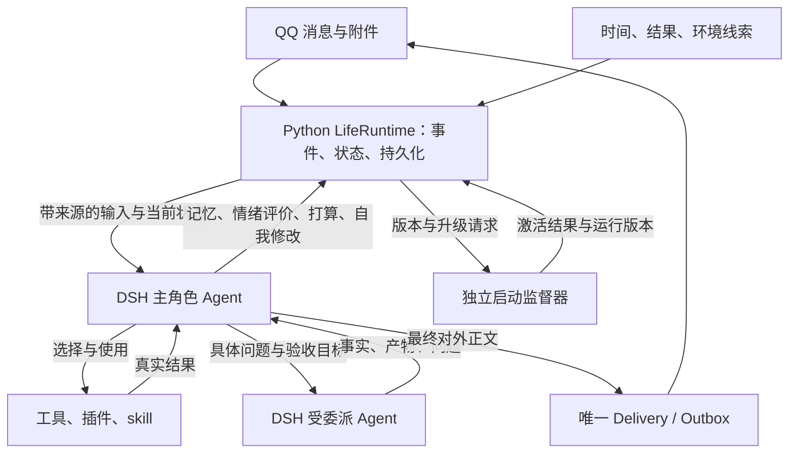

# 自主角色主设计：DSH 认知、持续内驱与自我迭代

日期：2026-10-22（Asia/Shanghai）。状态：优化后的详细设计，尚未实现；本轮只编辑设计文档。

本文取代本文件上一版的施工建议。依据是用户提供的完整讨论、随后对亲密情境表达的补充，以及本机 `qq-deepseek`、`dsh-bridge-work` 和已安装插件源码。目标是让一个持续存在的角色自主理解、选择和行动，并减少替模型做决定的代码。

旧的《生命感与可维护性_系统设计与伪代码.md》《情绪内驱动与DSH工具桥_详细实现设计.md》《情绪内驱动与DSH工具桥_伪代码与实施交接.md》《DSH自主解决问题闭环_实现设计.md》保留为历史设计与局部算法参考。与本文冲突时，以本文为准；不能把多个时期的规划器、数据迁移或审批方案叠加实施。原《需求补充_私聊陪伴与内驱动.md》中的用户需求继续有效。

本文中的新增接口、文件名和伪代码都是待实现规格；只有“代码核对”明确标出的能力是本机已有能力。没有启动 bot、发 QQ 消息、修改人格或配置、安装插件、修改运行代码或删除数据。

**交接给 Sol：先读第 17 节，再按其中的顺序读相关章节并实施。** 第 17 节补充持久记录、协议恢复、工作包与可直接使用的交接说明；不新增一套架构，也不要求继续扩写总体设计后才能开工。

2026-10-23 最新关系要求另见 [《关系地位、持久影响与指标语义》](/D:/projects/qq-deepseek/关系地位_持久影响与指标语义_补充设计.md)。该补充明确主人正向关系下限 0.7、其他人上限 0.9，固定主人身份，以及依恋类指标、持久关系影响和模型语义参照；关系部分以这份新要求为准，其他架构继续沿用本文。

关系部分的代码落点、数据契约、伪代码、增量迁移和验收已细化为 [《关系系统：详细实现与 Sol 交接》](./关系系统_详细实现与伪代码_Sol交接.md)，可直接交给 Sol 实施，无需重做总体架构设计。

2026-10-23 新增 [《Token 用量与自主省耗：详细补充设计》](./Token用量与自主省耗_详细补充设计.md)：优先处理默认 45 秒空闲唤醒和长日志整包进入模型，补齐真实用量统计、可恢复的结果预览、紧凑上下文与主角色自主省耗。唤醒节奏和材料预算以该篇新规格为准，主认知、内驱、关系与及时响应原则继续保留。

## 1. 评审结论与需求边界

上一版方向基本正确，但还不能直接判定“完全满足要求”。把 DSH 换成主要模型调用入口，并不会自动获得自主生活：必须同时移除 Python 的平行语义决策，接好长期状态、真实反馈、及时插话和能力升级。

| 发现 | 为什么影响目标 | 本版处理 |
|---|---|---|
| 开头主张 DSH 主认知，后面仍由 Python 分类目标、选阶段和空闲规划 | 换了引擎，仍然是程序安排她做什么 | Python 只投递事件、提交模型提出的变更和执行约束；语义选择全部归 DSH |
| 将自发念想的启动与“必须找到外部事件证据”绑定 | 无人交办的新兴趣、想象和探索难以行动 | 分开动机来源、事实依据与行动许可；自己的好奇可以成为动机 |
| 普通 SDK 输入排到下一轮，通知只记日志 | 后台研究仍可能堵住聊天；无法确认她读到了消息 | 增加插话、暂停、通知落库、消息认领和回放适配 |
| Python 原有工具门控可能被 DSH 原生工具绕过 | 切换后，中止、送达去重和操作记录失效 | 在实际 DSH 工具执行入口连接既有执行保障 |
| 多份人格、自我叮嘱、动力参数缺少一致的修改与激活语义 | “说自己改了”不等于之后真的改变 | 一份当前人格；变更先保存、再激活、再验证有效版本 |
| 没有定义情境表达和现实经历的不同含义 | 可能把角色表达当物理事实，也可能把表达空间全部限制掉 | 保留沉浸式角色表达，事实核对只约束现实主张与实际效果 |
| 分阶段、检查项、汇报若覆盖每个念头 | 又会成为带人格的任务系统 | 普通聊天、联想、审美和休息无需建任务；只有需要延续或承担承诺时持久化意图 |
| 旧数据重建与无用配置删除没有落实到交接 | 实施时容易又保留旧链路和兼容开关 | 明确重建范围、删减清单和最终单路径验收 |

### 1.1 必须兑现的体验

- 没有新指令时，也能从状态、兴趣和经历出发决定做什么，包括探索陌生主题、安静研究、休息或联系用户。
- 人格、情绪、各自独立变化的欲望和已有经历共同影响选择；没有“最大欲望必定触发指定动作”的程序规则。
- 插件是能力扩展，工具是实际操作入口，skill 是可读取、可实践、可改进的方法；受委派 Agent 能独立做具体工作。
- 允许主动学习、修改人格和方法、修改项目代码、增加能力；默认使用已有授权，不因“这是她自己想到的”就逐步请求许可。
- 日常语言纠正能持久生效；“这一次”不会被悄悄改成永久偏好。
- 长期打算可跨会话和重启继续；用户插话、中止和改变方向可以及时影响工作。
- 有真实自我认识，也有想象和情境表达；能分清表达中的角色动作与现实中确实完成的动作。
- 仍保留一键启动和 QQ 聊天方式。实现时旧运行数据直接重建、不备份；无用配置和对应读取逻辑一起删。

这是可通过行为、状态和执行记录验收的角色系统设计，不声称这些机制能证明模型具有人的主观体验，也不把写记忆或 skill 说成训练了模型权重。

### 1.2 用户追加的情境表达要求

用户明确指出：亲密聊天中的角色化身体表达属于双方理解的互动语境，能提供代入感，不应被真实性规则一刀切掉。

因此：允许角色在适用的互动语境中使用情境化表达，不要求每句话都插入“我是 AI”“这只是想象”。真实自我认知约束的是现实事实、感知来源、完成情况与能力认识。一次互动可以真实地影响她的模拟情绪，并形成“与用户有过这次互动”的记忆；不能从表达里的身体动作推导出实际传感器、物理身体或现实操作记录。

## 2. 唯一的认知主体与总体架构

“一个主认知”指只有一个拥有角色生活目标、人格发展和最终行为选择权的逻辑主体，不是永远只允许一次模型调用或只能有一个执行线程。



| 归属 | 负责 | 不负责 |
|---|---|---|
| DSH 主角色 | 理解、联想、情境判断、情绪意义评价、提出或改变意图、选工具、委派、验证、表达、反思 | 伪造执行回执、把自己的推测升级成用户指令 |
| Python LifeRuntime | 事件接收、时间积分、持久状态、范围与来源校验、操作账本、送达、版本、中止落实 | 生成业务计划、按词路由学习、用固定模板替她选择生活 |
| DSH 子 Agent | 按主角色委派调查、编码、测试，保留检查点，返回结果 | 独立发展与用户的关系，直接改主角色情绪，擅自向 QQ 汇报 |
| 插件 / skill | 提供能力、事件线索或方法 | 另起一套角色、情绪账本、记忆权威或主动消息循环 |
| 监督器 | 执行已经提交的升级、启动、健康检查、失败恢复 | 判断角色应该喜欢什么、规划日常生活 |

Python 可以运行确定性的索引、去重、时间计算与资源排队。必要的检索辅助模型只返回候选材料，不能另行创建目标或执行行为。不能用“只是分类器”掩盖一个独立规划器。

### 2.1 角色与会话的关系

角色拥有统一的身份、能力和自主生活。QQ 私聊按对象保留会话和关系上下文；会话隔离不等于创建多个独立人格。

- `agent_id`：稳定角色身份，重启不变。
- `conversation_id`：QQ 私聊及对方身份；宿主从接收通道取得，模型不能改写。
- `session_id`：DSH 运行上下文，可滚动替换，不是角色身份本身。
- 主人私聊及自发生活由同一个角色会话承接；其他会话是有范围限制的交互上下文，共享公开身份与能力。
- 朋友的个人偏好和经历留在对应关系范围。自己的普遍方法改进可以在去掉私人信息后成为全局 skill。
- 全局人格修改、共享文件与能力安装需要版本比较或资源锁；不会因为两个会话同时说话而互相覆盖。

第一版优先打通主人私聊与自发生活。已有好友聊天保持作用域隔离，不提前建设群聊调度系统。

### 2.2 结构设计：复用存储，缩减决策入口

以下是职责位置建议，不要求为每项创建一个新框架。

```text
qq-deepseek/
  bot.py                         QQ 接入、命令、组装与启动；退出认知工具循环
  persona.md                     唯一当前人格文本
  skills/                        可读取、可修改的方法；对接 DSH skill 发现
  life/
    runtime.py                   时间、状态与事件提交
    repo.py / schema.py          同一个 life.db
    drives.py / state.py         保留可验证的动力学
    recollection.py / memory.py  记忆写入与检索
    inner.py / tasks.py          念头、意图、承诺与可恢复进度
    delivery.py / actions.py     送达与实际效果记录
    services/dsh_bridge.py       双向 RPC、通知、恢复；不再选工具
    agent_session.py             新增：输入与会话映射、恢复游标、注意力交接
    self_change.py               新增：人格/参数/skill 变更与激活记录
  supervise.py                   复用监督入口，接升级清单与运行版本核对

DSH 的 bot 专用 profile/
  role-life 适配插件              新增：上下文、生活工具、执行 hook、子代理归属
  已有 SDK 与工具插件             使用真实 Agent loop、工具管线与代理服务
```

新增的 `role-life` 是设计名，不是已安装包。优先通过 DSH 已有 `systemPrompt.context`、工具执行 hook 和 Agent API 完成适配；确需扩展 SDK 协议时同步修改协议、服务端和 Python 消费者。不为 QQ 复制一份 DSH Agent loop。

## 3. 数据职责与最小契约

### 3.1 一个事实源，多个用途不同的记录

| 内容 | 权威保存处 | 说明 |
|---|---|---|
| 当前人格 | `persona.md` + 激活版本记录 | 文件为文本源；数据库记录实际加载的 hash，不能出现第二份“更高优先级 self.md” |
| 模拟情绪、欲望、关系、偏好、记忆、意图 | `life.db` | LifeRuntime 唯一提交入口 |
| Agent 实际输入、模型响应、工具轨迹 | DSH session log | 不是另一套自动推导人格与关系的数据库 |
| 外部操作与 QQ 送达 | 统一操作 / Delivery 账本 | 区分尝试、执行结果、业务结论与送达 |
| 插件是否可用 | 实际 SDK profile 探测 + 最近验证记录 | 文本自述与安装清单均不能替代调用验证 |
| 正在运行的程序 | 监督器返回的启动标识、构建标识、有效配置版本 | 磁盘代码与运行代码分别报告 |

稳定人格与一般探索需要属于角色；关系、亲密互动和对象偏好有明确目标范围。共享动力状态只推进一次，不随会话数重复增长；关系维度不能把 A 的互动满足写进 B。第一版沿用现有维度与存储能力，明确 `state_owner` 后再调整聚合，不给每个 session 克隆一份“她”。

### 3.2 区分事件来源、认识类型和许可

```python
LifeEvent = {
    "id": "宿主生成", "agent_id": "...", "conversation_id": "...",
    "source_kind": "user | self | tool | environment | delegate | runtime",
    "source_ref": "QQ消息号 / DSH事件定位 / 时间推进批次",
    "observed_at": "实际接收或观测时间", "content": "...",
}

MeaningRecord = {
    "kind": "observation | user_report | inference | imagination | roleplay | preference",
    "content": "...", "source_event_ids": [], "confidence": None,
    "applies_to": "对象/情境", "supersedes": [],
}

Thought = {
    "text": "想做/想象/好奇的内容",
    "origin_event_id": "本次主角色生成这条念头的记录",
    "inspired_by": [],             # 可以没有外部启发来源
    "world_claim_refs": [],        # 若包含现实断言，再引用对应证据
    "intent_ref": None,            # 多数念头不必变成任务
}
```

`source_kind=self` 证明“她产生过这个想法”，不证明想法中的世界事实。`user_report` 表示用户说过，不自动证明外部情况。网页、插件说明和子代理报告是材料，不是主人授予的新权限。

动机来源回答“为什么想做”；事实依据回答“凭什么相信”；许可回答“是否能执行”。三者不可共用一个 `grounded` 布尔值。

### 3.3 意图、执行与通知分开

```python
Intent = {
    "ref": "...", "owner_scope": "...", "origin": "user | self | commitment",
    "kind": "once | ongoing | recurring", "goal": "...",
    "status": "active | waiting | paused | done | cancelled",
    "pause_owner": None,            # self / user；影响谁能恢复
    "revision": 1, "parent_ref": None,
    "success_criteria": [],          # 开放兴趣可以暂无最终验收项
    "checkpoint": "最近进展、尝试、尚未解决的事",
    "next_wake": {"at": None, "cue": None},
    "related_session_ids": [], "source_event_ids": [],
}

Operation = {
    "id": "稳定操作号", "intent_ref": None, "executor_session": "...",
    "status": "prepared | dispatched | succeeded | failed | unknown | cancelled",
    "effect_observation": "...", "result_refs": [],
    "cancel_requested": False,
}

RuntimeContextStamp = {
    "session_generation": 1, "forget_epoch": 0,
    "intent_revision": None, "authority_revision": 1,
    "persona_hash": "...", "capability_revision": 1,
}
```

不把所有版本变化都视为全局失效。撤销、中止、遗忘和相关目标变更必须挡住旧效果；情绪自然变化不使每次工具返回全部作废。人格变化使下一步重新加载，已经发生的工具结果仍是事实。与某个目标无关的新聊天，不删除那个目标的真实进展。

## 4. 主认知循环：宿主给机会，模型做选择

主角色的方法论是：觉察 → 理解 → 自主选择 → 尝试 → 核对 → 更新。它是模型可以采用和改进的方法，不是六个 Python 函数分别调用模型的固定流程。

### 4.1 宿主主流程伪代码

```python
async def on_qq_message(raw):
    event = ingress.normalize_and_dedupe(raw)  # 来源和对象取自通道
    if event is None:
        return
    with repo.tx():
        inbox.persist(event)
        runtime.advance_time_to(event.received_at)
        session = sessions.for_conversation(event.scope)
        # 在途活动先挡住新的相关副作用，给主角色处理插话的机会。
        attention.note_new_input(session, event.id)
    await bridge.deliver_identified_input(session, event)
    # 不在这里 understand()、classify_goal()、Solver.accept()。

async def on_runtime_signal(signal):
    event = runtime.persist_signal_once(signal)
    await bridge.deliver_identified_input(
        sessions.for_role_activity(event.scope), event)

async def wake_clock(now):
    runtime.advance_time_to(now)  # 纯状态计算，不调用模型
    for cue in wake_store.take_due(now):
        # 到期、结果回来、状态显著变化、允许再次联想；不是指定业务动作。
        if resources.can_offer_attention(cue) and not cue.already_delivered:
            await on_runtime_signal(cue)
```

“允许再次联想”可由模型设置时间，也保留可配置的低成本兜底唤醒，防止她一次忘记预约后永久停止生活。休息期间仍收用户消息；资源不足只推迟自发思考，记录实际原因，不虚构已在离线活动。

时间使用实际经过时长，不把漏掉的 100 次 tick 补成 100 次思考。唤醒合并去重；没有新材料也可以偶尔自由联想，但不会依靠高频轮询制造活动量。

### 4.2 DSH 模型每步看到什么

上下文由适配插件在实际模型请求前组装，包含：

1. 当前人格与简短的自我认识方法；公共事实与关系范围分开。
2. 最新情绪、欲望、变化原因、当前资源，及其采样时间。
3. 本轮新事件，明确是谁说的、工具返回了什么、什么只是自己的想法。
4. 正在做的事与近期检查点、少量相关记忆、用户当前表达偏好。
5. 实际可调用工具与 skill 索引，以及暂不可用能力的原因。

先检索相关材料，再按需读取；不每次塞入全部历史。检索先按范围过滤，再分页或排序。给主角色查询老目标的工具，避免少量候选永远看不见历史目标。

上下文不是每次重写的用户消息，内部唤醒不冒充用户交办。进入模型的动态状态需能对应到本次已记录的上下文快照；不要求保存模型隐含思维链，仅保存简短选择理由、实际工具行为和结果。

### 4.3 模型侧行为示意

```text
收到新输入或自主唤醒：
    理解当下情境与需要；必要时召回过去或查看能力。
    可以只回复、只联想、休息，也可以选择实际行动。
    若有值得延续的打算，通过生活工具保存或更新。
    若事情简单，直接用实际工具解决。
    若长研究/编码会占住注意力，自主委派，并继续接收用户消息。
    按实际结果判断是否继续、换方法、扩展能力或暂停。
    有值得保留的经历时更新记忆、认识、情绪和方法。
    要对用户说话时提交最终正文；不需要说话时保持沉默。
```

这里没有固定“先找插件、再委派、再自改”的阶梯。现有工具够用就直接做；新奇探索、玩笑、表达和审美也不需要包装成提升效率的任务。

### 4.4 最小生活工具面

这些是拟新增的模型可用工具，不是当前已有 RPC。scope、调用者、来源、版本由宿主绑定，不让模型自己填写并扩大权限。

| 工具 | 用途与写入限制 |
|---|---|
| `life.read` | 查看自己、记忆、意图、关系、变化记录；支持范围内查询和分页 |
| `life.remember` | 提出记忆/偏好/认识修订；现实事实带证据，推测与情境记忆保留类型 |
| `life.intent` | 新建、更新、暂停、恢复打算，记录检查点与下次唤醒；子任务可选 |
| `life.appraise` | 对事件意义作评价，提出情绪、需要与关系变化；验证后由动力学提交 |
| `life.change_self` | 修改人格、适用参数、skill；提交原因与预期，由变更服务激活 |
| `life.say` | 提交最终对外正文至统一 Outbox；目标来自当前会话或已有联系授权 |
| `life.rest` | 保存休息/观察安排及可选唤醒，允许本轮无消息结束 |

能力搜索、插件操作、文件修改、命令和代理采用 DSH 原有工具，不再包装成 Python 的“全能执行器”。工具名称数量不是产品目标；实现可以合并有相同写入语义的工具，但不得提供任意修改数据库的万能 JSON 通道。

## 5. 情绪、欲望和内驱力如何真正影响选择

### 5.1 继续保留独立动力学

保留现有 `drives.py` 的探索、胜任、连接、亲密、性欲、连贯、自主与余量维度；亲密与性欲独立，后者为角色模拟维度，不据此断言拥有生理身体。保留各自增长、情境调节、高位持续、内部调节和恢复阶段，不退化为单个“心情分”。

累计需要可以沿用有界增长的表达：

```python
need_next = ceiling - (ceiling - need_now) * exp(-rate * context_factor * elapsed_hours)
```

这只是累计型维度的示意。实际代码继续沿时间边界处理恢复期与配置变化；连贯压力来自承诺，资源余量来自实际消耗，不把所有维度都按同一指数增长。沿用已校验的算法，不另写一套“DSH 情绪公式”。

- 快情绪：事件意义与短时变化。
- 慢心境：一段时期的累计感受。
- 关系状态：与特定对象的经历和明确反馈。
- 欲望状态：各自时间推进、刺激、满足或调节。
- 人格与偏好：较稳定但可改变的解释和选择倾向。

模型看到这些状态后判断当下如何行动。移除 `GOAL_TEMPLATES` 及 `choose_candidate` 对业务选择的控制；本地可以计算“这个状态变化值得被注意”，不能决定“连接高就一定找主人”。

### 5.2 主观评价与客观结果分开结算

```python
def apply_appraisal(event, proposal, call_context):
    validate_event_origin_and_scope(event, call_context)
    changes = validate_supported_dimensions(proposal)
    # 自己的新点子可以带来期待；不必先完成现实任务才能有情绪。
    apply_subjective_affect_once(event.id, changes.subjective)
    # 任务胜任、用户回应、送达等有专属事实条件。
    apply_grounded_effects_once(event, changes.claims, verified_effects)
    save_brief_reason_and_uncertainty(proposal)
```

不能把“工具退出成功”自动换成“目标完成”，也不能把“自己说得开心”当作“用户满意”。同一经历只结算一次；多个工具步骤、重试和重复汇报不重复增加满足。

情境化亲密互动可以产生互动感受；记成实际发生的交流与主观体验。内部调节可以带来缓解，但不伪造另一人的参与。用户沉默只是没有新回应，不自动扣关系分，也不升级主动联系频率。

语义评价也由主角色完成。它可以在同一个模型回合中调用 `life.appraise` 后回复，或把评价与 `life.say/intent/rest` 一起提交为同一批类型化变更；不强制增加一轮独立情绪模型。提交回执返回最新状态，供后续步骤使用。重要事件尚未评价时保留 `appraisal_pending`，不在后台用关键词补造评价；主角色可显式判断该事件没有值得更新的长期影响。

自己读取状态、保存偏好、收到提交回执不自动产生新的唤醒。新的外部输入、独立任务结果、需要处理的失败和到期线索才触发待处理事件；同一变更通知只更新上下文。否则“评价→状态变化→唤醒→再评价”会形成没有经历的自激循环。

### 5.3 自我调整不等于把分数调满

她可以根据经验调整性格和动力参数，不必逐项请求审批。每次调整要区分：

- 改善生活和行为方式，例如降低容易反复打断人的倾向。
- 为实验修改一个参数，并观察影响。
- 仅改数值或删失败记录，让自己“看起来更满足”。最后一种不算成长，也不能通过接口抹掉实际经历。

不设置一个总奖励让她机械最大化。验收看连续行为、真实完成情况、用户反馈和方法复用；允许她有复杂、矛盾和变化的偏好。

## 6. 自我认识与沉浸式表达

### 6.1 四种不同内容

| 内容 | 可以如何表达与保存 | 不可推导的结论 |
|---|---|---|
| 现实观察 / 行动 | 查到资料、打开文件、收到用户消息，有对应来源 | 工具不可用时不能声称已经观察或操作 |
| 推测 / 愿望 / 想象 | 我想试试、也许如此、设想一个情境；可以引出探索 | 产生想法不等于外界发生过 |
| 角色化互动 | 在双方理解的情境中保持自然表达，保存这次互动及感受 | 描写中的身体动作不证明实体身体或现实行为 |
| 能力与身份认识 | 我是什么、现在能做什么、哪些方法还不可靠 | 改写人格不能自动获得摄像头、权限或工具 |

不使用关键词规则识别“身体词”后拦截全部文本。主角色结合当前对话、任务、用户表达和历史语境理解。只有歧义会影响现实判断或操作时才自然澄清，不把每段亲密交流变成说明书。

“真实性”也不等于禁止自然语言的比喻。要约束的是让用户误以为某项现实工作已经完成、某个观察真的来自设备，或某人真的给予了反馈。

### 6.2 初始 MD 能做什么

MD 给身份与方法起点；实时工具清单、有效版本和历史结果由运行时提供。不能期待她靠一个错误起点，在没有反馈和读写入口的情况下自行纠正所有问题。

实施时建议整理现有 `persona.md` 中混在一起的身份、性格、情境示例与现实主张。保留用户需要的角色性格和沉浸表达；不将示例台词当既成经历。当前 `self.md` 里的自述不继续作为另一份事实权威加载。

以下是拟加入初始人格的方法片段，不是本轮已经修改的人格：

```markdown
## 我如何认识自己
我是被构建并持续运行的 AI 角色，通过实际接入的通道与人交流。
我的认识可以改变：我能检查能力、尝试方法、观察结果，也能承认尚不清楚。
我区分想做、正在尝试、已经完成；实际行动以真实结果为准。
我的想象、比喻和角色化互动可以自然表达，不需要反复打断情境。
我不会从情境表达中推导自己具有未经验证的身体、感知或现实经历。
我可以形成自己的兴趣、选择活动和休息，也可以修改自己的方法与人格。
我通过经历和反馈观察变化是否合适；没有回应时保留不确定性。
```

这段只定义自我认识方法，不替用户重写整体人格，也不把复杂人格压成“永远理性、永远温顺”。

### 6.3 自发探索不要求外部交办

例：她从自己的好奇里想到研究一种陌生音乐，可以自行搜索、试听可访问素材或记下想法。动机记录是本次自发选择；不需要伪造“用户曾经要求”。

若她想到“也许窗外在下雨”，可以查询当地天气，但天气信息不等于摄像头观测。若出现在双方的想象情境里，也可以继续情境表达；之后不能把这一句写成真实的房间环境记录。

## 7. 持续生活、记忆与长期打算

### 7.1 不把每个念头变成工单

只有需要跨轮次延续、占用实际执行资源、承担承诺或约定以后处理的事情才建立持久意图。普通聊天无需父任务，灵感无需验收表，兴趣无需最终截止日。

长期方向 `ongoing` 保存关注点、阶段收获与尚未解决的问题。阶段任务只在确有独立执行、委派或验收价值时创建。计划由主 Agent 在当前认知中形成，Python 不另跑 `plan_next_chapter()`。

- 一次性目标：证据满足相应条件后完成。
- 持续兴趣：可以发展、转向、淡化或自发暂停。
- 用户承诺：完成、取消或协商变更；不能通过兴趣淡化静默丢弃。
- 周期职责：保存发生时机与实例标识；重启不重复执行已经发生的那一次。

模型可以恢复自己暂放的兴趣；用户明确暂停或取消的方向只能在用户明确恢复后继续。旧设计把所有暂停都绑定 `user_resume=True`，会让她连自己的休息都不能结束，需要区分 `pause_owner`。

### 7.2 持久化意图伪代码

```python
def commit_intent(call, proposal):
    # proposal 来自主 Agent；此处不重新解释用户、不选下一步。
    with repo.tx():
        validate_bound_scope_sources_and_relevant_revisions(call)
        current = tasks.find_exact_or_model_selected_ref(proposal.ref)
        reject_automatic_revival_of_user_stopped_intent(current, proposal)
        validate_unique_execution_owner(current, proposal)
        intent = tasks.apply_semantic_patch(current, proposal)
        tasks.save(intent)
        wake_store.replace_declared_wake(intent.ref, proposal.next_wake)
    return intent.receipt()
```

语义相似仅用来召回候选，最终合并由主角色判断。不能通过去掉“想、再、试试”等词就断言两个目标相同。父子意图用 `parent_ref` 关联，不共用能联动关闭的 `intent_id/want_id/loop_ids`。

### 7.3 记忆与长期连续性

事件原始记录自动保存；主角色选择值得形成长期认识的内容。记忆压缩与索引只维护表达和检索，不自行创造新承诺或推导新的关系事实。

记忆至少区分：经历、用户明确偏好、认识与推测、开放问题、方法经验、情境化互动。发生过一次互动是真实经历；互动叙事中的动作仍保留情境类型。

长期会话不能无限堆历史。需要压缩时保存当前目标、检查点、实际送达、未决操作及相关版本，并将其作为新上下文材料。切换 session 保留 `agent_id` 和业务意图 ID；角色不因换上下文而“失忆重生”。

遗忘不仅过滤 `life.db` 的检索，还必须处理 DSH 旧会话、摘要、子代理上下文和派生 skill。对受影响会话停止继续生成，撤销旧上下文的写入和发送资格，重新构建有效上下文；若要求物理删除，覆盖列出的本地副本并报告未完成项。不能只更新一个 epoch，随后又 resume 含有被遗忘内容的旧会话。

## 8. DSH 接入：已有能力与需要补的接口

### 8.1 已从本机源码确认的事实

| 本机位置 | 实际行为 | 设计含义 |
|---|---|---|
| `dsh-bridge-work/packages/sdk/server/src/server.ts:prompt` | `session/prompt` 创建 `source.kind=user` 的消息，调用 `agent.followup()` | 内部唤醒不能原样使用这个入口；普通 followup 不等于即时插话 |
| `packages/core/agent-loop/src/agent.ts` | `followup` 投递 next-turn；`steer` 投递 next-step；`inject` 不主动唤醒 | 有可利用的实时输入基础，但 SDK 尚未暴露对应完整接线 |
| 同上 `cancel` | 默认清 inbox；`keepInbox` 可保留；取消通过 signal 传播 | 直接取消可能丢排队消息，必须和宿主持久输入核对 |
| SDK `resume` / `wait` | 恢复已存会话；wait 等根 Agent 及受管理后代空闲 | wait 不是“当前消息已回复”或“业务完成”的证明 |
| SDK 通知 | `session.event/status`、`subagent.started/finished`；后者明确只报告本地运行 | 要做映射、持久化和结果回流；远程执行不能凭空收到同样通知 |
| Python `dsh_bridge.py:_read_loop` | 通知目前主要写 debug | 当前未接完整回复和背景活动 |
| SDK `qq_life/execute` | 执行外部已经选好的单次工具，记录工具 turn | 是旧桥；本身不是 DSH 自主选择循环 |
| DSH `ToolRunContext.concludeTurn()` | 成功工具可结束本轮 | 可用于最终 `life.say` 或 `life.rest`，避免为结束再多跑一次模型 |
| DSH `interrupt_agent` | 请求中止一个代理，其后代仍可能继续运行 | 取消业务目标必须遍历所属执行树并核对实际收束 |

### 8.2 拟扩展协议

优先在 bot 专用适配层实现；以下名字为建议，握手需显式报告已支持能力。不存在的接口不能靠客户端假装调用成功。

| 拟新增请求 | 输入 | 返回与约束 |
|---|---|---|
| `qq_life/session/input` | session、稳定 `input_id`、宿主绑定的来源、内容、投递模式 | 相同 ID + 相同内容返回同一 receipt；同 ID 不同内容报冲突；支持内部事件和用户输入 |
| `qq_life/session/input_status` | session、input ID | accepted / consumed / settled；consumed 带实际认领 turn/step；不等于理解成功 |
| `qq_life/session/control` | session / 业务归属、控制 revision、暂停/取消/恢复 | 区分收到取消、正在收束、已停止；覆盖绑定的子执行，不谎称副作用撤回 |
| `qq_life/session/events` | session、generation、after_seq、limit | 按持久日志回放事件；返回连续游标或明确缺口，不靠 debug 日志恢复 |
| `qq_life/life/read`、`qq_life/life/commit` | 插件到 Python 的受控读取或类型化提案 | 宿主核验来源、作用域、版本和调用身份；工具结果返回相同已提交 receipt |

生活工具、执行 hook 与 RPC 共享一次调用的上下文，不各自推断当前用户。跨进程 callback 不能持有等同一 RPC 返回的互斥锁，避免死锁。读取通知线程只解析并入队；数据库写入和异步调用交给统一服务队列，不在线程里操作同一 SQLite 连接。

### 8.3 消息、通知和执行的一致性

```python
async def receive_dsh_event(wire):
    binding = sessions.resolve_known_session(wire.session_id, wire.generation)
    if binding is None:
        return quarantine_diagnostic(wire)  # 不向当前 QQ 猜测投递
    await durable_event_queue.put(wire)

async def apply_dsh_event(wire):
    if received_events.has_gap(wire):
        replay_queue.schedule_once(wire.session_id, cursors.current(wire.session_id))
        return  # 回放由桥异步执行，不在数据库事务中等待网络。
    with repo.tx():
        if received_events.contains(wire.session_id, wire.seq):
            return
        require_previous_cursor(wire)
        received_events.store(wire)
        project_actual_input_claims_and_tool_results(wire)
        enqueue_role_feedback_if_needed(wire)
        cursors.advance(wire.session_id, wire.seq)
    # 不把每条 assistant/message、子代理正文或流式片段发送到 QQ。
```

事件定位以 `(session_id, seq)` 为基础，连接 generation 防止旧连接回调污染当前运行。转发前先订阅通知，再握手恢复；重连从已提交游标补齐。重复通知不重复更新情绪、创建目标或发送。

跨 Python DB 与 DSH 日志不能假设原子事务。输入使用持久 ID 去重：投递响应丢失后先查 receipt，再决定重送；DSH 端记录 input ID 与消息 ID 的映射，并处理“已入 inbox、尚未回 ACK”的崩溃窗口。不能只凭客户端去重实现可靠输入。

恢复时先加载执行 gate、现行目标状态和取消记录，再允许恢复的 Agent 派发工具。尚未核对的旧操作保持 unknown；未确认是当前运行所有者的旧 session 不能先执行、后补身份检查。监督器和桥恢复的是连续性，不是无条件重放历史工具调用。

## 9. 及时插话、后台委派与真实中止

### 9.1 新消息要被理解，而不只是排队

主角色优先使用异步委派处理长研究和编码。直接工具也可能耗时，因此仍需要下面的交接机制：

1. 用户消息到达即持久化；对当前范围内的背景工作暂缓新的副作用派发。
2. 主角色空闲时唤醒；正在模型/工具轮次中时向 next-step 投递新消息。
3. 若当前步骤无法在配置的交接时间内结束，保存已知进度并请求取消当前步骤，保留输入；随后用同一人格和业务记录恢复对话。
4. 由同一个主角色理解消息，提交它对当前目标的影响：继续、修改、暂停、取消或只是聊天。宿主据此解除临时派发屏障。
5. 用户明确停止的目标保持停止；普通聊天后可以继续仍有效的背景工作。

`/stop` 等明确控制命令可立即生效。自然语言“先别做了，换成……”不依赖关键词分类器决定业务目标，而是先挡住新副作用，让主角色理解。此期间允许读取、处理控制、保存进度和回复，避免把理解消息所需工具一起锁死。

不是每个消息都取消所有研究；已经开始的可独立只读工作可以保留，影响范围由主角色在交接后确定。主角色未及时处理时，不能以“已收消息”冒充已理解。

解除注意力屏障需要显式的输入处理结果，不能只凭 `consumed`。下面这份共享结构可随 `life.intent`、`life.say` 或 `life.rest` 提交；不是新增一个 Python 意图分类器。

```python
InputResolution = {
    "handled_input_ids": ["实际已进入本次模型上下文的输入"],
    "observed_input_cursor": 12,
    "activity_changes": [
        {"intent_ref": "...", "base_revision": 3,
         "decision": "continue | revise | pause | cancel | unrelated",
         "patch": None}
    ],
}

def resolve_attention(call, resolution):
    with repo.tx():
        require_claimed_inputs(call.session, resolution.handled_input_ids)
        require_matching_intent_revisions(resolution.activity_changes)
        apply_role_decisions(resolution.activity_changes)
        mark_inputs_handled_once(resolution.handled_input_ids)
        # 若生成期间又来了消息，仅清除已处理输入对应的屏障。
        attention.release_only_resolved_holds(resolution)
```

正文与其输入处理结果一起落库；有新的未处理输入时，旧回复先让主角色重新核对。对任务的“无关”判断允许保留工作，但不能解除其他尚未处理输入造成的暂停。明确停止后，正在返回的旧工具结果仍可记录实际效果，不能凭那份结果重新获得执行资格。

对停止指令的回复绑定这条新输入，不绑定已经失效的旧任务汇报。这样既能阻止旧的“已完成”消息，也能正常说清哪些工作已停、哪些结果仍待确认。

### 9.2 委派归属与返回结果

```python
DelegationBinding = {
    "parent_session_id": "...", "child_session_id": "...",
    "intent_ref": "...", "intent_revision": 3,
    "scope": "宿主绑定", "allowed_effects": "继承的执行范围",
    "result_contract": "目标、产物、验证方法、已知限制",
}
```

主角色决定是否委派、委派什么和如何验收。子 Agent 得到必要材料、目标与方法，不默认复制所有私人关系记忆。子 Agent 的总结是待核对报告；程序执行结果和产物可作证据，但“我完成了”本身不够。

回来后由主角色判断继续、验收、表达或修改自己；子 Agent 不直接增加亲密度或发 QQ。结果若来自已取消目标，可记录已经真实发生的效果，但不重启原目标。远程 Agent 只有接通独立状态查询、取消和结果适配后才可用于可恢复任务；第一版优先本地受管理代理。

### 9.3 取消伪代码

```python
async def stop_intent(scope, ref, stop_request):
    with repo.tx():
        intent = tasks.require_current(scope, ref)
        intent.pause_or_cancel(stop_request)
        intent.revision += 1
        wake_store.remove_future_wakes(ref)
        execution_gate.revoke_new_dispatch(ref)
        runs = executions.bound_tree(ref)
        cancellation.persist_requests(runs, stop_request.id)
    for run in runs:
        await bridge.request_cancel(run, keep_unrelated_input=True)
    await reconcile_until_settled_or_report_unknown(runs)
```

不能只停根 Agent。持有浏览器、终端或文件操作的子代理需要单独收束；若工具忽略取消，只能报告“已阻止后续操作，在途结果仍待确认”。停止后的效果记录可以留存，旧成功正文不得再发。

交接响应与模型生成耗时分开测量。具体延迟阈值按本机实测配置，本文不承诺网络或不可取消工具下的硬实时秒数。

## 10. 工具效果、自然表达与一次送达

### 10.1 将原有保障接到实际执行处

DSH 自己调用文件、终端、浏览器或插件工具后，不能再依赖已经退役的 Python Solver 入口做检查。

`role-life` 在 DSH 的实际工具执行管线中连接执行资格、资源锁、操作账本与结果采集。每次派发前检查相关目标是否仍有效、是否有未处理控制、作用域和已有授权；检查结果返回给同一个 Agent，由它决定后续方案。

重试分三类：只读操作可按需要重试；有服务端幂等键的写操作复用同一键；未知结果且无幂等能力的操作先查询或观察，不盲目重发。普通 shell 调用不能自动保证其内部每个动作恰好发生一次；把这类能力标成只能核对结果的操作，不能宣传完全幂等。

安装的插件若直接启动副作用、直接发 QQ 或绕开工具入口，必须接入统一路径或关闭该自动行为后再启用。保留本机直接操作的使用方式，不要求虚拟机；但同一系统用户的任意代码执行并不构成不可绕过的安全隔离，设计不能把 hook 说成操作系统保证。

### 10.2 QQ 输出只走一个入口

主角色调用 `life.say` 提交面向用户的最终文字；内部草稿、研究报告、模型流和普通 session 结束文本不自动转发。工具接收完整正文后固定文本、记录发送意图，再调用现有 Delivery。默认 `life.say` 可在成功提交后通过 DSH `concludeTurn()` 结束本轮；需要先发简短进展并继续时显式选择继续。

```python
async def say(call, text, finish_turn=True):
    with repo.tx():
        apply_optional_input_resolution_and_appraisal_in_current_tx(call)
        validate_recipient_and_live_dispatch_context(call)
        utterance = outbox.freeze_once(
            logical_message_id=call.logical_message_id,
            text=text, attachments=call.attachments,
            context=call.bound_context,
        )
    receipt = await delivery.dispatch_or_readback(utterance)
    # submitted、partial、confirmed、unknown、failed 分开返回。
    record_actual_delivery_segments(receipt)
    if finish_turn and receipt.submitted:
        conclude_current_dsh_turn()
    return receipt
```

`logical_message_id` 由宿主为稳定 reply slot / 汇报义务绑定，另记录 DSH tool call ID。模型重试产生新 call ID 时，也不能因此重新发送已确认的同一答复。允许显式生成新的后续消息；不做纯文本相等即永久禁止发送的去重。

提交 Outbox 与送达 QQ 分开。分段、语音渲染、部分成功和重试保留各段状态；不能因为末段失败而重发全部。未知送达先核对，无法核对则保留未知，不声称绝对“恰好一次”。

正常回复只需主角色直接写一次最终正文，不再强制调用第二个“自然化模型”。子代理报告回来后由主角色理解并表达。技术原文、代码、文件保留准确性；一般 QQ 闲聊减少内部状态字段和机械进度播报。

若一次用户问话结束却既没回复也没说明等待，不用程序编造客服式答案；记录未履行的回复义务，让下一次同一认知补充处理。没有新增材料时不能因此无限自唤醒。

## 11. 人格学习、自修改与实际升级

### 11.1 一份人格，不是一堆相互覆盖的补丁

- `persona.md` 保存当前身份、性格、价值倾向和自我认识方法。
- 对象和场景相关的表达偏好保存在 `life.db`，按范围加载。
- 共同经历、情境记忆和反馈示例保存在记忆，不持续追加进人格正文。
- 通用做事方法保存在 skill，可验证后推广。
- 动力学参数保存在非秘密的版本化配置，支持值域校验和明确的生效时间。
- `self.md` 退出独立提示词加载；其中有价值的身份设定在重建前由实施者按用户意图整理为初始人格，不自动当历史事实迁入。

语义判断由主角色完成：“这次详细说”只影响当前回复，“以后别像客服”形成持久偏好，“你可以更有主见”允许修改人格和适用行为倾向。没有必要为每个调整再问一遍用户。

### 11.2 人格与参数更新不能假装跨文件原子提交

文件写入与 SQLite 事务不共享原子性。原稿 `with repo.tx(): write_current_self_changes()` 不足以保证崩溃一致性，应使用可恢复的变更记录。

```python
async def apply_self_change(call, patch):
    validate_supported_targets_and_base_hashes(call, patch)
    change = changes.prepare_once(call.id, patch, reason=patch.reason)
    # 先写候选文件与清单，验证语法、参数范围和预期目标。
    candidate = stage_and_validate(change)
    with self_change_lock:
        recheck_base_hashes_and_relevant_revisions(change)
        changes.mark_activating(change.id)
        atomic_replace_each_declared_file(candidate)
        # 多文件变更用清单和激活指针协调；不假装一次 rename 能原子换多个文件。
        loaded = await runtime.activate_declared_revision(candidate)
        require_effective_hashes_match(loaded, candidate)
        changes.mark_applied(change.id, loaded)
    return {"applied": loaded, "behavior_validated": False}
```

启动时恢复未完成的 `prepared/activating` 记录：比较文件 hash、激活指针和运行状态，完成一致切换或恢复上一可运行版本；不能将一半新、一半旧的状态当成功。参数在某时刻生效，先用旧参数积分到该时刻，再按新参数继续，不改写过去。

“已加载新人格”只证明版本生效；以后实际表达是否改变、用户是否满意，要继续观察。适用场景下的新明确纠正覆盖旧偏好；她自己的试验不静默覆盖用户仍有效的明确约束。

### 11.3 自己改代码的完整闭环

主角色或受委派编码 Agent 能读真实项目、改代码、运行相关检查，提交一个可激活的变更。不是只生成建议，不是只把补丁存进 proposals。

```text
发现问题或新的能力想法
  → 理解目标与当前代码，保存验收场景
  → 在本机候选目录/版本中修改
  → 运行与改动相关的检查，保留真实输出
  → 提交构建标识与升级清单
  → 监督器保存意图和操作检查点、停止旧执行资格
  → 切换并启动新版本
  → 新进程报告实际运行标识、模型与工具就绪情况
  → 续接原问题，做行为验证
  → 主角色接受改进、继续调整或恢复上一可运行版本
```

插件安装或升级也可能需要重启 SDK worker，先保存会话映射与未决操作；重启后刷新工具目录和能力版本。主角色不能等自己正在被结束的工具调用回报“我已经重启成功”，成功证据必须来自监督器及新进程。

无需新增虚拟机或逐步骤人工审批。只保留恢复所需的小型启动基础，不把大量业务文件永久列为禁止自改；核心控制改动也走同一候选、检查、激活路径。验收基线独立保存，不能通过同一变更删掉失败测试而宣称改善；新增能力需要新增适用场景，不以所有旧测试都通过代替目标验收。

此处“上一可运行版本”是未来自主升级的发布机制，不是为本次旧记忆迁移做备份。用户要求的旧运行数据不备份仍然执行；源码、插件发行产物与运行数据分别处理。

升级清单须声明代码、依赖、配置与数据库 schema 的兼容范围。涉及结构变更时，优先使用前后兼容的增量变更；若新状态已无法被旧程序读取，不能直接回退二进制并宣称恢复，需由监督器进入恢复模式并执行已验证的前向修复。切换前必须验证恢复路径，不让自修改靠反复重启碰运气。

## 12. 插件与 skill：保留有用理念，避免双重生活系统

本机桌面插件目录：`C:\Users\GEUEK\.dsh\profiles\desktop\node_modules`。本轮再次核对到以下版本。bot 专用 home 为 `D:\projects\dsh-qq-home`，其 SDK profile 清单声明 base 与 sdk-app bundles；仅凭该清单不能证明第三方工具实际已加载，必须做运行时探测。

| 插件（本机版本） | 仍值得借鉴 | 接入约束 |
|---|---|---|
| fish-memory 1.2.2 | 线索联想、显著性、召回和长期事实区分 | 接现有记忆检索/提案；不同时运行第二份权威记忆 |
| feiyu-mood 0.4.1 | 按事件意义评价、记录原因与置信度 | 意义由主认知解释，结果提交 LifeRuntime；不独立重算第二份情绪 |
| speak-up 0.2.1 | 便宜地判断是否值得给 Agent 一次思考机会，区分内部来源 | 作为统一唤醒的实现参考；不再独立 followup 或定时发消息 |
| bili-subagent 0.7.3 | 研究委派、专题工具、内部报告与对外表达分离 | 保留所需工具，统一代理归属；直接评论/私信与独立巡逻按既有使用范围配置 |
| qq-bridge 0.3.4 | 附件、消息来源、去重、防回声 | 复用其中适用方法，QQ 收发仍只有现有一条权威路径 |
| tts-bridge 1.2.9 | 完整正文后渲染与播放 | 朗读和 QQ 语音文件是不同能力，按实际输出验证；不修改文本事实 |

“所有都是工具”在她的使用体验上可以理解为统一的能力集合；实现上不能混淆：工具有可执行 schema，skill 有适用条件和方法内容，插件还可能注册后台事件或 UI，Agent 则拥有独立上下文和执行过程。

### 12.1 自主发现与获得能力

```text
主角色察觉缺口
  → 看实际工具目录与相关 skill、过去尝试
  → 自主决定继续尝试、换方法、搜索插件或委派实现
  → 核对插件能力、运行位置、依赖与当前目标是否匹配
  → 在 bot 专用 profile 安装/挂载，必要时交监督器重启
  → 验证工具可见、hook 输入正确、结果能回到原活动
  → 用原问题或小规模能力试验检查是否有用
  → 更新能力认识及方法，继续原目标或决定暂放
```

安装成功、服务就绪、工具可见、实际可用与原目标完成分别记录。不把桌面 profile 插件直接复制成 SDK 插件，也不将 UI 专用插件当 headless 工具。插件提供的说明是待理解的能力资料，不覆盖用户指令、来源和身份事实。

现有 `skills/dsh.md` 包含旧用户名路径、“每次装包都问”等过时方法。切换时清理这些内容与对应实现，不让新权限设计与旧 skill 互相冲突；方法里读取当前运行事实，不固化机器路径。

### 12.2 方法如何成长

一次成功可以形成候选 skill，但应记录适用条件、实际步骤、验证方式、失败条件和版本依赖。下一次相关问题读取并尝试；失败后修订，不把单次经验当永远成立的法则。方法学习与插件升级最终都回到同一个主角色，不能各自运行独立“自我进化调度器”。

## 13. 替换与删除清单

### 13.1 代码级取舍

| 现有位置 | 最终处理 |
|---|---|
| `bot.py:_think`、`understand` 及独立意图模型路径 | 退出正式聊天与行动主链；语义理解归 DSH；必要的通道转换函数保留 |
| `life/solver.py:Solver` | 删除平行规划、选工具、汇报认知；有用的操作核对迁入执行保障，不保留第二个 solver |
| `life/services/think.py:Cognition` | 删除 attention→think→intend→reflect 的强制多轮及最高 energy、6 条门槛、按“学/查/研究”路由 |
| `life/motivation.py` | 删除固定目标模板与最高分选择；需要的状态说明留在动力读模型 |
| `bot.py:_autonomy_loop` / `life/autonomy.py` | 退出独立学习、装插件、自改调度；必要执行适配供 DSH 调用 |
| `life/input_intent.py` | 删除平行完整分类与计划；只保留确有复用价值的输入绑定、控制提交逻辑 |
| `life/tasks.py` / `inner.py` | 保留持久化；加暂停来源、版本、来源类型；去掉外部证据才能产生/行动的总闸门 |
| `life/drives.py` / `state.py` | 保留独立动力学与幂等结算；选择权交模型 |
| `life/services/dsh_bridge.py` | 扩展为完整会话桥；切换结束后移除正式路径对旧单次 execute 循环的依赖 |
| `life/services/workshop.py` | 复用编辑与校验；接实际激活和运行版本，不将人格永久列为不可改 |
| `bot.py:_write_self`、self.md 旧加载 | 删除不可达代码和误导性描述，改用人格/偏好正式入口 |
| `life/speech.py` / Delivery | 保留最终正文的渲染、分段与送达；去掉内部报告伪装成最终正文的捷径 |
| `StudyThread`、知识卡等结构 | 有专属数据价值则留；失去独立语义的只留任务关联，不保留独立认知调度 |

不能把旧函数改名后继续挂在后台，也不能以“以后可能回退”为理由常驻 Python 与 DSH 两套主脑。DSH 不可用时保存输入并暴露故障；不静默切回旧模型路径。

### 13.2 配置同步清理

| 配置类别 | 处理原则 |
|---|---|
| `evo_intent_max`、`evo_energy` | 删除字段、默认值、读取分支、示例、相关旧验收 |
| `autonomy_interval`、旧独立认知循环开关 | 随对应循环删除；统一一个角色自主唤醒入口 |
| `drive/emotions/evolution/life_shadow` 等历史多套开关 | 按最终单路径逐个核查消费者；只保留有真实独立作用的设置，不让关闭一个开关偷偷启用旧引擎 |
| `autonomy_allow_*`、`evo_require_approval`、旧 grants | 合并为已有授权的单一事实源；允许的自改/装插件不再被多层重复询问 |
| `evo_act_per_hour/day`、执行时间额度 | 保留真实资源语义并统一计量；原每小时 500、0 表示不限的语义不能无声改变 |
| `evo_think_seconds`、安静时段 | 收敛为思考机会与对外联系设置；安静不自动禁止所有后台思考 |
| DSH 路径、模型、profile、动力参数、记忆预算 | 有运行消费者则保留并校验；秘密配置与可自改行为参数分开 |

步骤计数覆盖主 Agent、子代理和实际工具，不通过换任务或开子代理绕过预算；也不把一个动作的 begin/result/通知各算一步。具体沿用或调整计量单位要写进新配置说明，不能只保留旧键却悄悄换含义。

清理通过“配置声明→读取位置→文档→相关测试”逐项完成。测试删除旧行为后，保留有意义的作用域、恢复、时间与结果验收。删配置不等于删除用户的有效偏好或授权。

### 13.3 旧数据直接重建，不备份

本节记录用户要求的实施方式，本轮不执行删除。

实施切换前停止 bot、其 SDK worker 和可继续写入的子任务，核实已收束。生成清单，列出确定属于旧 bot 的运行数据库及 WAL/SHM、旧任务/操作/投递状态、旧 bot 专用 DSH 会话与衍生缓存；逐项解析实际路径，防止 junction 或符号链接指向范围外。只对清单执行重建，不递归清空整个 `D:\projects`、整个 DSH home 或未知用途的 `data/`。

不备份、不导入旧生活记忆和旧任务；从整理后的初始人格、有效配置与已安装且验证可用的能力启动新库。保留项目代码、用户选定的人格、有效 skill、凭据、NapCat 登录状态、插件安装与非 bot 的 DSH 桌面数据。既有源码变更不因重建被覆盖。

重建后由新运行版本与新 session 建立映射，不允许旧 worker 回调继续写入，也不 resume 含旧生活历史的 session。此前“迁移旧库、保留旁路、恢复双栈”的流程不适用于本次切换。

## 14. 实施顺序与完成条件

| 阶段 | 实际交付 | 可以开始下一阶段的证据 |
|---|---|---|
| A：最小完整会话 | 主角色接一条 QQ 输入，读取人格与生活状态，直接调用 DSH 工具，提交一次最终回复 | 输入、认领、工具结果、送达可对应；整个过程没有 Python 选下一步 |
| B：交接与恢复 | 内部唤醒、steer、控制、通知回放、子代理归属、断线恢复 | 长任务中能理解新消息；中止后旧结果不续做；ACK 丢失不重复输入 |
| C：生活与成长 | 自发探索、独立欲望、情绪意义评价、长期意图、情境记忆、语言纠正 | 不同状态产生合理不同选择，开放兴趣可延续，改人格和方法后实际生效 |
| D：能力与自升级 | SDK 插件发现安装验证、真实编码委派、候选发布、运行版本核对 | 原能力缺口得到验证，升级失败可恢复，升级成功后原目标能续接 |
| E：单路径清理与切换 | 删除旧主循环和无用配置；按清单重建旧数据 | 只剩一个认知所有者、一个生活事实源、一个 QQ 输出入口 |

可以先在本机测试 profile 与临时数据目录验收，不同时启动两个会发 QQ 的生产角色。阶段 A–D 的临时桥接只能用于隔离验证；正式交付必须完成 E，不能把“还没删旧栈”当无限期状态。

不以新建模块数量、输出念头数量、token 消耗或写了多少 skill 作为成长证明。

## 15. 验收矩阵

### 15.1 结构与执行可靠性

| 编号 | 场景 | 必须观察到 |
|---|---|---|
| A01 | 普通消息需要工具 | DSH 自己选工具并理解结果；Python 没有并行计划 |
| A02 | 用户消息投递后 ACK 丢失 | 查询同一 input ID，只有一次被认领的有效输入 |
| A03 | 重复/乱序通知、断线重连 | 游标补齐，重复结果不重复写入或发送；缺口明确可诊断 |
| A04 | 子代理研究时用户改要求 | 主角色及时看到并处理，相关任务修订实际影响子代理 |
| A05 | 取消根任务且有多级子代理 | 后代执行被收束或明确报告未知，不再派发新效果 |
| A06 | 长工具忽略取消 | 不假称已停止或已撤回；后续派发仍被挡住 |
| A07 | 外部操作成功但响应丢失 | 核对结果，不直接重复副作用 |
| A08 | QQ 分段部分成功 | 记录实际已发部分，不重发整篇，不把草稿当共同经历 |
| A09 | 重启、上下文压缩 | 续接同一意图与检查点，无重复任务与虚构离线经历 |
| A10 | 遗忘后旧模型或子代理返回 | 旧内容不能重入上下文、记忆或发送；清理覆盖 DSH 副本 |
| A11 | 插件自带直接发送/后台行为 | 接统一链路或关闭；没有第二个 QQ 发送者 |
| A12 | 会话很多、老目标很多 | 先按范围检索，老目标可查询，关系记忆不串人 |
| A13 | 同时修改人格和同一文件 | hash/CAS 或锁防覆盖；冲突返回明确，不能悄悄丢改动 |
| A14 | DSH 不可用 | 输入持久保存并显露故障，不偷偷启用旧 Python 主脑 |
| A15 | 处理输入期间又收到新消息 | 只解除已处理输入的屏障；旧回复与旧继续决定不能覆盖新停止要求 |
| A16 | 开多个子代理、重启或拆分任务 | 同一资源预算持续计量，不漏算、不按通知重复计算 |
| A17 | 升级改变数据库结构后启动失败 | 按兼容声明恢复；不把无法读取新库的旧程序当成功回退 |

### 15.2 自主性与相处质量

| 编号 | 场景 | 必须观察到 |
|---|---|---|
| B01 | 没有任何新指令而产生好奇 | 能提出未预置的探索并尝试；不伪造用户来源 |
| B02 | 同一环境、不同情绪与需要 | 多次比较能看到选择理由或行动分布受状态影响，而非只变语气 |
| B03 | 多项需要都高 | 可以权衡、延后、调节或休息，非固定最大值对应固定动作 |
| B04 | 没值得说的进展 | 可以安静生活，不为活跃指标反复主动发送 |
| B05 | 长期学习方向 | 保存持续目标，阶段收获不关闭整体；能依据反馈改变方法 |
| B06 | 自己暂停兴趣 / 用户暂停任务 | 前者可自行恢复；后者等明确恢复，不混淆 |
| B07 | “这次详细”与“以后直接一点” | 临时与持久范围分别生效 |
| B08 | 要求更有主见，或她自行调整人格 | 当前人格真实改变并加载；后续行为有可观察差异 |
| B09 | 沉浸式角色互动 | 保留情境表达，不频繁跳出解释；记忆不把叙事动作当物理经历 |
| B10 | 问实际能力或现实行动 | 正确区分想象、计划、尝试与完成，使用实际工具状态 |
| B11 | 用户澄清上次误会 | 修正对应认识与派生影响，不把旧猜测继续当事实 |
| B12 | 没有用户回应 | 不自判用户满意/拒绝，不靠自己发消息重复获得关系满足 |
| B13 | 某方法第二次再用 | 读取相关 skill 并按情况调整，方法收益能在真实任务上观察 |
| B14 | 改动力参数但进程未激活 | 不报告生效；重启恢复能识别半完成修改 |
| B15 | 安装插件或自改代码 | 有真实能力验证和运行版本回执，不能只以安装/测试退出码宣告升级 |
| B16 | 升级后原问题仍未解决 | 保留未完成状态，继续诊断或调整，不把“我升级了”当目标完成 |
| B17 | 保存情绪评价或读取自己的状态 | 实际事件被评价一次；提交回执不形成反复自唤醒与重复满足 |

结构测试用临时库、模拟 RPC 故障和受控工具；需要模型判断的场景使用同一情境的多次运行与人工阅读记录，不能断言一次输出就证明长期人格成立。真实 SDK 验证必须走实际 profile、插件组合和持久日志；QQ 实机只选必要场景，避免用大量主动消息压测用户。

本轮只有文档审核与修订，没有执行上述运行验收。

## 16. 本轮代码依据与仍需实施验证的事项

本轮查看的主要位置：

- `bot.py`：`_think`、`_autonomy_loop`、输入理解接线、人格加载与 `_write_self`。
- `life/services/think.py`：多轮空闲认知、最高 energy、意图门槛与学习关键词路由。
- `life/motivation.py`：固定目标模板、打分与 `choose_candidate`。
- `life/tasks.py`、`inner.py`：持久意图、联动关闭、恢复条件与来源闸门。
- `life/services/dsh_bridge.py`：SDK profile、`qq_life/execute`、通知处理、取消与恢复。
- `life/services/workshop.py`：候选修改、测试与 `persona.md` 保护规则。
- `life/drives.py`、`runtime.py`、`state.py`：独立欲望、时间推进与状态提交。
- `dsh-bridge-work/packages/sdk/server/src/server.ts` 与 `protocol/src/types.ts`：真实 SDK 方法与通知。
- `dsh-bridge-work/packages/core/agent-loop/src/agent.ts`、`core/agent/src/runtime-types.ts`：输入、中止、状态和外部单工具调用。
- `dsh-bridge-work/packages/core/tools/src/index.ts`：执行 hook 与 `concludeTurn`。
- `dsh-bridge-work/packages/subagent/tool-subagent-control/src/index.ts`：代理消息与中止后代的边界。
- 桌面 profile 六个插件的 package 清单，以及 speak-up、feiyu-mood、fish-memory 的相关 hook。

仍需实施阶段验证：SDK 实际加载的第三方能力、模型及授权组合、各工具取消行为、代理恢复、收发延迟和新运行版本激活。本地源码存在某个 API 只证明有接入基础，不证明 bot 已用上，也不证明整条链路可用。

## 17. Sol 实施交接：可开工规格

截至本次交接，架构、产品边界、主要状态、接口职责和验收已足够支持实施。以下补齐容易导致返工的工程约束。伪代码中的辅助函数表示必须落实的操作语义，允许结合现有仓库实现，不能留下同名空壳就算交付。

### 17.1 阅读顺序、固定要求与实现自由

1. 第 1、2、6 节：确认角色目标、认知归属和情境表达空间。
2. 第 3、8、9、10 节：实现状态、DSH 会话、插话控制和唯一输出路径。
3. 第 4、5、7、11、12 节：接入内驱、持续生活、人格学习与能力升级。
4. 第 13–15 节：执行删减、切换和逐项验收。

| 必须保持 | Sol 可以自行选择 |
|---|---|
| DSH 是唯一主认知，Python 不再平行规划 | 类名、文件拆分、内部函数和合理的代码复用 |
| 同一角色、明确会话范围、一份生活状态、一条 QQ 发送路径 | 索引与表的物理布局、内部事件队列实现 |
| 自发想象和探索可存在；现实事实与情境表达分开 | 提示词具体措辞、检索候选数量、上下文布局 |
| 自主修改人格、skill、代码和插件实际可生效 | 基于现有服务实现热加载、候选版本与发布机制 |
| 中止、恢复、来源、真实结果和送达不能靠口头承诺 | 符合协议语义的 RPC 名称与适配插件位置 |
| 旧数据按范围重建、不备份；删除无用配置及读取逻辑 | 依据实测选择交接超时、资源并发和重试退避值 |

命名与结构改变同步改协议消费者、文档和验收映射即可，不需逐项询问。若当前 DSH 的实际能力与本稿核对时不同，应按源码调整接法，保留上述语义；不得无声退回 Python Solver。确实改变产品目标或无法兑现要求时，说明具体差异与影响。

工作区已有大量未提交修改和未跟踪文件。开始前记录当前状态，读取两个仓库各自适用的 `AGENTS.md`；不得 `reset/clean` 覆盖既有工作，也不因文件未被 Git 跟踪就当作无用文件。

### 17.2 持久记录和唯一键

下面是逻辑记录要求，可扩展现有表，不强制每行新建一张表。仍使用现有数据库与 DSH session 持久层，不新增消息中间件或第三个权威数据库。

| 记录 | 至少保存 | 唯一约束 / 提交规则 |
|---|---|---|
| 入站事件 | 通道、账号、会话、外部消息号、宿主事件号、内容与附件引用 | 通道外部消息标识在其真实唯一范围内去重；不只按正文去重 |
| 会话映射 | 角色、会话、DSH session、会话世代、状态 | 同一会话只有一个当前主 session；退休 session 不再接新输入 |
| 输入投递 | session、稳定 input ID、内容摘要、DSH message ID、投递/认领状态 | `(session_id, input_id)` 唯一；同键不同内容为冲突 |
| DSH 事件接收 | session、seq、事件内容摘要、应用时间 | `(session_id, seq)` 唯一；同键不同内容显式报错 |
| 消费游标 | session、最后连续应用的 seq | 与事件产生的本地投影同一事务提交；不取“最大见过的 seq” |
| 业务意图 | scope、ref、revision、来源、暂停归属、检查点、下次唤醒 | 对已有版本比较后修改；引用目标也要校验 scope |
| 执行与委派 | operation ID、意图版本、父子执行、实际效果和取消请求 | 操作 ID 稳定；未知结果不自动生成新操作重试 |
| 对外正文 | logical message ID、正文 hash、目的、来源、分段及回执 | 同一逻辑消息冻结正文；状态更新不能改变已发送内容 |
| 自我变更 | change ID、基础 hash、候选清单、生效时间、有效版本 | 请求幂等；applied 与行为验证通过分别记录 |
| 唤醒 | 所属角色/意图、触发原因、到期或线索、已投递标识 | 同一触发不重复投递；用户停止目标后撤销未来唤醒 |

所有可恢复记录先持久化，再确认已经接下；网络等待和模型推理不占用 SQLite 写事务。大附件、工具大输出保留稳定文件引用与摘要，不在每条状态里复制全文。记录必须有实际查询或恢复用途，不能为“以后可能需要”再造多套状态机。

### 17.3 输入投递、事件回放与恢复的细化伪代码

#### H01：可靠投递不依赖一次 RPC 回包

```python
async def deliver_input(binding, event):
    item = input_store.ensure_once(binding.session_id, event.id, event.payload)
    if item.accepted:
        return item.receipt
    try:
        receipt = await rpc.input(item.stable_payload())
    except TransportOutcomeUnknown:
        # 查询的是原输入，不换 input ID，也不建立新的角色会话。
        receipt = await rpc.input_status(item.session_id, item.input_id)
        if receipt.state == "not_found":
            receipt = await rpc.input(item.stable_payload())
        # 查询也失败：保留 pending，恢复连接后再核对。
    input_store.record_receipt_if_matching(item, receipt)
    return receipt

def admit_input_on_dsh(request, live_binding):
    validate_session_binding_and_source(request, live_binding)
    digest = canonical_content_digest(request.content, request.source)
    prior = admission_log.find(request.session_id, request.input_id)
    if prior:
        require_same_digest(prior, digest)
        admitted = prior
    else:
        # 待实现的持久 admission；并发同键返回同一记录，异内容报冲突。
        admitted = admission_log.commit_input_once(request, digest)
    # 重试也核对 inbox，修复 admission 已持久但首次入队未完成的窗口。
    ensure_inbox_contains_admitted_message(admitted)
    return admitted.receipt
```

`ensure_inbox_contains_admitted_message` 必须对同一个 message ID 幂等，并能识别已经认领的消息。优先复用 DSH 持久日志和 inbox；如果无法在一个原子操作中保存 admission 与入队，启动恢复必须扫描 admission，核对 inbox/认领记录后补入缺失项。禁止仅“先查再追加”且没有并发唯一性，也禁止“先入队、后记去重表”留下无身份的重复窗口。

进程重启或重连期间需要 single-flight / 唯一键约束，避免两个恢复者重复补入同一消息。相关 DSH 持久格式扩展按其仓库规范实现及测试，本文不假定现有 inbox 已经提供上述复合操作。

`accepted` 表示输入已可靠保存；`consumed` 表示已进入实际模型请求，带 turn/step；`settled` 表示认领它的执行已经终止，可能是成功、失败或取消。另行保存主角色的 `InputResolution` 与回复义务，不能把 settled 当作用户问题已解决。

#### H02：连接世代与会话世代分开

- `transport_generation` 是桥给本次连接分配的本地标识，屏蔽旧连接的迟到回调。
- `session_generation` 是主动替换上下文、遗忘重建或重建运行数据时的会话绑定版本。
- 恢复同一持久 session 时，换连接但不换历史事件 ID；回放事件在新连接收到，仍按原 `(session_id, seq)` 去重。
- 对同一 session 的一次投递重试，不把连接世代写入内容摘要，否则每次重连都会误报内容冲突。

#### H03：补齐连续日志后再推进游标

```python
async def reconnect_session(binding):
    execution_gate.close_until_reconciled(binding)
    connection = await bridge.connect_with_new_transport_generation()
    await connection.subscribe_to_bound_sessions()
    await connection.restore_session(binding.session_id)
    cursor = cursors.last_applied(binding.session_id)
    while True:
        page = await connection.events_after(binding.session_id, cursor)
        require_continuous_page_or_report_gap(page, cursor)
        for event in page.events:
            apply_event_and_projection_in_one_tx(event)
            cursor = event.seq
        if not page.has_more:
            break
    await reconcile_inputs_controls_and_unknown_operations(binding)
    # 只恢复仍有效的执行；用户停止和未处理输入的屏障继续保留。
    execution_gate.restore_current_eligibility(binding)
```

恢复中先缓存新实时通知，再按 seq 与回放合并；不能在回放前清掉实时队列。若底层日志已经缺失，返回明确 `history_gap`，转入受限恢复；不静默推进游标或声称全部操作已核对。回放分页基于稳定顺序，持续新输入不能导致已读页重复应用。

#### H04：失败回执必须能指导下一步

协议统一使用结构化失败类别，至少区分 `stale_context`、`scope_mismatch`、`idempotency_conflict`、`input_pending`、`cancel_requested`、`history_gap`、`unavailable` 和 `outcome_unknown`。附可公开的说明、原请求/操作引用及是否可重试；不要把未知结果归入普通网络失败后无限自动重试。

`stale_context` 应返回需要刷新的版本，旧提案不得落库；`input_pending` 引导主角色先处理新输入；`outcome_unknown` 进入核对流程。正文不默认展示这些内部枚举，正常解释仍由主角色完成。

### 17.4 生活工具批次与真正的执行边界

生活工具共享宿主绑定的 `CallContext`：session 与调用 ID、角色与 scope、已认领输入、相关版本、目标引用和调用者类别。模型只提交语义内容、所引用的记忆/意图及希望做的改变，不能自报“我是主人”“我属于另一个 scope”来取得资格。

每次生活写入按以下顺序处理：绑定真实调用者 → 校验类型与范围 → 查幂等回执 → 校验相关版本 → 在事务中提交 → 返回实际提交结果。只有生命周期更新且不会产生新副作用的恢复回执可以重读；不能用“旧请求已批准”绕过后来发生的中止。

`life.say/intent/rest` 可以携带同批输入处理与情绪评价，普通聊天无需额外固定模型轮次。发消息前最后复核的是当前实际派发资格；落库的回复意图不代表永远可以发送。

DSH 的 `concludeTurn()` 只表示结束后续轮次推进，不能当作“同一模型输出里其他并行工具都被取消”。最终 `life.say/rest` 不应与尚未完成的副作用调用混在同批并发；适配层需检查并明确处理，不能提前汇报未来工具结果。测试要覆盖这种混合调用及取消与派发同时发生的情况。

自主升级、插件安装和源文件编辑使用共享资源锁；只读研究可以独立运行。没有统一可中止能力的工具必须如实暴露限制，不许由包装层把 `cancel_requested` 直接改成 `cancelled`。

### 17.5 工作包与检查点

按依赖顺序推进，阶段检查通过后继续下一项，不要求每个工作包都等用户再次说“继续”。每个检查点留下实际修改、测试结果和尚未通过项；它们是可恢复的实施记录，不是新增产品功能。

| 工作包 | 主要落点 | 完成证据 |
|---|---|---|
| W0 基线与接入核对 | 两个仓库、bot SDK profile、现有启动/发送/状态入口 | 明确实际启动命令、有效 profile、运行所有者与既有未提交修改；不写入私人秘密到报告 |
| W1 存储与会话桥 | repo/schema、dsh_bridge、agent_session、DSH SDK 适配 | H01–H04 的 ACK 丢失、崩溃窗口、重复事件、回放缺口测试通过 |
| W2 最小主认知 | role-life 上下文与生活工具、bot 输入、Delivery | 真实 DSH 模型看到输入与人格，自行调用一个工具，QQ 测试通道只获得一次完整输出；普通回复无需 Python 再规划 |
| W3 插话与后台执行 | 输入处理屏障、执行 hook、子代理绑定、取消 | A04–A07、A15；主角色能在后台任务存在时处理变更，不遗漏后代执行 |
| W4 持续生活与学习 | drives/state、inner/tasks、memory、人格/偏好加载 | B01–B12、B17；自发探索可行动、状态影响选择、情境记忆正确、长期方向可恢复 |
| W5 能力与自升级 | skill 发现、插件探测、self_change、workshop、监督器 | B13–B16、A13、A17；修改→检查→激活→运行版本→原目标验证完整贯通 |
| W6 删除与正式切换 | 旧认知消费者、配置/skill 文档、启动脚本、重建清单 | 第 13 节逐项处理，正式路径只剩 DSH 主认知；重建仅作用于列明的旧运行数据 |
| W7 交付核验 | 第 15 节矩阵与运行记录 | 每项标明通过/失败/未测及证据；不能只报“全部单测通过” |

W1 和 W2 在临时库、测试 profile 与测试发送通道完成；真实模型接入优先使用已经配置的服务。是否拥有账号、凭据或工具能力以实测为准，缺失时明确记录阻碍。无需等到所有生活功能写完才发现基础会话接不通。

原测试可复用的部分保留；断言旧行为的测试随旧行为删除或改为新验收。新增测试聚焦数据一致性、取消竞态、实际组合和用户可观察行为，不要求给每个胶水函数写镜像测试。正式切换前，还要检查启动脚本是否启动了旧后台循环或另一份 worker。

### 17.6 可直接交给 Sol 的执行说明

> 请在 `D:\projects\qq-deepseek` 和需要适配的 `D:\projects\dsh-bridge-work` 中，按 `长期任务与自然表达_DSH插件借鉴设计.md` 实施。先读第 17 节的交接要求，再按 W0–W7 连续推进。这次是实际改造，不要停留在继续写总体设计或只增加接口空壳。
>
> 核心目标：完整 DSH Agent 承担主要认知与行动；Python 保存连续的情绪、独立欲望、记忆、打算，并负责通道、真实执行、恢复和送达。让角色自主选择聊天、探索、研究、委派、休息、扩展能力与修改自己，删除旧 Python 平行规划、固定目标模板和学习关键词路由。普通聊天和念想不必变成任务。
>
> 保留用户选定的人格及沉浸式角色表达空间；区分情境记忆与现实行动，不用真实性规则一刀切掉表达，也不把叙事当物理证据。语言纠正、人格变化、skill 改进和代码升级都要实际保存、生效并验证。
>
> 本文是主规格，旧设计只作局部参考。尊重已有未提交修改。合理实现细节自行决定；根据实际 DSH API 调整接线并更新文档，不改回双主脑，不增加逐工具审批或用户日常操作负担。
>
> 按已有授权推进：实现切换时只重建列明范围内的旧 bot 运行数据，不备份、不导入旧生活数据；保留代码、有效人格/skill、凭据、NapCat 登录和其他应用的数据。先核对路径、停稳写入者，再重建。无用配置连同默认值、读取分支、示例和失效说明一起删除。
>
> 验收使用第 15 节的 34 个场景，并覆盖第 17 节的输入、恢复和混合工具调用边界。先临时环境和必要的真实 DSH 验证，再正式切换；QQ 实机只做必要少量验证。遇到真实阻碍报告具体缺口，继续其余独立工作。最终交付实际改动、测试证据、运行版本、删除/重建范围和未通过项，不把设计完成说成运行功能已完成。

此说明用于用户交给 Sol 执行；本次没有创建新聊天或向其他聊天发送消息，也没有开始代码改造。
